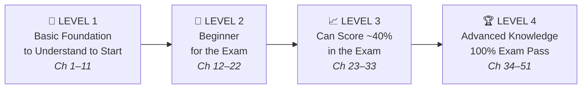
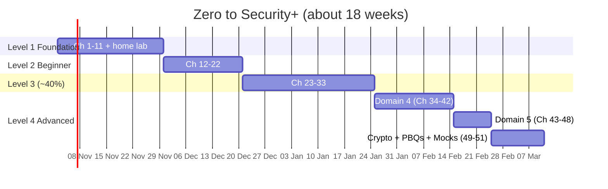

# 📘 Book Plan — *From Zero to Security+*

### A complete, picture-driven guide to the CompTIA Security+ exam for someone who is just discovering what a computer is

---

## 0. Who this book is for and how it is built

**The reader:** You have never studied computers. You may not know what a CPU, an IP address, or a password hash is. That's fine — this book starts at **"this is a computer"** and finishes at **"I can pass Security+ with confidence."**

**The exam it targets:** CompTIA Security+ **SY0-701**, which is the live exam right now.
CompTIA is preparing the next version, **SY0-801** (reported by training providers to launch on 17 November 2026; the English SY0-701 exam retires on 11 June 2027). Training providers expect most of the content to stay the same, with **AI / Large Language Model security** as the big addition. This book covers that in **Appendix A**, giving you a head start on SY0-801 too. Always check CompTIA's official SY0-801 objectives once they are published.

### Exam facts (SY0-701)

| Item | Detail |
|---|---|
| Questions | Up to **90** (multiple choice + **Performance-Based Questions / PBQs**) |
| Time | **90 minutes** |
| Passing score | **750** on a scale of **100–900** |
| Recommended experience | CompTIA Network+ and about two years of IT/security administration (recommended, not required; Level 1 of this book fills the knowledge gap) |
| Validity | 3 years |

### The 5 exam domains and their weight

```
 Domain                                           Weight
 ─────────────────────────────────────────────────────────────
 1.0 General Security Concepts                    ████░░░░░░  12%
 2.0 Threats, Vulnerabilities & Mitigations       ███████░░░  22%
 3.0 Security Architecture                        ██████░░░░  18%
 4.0 Security Operations                          █████████░  28%   ← biggest
 5.0 Security Program Management & Oversight      ██████░░░░  20%
```

### The four levels (the "staircase")



| Level | Name | What you can do after it | Approx. time* |
|---|---|---|---|
| 1 | **Basic Foundation to Understand to Start** | Explain how a computer, a network and the internet work. Use basic commands. Know the words the exam assumes you already know. | 3–4 weeks |
| 2 | **Beginner for Exam** | Know the core vocabulary of all 5 domains. Recognize what a question is *about*. | 3 weeks |
| 3 | **Can Score ~40% in Exam** | Answer most "what is X?" and "which attack is this?" questions. You know every objective at a *working* level. | 4–5 weeks |
| 4 | **Advanced Knowledge — 100% Exam Pass** | Solve scenario questions and PBQs, do risk math, read logs, choose the *best* control. Score consistently 85%+ on practice exams. | 5–6 weeks |

\* At about 1–1.5 hours per day. Total ≈ **4–5 months** from zero.

> **About "40%":** Security+ uses a *scaled* score (750 on a 100–900 scale). CompTIA does **not** publish how many correct answers 750 equals; an **unofficial estimate** often quoted by trainers is around 80–85% correct, which is why this book asks for **85%+** on practice exams as a safety margin. Level 3 is the milestone where you could answer around 40% of exam questions with confidence. It is **not** a pass yet. Level 4 is what turns that into a pass.

---

## 1. How every chapter is written (the chapter template)

Each chapter follows the same 8-part recipe, so a beginner always knows what comes next:

| # | Part | What it contains |
|---|---|---|
| 1 | 🎯 **Goal** | One sentence: what you will learn |
| 2 | 🏠 **Real-life story** | An everyday analogy (house, post office, bank, school…) |
| 3 | 🖼️ **Figure** | A diagram shown *before* the technical words |
| 4 | 📖 **Explanation** | Short paragraphs, one idea each |
| 5 | 🧠 **Memory trick** | Mnemonic / acronym / rhyme |
| 6 | ⚠️ **Exam tip** | How CompTIA asks about this topic |
| 7 | 🧪 **Try it** | A tiny hands-on lab (free tools) |
| 8 | ✅ **Checkpoint** | Practice questions with hidden answers |
| + | 📌 **Summary** | One table that recaps the chapter |

**Figure types used in the book:**

| Figure type | Used for | Example |
|---|---|---|
| Analogy picture | First contact with an idea | Firewall = security guard at a building door |
| Flow diagram | Processes | Incident-response steps, TLS handshake |
| Layer / stack diagram | Models | OSI model, defense in depth |
| Network map | Architecture | DMZ / screened subnet placement |
| Comparison table | "Compare and contrast" objectives | Symmetric vs asymmetric encryption |
| Timeline | Attack chains | Phishing → credential theft → ransomware |
| Sample log / screen | Investigation objectives | A firewall log showing a port scan |

A **fully written sample chapter** that shows this style is here: [`chapters/level-1-foundation/01-what-is-a-computer.md`](chapters/level-1-foundation/01-what-is-a-computer.md).

---

## 2. LEVEL 1 — 🧱 Basic Foundation to Understand to Start (Chapters 1–11)

> **Purpose:** Security+ assumes you already know computers and networks (A+ and Network+ level). This level gives you that background from scratch. Nothing here is "exam content" by name, but **many exam questions silently depend on it**: ports, protocols, IP addresses, OS concepts, and so on.

### Chapter 1 — What Is a Computer? *(sample chapter written)*
- **Topics:** input → processing → storage → output. CPU, RAM, storage (HDD/SSD), motherboard, power supply, peripherals. Firmware (BIOS/UEFI). Bits and bytes. Types of computers: PC, laptop, server, phone, IoT device.
- **Figures:** "Computer as a kitchen" (CPU = chef, RAM = countertop, storage = fridge). The IPOS cycle diagram. Inside-the-case labelled drawing. Size ladder from bit to terabyte.
- **Try it:** Open Task Manager (Windows) or Activity Monitor (Mac) and find your CPU, RAM and disk.

### Chapter 2 — Software, Operating Systems & Files
- **Topics:** hardware vs software. What an OS does. Windows, Linux, macOS, Android, iOS. Applications, drivers, services/daemons, processes. Files, folders, file extensions. User accounts, administrator/root, file permissions (read/write/execute). Updates and patches. Boot process (UEFI → bootloader → kernel → login).
- **Figures:** OS as the "manager" between apps and hardware (layer cake). Folder tree. Boot sequence flowchart. Permission matrix (user × read/write/execute).
- **Why it matters for Security+:** least privilege, patching, OS vulnerabilities, secure boot.
- **Try it:** Create a standard (non-admin) user account; look at a file's permissions.

### Chapter 3 — How Computers Represent Data
- **Topics:** binary (0/1), decimal ↔ binary, hexadecimal, ASCII/Unicode. Why a hash looks like `5f4dcc3b5aa765d6…`. Encoding vs encryption (Base64 is **not** encryption!). Compression.
- **Figures:** Light-switch bank = binary. Binary ↔ hex conversion chart. "Same message, three looks" (text / Base64 / hex).
- **Why it matters:** hashing, crypto, obfuscation, reading logs and packet captures.

### Chapter 4 — Networking 101: How Computers Talk
- **Topics:** what a network is. LAN, WAN, MAN, PAN. The internet. Clients and servers. NIC, MAC address, IP address (IPv4/IPv6), subnet mask, default gateway. Public vs private IPs, NAT. Switch vs router vs access point vs modem. Packets.
- **Figures:** **Postal-system analogy** (IP = street address, MAC = person's name, port = apartment number, router = post office). Home network diagram. Packet "envelope" anatomy. Private IP ranges table (10.x, 172.16–31.x, 192.168.x).
- **Try it:** `ipconfig` / `ip a` — find your IP, MAC and gateway.

### Chapter 5 — Network Models: OSI & TCP/IP
- **Topics:** the 7 OSI layers. The 4-layer TCP/IP model. Encapsulation. TCP vs UDP. The 3-way handshake (SYN, SYN-ACK, ACK). Ports (0–65535; well-known ports below 1024).
- **Figures:** OSI "7-floor building" with a device on each floor (L1 cable/hub, L2 switch, L3 router, L4 firewall ports, L7 WAF). Encapsulation "Russian doll". TCP handshake ladder diagram. TCP (registered letter) vs UDP (postcard) comparison.
- **Memory trick:** "**P**lease **D**o **N**ot **T**hrow **S**ausage **P**izza **A**way" (layers 1→7).

### Chapter 6 — Common Network Services, Protocols & Ports
- **Topics:** DNS (the internet's phone book), DHCP, HTTP/HTTPS, FTP/SFTP/FTPS, SSH, Telnet, RDP, SMTP/POP3/IMAP (and secure versions), SNMP, LDAP/LDAPS, NTP, SMB, Syslog. **Insecure vs secure pairs.**
- **Figures:** DNS lookup step-by-step (browser → resolver → root → TLD → authoritative). DHCP "DORA" diagram. **Master port table** (the most-memorized table in the book).
- **Exam tip:** Questions often say "replace the insecure protocol". Know the pairs: Telnet → SSH, HTTP → HTTPS, FTP → SFTP, LDAP → LDAPS, SNMPv1/2 → SNMPv3, POP3/IMAP → POP3S/IMAPS.

### Chapter 7 — Wireless & Mobile Basics
- **Topics:** Wi-Fi (802.11 standards, SSID, channels, frequencies 2.4/5/6 GHz). Bluetooth, NFC, RFID, cellular (4G/5G), satellite. Smartphones and tablets as computers. App stores.
- **Figures:** Wi-Fi coverage "bubbles" around access points. Range ladder (NFC cm → Bluetooth m → Wi-Fi tens of m → cellular km).

### Chapter 8 — Servers, Data Centers, Virtualization & Cloud
- **Topics:** what a server is. Data centers. Virtual machines and hypervisors (Type 1 vs Type 2). Containers. Cloud basics: IaaS, PaaS, SaaS. Public, private, hybrid and community cloud.
- **Figures:** "Apartment building" for virtualization (one building, many apartments). Type 1 vs Type 2 hypervisor stack. **Pizza-as-a-Service** chart for IaaS/PaaS/SaaS.

### Chapter 9 — The Command Line (Your First Security Tools)
- **Topics:** Windows CMD/PowerShell and the Linux shell. Navigation commands. Network commands: `ping`, `tracert/traceroute`, `nslookup/dig`, `netstat`, `arp`, `ipconfig/ip`, `curl`. Intro to `nmap` and Wireshark (just looking, not attacking).
- **Figures:** Annotated terminal screenshots. Traceroute hops drawn as a road trip.
- **Try it:** Set up a free home lab (VirtualBox + a Linux VM). Ping, trace and capture your own traffic.

### Chapter 10 — What Is Cybersecurity?
- **Topics:** assets, threats, vulnerabilities, exploits, risk (Risk = Threat × Vulnerability × Impact). Attackers vs defenders. Red team / blue team / purple team. Famous incidents told as stories (WannaCry, SolarWinds, Colonial Pipeline). Cybersecurity careers. Ethics and the law.
- **Figures:** **House analogy** (asset = jewelry, vulnerability = unlocked window, threat = burglar, control = lock + alarm). Risk equation drawing.

### Chapter 11 — How the Security+ Exam Works & How to Study
- **Topics:** exam format, PBQs, scaled scoring, how to read objectives, CompTIA question style ("BEST", "MOST", "FIRST"), elimination technique. Study tools: flashcards, spaced repetition, labs, practice tests. Booking the exam.
- **Figures:** Study-cycle wheel (Read → Draw → Lab → Quiz → Review). Question-anatomy figure (scenario / keyword / distractors).

**✅ Level 1 Gate Test:** 50 questions on computers, networking and ports. Move on at **80%**.

---

## 3. LEVEL 2 — 🌱 Beginner for the Exam (Chapters 12–22)

> **Purpose:** Learn the **core vocabulary of all 5 domains** at a light level. After this level, when you read any exam question you will know *which topic* it is about, even if you can't solve it yet.

### Chapter 12 — The CIA Triad & Friends *(Obj 1.2)*
- **Topics:** Confidentiality, Integrity, Availability. Non-repudiation. AAA (Authentication, Authorization, Accounting). Authenticating people vs systems. Authorization models (intro).
- **Figures:** CIA triangle with an attack example on each side (eavesdropping / tampering / DDoS). AAA as an airport (ID check → boarding pass → flight log).

### Chapter 13 — Security Controls *(Obj 1.1)*
- **Topics:** **Categories:** technical, managerial, operational, physical. **Types:** preventive, deterrent, detective, corrective, compensating, directive.
- **Figures:** **4×6 control grid** filled with examples (e.g., physical + deterrent = warning sign; technical + detective = IDS). Timeline of an incident showing *where* each control type acts (before / during / after).
- **Exam tip:** One control can be in two places at once. A security guard is physical *and* can be preventive, deterrent and detective.

### Chapter 14 — Who Attacks and Why: Threat Actors *(Obj 2.1)*
- **Topics:** nation-state, unskilled attacker (script kiddie), hacktivist, insider threat, organized crime, shadow IT. Attributes: internal/external, resources/funding, sophistication. Motivations: data exfiltration, espionage, service disruption, blackmail, financial gain, philosophical/political beliefs, ethical, revenge, disruption/chaos, war.
- **Figures:** **Threat-actor "trading cards"** (skill, money, motive, typical attack). Sophistication vs resources quadrant chart.

### Chapter 15 — Tricking Humans: Social Engineering *(Obj 2.2 human vectors, 5.6)*
- **Topics:** phishing, spear phishing, whaling, vishing, smishing, misinformation/disinformation, impersonation, business email compromise (BEC), pretexting, watering-hole attacks, brand impersonation, typosquatting. Psychological principles: authority, urgency, scarcity, social proof, familiarity, intimidation.
- **Figures:** **Annotated phishing email** with red circles on each warning sign. Watering-hole diagram. Typosquatting examples (`paypa1.com`).

### Chapter 16 — Malware Zoo *(Obj 2.4 malware)*
- **Topics:** virus, worm, trojan, ransomware, spyware, keylogger, rootkit, logic bomb, bloatware, RAT/backdoor, fileless malware, botnet.
- **Figures:** **Malware family tree**. "How it spreads / what it does / how to spot it" table. Ransomware attack timeline.
- **Memory trick:** Worm = *self-spreads*; Virus = *needs you to run it*; Trojan = *pretends to be good*.

### Chapter 17 — Passwords, Authentication & MFA (Basics) *(Obj 4.6 intro)*
- **Topics:** authentication factors (something you know / have / are / somewhere you are). MFA vs 2-step. Password best practices (length > complexity). Password managers. Passwordless and passkeys. Biometrics (FAR, FRR, CER).
- **Figures:** Factor "icons" (🔑 know, 📱 have, 👆 are, 📍 somewhere). Biometric FAR/FRR crossover graph (CER).

### Chapter 18 — Cryptography Made Simple *(Obj 1.4 intro)*
- **Topics:** plaintext, ciphertext, key, algorithm. Symmetric (one shared key) vs asymmetric (public/private key pair). Hashing (fingerprint, one-way). Digital signatures (intro). Encryption at rest vs in transit.
- **Figures:** **Lockbox analogy** — symmetric = one key copied for both; asymmetric = a padlock anyone can close (public key) but only you can open (private key). Hash "meat grinder" (you can't un-grind). Symmetric vs asymmetric comparison table.

### Chapter 19 — Physical Security *(Obj 1.2 physical)*
- **Topics:** bollards, fencing, lighting, access control vestibule (mantrap), badges, security guards, video surveillance, sensors (infrared, pressure, microwave, ultrasonic), locks. Tailgating vs piggybacking.
- **Figures:** **Bird's-eye view of a secure building** with each control labelled from the parking lot to the server room (layers of an onion).

### Chapter 20 — Defense in Depth & First Security Tools
- **Topics:** layered security. Firewall (intro), antivirus/anti-malware, IDS vs IPS (intro), VPN (intro), backups, patching, least privilege, honeypots (intro).
- **Figures:** **Castle diagram** (moat = firewall, walls = network segmentation, guards = IDS, vault = encryption). Onion-layer diagram.

### Chapter 21 — Data Basics *(Obj 3.3 intro)*
- **Topics:** data types (regulated, trade secret, intellectual property, legal, financial, human- vs non-human-readable). Classifications (public, private, sensitive, confidential, restricted, critical). Data states: **at rest, in transit, in use**.
- **Figures:** Data-state diagram (laptop disk → network cable → RAM). Classification "traffic light" labels.

### Chapter 22 — Introduction to Policies, Risk & Compliance *(Obj 5.1, 5.2 intro)*
- **Topics:** policy vs standard vs procedure vs guideline. AUP. What risk management means. What compliance means (GDPR, HIPAA, PCI DSS, SOX — names only).
- **Figures:** **Governance pyramid** (policy at top → standards → procedures → guidelines). Real-life example: "School rules" mapped to each layer.

**✅ Level 2 Gate Test:** 75 vocabulary-style questions covering all 5 domains. Move on at **75%**.

---

## 4. LEVEL 3 — 📈 Can Score ~40% in the Exam (Chapters 23–33)

> **Purpose:** Cover **every remaining objective** of Domains 1, 2 and 3 at working depth, so you can answer "identify the attack" and "which control fits" questions. After this level, Domains 1–3 (52% of the exam) are covered well.

### Chapter 23 — Threat Vectors & Attack Surfaces *(Obj 2.2)*
- **Topics:** message-based (email, SMS, IM), image-based, file-based, voice call, removable devices, vulnerable software (client-based vs agentless), unsupported systems and apps, unsecure networks (wireless, wired, Bluetooth), open service ports, default credentials, supply chain (MSPs, vendors, suppliers).
- **Figures:** **"Doors into the company" map** — a building with every vector as a door or window. Supply-chain attack flow (vendor compromised → update pushed → victims).

### Chapter 24 — Vulnerability Types *(Obj 2.3)*
- **Topics:** application (memory injection, buffer overflow, race condition TOC/TOU, malicious update). OS-based. Web-based (**SQL injection**, **cross-site scripting**). Hardware (firmware, end-of-life, legacy). Virtualization (VM escape, resource reuse). Cloud-specific. Supply chain (service/hardware/software providers). Cryptographic. Misconfiguration. Mobile (side-loading, jailbreaking). Zero-day.
- **Figures:** **Buffer-overflow "overfilled glass"** spilling into the next memory box. **SQLi step-by-step** (login form → `' OR 1=1 --` → database). **XSS diagram** (stored vs reflected). Race-condition timeline (check … gap … use). VM escape drawing.

### Chapter 25 — Network Attacks & Their Indicators *(Obj 2.4 network)*
- **Topics:** DDoS (amplified, reflected), DNS attacks (poisoning, hijacking, tunneling), wireless attacks (evil twin, rogue AP, deauthentication, jamming), on-path (MITM), credential replay, malicious code.
- **Figures:** **DDoS amplification diagram** (small request → large reply aimed at victim). On-path attacker between Alice and Bob. Evil-twin coffee-shop scene. ARP poisoning table before/after.

### Chapter 26 — Application, Crypto, Password & Physical Attacks + Indicators of Compromise *(Obj 2.4)*
- **Topics:** injection, buffer overflow, replay, privilege escalation (vertical/horizontal), request forgery (CSRF/SSRF), directory traversal. Cryptographic attacks (downgrade, collision, birthday). Password attacks (spraying, brute force, dictionary, rainbow tables). Physical attacks (brute force, RFID cloning, environmental). **Indicators:** account lockout, concurrent session usage, blocked content, impossible travel, resource consumption, resource inaccessibility, out-of-cycle logging, published/documented, missing logs.
- **Figures:** Directory traversal `../../etc/passwd` path drawing. **Password spraying vs brute force** picture (many users × one password vs one user × many passwords). **Impossible-travel map** (login in London, then Tokyo 10 minutes later). CSRF vs SSRF side by side.

### Chapter 27 — Mitigation Techniques & Hardening *(Obj 2.5)*
- **Topics:** segmentation, access control (ACLs, permissions), application allow list, isolation, patching, encryption, monitoring, least privilege, configuration enforcement, decommissioning. Hardening: encryption, installing EDR, host-based firewall, HIPS, disabling ports/protocols, changing default passwords, removing unnecessary software.
- **Figures:** **Hardening checklist "before/after" server**. Allow list vs block list (guest list vs banned list at a party).

### Chapter 28 — PKI, Certificates & Applied Cryptography *(Obj 1.4)*
- **Topics:** PKI (public/private keys, key escrow). Encryption levels (full-disk, partition, file, volume, database, record). Transport/communication encryption. Tools: TPM, HSM, key management system, secure enclave. Obfuscation (steganography, tokenization, data masking). Hashing, salting, digital signatures, key stretching. Blockchain and open public ledger. Certificates: CA, CRL, OCSP, self-signed, third-party, root of trust, CSR, wildcard.
- **Figures:** **Certificate chain of trust** (root CA → intermediate → website). **How a digital signature works** (hash → encrypt with private key → verify with public key). Salting picture (same password, different salt, different hash). CRL (printed blacklist) vs OCSP (phone call to check).

### Chapter 29 — Architecture Models *(Obj 3.1)*
- **Topics:** cloud (shared responsibility matrix, hybrid, third-party vendors), infrastructure as code (IaC), serverless, microservices, network infrastructure (physical isolation/air gap, logical segmentation, SDN), on-premises, centralized vs decentralized, containerization, virtualization, IoT, ICS/SCADA, RTOS, embedded systems, high availability. Considerations: availability, resilience, cost, responsiveness, scalability, ease of deployment, risk transference, ease of recovery, patch availability, inability to patch, power, compute.
- **Figures:** **Shared responsibility matrix** (on-prem vs IaaS vs PaaS vs SaaS, coloured by who owns what). Monolith vs microservices. VM vs container stack comparison. SCADA network diagram (control center → PLCs → factory).

### Chapter 30 — Securing Enterprise Infrastructure *(Obj 3.2)*
- **Topics:** device placement, security zones, attack surface, connectivity, failure modes (fail-open vs fail-closed), active vs passive devices, inline vs tap/monitor. Appliances: jump server, proxy, IDS/IPS, load balancer, sensors. Port security: 802.1X, EAP. Firewalls: WAF, UTM, NGFW, Layer 4 vs Layer 7. Secure communication: VPN, remote access, tunneling (TLS, IPsec), SD-WAN, SASE. Selecting effective controls.
- **Figures:** **Enterprise network map** (internet → firewall → screened subnet/DMZ with web server → internal firewall → LAN → data center). **802.1X three-party diagram** (supplicant → authenticator → authentication server). Inline vs tap placement. IPsec tunnel vs transport mode.

### Chapter 31 — Protecting Data *(Obj 3.3)*
- **Topics:** data sovereignty, geolocation. Methods: geographic restrictions, encryption, hashing, masking, tokenization, obfuscation, segmentation, permission restrictions.
- **Figures:** **Tokenization vs masking vs encryption** — the same credit card number shown three ways. Data-sovereignty world map.

### Chapter 32 — Resilience & Recovery *(Obj 3.4)*
- **Topics:** high availability (load balancing vs clustering), sites (hot, warm, cold), geographic dispersion, platform diversity, multi-cloud, continuity of operations (COOP), capacity planning (people, technology, infrastructure), testing (tabletop, failover, simulation, parallel processing), backups (onsite/offsite, frequency, encryption, snapshots, recovery, replication, journaling), power (generators, UPS).
- **Figures:** **Hot / warm / cold site comparison** (ready-to-move-in apartment vs furnished-but-empty vs empty land). Backup types timeline (full, incremental, differential). UPS → generator power timeline.

### Chapter 33 — Change Management, Zero Trust & Deception *(Obj 1.3, 1.2)*
- **Topics:** change management (approval process, ownership, stakeholders, impact analysis, test results, backout plan, maintenance window, SOP; technical implications: allow/deny lists, restricted activities, downtime, service/application restart, legacy apps, dependencies; documentation and version control). Gap analysis. **Zero trust** (control plane: adaptive identity, threat scope reduction, policy-driven access control, policy administrator, policy engine; data plane: implicit trust zones, subject/system, policy enforcement point). Deception: honeypot, honeynet, honeyfile, honeytoken.
- **Figures:** **Change-management flowchart** (request → impact analysis → CAB approval → test → implement → backout if needed → document). **Zero-trust architecture** (subject → PEP ↔ PDP (PE + PA) → resource). Honeypot "bait" illustration.

**✅ Level 3 Gate Test:** 90-question practice exam focused on Domains 1–3 (about half of the exam's content). Target **≥ 70%** on those domains.

---

## 5. LEVEL 4 — 🏆 Advanced Knowledge, 100% Exam Pass (Chapters 34–51)

> **Purpose:** Master **Domain 4 (28%)** and **Domain 5 (20%)**, deepen crypto and IAM, and train for PBQs and scenario questions with full mock exams.

### Part 4A — Security Operations (Domain 4)

### Chapter 34 — Secure Baselines, Hardening Targets, Wireless & Mobile Security *(Obj 4.1)*
- **Topics:** secure baselines (establish, deploy, maintain). Hardening targets: mobile devices, workstations, switches, routers, cloud infrastructure, servers, ICS/SCADA, embedded systems, RTOS, IoT. Wireless: site surveys, heat maps. Mobile: MDM, BYOD/COPE/CYOD; cellular, Wi-Fi, Bluetooth. Wireless security: WPA3, AAA/RADIUS, cryptographic and authentication protocols. Application security: input validation, secure cookies, static code analysis, code signing. Sandboxing. Monitoring.
- **Figures:** **Wi-Fi heat map** example. **BYOD vs COPE vs CYOD** ownership chart. WPA2 vs WPA3 comparison. Sandbox "playpen" diagram.

### Chapter 35 — Asset Management *(Obj 4.2)*
- **Topics:** acquisition/procurement, assignment/accounting (ownership, classification), monitoring/asset tracking (inventory, enumeration), disposal/decommissioning (sanitization, destruction, certification, data retention).
- **Figures:** **Asset lifecycle circle** (buy → assign → track → retire → destroy). Sanitization methods ladder (clear → purge → destroy: shredding, degaussing, incineration).

### Chapter 36 — Vulnerability Management *(Obj 4.3)*
- **Topics:** identification (vulnerability scans, static/dynamic analysis, package monitoring, threat feeds: OSINT, proprietary, information-sharing organizations, dark web; penetration testing; responsible disclosure and bug bounty; system/process audits). Analysis (false positive/negative, prioritization, **CVSS**, **CVE**, classification, exposure factor, environmental variables, industry/organizational impact, risk tolerance). Response (patching, insurance, segmentation, compensating controls, exceptions/exemptions). Validation (rescanning, audit, verification). Reporting.
- **Figures:** **Vulnerability-management cycle** (identify → analyze → respond → validate → report). **CVSS score bar** (0–10, Low/Medium/High/Critical). False-positive / false-negative 2×2 truth table.

### Chapter 37 — Alerting & Monitoring *(Obj 4.4)*
- **Topics:** monitoring systems, applications and infrastructure. Activities: log aggregation, alerting, scanning, reporting, archiving, alert response and remediation (quarantine, alert tuning). Tools: SCAP, benchmarks, agents vs agentless, **SIEM**, antivirus, DLP, SNMP traps, NetFlow, vulnerability scanners.
- **Figures:** **SIEM funnel** (logs from firewalls, servers, endpoints → normalize → correlate → alert → analyst). Agent vs agentless drawing. NetFlow record anatomy.

### Chapter 38 — Enhancing Enterprise Security Capabilities *(Obj 4.5)*
- **Topics:** firewall rules, ACLs, ports/protocols, screened subnets. IDS/IPS (trends, signatures). Web filtering (agent-based, centralized proxy, URL scanning, content categorization, block rules, reputation). OS security (Group Policy, SELinux). Secure protocols (protocol, port and transport selection). DNS filtering. **Email security: DMARC, DKIM, SPF**, gateways. File integrity monitoring. DLP. NAC. EDR/XDR. User behavior analytics.
- **Figures:** **Firewall rule table** walkthrough (top-down processing, implicit deny). **SPF / DKIM / DMARC** "three checkpoints for a letter" diagram. NAC posture-check flow. EDR vs XDR scope picture.
- **PBQ practice:** Write firewall rules from a scenario.

### Chapter 39 — Identity & Access Management (Deep Dive) *(Obj 4.6)*
- **Topics:** provisioning/de-provisioning, permission assignments, identity proofing, federation, SSO (LDAP, OAuth, SAML), OpenID Connect, Kerberos, interoperability, attestation. Access control models: **MAC, DAC, RBAC, rule-based, ABAC**, time-of-day restrictions, least privilege. MFA implementations (biometrics, hard/soft tokens, security keys). Password concepts (length, complexity, reuse, expiration, age). Password managers. Passwordless. **PAM** (just-in-time permissions, password vaulting, ephemeral credentials).
- **Figures:** **SAML SSO flow** (user → service provider → identity provider → assertion → back). **OAuth "valet key"** analogy. Kerberos ticket diagram. **Access-control-model comparison table** with an everyday example for each (MAC = military clearance, DAC = sharing your Google Doc, RBAC = job title, ABAC = "managers in HR, during work hours, on company laptops").

### Chapter 40 — Automation & Orchestration *(Obj 4.7)*
- **Topics:** use cases (user and resource provisioning, guardrails, security groups, ticket creation, escalation, enabling/disabling services and access, CI and testing, integrations and APIs). Benefits (efficiency, enforcing baselines, standard configurations, scaling, employee retention, reaction time, workforce multiplier). Considerations (complexity, cost, single point of failure, technical debt, ongoing supportability). SOAR and playbooks.
- **Figures:** **SOAR playbook flowchart** (phishing email reported → auto-analyze → block sender → open ticket). Benefits vs risks scale.

### Chapter 41 — Incident Response & Digital Forensics *(Obj 4.8)*
- **Topics:** IR process: **preparation, detection, analysis, containment, eradication, recovery, lessons learned**. Training. Testing (tabletop, simulation). Root cause analysis. Threat hunting. Forensics: legal hold, **chain of custody**, acquisition, **order of volatility**, reporting, preservation, e-discovery.
- **Figures:** **IR lifecycle circle**. **Order of volatility staircase** (CPU registers/cache → RAM → swap → disk → remote logs → backups). Chain-of-custody form sample.
- **Memory trick:** "**P**lease **D**on't **A**sk **C**ats **E**very **R**andom **L**esson" (PDACERL).

### Chapter 42 — Investigations: Using Data Sources *(Obj 4.9)*
- **Topics:** log data (firewall, application, endpoint, OS security logs, IPS/IDS, network, metadata). Data sources (vulnerability scans, automated reports, dashboards, packet captures).
- **Figures:** **Annotated real-style logs**: a firewall log showing a port scan, a Windows Security log showing brute force (Event ID 4625 storm), a web log showing SQLi, a Wireshark capture of cleartext credentials.
- **PBQ practice:** "Read these logs and identify the attack and source IP."

### Part 4B — Program Management & Oversight (Domain 5)

### Chapter 43 — Security Governance *(Obj 5.1)*
- **Topics:** guidelines. Policies (AUP, information security, business continuity, disaster recovery, incident response, SDLC, change management). Standards (password, access control, physical security, encryption). Procedures (change management, onboarding/offboarding, playbooks). External considerations (regulatory, legal, industry, local/regional, national, global). Monitoring and revision. Governance structures (boards, committees, government entities, centralized/decentralized). Roles: **owner, controller, processor, custodian/steward**.
- **Figures:** Org chart of data roles with a "who does what" table. Policy lifecycle diagram.

### Chapter 44 — Risk Management (with the Math) *(Obj 5.2)*
- **Topics:** risk identification, assessment (ad hoc, recurring, one-time, continuous), analysis (qualitative vs quantitative; **SLE, ALE, ARO, exposure factor**; probability, likelihood, impact), risk register (KRIs, owners, thresholds), risk tolerance, risk appetite (expansionary, conservative, neutral), strategies (**transfer, accept** (exemption, exception), **avoid, mitigate**), risk reporting. **Business impact analysis: RTO, RPO, MTTR, MTBF.**
- **Figures:** **Risk heat map** (likelihood × impact grid). **Formula cards:** `SLE = AV × EF`, `ALE = SLE × ARO`. **RPO/RTO timeline** (last backup ← disaster → back online). Worked examples with numbers.

### Chapter 45 — Third-Party Risk Management *(Obj 5.3)*
- **Topics:** vendor assessment (pen testing, right-to-audit clause, internal audit evidence, independent assessments, supply chain analysis). Vendor selection (due diligence, conflict of interest). Agreements: **SLA, MOA, MOU, MSA, WO/SOW, NDA, BPA**. Vendor monitoring, questionnaires, rules of engagement.
- **Figures:** **Agreement-types cheat table** (what each one is, how formal it is, an example). Vendor lifecycle flow.

### Chapter 46 — Compliance & Privacy *(Obj 5.4)*
- **Topics:** compliance reporting (internal/external). Consequences of non-compliance (fines, sanctions, reputational damage, loss of license, contractual impacts). Compliance monitoring (due diligence/care, attestation and acknowledgement, internal/external, automation). Privacy: legal implications (local/regional, national, global), data subject, **controller vs processor**, ownership, data inventory and retention, **right to be forgotten**. Overview of GDPR, HIPAA, PCI DSS, SOX, GLBA, CCPA.
- **Figures:** Controller ↔ processor ↔ data subject diagram. Regulation "passport" cards (who it protects, where, what data).

### Chapter 47 — Audits, Assessments & Penetration Testing *(Obj 5.5)*
- **Topics:** attestation. Internal (compliance, audit committee, self-assessment). External (regulatory, examinations, assessment, independent third-party audit). Pen testing (physical, offensive, defensive, integrated; **known, partially known, unknown environment**). Reconnaissance (passive vs active).
- **Figures:** **Pen-test phases** (plan/rules of engagement → recon → scan → exploit → post-exploit → report). Known / partially known / unknown environment shown as "white / grey / black box".

### Chapter 48 — Security Awareness Programs *(Obj 5.6)*
- **Topics:** phishing campaigns, recognizing and responding to suspicious messages. Anomalous behavior (risky, unexpected, unintentional). User training (policy handbooks, situational awareness, insider threat, password management, removable media and cables, social engineering, OPSEC, hybrid/remote work). Reporting and monitoring (initial, recurring). Development and execution.
- **Figures:** Awareness program cycle. "Report, don't click" poster.

### Part 4C — Deep Dives & Exam Mastery

### Chapter 49 — Cryptography Deep Dive *(Obj 1.4 advanced, 2.3/2.4 crypto)*
- **Topics:** algorithms: AES, 3DES (legacy), ChaCha20, RSA, ECC, Diffie-Hellman/ECDHE, DSA/ECDSA. Hashes: SHA-2/SHA-3, MD5 (broken). HMAC. Key lengths. Block vs stream ciphers, modes (GCM, CBC). Perfect forward secrecy. The **TLS 1.3 handshake**. Key stretching (PBKDF2, bcrypt, Argon2). Quantum-resistant crypto (intro). Crypto attacks revisited.
- **Figures:** **TLS handshake ladder**. **Diffie-Hellman paint-mixing analogy**. Algorithm cheat table (type / use / key size / status).

### Chapter 50 — PBQ Mastery & Memory Drills
- **Topics:** PBQ types (drag-and-drop matching, firewall rules, log analysis, network diagram placement, command output). Time management (flag PBQs and do them last). Master drills: ports, acronyms, attack ↔ control matching, control-type matching.
- **Figures:** Sample PBQs drawn as screens. **One-page "brain dump" sheet** to rewrite from memory every day.

### Chapter 51 — Full Mock Exams & the Final Two Weeks
- **Content:** 3 full-length 90-question mock exams with detailed explanations, a domain-by-domain weakness tracker, the **14-day final plan**, and exam-day checklist (ID, check-in, mindset, time pacing: ~1 min per MCQ).
- **Figures:** Score tracker chart. Exam-day timeline.

**✅ Level 4 Gate:** Score **≥ 85%** on two different full mock exams → book the real exam.

---

## 6. Appendices

| Appendix | Content |
|---|---|
| **A — AI & LLM Security (SY0-801 ready)** | How AI/LLMs work (simply). Prompt injection, data poisoning, model theft, hallucination risks, AI-powered phishing and deepfakes, shadow AI, AI in defense (SOC automation), governance of AI use. |
| **B — Acronym Dictionary** | About 380 acronyms used in the book (and the most important from the official CompTIA list), in plain English, with the chapter that teaches each. |
| **C — Master Port & Protocol Table** | Port, protocol, secure alternative, what it does. |
| **D — Attack ↔ Control Matrix** | Each attack mapped to the controls that stop, detect or recover from it. |
| **E — Home Lab Guide** | VirtualBox, Kali Linux, a Windows VM, Wireshark, Nmap, pfSense/OPNsense, Wazuh or Security Onion, plus free online labs. Safe and legal practice rules, 16 exercises mapped to chapters. |
| **F — Glossary with Pictures** | About 220 key terms, each with a picture-icon and chapter reference. |
| **G — Practice Question Bank** | Index of the book's 1,000+ questions by exam objective, plus 84 bonus questions for the least-practised objectives. |

---

## 7. Coverage map — every SY0-701 objective → chapter

This table proves the book covers **100% of the exam objectives**.

| Objective | Title | Intro (L2) | Main chapter (L3/L4) |
|---|---|---|---|
| 1.1 | Types of security controls | — | **13** |
| 1.2 | Fundamental security concepts | 12, 19 | **33** (zero trust, deception, gap analysis) |
| 1.3 | Change management | 22 | **33** |
| 1.4 | Cryptographic solutions | 18 | **28**, **49** |
| 2.1 | Threat actors & motivations | — | **14** |
| 2.2 | Threat vectors & attack surfaces | 15 | **23** |
| 2.3 | Types of vulnerabilities | — | **24** |
| 2.4 | Indicators of malicious activity | 16 | **25**, **26** |
| 2.5 | Mitigation techniques | 20 | **27** |
| 3.1 | Architecture models | 8 (L1) | **29** |
| 3.2 | Secure enterprise infrastructure | 20 | **30** |
| 3.3 | Protecting data | 21 | **31** |
| 3.4 | Resilience & recovery | — | **32** |
| 4.1 | Security techniques for computing resources | 7 (L1) | **34** |
| 4.2 | Asset management | — | **35** |
| 4.3 | Vulnerability management | — | **36** |
| 4.4 | Alerting & monitoring | — | **37** |
| 4.5 | Enhancing enterprise capabilities | 20 | **38** |
| 4.6 | Identity & access management | 17 | **39** |
| 4.7 | Automation & orchestration | — | **40** |
| 4.8 | Incident response | — | **41** |
| 4.9 | Data sources for investigations | 9 (L1) | **42** |
| 5.1 | Security governance | 22 | **43** |
| 5.2 | Risk management | 22 | **44** |
| 5.3 | Third-party risk | — | **45** |
| 5.4 | Security compliance | 22 | **46** |
| 5.5 | Audits & assessments | — | **47** |
| 5.6 | Security awareness | 15 | **48** |

---

## 8. Study schedule (from zero, ~1–1.5 hours/day)



**Daily routine:**
1. 10 min — review yesterday's flashcards (spaced repetition)
2. 40 min — read one chapter section and **redraw its figure from memory**
3. 15 min — do the "Try it" lab
4. 10 min — checkpoint questions; log wrong answers in a mistake journal

**Weekly:** one 30-question mixed quiz. Rewrite the "brain dump" sheet (from Level 3 onward).

---

## 9. Writing roadmap for the book itself

| Phase | Deliverable | Status |
|---|---|---|
| 1 | Book plan (this document) | ✅ Done |
| 2 | Sample chapter to lock in style (Ch 1) | ✅ Done |
| 3 | Level 1 chapters 2–11 + Level 1 Gate Test (50 questions) | ✅ Done (verified) |
| 4 | Level 2 chapters 12–22 + Level 2 Gate Test (75 questions) | ✅ Done (verified) |
| 5 | Level 3 chapters 23–33 + Level 3 Gate Test (90 questions) | ✅ Done (verified; 326/326 Domain 1–3 objective terms covered) |
| 6 | Level 4 chapters 34–51 + 3 full mock exams (270 questions) | ✅ Done (verified; 351/351 Domain 4–5 objective terms covered) |
| 7 | Appendices A–G (AI/LLM security, acronyms, ports, attack↔control matrix, lab guide, glossary, question bank) | ✅ Done (verified; answer keys rebalanced, chapter references checked) |
| 8 | Review against latest CompTIA objectives (update for SY0-801 once it is final) | ⏳ Next |

For a short beginner's guide to studying with the book (study path, gate tests, when to take mocks, how to use the appendices), see **How to use this book** in the [README](README.md).

Chapters are stored as Markdown under `chapters/level-N-…/NN-title.md`. Figures are drawn as Mermaid diagrams or text drawings so they render directly on GitHub.
