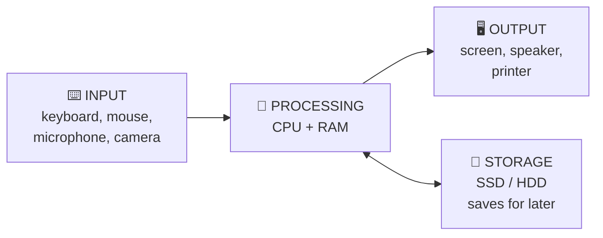
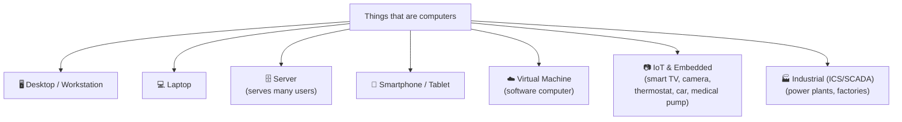

# Chapter 1 — What Is a Computer?

**Level 1 · Basic Foundation to Understand to Start**

---

## 🎯 Goal

By the end of this chapter you will be able to name the main parts of a computer, say what each part does, and explain why a security professional cares about each one.

---

## 🏠 Real-Life Story: The Kitchen

Imagine a restaurant kitchen.

- A **customer's order** comes in.
- The **chef** reads it and does the cooking.
- The chef works on a **countertop** that holds the ingredients for *right now*.
- Everything else is kept in the **fridge and pantry** until it is needed.
- When the dish is ready, a **waiter** carries it out to the customer.

A computer works the same way:

```
   RESTAURANT KITCHEN                     COMPUTER
   ──────────────────                     ────────
   Customer's order        ───────►       INPUT     (keyboard, mouse, touch screen)
   Chef                    ───────►       CPU       (the "brain" that does the work)
   Countertop              ───────►       RAM       (short-term working memory)
   Fridge / pantry         ───────►       STORAGE   (SSD / hard drive – long-term)
   Waiter delivering dish  ───────►       OUTPUT    (screen, speakers, printer)
   Electricity & gas       ───────►       POWER SUPPLY
   The building itself     ───────►       MOTHERBOARD (connects everything)
```

---

## 🖼️ Figure 1.1 — The IPOS Cycle

Every computer, from a phone to a giant server, follows the same four steps: **I**nput → **P**rocessing → **O**utput, with **S**torage on the side.



**Example:** You type "cat videos" (input). The CPU works out what to do (processing). It may load your browser from the SSD (storage). The results appear on the screen (output).

---

## 📖 The Parts, One at a Time

### 1. CPU — Central Processing Unit (the chef 👨‍🍳)

- The CPU does all the "thinking": calculations, comparisons and following instructions.
- Its speed is measured in **gigahertz (GHz)**. 3 GHz means about 3 billion small steps per second.
- Modern CPUs have several **cores**. Each core is like an extra chef in the same kitchen.

> 🔐 **Why security cares:** Attacks such as *Spectre* and *Meltdown* abused how CPUs work to steal secrets. Some CPUs include security features (e.g., a **secure enclave**, covered in Chapter 28) that keep secrets in a protected area.

### 2. RAM — Random Access Memory (the countertop 🍽️)

- RAM holds whatever the computer is working on **right now**: open apps, open documents, passwords you just typed.
- RAM is **fast** but **volatile**: when power goes off, everything in RAM disappears, just like a countertop cleaned at closing time.

> 🔐 **Why security cares:** Because RAM is volatile, investigators must capture it **first** when collecting evidence. This is called the **order of volatility** (Chapter 41). Some malware lives *only* in RAM ("fileless malware", Chapter 16) to avoid leaving traces on the disk.

### 3. Storage — HDD and SSD (the fridge 🧊)

- Storage keeps your files, apps and the operating system **even when power is off** (it is **non-volatile**).
- **HDD (Hard Disk Drive):** spinning metal platters with a moving arm. Cheaper and slower.
- **SSD (Solid State Drive):** no moving parts, uses flash chips. Faster and more durable.

```
   HDD (Hard Disk Drive)                 SSD (Solid State Drive)
   ┌───────────────────┐                 ┌───────────────────┐
   │    ╭───────╮      │                 │ ▣ ▣ ▣ ▣ ▣ ▣ ▣ ▣   │
   │   (  ●    )──┐    │  spinning disk  │ ▣ ▣ ▣ ▣ ▣ ▣ ▣ ▣   │  flash chips,
   │    ╰───────╯  │   │  + moving arm   │ ▣ ▣ ▣ ▣ ▣ ▣ ▣ ▣   │  no moving parts
   └───────────────┴───┘                 └───────────────────┘
   Slower · cheaper · fragile            Faster · pricier · tougher
```

> 🔐 **Why security cares:** A stolen laptop exposes all its data unless the disk is **encrypted** (full-disk encryption, Chapter 28). When an old disk is thrown away, it must be **sanitized or destroyed** (Chapter 35), because "deleted" files can often be recovered.

### 4. Motherboard (the building 🏢)

- The main circuit board. Every other part plugs into it, and it lets them talk to each other.
- It contains the **firmware** (**BIOS** or its modern replacement **UEFI**). Firmware is the first small program that runs when you press the power button.
- Many motherboards include a **TPM (Trusted Platform Module)**, a tiny security chip that stores encryption keys.

> 🔐 **Why security cares:** If attackers infect firmware, their malware runs *before* the operating system and antivirus can even start. **Secure Boot** (part of UEFI) checks that only trusted software starts up.

### 5. Power Supply (the electricity ⚡)

- Converts wall power into the steady power the computer needs.

> 🔐 **Why security cares:** No power means no **availability**. Companies use **UPS** batteries and **generators** to keep systems running (Chapter 32).

### 6. Input and Output Devices (the order and the waiter 🧾)

| Input devices | Output devices | Both |
|---|---|---|
| Keyboard, mouse, microphone, webcam, scanner, fingerprint reader | Monitor, speakers, printer | Touch screen, USB drive, network card |

> 🔐 **Why security cares:** A **USB drive** found in a parking lot might carry malware (a *removable-device* threat vector, Chapter 23). A hidden **keylogger** device can sit between a keyboard and the computer and record every key you press.

---

## 🖼️ Figure 1.2 — Inside the Box

```
 ┌──────────────────────────────── COMPUTER CASE ────────────────────────────────┐
 │                                                                              │
 │   ┌──────────┐      ┌────────────────── MOTHERBOARD ───────────────────┐     │
 │   │  POWER   │═════►│                                                  │     │
 │   │  SUPPLY  │      │   ┌───────┐    ┌──────┐┌──────┐    ┌──────────┐  │     │
 │   └──────────┘      │   │  CPU  │◄──►│ RAM  ││ RAM  │    │ FIRMWARE │  │     │
 │                     │   │  🧠   │    └──────┘└──────┘    │ UEFI/BIOS│  │     │
 │   ┌──────────┐      │   └───┬───┘                        └──────────┘  │     │
 │   │ SSD/HDD  │◄════►│       │         ┌──────┐   ┌───────────────────┐ │     │
 │   │   💾     │      │       └────────►│ TPM  │   │ NETWORK CARD (NIC)│ │     │
 │   └──────────┘      │                 │ 🔐   │   │  🌐 to internet   │ │     │
 │                     │                 └──────┘   └───────────────────┘ │     │
 │                     │   USB ports  ·  Audio  ·  Video (GPU) ports      │     │
 │                     └──────────────────────────────────────────────────┘     │
 └──────────────────────────────────────────────────────────────────────────────┘
```

---

## 📖 Bits and Bytes: How Big Is Data?

Computers only understand **two states**: electricity **on (1)** or **off (0)**. One 0-or-1 is a **bit**.

## 🖼️ Figure 1.3 — The Size Ladder

```
 1 bit           = a single 0 or 1                          💡
 8 bits          = 1 byte    (enough for one letter, e.g. "A")
 1,000 bytes     = 1 kilobyte  (KB)   ≈ a short email
 1,000 KB        = 1 megabyte  (MB)   ≈ one photo / one song
 1,000 MB        = 1 gigabyte  (GB)   ≈ a movie
 1,000 GB        = 1 terabyte  (TB)   ≈ a large laptop drive
 1,000 TB        = 1 petabyte  (PB)   ≈ a big company's data
```

> ℹ️ Strictly, computers often count in powers of 2 (1 KiB = 1,024 bytes). For the exam, "about 1,000" is fine.

> ⚠️ **Network speed vs file size:** Network speed is measured in **bits** per second (Mbps). File size is measured in **bytes** (MB). A 100 **Mbps** connection moves about 12.5 **MB** per second.

---

## 📖 Types of Computers



**Key idea:** *Anything with a CPU, memory and software is a computer, and anything that is a computer can be hacked.* A smart light bulb is a computer. A car is many computers on wheels. Security+ asks about all of them (IoT, embedded systems, ICS/SCADA in Chapter 29).

---

## 🧠 Memory Trick

> **"C-R-S-M-P"** → "**C**hef **R**eads **S**hopping **M**enu **P**roperly"
> **C**PU · **R**AM · **S**torage · **M**otherboard · **P**ower supply

And remember: **RAM forgets, Storage remembers.**

---

## ⚠️ Exam Tip

Security+ will not ask "what is RAM?" directly. It *will* ask things that depend on it, for example:

- *"Which evidence should a forensic analyst collect FIRST?"* → **RAM / memory** (most volatile).
- *"Which hardware component stores keys for full-disk encryption?"* → **TPM**.
- *"Malware that infects the system before the OS loads is MOST likely a…?"* → **firmware / boot-level (rootkit)** threat.
- *"What prevents unauthorized code from running at startup?"* → **Secure Boot (UEFI)**.

---

## 🧪 Try It (10 minutes)

**Windows:** Press `Ctrl + Shift + Esc` → open the **Performance** tab.
**Mac:** Open **Activity Monitor** (Cmd + Space → type it).
**Linux:** Run `lscpu`, `free -h` and `lsblk` in a terminal.

Write down:
1. Your CPU name and number of cores: __________
2. Total RAM: __________ GB
3. Storage type (SSD or HDD) and size: __________
4. How much RAM is in use right now? Open 10 browser tabs and check again. What changed?

**Bonus (Windows):** Search "System Information" → look for **"Secure Boot State"** and run `tpm.msc` to see if you have a TPM.

---

## ✅ Checkpoint Questions

1. Which component is the "brain" that carries out instructions?
2. You are writing a document and the power suddenly goes out. You had not saved it. Why is your work lost?
3. Which is faster and has no moving parts: HDD or SSD?
4. What is the first program that runs when you press the power button?
5. What small chip on the motherboard securely stores encryption keys?
6. How many bits are in one byte?
7. Is a smart doorbell camera a computer? Why?
8. A forensic investigator arrives at a running computer. Should they collect the RAM or the hard drive first? Why?

<details>
<summary><b>Show answers</b></summary>

1. The **CPU**.
2. Unsaved work lives in **RAM**, which is **volatile**. It is erased when power is lost.
3. **SSD**.
4. The **firmware**: **BIOS/UEFI**.
5. The **TPM (Trusted Platform Module)**.
6. **8 bits**.
7. **Yes.** It has a processor, memory and software, so it can be attacked like any other computer (an IoT device).
8. **RAM first.** It is more volatile and will be lost if the machine is turned off. The disk keeps its data.

</details>

---

## 📌 Chapter Summary

| Part | Analogy | Volatile? | Security link |
|---|---|---|---|
| CPU | Chef | — | CPU flaws, secure enclave |
| RAM | Countertop | **Yes** | Order of volatility, fileless malware |
| Storage (SSD/HDD) | Fridge | No | Encryption, sanitization |
| Motherboard + firmware | Building | No | Secure Boot, firmware attacks, TPM |
| Power supply | Electricity | — | Availability, UPS, generators |
| Input/Output | Order & waiter | — | USB threats, keyloggers |

**Next chapter →** *Chapter 2: Software, Operating Systems & Files.* Now that you know the hardware, meet the software that brings it to life.
