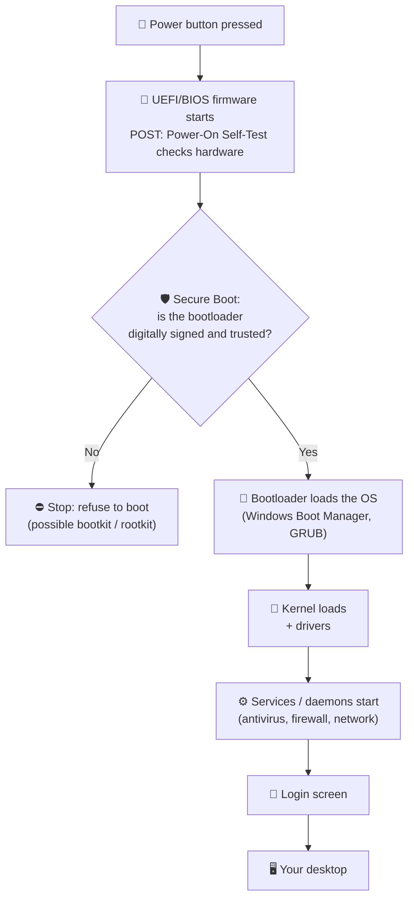

# Chapter 2 — Software, Operating Systems & Files

**Level 1 · Basic Foundation to Understand to Start**

---

## 🎯 Goal

By the end of this chapter you will understand what software is, what an **operating system (OS)** does, how files and permissions work, and why **patching** and **least privilege** are two of the most important ideas in all of security.

---

## 🏠 Real-Life Story: The Hotel

Think of a big hotel.

- The **building** (walls, pipes, wiring) is the **hardware**. You met it in Chapter 1.
- The **hotel manager** decides who gets which room, keeps the electricity and water running, and makes sure guests don't walk into each other's rooms. That's the **operating system**.
- The **guests** come and go and each do their own thing. Those are the **applications** (browser, games, Word).
- The **room keys** decide who may enter which room. Those are **user accounts and permissions**.
- The **maintenance crew** fixes broken locks and leaky pipes. That's **updates and patches**.

```
   HOTEL                                  COMPUTER
   ─────                                  ────────
   Guests                    ───────►     Applications (apps)
   Hotel manager             ───────►     Operating System (OS)
   Building, pipes, wiring   ───────►     Hardware
   Room keys                 ───────►     User accounts & permissions
   Maintenance crew          ───────►     Updates & patches
```

---

## 📖 Hardware vs Software

| | Hardware | Software |
|---|---|---|
| What is it? | The physical parts you can touch | Instructions (code) that tell hardware what to do |
| Examples | CPU, RAM, SSD, keyboard | Windows, Chrome, WhatsApp, games |
| Can it be "infected"? | Rarely (firmware is the exception) | Yes, this is where most malware lives |

**Firmware** sits in between. It is software that is permanently stored *on* a hardware chip (e.g., UEFI on the motherboard, the code inside your router). It is updated much less often, which makes it attractive to attackers.

---

## 🖼️ Figure 2.1 — The Layer Cake

The OS sits between the apps and the hardware. Apps never talk to the hardware directly. They **ask the OS**, and the OS decides whether to allow it.

```
  ┌───────────────────────────────────────────────────────┐
  │   👤  USER  (you)                                     │
  ├───────────────────────────────────────────────────────┤
  │   📱  APPLICATIONS   browser · email · games · Word   │
  ├───────────────────────────────────────────────────────┤
  │   🧑‍💼 OPERATING SYSTEM                                 │
  │       ┌──────────── user space ────────────┐          │
  │       │ services · settings · user accounts│          │
  │       ├──────────── KERNEL (core) ─────────┤          │
  │       │ memory · CPU scheduling · files ·  │          │
  │       │ security checks · DRIVERS          │          │
  │       └────────────────────────────────────┘          │
  ├───────────────────────────────────────────────────────┤
  │   🔩  FIRMWARE  (UEFI / BIOS)                         │
  ├───────────────────────────────────────────────────────┤
  │   🖥️  HARDWARE   CPU · RAM · storage · network card   │
  └───────────────────────────────────────────────────────┘
```

> 🔐 **Why security cares:** The **kernel** is the most powerful part of the OS. Malware that gets into the kernel (a **rootkit**, Chapter 16) can hide from antivirus because it controls what the antivirus is allowed to see.

---

## 📖 What Does an Operating System Do?

1. **Manages the CPU:** decides which program runs when (like a manager scheduling staff shifts).
2. **Manages memory (RAM):** gives each app its own space and stops apps from reading each other's memory.
3. **Manages storage:** organizes data into **files** and **folders** through a **file system**.
4. **Manages devices:** uses **drivers** (small translator programs) to talk to printers, cameras and so on.
5. **Manages users and security:** logins, passwords and who may do what.
6. **Provides the interface:** a **GUI** (graphical user interface: windows, icons, mouse) and/or a **CLI** (command-line interface: typing commands, Chapter 9).

### The Operating Systems You Should Know

| OS | Made by | Where you see it | Fun fact for security |
|---|---|---|---|
| **Windows** | Microsoft | Most office PCs and many servers | Biggest malware target because it's the most common desktop OS |
| **macOS** | Apple | Mac computers | Based on Unix, like Linux |
| **Linux** | Open-source community (Ubuntu, Red Hat, Kali…) | Most web servers, cloud and IoT devices | **Kali Linux** is a popular security-testing distribution |
| **Android** | Google (based on Linux) | Most smartphones worldwide | Allows apps from outside the store (side-loading, Chapter 7) |
| **iOS / iPadOS** | Apple | iPhone, iPad | Very locked down. Removing restrictions = **jailbreaking** |
| **Embedded / RTOS** | Many | Cars, medical devices, factory machines | Often hard or impossible to patch (Chapter 29) |

---

## 📖 Programs, Processes and Services

- A **program** (or application) is a file on the disk, like `chrome.exe`. It's a recipe sitting in a cookbook.
- A **process** is a program that is **running** in RAM. It's the recipe being cooked right now. One program can run as many processes (Chrome opens one per tab).
- A **service** (Windows) or **daemon** (Linux) is a process that runs **in the background** without a window, often starting automatically at boot. Examples: the print spooler, the web server, Windows Update.

> 🔐 **Why security cares:** Every running service is a possible door for an attacker. **Hardening** (Chapter 27) means turning off every service you don't need. Malware also likes to disguise itself as a normal-looking service or process, such as `svch0st.exe` instead of `svchost.exe`.

---

## 📖 Files, Folders and Extensions

A **file** is a named container of data. A **folder** (or **directory**) holds files and other folders. Together they form a **tree**.

## 🖼️ Figure 2.2 — The Folder Tree

```
 Windows                                   Linux / macOS
 ───────                                   ─────────────
 C:\                                       /            ← "root" of the tree
 ├── Windows\        (OS files)            ├── bin/        (basic programs)
 ├── Program Files\  (installed apps)      ├── etc/        (settings/config files)
 └── Users\                                ├── home/
     ├── Alice\                            │   ├── alice/
     │   ├── Documents\                    │   └── bob/
     │   │   └── report.docx               ├── var/
     │   └── Downloads\                    │   └── log/   (log files!)
     └── Bob\                              └── tmp/        (temporary files)

 Path example: C:\Users\Alice\Documents\report.docx
 Path example: /home/alice/report.txt
```

Note: Windows uses **backslashes** `\` and drive letters (`C:`). Linux and macOS use **forward slashes** `/` and start from `/` (called **root**).

### File Extensions: The File's "Name Tag"

The letters after the last dot tell the OS what kind of file it is.

| Extension | Type | Danger level |
|---|---|---|
| `.txt`, `.jpg`, `.png`, `.mp3` | Text, pictures, audio | Low |
| `.pdf`, `.docx`, `.xlsx` | Documents | Medium (can contain links, **macros** in `.docm`/`.xlsm`) |
| `.zip`, `.rar`, `.iso` | Archives / disk images | Medium (can hide other files) |
| `.exe`, `.msi`, `.bat`, `.ps1`, `.vbs`, `.js`, `.scr` | **Programs and scripts (they run code!)** | **High** |
| `.sh`, `.py`, `.elf` | Linux scripts and programs | **High** |

## 🖼️ Figure 2.3 — The Double-Extension Trick

```
  What the victim sees:         invoice.pdf          📄  "It's just a PDF"
  (extensions hidden)

  What the file really is:      invoice.pdf.exe      ⚙️  A PROGRAM!
                                         └─┬─┘
                                    the REAL extension is the LAST one
```

> 🔐 **Why security cares:** Windows hides known extensions by default. Attackers name malware `invoice.pdf.exe` so it *looks* like a PDF. Always turn on **"Show file extensions"**.

### File Systems

A **file system** is the OS's filing method, the way it organizes data on a disk.

| File system | Used by | Security note |
|---|---|---|
| **NTFS** | Windows | Supports permissions and encryption (EFS, BitLocker) |
| **FAT32 / exFAT** | USB sticks, SD cards | **No permissions.** Anyone can read everything |
| **ext4**, XFS | Linux | Supports Linux permissions |
| **APFS** | macOS / iOS | Built-in encryption |

---

## 📖 User Accounts: Who Are You?

Every person (and many programs) gets a **user account**: a username plus a way to prove identity, usually a password.

## 🖼️ Figure 2.4 — Account Types

```
   ┌───────────────────────────────┐
   │ 👑 ADMINISTRATOR / ROOT        │  Can do ANYTHING: install software,
   │    (Windows "Administrator",  │  change any setting, read any file,
   │     Linux "root", UID 0)      │  delete the whole system.
   ├───────────────────────────────┤
   │ 👤 STANDARD USER               │  Can use apps and their OWN files.
   │                               │  Cannot change system settings.
   ├───────────────────────────────┤
   │ 🙈 GUEST                       │  Very limited, temporary.
   │                               │  Should usually be DISABLED.
   ├───────────────────────────────┤
   │ ⚙️ SERVICE ACCOUNT             │  Used by programs (e.g. the web
   │                               │  server), not by people.
   └───────────────────────────────┘
```

**Raising privileges safely:**
- **Windows:** **UAC (User Account Control)** pops up "Do you want to allow this app to make changes?" before admin actions.
- **Linux/macOS:** the `sudo` command ("**s**uper**u**ser **do**") runs one command as root after you enter your password.

> 🔐 **Why security cares — the Principle of Least Privilege:** Give every user and program **only the access it needs, and nothing more**. If you browse the web as an administrator and click a malicious link, the malware gets administrator power too. As a standard user, the damage is much smaller. You will see "least privilege" in dozens of exam questions.

---

## 📖 Permissions: What Are You Allowed to Do?

Permissions decide which accounts can **read**, **change** or **run** each file.

### Linux Permissions (rwx)

Every Linux file has three permission sets: for the **owner (u)**, the **group (g)**, and **others (o)**, everyone else.

## 🖼️ Figure 2.5 — Reading `ls -l` Output

```
   -rwxr-x---  1  alice  staff  4096  Jan 10  backup.sh
   │└┬┘└┬┘└┬┘      └─┬─┘  └─┬─┘
   │ │  │  │         │      └── group that owns the file
   │ │  │  │         └───────── user that owns the file
   │ │  │  └── OTHERS:  ---   no access at all
   │ │  └───── GROUP:   r-x   can read and run, NOT change
   │ └──────── OWNER:   rwx   can read, write (change) and execute (run)
   └────────── type: "-" = file, "d" = directory

   r = read (4)    w = write (2)    x = execute (1)    - = not allowed (0)

   Number form:  owner rwx = 4+2+1 = 7
                 group r-x = 4+0+1 = 5        →  chmod 750 backup.sh
                 others --- = 0
```

### Windows Permissions (NTFS)

Windows uses a similar idea with more choices: **Full control, Modify, Read & execute, List folder contents, Read, Write**. You can see them by right-clicking a file → **Properties → Security**.

### 🖼️ Figure 2.6 — Permission Matrix Example

| File: `salaries.xlsx` | Read | Write | Execute |
|---|:---:|:---:|:---:|
| HR Manager (owner) | ✅ | ✅ | — |
| HR team (group) | ✅ | ❌ | — |
| Everyone else | ❌ | ❌ | — |

> This list of "who can do what" is called an **Access Control List (ACL)**. ACLs come back in Chapters 27 and 38.

---

## 📖 Updates, Patches and End-of-Life

Software is written by humans, and humans make mistakes. Some mistakes are **vulnerabilities**: weaknesses an attacker can use.

- A **patch** is a fix for a specific problem. An **update** may include many patches plus new features.
- Microsoft releases security patches on the **second Tuesday of each month** ("**Patch Tuesday**").
- **End-of-Life (EOL)** or **end-of-support** means the vendor **no longer releases patches**. Example: Windows 10 support ended on 14 October 2025. Any new weakness found after that date stays open forever.

## 🖼️ Figure 2.7 — The Patch Race

```
   Day 0           Day 1               Day 7                Day 30
   ──┬──────────────┬───────────────────┬────────────────────┬─────────►
     │              │                   │                    │
   Bug found     Vendor releases     Attackers study the   Unpatched systems
   (maybe by     a PATCH 🩹          patch to learn the     get hacked 💥
   an attacker!)                     weakness and build
                                     an attack

   If an attacker finds and uses the bug BEFORE a patch exists,
   it is called a ZERO-DAY (the vendor had "zero days" to fix it).
```

> 🔐 **Why security cares:** Many of the most famous attacks (WannaCry, Equifax, Chapter 10) used weaknesses that **already had a patch**. The victims simply hadn't installed it. Patching is one of the cheapest and most effective defenses.

---

## 📖 The Boot Process: From Power Button to Desktop

## 🖼️ Figure 2.8 — Boot Sequence



**Measured Boot** goes one step further: the **TPM** (Chapter 1) records a fingerprint (hash, Chapter 3) of each step so any change can be detected later.

> 🔐 **Why security cares:** Malware that loads *before* the OS (a **bootkit**) is very hard to detect. Secure Boot + TPM are the defenses.

---

## 🧠 Memory Tricks

- **"Program = recipe, Process = cooking, Service = the oven left on."**
- **Least privilege = "need to know, need to do, nothing more."**
- **rwx = 4-2-1** → "**R**eally **W**ant e**X**tra cookies: 4, 2, 1."
- **The LAST extension wins:** `photo.jpg.exe` is a program.

---

## ⚠️ Exam Tip

CompTIA loves these OS-related ideas:

- *"A user's account was used to install malware. What would have limited the damage?"* → **Least privilege** (not running as admin).
- *"Which control ensures only signed, trusted code runs at startup?"* → **Secure Boot**.
- *"A company still runs a system the vendor no longer supports. What is this vulnerability called?"* → **End-of-life (EOL) / legacy / unsupported system**.
- *"What should be removed or disabled when hardening a server?"* → **Unnecessary services, software and default accounts (e.g., guest).**

---

## 🧪 Try It (15 minutes)

1. **Show file extensions.** Windows 11: File Explorer → **View** → **Show** → **File name extensions**. Windows 10: File Explorer → **View** tab → tick **File name extensions**. Mac: Finder → Settings → Advanced → **Show all filename extensions**.
2. **Look at running processes.** Windows: Task Manager → **Details** tab. Mac: Activity Monitor. Linux: run `ps aux` or `top`.
3. **Look at services.** Windows: press `Win + R`, type `services.msc`. Linux: `systemctl list-units --type=service`.
4. **Check permissions.** Windows: right-click any file → Properties → **Security**. Linux/Mac: open a terminal and run `ls -l`.
5. **Create a standard user** and use it for your everyday work. Keep the admin account only for installing software.
6. **Check for updates** right now (Windows Update / Software Update / `sudo apt update && sudo apt upgrade`).

---

## ✅ Checkpoint Questions

1. What is the job of the operating system, in one sentence?
2. What is the difference between a **program** and a **process**?
3. A file is named `holiday_photos.zip.exe`. What kind of file is it really?
4. Which account type should you use for everyday web browsing, and why?
5. On Linux, a file shows `-rw-r--r--`. Can the group change (write) the file?
6. What does `chmod 700 secret.txt` do?
7. What do we call a weakness that attackers use **before** a patch exists?
8. A hospital still runs an X-ray machine on an operating system that no longer gets security updates. What is this risk called?
9. Which boot feature checks that only trusted, signed software starts?
10. Which file system on a USB stick has **no** permission system?

<details>
<summary><b>Show answers</b></summary>

1. It manages the hardware (CPU, memory, storage, devices) and provides services and security for applications and users.
2. A **program** is the file stored on the disk. A **process** is that program **running** in memory.
3. An **executable program** (`.exe`). The last extension is the real one, so it may be malware.
4. A **standard user** account. This follows **least privilege**: if malware runs, it gets only limited rights.
5. **No.** The group has `r--` (read only).
6. Owner = `rwx` (7), group = `---` (0), others = `---` (0). Only the owner can read, write or run it.
7. A **zero-day** vulnerability.
8. An **end-of-life (EOL) / legacy / unsupported system** vulnerability.
9. **Secure Boot** (part of UEFI).
10. **FAT32** (and exFAT).

</details>

---

## 📌 Chapter Summary

| Concept | One-line meaning | Security link |
|---|---|---|
| Operating system | Manager between apps and hardware | Kernel = most powerful part; rootkits target it |
| Process / service | Running program / background program | Disable unneeded services (hardening) |
| File extension | Tells you the file type | Double-extension trick; `.exe` and scripts run code |
| User accounts | Admin vs standard vs guest vs service | **Least privilege** |
| Permissions / ACL | Who can read, write, execute | Access control |
| Patches | Fixes for bugs | Patch fast; EOL systems can't be patched |
| Boot process | Firmware → bootloader → kernel → login | Secure Boot, Measured Boot, TPM |

**Next chapter →** *Chapter 3: How Computers Represent Data.* Why does a password hash look like `5f4dcc3b…`? Time to learn the computer's alphabet.
