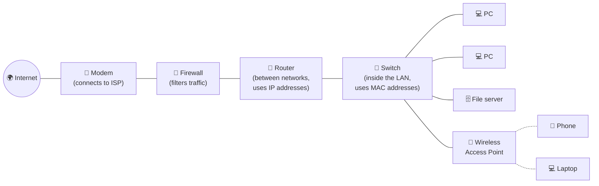

# Chapter 4 — Networking 101: How Computers Talk

**Level 1 · Basic Foundation to Understand to Start**

---

## 🎯 Goal

By the end of this chapter you will understand what a network is, how devices find each other using **MAC addresses** and **IP addresses**, what **routers** and **switches** do, and why your home has a "private" address that the internet never sees.

---

## 🏠 Real-Life Story: The Postal System 📮

Sending data across a network is just like sending a letter.

| Postal system | Network | What it means |
|---|---|---|
| The letter inside | **Data** (the payload) | What you actually want to send |
| Envelope | **Packet** | Data wrapped with addressing information |
| Street address of the building | **IP address** | *Where* on the network (can change when you move) |
| Apartment number | **Port number** | *Which service/app* inside that computer (Chapter 5) |
| Person's name / ID number | **MAC address** | The device's permanent hardware ID (used on the local network) |
| Local mail sorter in your building | **Switch** | Delivers within the same local network |
| Post office between cities | **Router** | Forwards packets between different networks |
| The worldwide postal system | **The Internet** | A network of networks |

## 🖼️ Figure 4.1 — A Packet Is an Envelope

```
   ┌──────────────────────────────────────────────────────────────┐
   │  FROM: 192.168.1.20  : port 51544     (your laptop)          │
   │  TO:   203.0.113.10  : port 443       (a web server)         │
   │ ┌──────────────────────────────────────────────────────────┐ │
   │ │                                                          │ │
   │ │      DATA (payload):  "GET me the Google homepage"       │ │
   │ │                                                          │ │
   │ └──────────────────────────────────────────────────────────┘ │
   └──────────────────────────────────────────────────────────────┘
   Big files are cut into MANY small packets, sent separately,
   and put back together at the other end.
```

---

## 📖 What Is a Network?

A **network** is two or more devices connected so they can share data and resources (files, printers, internet access).

### Network Sizes

```
   PAN  ⊂  LAN  ⊂  MAN  ⊂  WAN
```

| Type | Stands for | Size | Example |
|---|---|---|---|
| **PAN** | Personal Area Network | A few meters around you | Phone ↔ Bluetooth earbuds |
| **LAN** | Local Area Network | One home, office or floor | Your home Wi-Fi |
| **WLAN** | Wireless LAN | Same as LAN, but over Wi-Fi | Coffee-shop Wi-Fi |
| **MAN** | Metropolitan Area Network | A city or campus | A university's buildings linked together |
| **WAN** | Wide Area Network | Countries / the world | A company linking offices in London and Delhi. **The internet is the biggest WAN.** |

### Client–Server vs Peer-to-Peer

```
     CLIENT–SERVER                         PEER-TO-PEER (P2P)
     ─────────────                         ──────────────────
         🗄️ Server                          💻 ─────── 💻
        /   |   \                            │  ╲    ╱  │
      💻    💻    💻                           │    ╳     │
     clients ASK, server ANSWERS             💻 ─────── 💻
     (websites, email, banking)            everyone is equal
                                           (torrents, some games)
```

- A **client** asks for something (your browser).
- A **server** provides it (the website's computer).
- Most business networks are client–server because it's easier to **control and secure** one central server.

---

## 📖 The Two Addresses Every Device Has

### 1. MAC Address — the device's hardware "name"

- **MAC** = **M**edia **A**ccess **C**ontrol.
- Burned into every **NIC** (Network Interface Card: the Wi-Fi or Ethernet chip).
- **48 bits**, written as **12 hex digits** (remember Chapter 3!): `3C:22:FB:9A:10:7E`
- The first half (`3C:22:FB`) identifies the **manufacturer**. This part is called the **OUI** (Organizationally Unique Identifier).
- Used only for delivery **inside the local network** (LAN).

> 🔐 **Why security cares:** MAC addresses can be **faked (spoofed)** with software. So "only allow these MAC addresses on our Wi-Fi" (MAC filtering) is a weak control. Phones now use **random MAC addresses** on each Wi-Fi network for privacy.

### 2. IP Address — the device's network "location"

- **IP** = **I**nternet **P**rotocol.
- Given to the device by the network (it changes when you move, just like your street address changes when you move house).
- Used to deliver data **between networks** across the world.

## 🖼️ Figure 4.2 — IPv4 vs IPv6

```
   IPv4  (32 bits = 4 bytes, written as 4 decimal numbers 0–255)
   ────
          192   .   168   .    1    .   20
        11000000 10101000 00000001 00010100      ← it's really just binary!
        About 4.3 billion addresses total.  The world ran out!

   IPv6  (128 bits, written as 8 groups of 4 hex digits)
   ────
        2001:0db8:85a3:0000:0000:8a2e:0370:7334
        Short form:  2001:db8:85a3::8a2e:370:7334
                     (leading zeros dropped; one run of all-zero groups → "::")
        About 340 undecillion addresses: enough for every grain of sand… many times over.
```

### MAC vs IP at a Glance

| | MAC address | IP address |
|---|---|---|
| Example | `3C:22:FB:9A:10:7E` | `192.168.1.20` |
| Size | 48 bits | 32 bits (IPv4) / 128 bits (IPv6) |
| Assigned by | Manufacturer | Network (usually **DHCP**, Chapter 6) |
| Changes? | Normally no | Yes, when you change networks |
| Used for | Local delivery (same LAN) | Delivery across networks |
| Analogy | Person's name | Street address |
| Network layer (Chapter 5) | Layer 2 | Layer 3 |

---

## 📖 Subnet Mask & Default Gateway

When your computer wants to send something, it first asks: *"Is the destination in my own local network, or somewhere else?"*

- The **subnet mask** answers this. It splits an IP address into a **network part** (the street) and a **host part** (the house number).
- If the destination is on the **same network**, the data goes straight there through the switch.
- If it is on a **different network**, the data goes to the **default gateway**: the router, your "door to the outside world."

## 🖼️ Figure 4.3 — Network Part vs Host Part

```
   IP address :   192 . 168 . 1   .  20
   Subnet mask:   255 . 255 . 255 .  0          (also written "/24")
                  └──── NETWORK ────┘  └HOST┘
                  "192.168.1 street"   "house 20"

   192.168.1.20  →  192.168.1.77   Same street   → deliver locally via switch
   192.168.1.20  →  8.8.8.8        Different     → send to default gateway (router) 192.168.1.1
```

> "/24" (**CIDR notation**) means "the first **24 bits** are the network part." `/24` = `255.255.255.0`, which allows 254 usable host addresses (.1 to .254).

---

## 📖 Public vs Private IP Addresses & NAT

There aren't enough IPv4 addresses for every device on Earth. The solution: **private addresses** that can be reused inside every home and office, and are **never routed on the public internet**.

## 🖼️ Figure 4.4 — Special IPv4 Ranges (memorize!)

| Range | CIDR | Meaning |
|---|---|---|
| `10.0.0.0` – `10.255.255.255` | `10.0.0.0/8` | **Private** (big companies) |
| `172.16.0.0` – `172.31.255.255` | `172.16.0.0/12` | **Private** (medium) |
| `192.168.0.0` – `192.168.255.255` | `192.168.0.0/16` | **Private** (homes, small offices) |
| `127.0.0.1` | `127.0.0.0/8` | **Loopback**: "myself" (localhost) |
| `169.254.x.x` | `169.254.0.0/16` | **APIPA**: self-assigned when **DHCP failed** (a troubleshooting clue!) |

Everything else (like `8.8.8.8`, Google's public DNS server) is generally a **public** address, reachable on the internet.

> 📘 **Note about the examples in this book:** addresses starting with `192.0.2.`, `198.51.100.` and `203.0.113.` are reserved **for documentation**. They are "pretend" public addresses, used in books so the examples never point at a real company's server. When you see them, read them as "some public server on the internet."

### NAT — Network Address Translation

Your router has **one public IP** from your internet provider. **NAT** lets all your private devices share it, like a company with one main phone number and many internal extensions.

## 🖼️ Figure 4.5 — NAT at Home

```
     YOUR HOME (private side)                    THE INTERNET (public side)
   ┌───────────────────────────┐
   │ 💻 Laptop  192.168.1.20   │\
   │ 📱 Phone   192.168.1.21   │─── 📶 ROUTER ════════════════  🌍  Websites see only
   │ 📺 TV      192.168.1.22   │/   inside: 192.168.1.1              203.0.113.50
   └───────────────────────────┘    outside: 203.0.113.50
                                    (NAT swaps the addresses
                                     and remembers who asked)
```

> 🔐 **Why security cares:** NAT hides your inside addresses, and by default outsiders can't start connections to your devices. That's a helpful side effect, but **NAT is not a firewall**. Also: if you see a `169.254.x.x` address, the device couldn't reach DHCP. That could be a broken cable, or an attacker interfering with DHCP.

---

## 📖 Network Devices

## 🖼️ Figure 4.6 — A Typical Small Office



| Device | Job | Works with | Analogy |
|---|---|---|---|
| **Modem** | Converts your provider's signal (cable, fiber, DSL) into network data | — | Translator at the border |
| **Router** | Connects **different networks** and picks the best path | **IP** addresses (Layer 3) | Post office between cities |
| **Switch** | Connects devices **within one LAN**, sends data only to the right port | **MAC** addresses (Layer 2) | Mail sorter in your building |
| **Hub** (old) | Copies everything to **every** port | — | Shouting in a room. Anyone can listen! |
| **Access point (AP)** | Lets wireless devices join the wired LAN | Wi-Fi | A wireless doorway |
| **Firewall** | Allows or blocks traffic based on rules | IP, ports, apps | Security guard at the door |

> 🏠 Your home "router" is usually **all of these in one box**: modem + router + switch + access point + basic firewall.

> 🔐 **Why security cares:** On a **hub**, every device sees everyone's traffic, which makes eavesdropping easy. **Switches** send traffic only where it needs to go, which is better for privacy (but they can still be attacked, Chapter 25).

---

## 📖 ARP — Connecting IP Addresses to MAC Addresses

Your computer knows the **IP** it wants to talk to, but on the local network it needs the **MAC** to actually deliver the data. **ARP (Address Resolution Protocol)** finds it.

## 🖼️ Figure 4.7 — ARP Asks the Room

```
   💻 192.168.1.20 shouts to everyone (broadcast):
        "WHO HAS 192.168.1.1?  Tell 192.168.1.20!"

   🔀 Router (192.168.1.1) replies only to the asker:
        "192.168.1.1 is at MAC  A4:2B:B0:11:22:33"

   💻 saves it in its ARP table (cache) and sends the data.
```

> 🔐 **Why security cares:** ARP **trusts any answer**. An attacker can shout "*I* am 192.168.1.1!" and receive everyone's traffic. This is **ARP poisoning**, an **on-path (man-in-the-middle)** attack (Chapter 25).

---

## 📖 Wired Connections (Quick Look)

| Medium | What it looks like | Notes |
|---|---|---|
| **Copper (Ethernet, twisted pair)** | Cable with an **RJ45** plug (Cat5e, Cat6) | Most common in offices. Up to 100 m per cable run |
| **Fiber optic** | Glass strands carrying light | Very fast, long distances, very hard to tap without being noticed |
| **Coaxial** | Round TV-style cable | Cable internet |

The usual topology today is the **star**: every device is connected to a central switch.

---

## 🧠 Memory Tricks

- **"MAC = Me, IP = I'm here."** MAC is *who* the device is; IP is *where* it is right now.
- **Switch = Same network (MAC). Router = Routes between networks (IP).**
- **Private ranges: "10, 172.16–31, 192.168."** Say it like a phone number: "*ten, one-seventy-two-sixteen-to-thirty-one, one-ninety-two-one-sixty-eight*."
- **169.254 = "DHCP is broken."**

---

## ⚠️ Exam Tip

- *"A user's PC shows the IP 169.254.10.5 and can't reach the internet. What is the MOST likely cause?"* → It couldn't get an address from **DHCP**.
- *"Which device forwards traffic between different networks?"* → **Router.**
- *"An attacker sends fake ARP replies to intercept traffic. What is this?"* → **ARP poisoning / on-path attack.**
- *"Why is MAC filtering a weak Wi-Fi control?"* → MAC addresses can be easily **spoofed**.

---

## 🧪 Try It (15 minutes)

1. **Find your addresses.**
   - Windows: open Command Prompt → `ipconfig /all`
   - macOS: `ifconfig` (or System Settings → Network → Details)
   - Linux: `ip a` and `ip route`

   Write down: **IPv4 address, subnet mask, default gateway, MAC (Physical) address, DNS servers.** Is your IPv4 address private? Which range is it in?

2. **Find your public IP.** Search "what is my IP" in a browser. It's different from your private IP, because of NAT!

3. **Look at your ARP table.** Run `arp -a` (Windows/macOS) or `ip neigh` (Linux). Find your router's IP and its MAC.

4. **Look up a manufacturer.** Take the first 6 hex digits of your MAC and search "MAC vendor lookup."

---

## ✅ Checkpoint Questions

1. Which address is burned into the network card: MAC or IP?
2. How many bits are in an IPv4 address? In an IPv6 address?
3. Is `172.20.5.9` a private or a public address?
4. Is `172.32.5.9` a private or a public address?
5. What does a **default gateway** do?
6. What does `/24` mean?
7. What does NAT do?
8. Which device sends data only to the correct port based on MAC address?
9. Why is a hub a security problem?
10. Which protocol finds the MAC address that belongs to an IP address, and why is it easy to abuse?

<details>
<summary><b>Show answers</b></summary>

1. **MAC** (though it can be spoofed in software).
2. IPv4 = **32 bits**. IPv6 = **128 bits**.
3. **Private.** It's inside 172.16.0.0–172.31.255.255.
4. **Public.** 172.32 is just outside the private range (which ends at 172.31).
5. It's the **router** your device sends traffic to when the destination is on a **different network**.
6. The first **24 bits** are the network part (mask `255.255.255.0`).
7. It lets many devices with **private** IPs share **one public** IP by translating addresses.
8. A **switch**.
9. It sends every packet to **every** port, so any connected device can **eavesdrop**.
10. **ARP.** It trusts any reply, so attackers can send fake replies (**ARP poisoning**).

</details>

---

## 📌 Chapter Summary

| Concept | Key fact | Security link |
|---|---|---|
| Packet | Data + addressing "envelope" | Can be captured and inspected |
| MAC address | 48-bit hardware ID, local delivery | Spoofable → MAC filtering is weak |
| IP address | Logical location; IPv4 32-bit, IPv6 128-bit | Basis of firewall rules |
| Subnet mask / gateway | Local vs remote decision; door to outside | — |
| Private IP + NAT | 10/8, 172.16/12, 192.168/16 | Hides inside hosts (not a firewall!) |
| Switch vs router vs hub | L2 local / L3 between networks / broadcast | Hubs leak traffic |
| ARP | IP → MAC lookup | ARP poisoning (on-path attack) |

**Next chapter →** *Chapter 5: Network Models — OSI & TCP/IP.* Let's organize all of this into the famous 7-layer model the exam keeps referring to.
