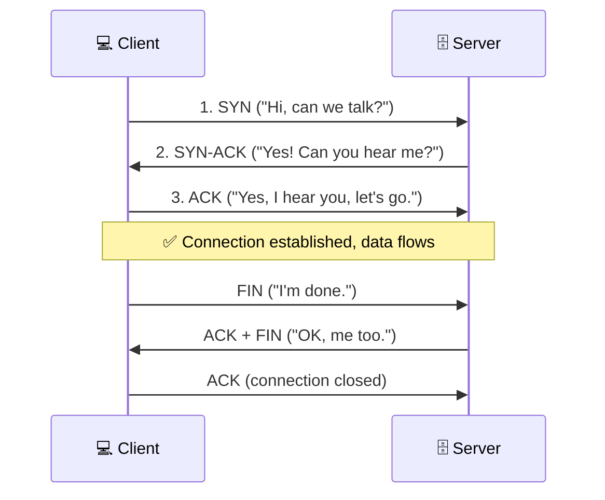

# Chapter 5 — Network Models: OSI & TCP/IP

**Level 1 · Basic Foundation to Understand to Start**

---

## 🎯 Goal

By the end of this chapter you will know the **7 layers of the OSI model**, the simpler **TCP/IP model**, how data gets wrapped as it travels (**encapsulation**), the difference between **TCP and UDP**, and what **ports** are.

---

## 🏠 Real-Life Story: Sending a Gift Overseas 🎁

You want to send a birthday gift to a friend in another country.

1. You **write a card** in a language your friend understands.
2. You **put it in a gift box**.
3. You **wrap it** and **write the address** on it.
4. The courier **puts it in a bigger shipping crate** with other parcels.
5. The crate goes on a **truck, then a plane, then another truck**.
6. At the other end, everything is **unwrapped in reverse order** until your friend reads the card.

Networking works the same way. Each **layer** adds its own "wrapping" with its own information, and the receiver unwraps it layer by layer. The **OSI model** is just a standard way to name each step, so everyone (and every exam question) can talk about them clearly.

---

## 🖼️ Figure 5.1 — The OSI Model as a 7-Floor Building

```
 ┌────┬──────────────────┬────────────────────────────────┬─────────────────────┬───────────────────────┐
 │ #  │ Layer            │ What it does (simple)          │ Examples            │ Devices / security    │
 ├────┼──────────────────┼────────────────────────────────┼─────────────────────┼───────────────────────┤
 │ 7  │ APPLICATION      │ What the user's app talks      │ HTTP, HTTPS, DNS,   │ WAF, proxy, NGFW      │
 │    │                  │ (web, email, file transfer)    │ SMTP, FTP, SSH      │ (app-aware filtering) │
 ├────┼──────────────────┼────────────────────────────────┼─────────────────────┼───────────────────────┤
 │ 6  │ PRESENTATION     │ Formatting, translating,       │ ASCII, JPEG, MP4,   │ —                     │
 │    │                  │ compressing, encrypting        │ encryption (TLS*)   │                       │
 ├────┼──────────────────┼────────────────────────────────┼─────────────────────┼───────────────────────┤
 │ 5  │ SESSION          │ Opens, manages and closes      │ RPC, NetBIOS,       │ —                     │
 │    │                  │ conversations ("sessions")     │ session tokens      │ session hijacking     │
 ├────┼──────────────────┼────────────────────────────────┼─────────────────────┼───────────────────────┤
 │ 4  │ TRANSPORT        │ Splits data into pieces,       │ TCP, UDP,           │ Firewall rules on     │
 │    │                  │ reliability, PORT numbers      │ port numbers        │ ports ("Layer 4 FW")  │
 ├────┼──────────────────┼────────────────────────────────┼─────────────────────┼───────────────────────┤
 │ 3  │ NETWORK          │ Addressing and routing         │ IP (v4/v6), ICMP,   │ ROUTER, L3 switch,    │
 │    │                  │ between networks (IP)          │ IPsec               │ packet-filter firewall│
 ├────┼──────────────────┼────────────────────────────────┼─────────────────────┼───────────────────────┤
 │ 2  │ DATA LINK        │ Delivery inside the local      │ Ethernet, Wi-Fi     │ SWITCH, access point, │
 │    │                  │ network using MAC addresses    │ (802.11), ARP, MAC  │ NIC; ARP poisoning    │
 ├────┼──────────────────┼────────────────────────────────┼─────────────────────┼───────────────────────┤
 │ 1  │ PHYSICAL         │ The actual signals: electric,  │ Cables, fiber,      │ Hub, repeater,        │
 │    │                  │ light, radio waves (0s and 1s) │ radio, connectors   │ cable; wiretapping,   │
 │    │                  │                                │                     │ jamming               │
 └────┴──────────────────┴────────────────────────────────┴─────────────────────┴───────────────────────┘
   * TLS doesn't fit neatly into one layer; it's often described as Layers 5–6.
   WAF = Web Application Firewall, NGFW = Next-Generation Firewall (both in Chapter 20).
```

### Mnemonics

```
   From Layer 1 up to 7:     Please   Do    Not    Throw    Sausage   Pizza          Away
                             Physical Data  Network Transport Session  Presentation  Application

   From Layer 7 down to 1:   All         People        Seem     To        Need     Data      Processing
                             Application Presentation  Session  Transport Network  Data link Physical
```

---

## 📖 Encapsulation: Wrapping and Unwrapping

As data moves **down** the layers on the sender's side, each layer adds a **header** (its own label). As it moves **up** on the receiver's side, each layer removes its header.

## 🖼️ Figure 5.2 — The Russian Doll

```
 Layer 7-5  │                              [   DATA   ]                              │  "Data"
            │                                                                        │
 Layer 4    │                    [TCP/UDP hdr][   DATA   ]                           │  "Segment" (TCP)
            │                    ports: from 51544 to 443                            │  "Datagram" (UDP)
            │                                                                        │
 Layer 3    │            [IP hdr][TCP/UDP hdr][   DATA   ]                           │  "Packet"
            │            IPs: from 192.168.1.20 to 203.0.113.10                      │
            │                                                                        │
 Layer 2    │   [Eth hdr][IP hdr][TCP/UDP hdr][   DATA   ][Eth trailer]              │  "Frame"
            │   MACs: from laptop's MAC to router's MAC                              │
            │                                                                        │
 Layer 1    │   0101100101010111010100101011010100101010101010101010101...           │  "Bits"
```

The name of each "package" is called its **PDU** (Protocol Data Unit). Mnemonic, from Layer 4 down to 1: **"Some People Fear Birthdays"** → **S**egment, **P**acket, **F**rame, **B**its.

---

## 📖 The TCP/IP Model (the one the internet really uses)

OSI is a teaching model. The real internet is built on the simpler **TCP/IP model**, which has 4 layers. You need to know how they line up.

## 🖼️ Figure 5.3 — OSI vs TCP/IP

```
        OSI (7 layers)                    TCP/IP (4 layers)
   ┌───────────────────────┐          ┌──────────────────────────┐
   │ 7 Application         │          │                          │
   ├───────────────────────┤          │                          │
   │ 6 Presentation        │  ─────►  │  APPLICATION             │  HTTP, DNS, SMTP, SSH
   ├───────────────────────┤          │                          │
   │ 5 Session             │          │                          │
   ├───────────────────────┤          ├──────────────────────────┤
   │ 4 Transport           │  ─────►  │  TRANSPORT               │  TCP, UDP
   ├───────────────────────┤          ├──────────────────────────┤
   │ 3 Network             │  ─────►  │  INTERNET                │  IP, ICMP
   ├───────────────────────┤          ├──────────────────────────┤
   │ 2 Data Link           │          │                          │
   ├───────────────────────┤  ─────►  │  NETWORK ACCESS (Link)   │  Ethernet, Wi-Fi
   │ 1 Physical            │          │                          │
   └───────────────────────┘          └──────────────────────────┘
```

> 💡 In the security world, people still say "Layer 7 firewall" or "Layer 2 attack". They always mean the **OSI** numbers.

---

## 📖 Layer 4 in Depth: TCP vs UDP

Layer 4 has two main protocols. Think of them as two ways of sending mail.

## 🖼️ Figure 5.4 — Registered Letter vs Postcard

```
   📬 TCP — Transmission Control Protocol         📮 UDP — User Datagram Protocol
   ("registered letter with tracking")           ("postcard dropped in a mailbox")
   ─────────────────────────────────────          ─────────────────────────────────
   ✔ Sets up a connection first (handshake)       ✘ No connection: just sends
   ✔ Numbers every piece, puts them in order      ✘ No ordering
   ✔ Confirms delivery, re-sends lost pieces      ✘ Lost pieces are just lost
   ✘ Slower, more overhead                         ✔ Fast, lightweight

   Used for: web pages, email, file transfer,     Used for: video calls, live streaming,
   SSH, anything that must arrive complete        online games, DNS lookups, DHCP, VoIP
```

| | **TCP** | **UDP** |
|---|---|---|
| Connection | **Connection-oriented** (handshake first) | **Connectionless** |
| Reliability | Guaranteed delivery and order | "Best effort" |
| Speed | Slower | Faster |
| Examples | HTTP/HTTPS, SSH, SMTP, FTP, RDP | DNS (queries), DHCP, SNMP, NTP, VoIP, TFTP, Syslog |

### The TCP Three-Way Handshake 🤝

Before TCP sends any data, the two sides "shake hands" in 3 steps.

## 🖼️ Figure 5.5 — SYN, SYN-ACK, ACK



**TCP flags you'll meet:**

| Flag | Meaning |
|---|---|
| **SYN** | Synchronize: "let's start a connection" |
| **ACK** | Acknowledge: "got it" |
| **FIN** | Finish: "I'm done, let's close politely" |
| **RST** | Reset: "stop immediately / no such service here" |
| **PSH / URG** | Push / urgent data |

> 🔐 **Why security cares:**
> - **SYN flood:** an attacker sends thousands of **SYN**s and never sends the final **ACK**. The server keeps waiting with half-open connections until it runs out of resources. That's a **denial-of-service** attack (Chapter 25).
> - **Port scanning** tools (like **Nmap**, Chapter 9) send SYNs to see which ports answer with SYN-ACK (**open**) or RST (**closed**).

---

## 📖 Ports: The Apartment Numbers

An IP address gets data to the right **computer**. A **port number** gets it to the right **program** on that computer.

## 🖼️ Figure 5.6 — One Building, Many Apartments

```
                      🏢 Server 203.0.113.10
              ┌─────────────────────────────────────┐
   Packet ──► │  Apt 22    SSH   (remote admin)     │
   to port    │  Apt 25    SMTP  (email)            │
   443 ─────► │  Apt 443   HTTPS (website)  ◄──     │  delivered here
              │  Apt 3389  RDP   (remote desktop)   │
              └─────────────────────────────────────┘

   IP address + port = a SOCKET, written 203.0.113.10:443
```

- Port numbers go from **0 to 65,535** (16 bits).
- **Well-known ports: 0–1023.** Reserved for common services (80 = HTTP, 443 = HTTPS).
- **Registered ports: 1024–49,151.** Used by specific applications (3389 = RDP, 3306 = MySQL).
- **Dynamic / ephemeral ports: 49,152–65,535.** Picked temporarily by **clients** for their side of a conversation.

A server **listens** on a fixed port (e.g., 443). Your browser uses a random **ephemeral** port (e.g., 51544) for its side, so replies come back to the right browser tab.

> 🔐 **Why security cares:** Every **open port** is a door into the system. Closing unused ports is basic **hardening**. Firewalls make most of their decisions using **IP addresses + ports + protocol (TCP/UDP)** (Chapter 38). The full port list is in Chapter 6.

---

## 📖 Layer 3 Extra: ICMP

**ICMP (Internet Control Message Protocol)** is the network's "messaging and error-report" system. It has **no ports**.

- `ping` uses ICMP **Echo Request** / **Echo Reply** to ask "are you there?"
- `traceroute` uses ICMP messages (such as "Time Exceeded") to map the path.
- Some firewalls block ICMP so attackers can't easily map the network. That's why some servers don't answer pings.

---

## 📖 Attacks and Defenses by Layer (Preview)

## 🖼️ Figure 5.7 — Where Things Happen

| Layer | Example attacks | Example defenses |
|---|---|---|
| 7 Application | SQL injection, XSS, phishing websites | WAF, input validation, NGFW |
| 6 Presentation | Weak/old encryption (SSL downgrade) | Strong TLS settings |
| 5 Session | Session hijacking (stealing cookies/tokens) | Secure cookies, session timeouts |
| 4 Transport | SYN flood, port scanning | Firewalls, rate limiting, IPS |
| 3 Network | IP spoofing, ICMP floods, route attacks | Router ACLs, IPsec, anti-spoofing filters |
| 2 Data Link | ARP poisoning, MAC flooding, MAC spoofing, rogue APs | Port security, 802.1X, Dynamic ARP Inspection |
| 1 Physical | Cable tapping, jamming, stealing devices | Locked rooms, shielded cables, cameras |

You don't need to understand all these attacks yet. Most of them come back in Levels 2 and 3 (especially Chapters 24–26 and 30). For now, just get used to the idea that **each layer has its own attacks and its own defenses**.

---

## 🧠 Memory Tricks

- **OSI up:** "**P**lease **D**o **N**ot **T**hrow **S**ausage **P**izza **A**way."
- **OSI down:** "**A**ll **P**eople **S**eem **T**o **N**eed **D**ata **P**rocessing."
- **PDUs (L4 → L1):** "**S**ome **P**eople **F**ear **B**irthdays": Segment, Packet, Frame, Bits.
- **Devices:** Layer **2 = switch** (MAC), Layer **3 = router** (IP), Layer **7 = WAF/proxy** (apps).
- **TCP = Trustworthy, UDP = Unreliable but Darn fast.**
- **Handshake:** "SYN, SYN-ACK, ACK": like "Hi!" "Hi, you there?" "Yep!"

---

## ⚠️ Exam Tip

- *"A firewall that can block traffic based on the specific web application or URL works at which layer?"* → **Layer 7.**
- *"Which protocol is connectionless and used by DNS queries?"* → **UDP.**
- *"A server has many half-open connections that never complete the handshake. What attack is this?"* → **SYN flood** (a DoS).
- *"A switch operates at which layer?"* → **Layer 2** (a "Layer 3 switch" can also route).

---

## 🧪 Try It (20 minutes)

1. **See open connections and ports on your own PC.**
   - Windows: `netstat -ano` · Linux: `ss -tunap` · macOS: `netstat -an`
   - Find a line with `:443`. That's a connection to a secure website. Note the **ephemeral port** on your side.
2. **Watch a handshake with Wireshark** (free, wireshark.org):
   - Start a capture on your Wi-Fi/Ethernet adapter. Open any website. Stop the capture.
   - In the filter bar type: `tcp.flags.syn == 1`
   - You'll see **SYN** and **SYN-ACK** packets: the first two steps of the handshake!
3. **Ping and trace:** `ping 8.8.8.8` and `tracert 8.8.8.8` (Windows) / `traceroute 8.8.8.8` (Linux/macOS).

---

## ✅ Checkpoint Questions

1. List the 7 OSI layers from 1 to 7.
2. At which layer do routers work? Switches?
3. What is the PDU called at Layer 3? At Layer 2?
4. Name the three steps of the TCP handshake.
5. Give two examples of services that use UDP, and explain why UDP suits them.
6. What range are the "well-known" ports?
7. What is a socket?
8. A firewall that only looks at IP addresses and port numbers is working at which layers?
9. Which TCP flag means "stop immediately"?
10. Which protocol does `ping` use, and does it use port numbers?

<details>
<summary><b>Show answers</b></summary>

1. Physical, Data Link, Network, Transport, Session, Presentation, Application.
2. Routers: **Layer 3**. Switches: **Layer 2**.
3. Layer 3: **packet**. Layer 2: **frame**.
4. **SYN → SYN-ACK → ACK.**
5. E.g., **DNS** lookups, **VoIP** / video calls, **online games**, **DHCP**. Speed matters more than perfect delivery. A dropped video frame is better than a delayed one.
6. **0–1023.**
7. An **IP address plus a port** (e.g., `10.0.0.5:443`).
8. **Layers 3 and 4.**
9. **RST** (reset).
10. **ICMP.** No, ICMP has **no ports**.

</details>

### 🎯 Exam-Style Practice (multiple choice)

**MC1.** During an authorized scan, an analyst sends a SYN packet to port 3389 on a server and receives an RST in reply. What does this MOST likely mean?
A. The port is open and RDP is listening  B. The three-way handshake completed  C. The port is closed  D. The server is under a SYN flood

**MC2.** An attacker plugs a laptop into an office switch and floods it with thousands of fake MAC addresses. At which OSI layer is this attack happening?
A. Layer 2 (Data Link)  B. Layer 3 (Network)  C. Layer 4 (Transport)  D. Layer 7 (Application)

**MC3.** A connection log shows `192.168.1.20:51544 → 203.0.113.10:443`. What is port 51544 MOST likely?
A. A well-known port for a secure web service  B. A registered port for remote desktop  C. A port opened by malware on the server  D. A temporary (ephemeral) port the client picked for its side of the conversation

**MC4.** A developer wants to move a live video-call app from UDP to TCP "so no frames are ever lost." Why could this make calls WORSE?
A. TCP has no port numbers, so calls could not connect  B. TCP cannot carry video data  C. TCP waits to re-send lost pieces, which adds delay that real-time audio and video cannot tolerate  D. TCP is connectionless, so frames arrive out of order

**MC5.** A web server answers HTTPS requests normally, but `ping` to it gets no reply. What is the MOST likely reason?
A. A firewall in front of the server blocks ICMP  B. The server's port 443 is closed  C. The server is using UDP instead of TCP  D. The server has no MAC address

**MC6.** In the four-layer TCP/IP model, which layer contains IP and ICMP?
A. Application  B. Internet  C. Transport  D. Network Access

<details>
<summary><b>Show multiple-choice answers</b></summary>

| # | Answer | Why |
|---|---|---|
| MC1 | C | A closed port replies to a SYN with RST ("no such service here"); an open port would reply with SYN-ACK. |
| MC2 | A | Switches and MAC addresses live at Layer 2, so MAC flooding is a Data Link attack. |
| MC3 | D | Ports 49,152–65,535 are ephemeral ports picked by clients; the server side here is the well-known port 443. |
| MC4 | C | TCP's re-sending makes delivery reliable but slow; for live video a dropped frame is better than a delayed one, which is why UDP is used. |
| MC5 | A | Ping uses ICMP, which many firewalls block to make network mapping harder, while HTTPS (TCP 443) is still allowed. |
| MC6 | B | OSI Layer 3 (IP, ICMP) maps to the TCP/IP Internet layer; "Network Access" covers OSI Layers 1–2. |

</details>


---

## 📌 Chapter Summary

| Concept | Key fact | Security link |
|---|---|---|
| OSI model | 7 layers: Physical → Application | "Layer X" firewalls and attacks |
| TCP/IP model | 4 layers: Link, Internet, Transport, Application | How the real internet works |
| Encapsulation | Each layer adds a header; Segment → Packet → Frame → Bits | Packet capture & analysis |
| TCP | Reliable, 3-way handshake | SYN floods, port scans |
| UDP | Fast, connectionless | DNS/NTP amplification attacks (Chapter 25) |
| Ports | 0–65535. Well-known 0–1023 | Close unused ports; firewall rules |
| ICMP | Ping/traceroute, no ports | Often filtered at the firewall |

**Next chapter →** *Chapter 6: Common Network Services, Protocols & Ports.* Now meet the actual "tenants" behind each port number, and their secure versions.
