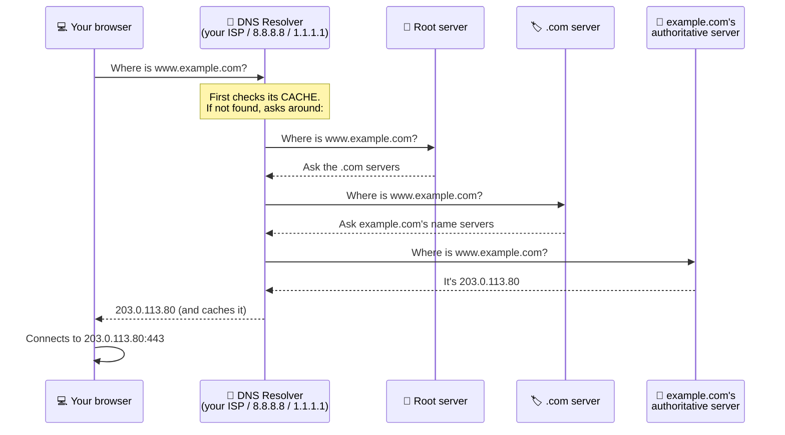

# Chapter 6 — Common Network Services, Protocols & Ports

**Level 1 · Basic Foundation to Understand to Start**

---

## 🎯 Goal

By the end of this chapter you will know what the most important network services do (**DNS, DHCP, HTTP/HTTPS, email, file transfer, remote access**), which **port** each one uses, and, most importantly for Security+, the **insecure protocol → secure replacement** pairs.

---

## 🏠 Real-Life Story: The Shopping Mall 🏬

A server is like a shopping mall. Each **shop** offers one service and sits at a fixed **unit number** (the **port**). The **protocol** is the "language and rules" spoken in that shop: how you ask, how they answer.

Some shops talk **out loud in the open** (anyone nearby can overhear your credit-card number). Their modern replacements talk **inside a private, soundproof booth** (encrypted). Security+ wants you to always pick the booth.

```
   🗣️ Plaintext (insecure)              🔒 Encrypted (secure)
   ───────────────────────             ──────────────────────
   Telnet  (port 23)          ──►      SSH    (port 22)
   HTTP    (port 80)          ──►      HTTPS  (port 443)
   FTP     (ports 20/21)      ──►      SFTP   (port 22)  or  FTPS (989/990)
```

---

## 📖 DNS — The Internet's Phone Book 📒

Humans remember names (`www.example.com`). Computers need IP addresses (`203.0.113.80`). **DNS (Domain Name System)** translates names into IP addresses.

- **Port 53.** UDP for normal lookups. TCP for large replies and **zone transfers** (copying DNS data between servers).

## 🖼️ Figure 6.1 — How a DNS Lookup Works



### DNS Record Types

| Record | Meaning | Example |
|---|---|---|
| **A** | Name → **IPv4** address | `www.example.com → 203.0.113.80` |
| **AAAA** | Name → **IPv6** address | `www.example.com → 2001:db8::80` |
| **CNAME** | Alias (nickname → real name) | `shop.example.com → stores.example.net` |
| **MX** | **Mail** server for the domain | `example.com mail → mail.example.com` |
| **NS** | The domain's name servers | |
| **PTR** | **Reverse** lookup: IP → name | |
| **TXT** | Free text, used for **email security (SPF, DKIM, DMARC)** and domain ownership checks | `v=spf1 include:_spf.example.net -all` |
| **SOA** | Start of Authority: admin info for the zone | |

> 🔐 **Why security cares:** If an attacker poisons the DNS "phone book", typing your bank's name takes you to a fake site (**DNS poisoning / spoofing**, Chapter 25). Defenses: **DNSSEC** (digitally signs DNS answers so they can't be faked), and **DNS over HTTPS (DoH)** / **DNS over TLS (DoT, port 853)**, which encrypt your lookups so others can't see them.

---

## 📖 DHCP — Automatic Address Assignment 🎟️

When you join a network, your device needs an IP address, subnet mask, default gateway and DNS server. **DHCP (Dynamic Host Configuration Protocol)** hands them out automatically.

- **UDP ports 67 (server) and 68 (client).**
- Addresses are **leased** for a period of time, like renting a hotel room.

## 🖼️ Figure 6.2 — DHCP "DORA"

```
   💻 New laptop                                        🗄️ DHCP server
        │                                                    │
        │ ── 1. DISCOVER (broadcast) ──────────────────────► │  "Is there a DHCP server? I need an IP!"
        │ ◄───────────────────────────────── 2. OFFER ───── │  "You can have 192.168.1.20"
        │ ── 3. REQUEST ───────────────────────────────────► │  "Yes please, I'll take 192.168.1.20"
        │ ◄───────────────────────────── 4. ACKNOWLEDGE ─── │  "It's yours for 24 hours.
        │                                                    │   Gateway .1, DNS 8.8.8.8"
```

> 🔐 **Why security cares:** A **rogue DHCP server** (set up by an attacker) can hand out a fake gateway or DNS server and send all your traffic through the attacker. Switch features like **DHCP snooping** block unauthorized DHCP servers.

---

## 📖 HTTP and HTTPS — The Web 🌐

- **HTTP (HyperText Transfer Protocol), port 80:** how browsers fetch web pages. **Plaintext**: anyone on the path can read and change it.
- **HTTPS, port 443:** HTTP inside an encrypted **TLS** tunnel. Protects passwords, card numbers and cookies.

## 🖼️ Figure 6.3 — Anatomy of a URL

```
   https://  shop.example.com  :443  /products/view.php  ?id=42      #reviews
   └───┬──┘  └───────┬──────┘  └─┬┘  └────────┬───────┘  └──┬─┘      └───┬──┘
   protocol   hostname/domain   port         path        query       fragment
   (scheme)   (→ DNS lookup)  (optional;               (data sent    (place on
                               443 assumed              to server)    the page)
                               for https)
```

> 🔐 Attackers often hide tricks in URLs: look-alike domains (`examp1e.com`), extra subdomains (`example.com.evil.net`, where the real domain is `evil.net`!) and malicious data in the query (`?id=42' OR 1=1--`, which is **SQL injection**, Chapter 24).

### HTTP Methods and Status Codes (you'll see them in logs)

| Method | Meaning | | Code | Meaning |
|---|---|---|---|---|
| **GET** | Fetch a page | | **200** | OK |
| **POST** | Send data (login forms, uploads) | | **301/302** | Redirect |
| **PUT** | Upload/replace | | **401** | Unauthorized (log in first) |
| **DELETE** | Remove | | **403** | Forbidden |
| | | | **404** | Not found |
| | | | **500** | Server error |

> 🔐 In Chapter 42 you'll read web-server logs. Hundreds of **401/403** responses from one IP = someone guessing passwords. Lots of **404**s = someone scanning for hidden pages.

### TLS (and the old SSL)

- **SSL** is the old name. It and early **TLS 1.0/1.1** are **broken/deprecated**.
- **TLS 1.2** and **TLS 1.3** are the current secure versions.
- The 🔒 padlock means the connection is **encrypted** and the site has a valid **certificate**. It does **not** mean the site is honest. Phishing sites can have padlocks too!

---

## 📖 Email Protocols ✉️

Email uses **different protocols to send and to receive**.

## 🖼️ Figure 6.4 — The Journey of an Email

```
   ✍️ Alice's app ──SMTP──► 📤 Alice's mail server ──SMTP──► 📥 Bob's mail server ──IMAP/POP3──► 📖 Bob's app
               (submission                            (server to server,              (Bob downloads
                port 587)                              port 25)                        or syncs mail)
```

| Protocol | Job | Insecure port | Secure version / port |
|---|---|---|---|
| **SMTP** | **Send** mail | 25 (server ↔ server) | **587** (submission with STARTTLS), **465** (SMTPS, implicit TLS) |
| **POP3** | **Download** mail (usually deletes from server) | 110 | **POP3S 995** |
| **IMAP** | **Sync** mail (stays on server, all devices see it) | 143 | **IMAPS 993** |

> 💡 **STARTTLS** is a command that upgrades a normal (plaintext) connection to an encrypted TLS connection on the same port. **Implicit TLS** (like port 465) is encrypted from the very first byte.

> 🔐 Plain SMTP doesn't check who the sender really is, which is why **spoofed "From:" addresses** are so easy. Fixes: **SPF, DKIM and DMARC** (DNS TXT records, Chapter 38).

---

## 📖 File Transfer 📁

| Protocol | Port | Secure? | Notes |
|---|---|---|---|
| **FTP** | 20 (data), 21 (control) | ❌ Passwords in plaintext | Old file transfer |
| **SFTP** | 22 | ✅ | **SSH** File Transfer Protocol (runs inside SSH) |
| **FTPS** | 989/990 (implicit) or 21 (explicit) | ✅ | FTP + **TLS** |
| **TFTP** | 69 (UDP) | ❌ No login at all | Trivial FTP, used to load configs onto network devices |
| **SMB** | 445 | ⚠️ (SMBv1 dangerous; SMBv3 can encrypt) | Windows file and printer sharing |

> ⚠️ **Classic trap:** **SFTP** (uses **SSH**, port 22) ≠ **FTPS** (uses **TLS**). Both are secure, but they work differently.

> 🔐 **SMB port 445** was the door the **WannaCry** ransomware worm used in 2017 (Chapter 10). Never expose SMB to the internet, and disable SMBv1.

---

## 📖 Remote Access 🖥️

| Protocol | Port | Secure? | What it does |
|---|---|---|---|
| **Telnet** | 23 | ❌ Everything plaintext, including passwords | Old text-based remote login |
| **SSH** | 22 | ✅ Encrypted | Secure remote command line (Linux/network devices). Replaces Telnet |
| **RDP** | 3389 | ✅ Encrypted, but a **huge attack target** | Windows Remote Desktop (full graphical screen) |
| **VNC** | 5900 | ⚠️ Depends on setup | Cross-platform remote desktop |

> 🔐 Attackers constantly scan the internet for open **RDP (3389)** and **SSH (22)**, then try password guessing. Put them behind a **VPN**, require **MFA**, and never leave them open to the whole internet.

---

## 📖 Network Management & Directory Services 🛠️

| Protocol | Port | Job | Secure version |
|---|---|---|---|
| **SNMP** | 161 (queries), 162 (traps/alerts) UDP | Monitor and manage network devices | **SNMPv3** (adds authentication and encryption). v1/v2c use plaintext "community strings" |
| **NTP** | 123 UDP | Keeps clocks in sync | NTS (Network Time Security) |
| **Syslog** | 514 UDP | Sends log messages to a central server | Syslog over TLS (6514) |
| **LDAP** | 389 | Directory lookups (users, groups) e.g., Active Directory | **LDAPS 636** |
| **Kerberos** | 88 | Ticket-based login (Windows domains) | Secure by design |
| **RADIUS** | 1812 (auth), 1813 (accounting) UDP | Central login checking for Wi-Fi/VPN (Chapter 30) | Use with strong EAP methods |

> 🔐 **Why NTP matters for security:** If clocks are wrong, **log timestamps don't line up**, and investigators can't rebuild what happened (Chapter 41). Some logins (Kerberos) fail if clocks differ by more than 5 minutes.

---

## 🖼️ Figure 6.5 — ⭐ THE MASTER PORT TABLE ⭐ (memorize this)

| Port | Protocol | TCP/UDP | Purpose | Secure? |
|---:|---|---|---|---|
| 20, 21 | FTP | TCP | File transfer | ❌ |
| **22** | **SSH / SFTP / SCP** | TCP | Secure remote shell and file transfer | ✅ |
| 23 | Telnet | TCP | Remote shell | ❌ |
| 25 | SMTP | TCP | Mail between servers | ❌ (unless STARTTLS) |
| **53** | **DNS** | UDP & TCP | Name lookups | ❌ (DNSSEC adds integrity) |
| 67, 68 | DHCP | UDP | Automatic IP addresses | ❌ |
| 69 | TFTP | UDP | Trivial file transfer | ❌ |
| **80** | **HTTP** | TCP | Web | ❌ |
| 88 | Kerberos | TCP/UDP | Authentication | ✅ |
| 110 | POP3 | TCP | Download mail | ❌ |
| 123 | NTP | UDP | Time sync | ❌ |
| 137–139 | NetBIOS | TCP/UDP | Old Windows networking | ❌ |
| 143 | IMAP | TCP | Sync mail | ❌ |
| 161, 162 | SNMP | UDP | Device management | ❌ (v3 ✅) |
| 389 | LDAP | TCP | Directory | ❌ |
| **443** | **HTTPS** | TCP | Secure web (also many VPNs) | ✅ |
| 445 | SMB | TCP | Windows file sharing | ⚠️ |
| 465 / 587 | SMTPS / SMTP submission | TCP | Secure mail sending | ✅ |
| 514 | Syslog | UDP | Logging | ❌ |
| 636 | LDAPS | TCP | Secure directory | ✅ |
| 853 | DNS over TLS | TCP | Encrypted DNS | ✅ |
| 989, 990 | FTPS | TCP | FTP over TLS | ✅ |
| 993 | IMAPS | TCP | Secure IMAP | ✅ |
| 995 | POP3S | TCP | Secure POP3 | ✅ |
| 1433 | Microsoft SQL Server | TCP | Database | — |
| 1812, 1813 | RADIUS | UDP | Central authentication | — |
| 3306 | MySQL | TCP | Database | — |
| **3389** | **RDP** | TCP | Windows Remote Desktop | ✅ (but high-risk target) |
| 5060 / 5061 | SIP / SIP over TLS | TCP/UDP | VoIP call setup | ❌ / ✅ |

## 🖼️ Figure 6.6 — The Secure-Replacement Cheat Sheet

```
   INSECURE              SECURE REPLACEMENT
   ────────────────────  ─────────────────────────────────────────
   Telnet  23        →   SSH 22
   HTTP    80        →   HTTPS 443
   FTP     20/21     →   SFTP 22   or   FTPS 989/990
   TFTP    69        →   SFTP 22
   POP3    110       →   POP3S 995
   IMAP    143       →   IMAPS 993
   SMTP    25        →   SMTPS 465 / SMTP + STARTTLS 587
   LDAP    389       →   LDAPS 636
   SNMPv1/v2c        →   SNMPv3
   DNS     53        →   DNSSEC (integrity) / DoH 443 / DoT 853 (privacy)
   SSL, TLS 1.0/1.1  →   TLS 1.2 / TLS 1.3
   SIP     5060      →   SIP-TLS 5061 (+ SRTP for the voice itself)
```

---

## 🧠 Memory Tricks

- **"22 is for SSH, the safe twin. 23 is Telnet, the talkative one who tells everyone your password."**
- **"80 is HTTP, 443 is HTTPS"**: "4-4-3, the S is for Secure, it's safe for me."
- **Secure mail-*reading* ports are 99x:** IMAPS **993**, POP3S **995**. (Secure *sending* uses 465 or 587.)
- **"S at the start = SSH"**: **S**FTP uses **S**SH. **FTPS** has the S at the end, like TL**S** (TLS is added on top of FTP).
- **DORA** for DHCP: Discover, Offer, Request, Acknowledge.
- **3389 = RDP**: "Remote Desktop's 33-89 is the door attackers knock on."

---

## ⚠️ Exam Tip

- *"An admin connects to switches using Telnet. Which protocol should replace it?"* → **SSH.**
- *"Which protocol should be used to securely query a directory service?"* → **LDAPS.**
- *"A company wants to monitor network devices securely."* → **SNMPv3.**
- *"Which DNS record helps prevent email spoofing?"* → A **TXT** record holding SPF, DKIM or DMARC.
- *"Which port should be blocked from the internet to stop ransomware spreading via file shares?"* → **445 (SMB).**
- On PBQs you may need to **match services to ports** or **write firewall rules** using these ports. Learn the master table cold.

---

## 🧪 Try It (20 minutes)

1. **DNS lookup:**
   - `nslookup example.com` (Windows/Linux/macOS)
   - `nslookup -type=MX gmail.com` → find Gmail's mail servers
   - `nslookup -type=TXT google.com` → spot the `v=spf1` record!
2. **Look at a certificate:** in your browser, click the 🔒 (or the site-settings icon) next to the address → view the certificate. Who issued it? When does it expire?
3. **See HTTP status codes:** open the browser's developer tools (`F12`) → **Network** tab → reload the page. Look at the "Status" column (200, 301, 404…).
4. **Flashcards:** make 30 flashcards: port number on one side, protocol + secure? on the other. Review them daily until Chapter 50.

---

## ✅ Checkpoint Questions

1. What does DNS do, in one sentence?
2. What are the four steps of DHCP?
3. Which port does HTTPS use? Which does RDP use?
4. Which protocol **sends** email, and which two **receive** it?
5. What is the difference between SFTP and FTPS?
6. What is the secure replacement for Telnet?
7. Which DNS record type maps a name to an IPv6 address?
8. A device on your network is handing out IP addresses but isn't your real DHCP server. What is it called, and what's the risk?
9. Why is NTP important for security investigations?
10. Which port is used by LDAPS?

<details>
<summary><b>Show answers</b></summary>

1. It translates human-friendly **domain names** into **IP addresses**.
2. **Discover, Offer, Request, Acknowledge** (DORA).
3. HTTPS = **443**. RDP = **3389**.
4. **SMTP** sends. **POP3** and **IMAP** receive.
5. **SFTP** runs over **SSH** (port 22). **FTPS** is FTP with **TLS** added (ports 989/990 or 21).
6. **SSH.**
7. **AAAA.**
8. A **rogue DHCP server**. It can give out a fake gateway/DNS and redirect your traffic (an on-path attack).
9. Accurate, synchronized timestamps let investigators **line up logs** from many systems and rebuild the timeline.
10. **636.**

</details>

---

## 📌 Chapter Summary

| Service | Port(s) | Secure version | Big security idea |
|---|---|---|---|
| DNS | 53 | DNSSEC, DoH, DoT | DNS poisoning; TXT records for email security |
| DHCP | 67/68 | DHCP snooping | Rogue DHCP |
| Web | 80 → 443 | HTTPS/TLS 1.2+ | Padlock ≠ trustworthy site |
| Email | 25/110/143 | 465/587, 995, 993 | Spoofing → SPF/DKIM/DMARC |
| File transfer | 20/21, 69 | SFTP 22, FTPS 989/990 | Plaintext passwords |
| Remote access | 23, 3389 | SSH 22, RDP behind VPN + MFA | Brute-force targets |
| Management | 161/162, 389, 514 | SNMPv3, LDAPS 636, Syslog-TLS | Central logging and monitoring |

**Next chapter →** *Chapter 7: Wireless & Mobile Basics.* No cables? No problem. Let's see how Wi-Fi, Bluetooth and phones fit in.
