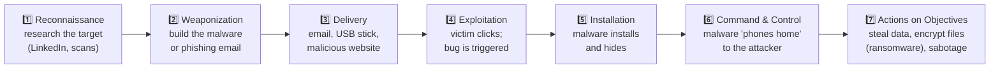

# Chapter 10 — What Is Cybersecurity?

**Level 1 · Basic Foundation to Understand to Start**

---

## 🎯 Goal

By the end of this chapter you will understand the core vocabulary of security: **asset, threat, threat actor, vulnerability, exploit, risk and control**. You'll see how a real attack unfolds step by step, learn from four famous incidents, and know the teams, careers and ethical rules of the field.

---

## 🏠 Real-Life Story: Protecting Your House 🏠

You already think like a security professional. You just don't use the jargon yet.

## 🖼️ Figure 10.1 — The House Analogy

```
                          🦹 BURGLAR  (THREAT ACTOR)
                             │  wants your jewelry (MOTIVATION: money)
                             │  might break in (THREAT)
                             ▼
       ┌────────────────────────────────────────────────┐
       │  🏠 YOUR HOUSE                                 │
       │                                                │
       │   🪟 window left unlocked  ◄── VULNERABILITY   │
       │      (a weakness)                              │
       │                                                │
       │   💎 jewelry box           ◄── ASSET           │
       │      (something valuable)                      │
       │                                                │
       │   🔒 locks · 🚨 alarm · 🐕 dog · 📹 camera     │
       │                            ◄── CONTROLS        │
       │                                (protections)   │
       └────────────────────────────────────────────────┘

   Climbing in through the unlocked window = EXPLOIT
   How likely a break-in is × how bad it would be = RISK
```

| Security term | Meaning | House example | Computer example |
|---|---|---|---|
| **Asset** | Anything of value worth protecting | Jewelry, family, the house | Customer data, servers, reputation, staff |
| **Threat** | Anything that *could* cause harm | Burglary, fire, flood | Ransomware, hackers, power cuts, floods |
| **Threat actor** | The *who* behind a threat | The burglar | Cybercriminal, nation-state, insider |
| **Vulnerability** | A weakness that can be used | Unlocked window | Unpatched software, weak password |
| **Exploit** | The *method* of using a weakness | Climbing through the window | Code or a trick that abuses the flaw |
| **Risk** | Chance of harm × size of harm | High-crime area + no locks = high risk | Unpatched internet-facing server = high risk |
| **Control** (countermeasure, safeguard) | Anything that reduces risk | Lock, alarm, insurance | Firewall, patching, MFA, backups, training |

---

## 📖 The Risk Equation

```
   ┌──────────────────────────────────────────────┐
   │   RISK  =  LIKELIHOOD  ×  IMPACT             │
   │                                              │
   │   (how probable)   (how bad if it happens)   │
   └──────────────────────────────────────────────┘

   You'll also see:   Risk = Threat × Vulnerability (× Impact)
   → No threat, OR no vulnerability, OR no impact  =  little or no risk.
```

## 🖼️ Figure 10.2 — A Simple Risk Heat Map

```
                     IMPACT →
                 Low        Medium       High
             ┌──────────┬──────────┬──────────┐
     High    │ 🟨 Medium │ 🟥 High   │ 🟥 Critical│
 LIKELIHOOD  ├──────────┼──────────┼──────────┤
     Medium  │ 🟩 Low    │ 🟨 Medium │ 🟥 High    │
      ↑      ├──────────┼──────────┼──────────┤
     Low     │ 🟩 Low    │ 🟩 Low    │ 🟨 Medium  │
             └──────────┴──────────┴──────────┘
   Fix the red boxes first. (Full risk math in Chapter 44.)
```

> 💡 **You can never reach zero risk.** Security is about reducing risk to a level the organization **accepts**, at a sensible cost. Nobody spends $1 million to protect a $1,000 laptop.

---

## 📖 What Are We Protecting? The CIA Triad (Preview)

Every security problem harms at least one of these three goals. Chapter 12 covers them in depth.

## 🖼️ Figure 10.3 — The CIA Triad

```
                         🔒 CONFIDENTIALITY
                       Only the right people
                          can SEE the data
                              /\
                             /  \
                            /    \
                           / DATA \
                          /        \
                         /__________\
      ✅ INTEGRITY                          ⚡ AVAILABILITY
   Data is accurate and                 Systems and data are
   NOT changed without                  there WHEN NEEDED
   permission

   Attack on C: someone reads your medical records    → defense: encryption, access control
   Attack on I: someone changes your bank balance     → defense: hashing, digital signatures
   Attack on A: ransomware locks the hospital systems → defense: backups, redundancy
```

---

## 📖 How a Cyberattack Unfolds: The Cyber Kill Chain ⛓️

Attacks are not one single click. They are a **chain of steps**. The **Lockheed Martin Cyber Kill Chain** names seven of them. **Defenders can break the chain at any link.**

## 🖼️ Figure 10.4 — The 7 Links of the Kill Chain



| Link | Example defense that breaks it |
|---|---|
| Reconnaissance | Limit public info; detect scans |
| Delivery | Email filtering, blocking USB drives, user training |
| Exploitation | **Patching**, least privilege |
| Installation | Anti-malware / EDR, application allow lists |
| Command & Control | Firewall egress rules, DNS filtering |
| Actions on Objectives | Encryption, DLP, **backups** |

> You may also hear of **MITRE ATT&CK**, a huge public catalog of real attacker techniques that defenders use to plan detections. You'll meet it again in Level 4.

---

## 📖 Four True Stories 📰

### 1. WannaCry (2017) — The Unpatched Worm 🐛

```
   Microsoft releases patch MS17-010 ──► 2 months pass ──► WannaCry ransomware worm
   (March 2017)                          many don't patch    spreads via SMB port 445
                                                             (May 2017)
                                                                  │
                                                                  ▼
                                    ~200,000+ computers in ~150 countries encrypted,
                                    including UK NHS hospitals (appointments cancelled)
```

- **Vulnerability:** a Windows SMB flaw (**EternalBlue**), plus unpatched and end-of-life systems (e.g., Windows XP).
- **Lesson:** **Patch promptly**, block **SMB (445)** from the internet, replace **EOL systems**, keep **offline backups**.

### 2. Equifax (2017) — One Missed Patch, ~147 Million People 🏦

- Attackers used a known flaw in **Apache Struts** (web software) that had a patch available **two months earlier**.
- They stayed hidden for weeks and stole names, birth dates and US Social Security numbers of ~147 million people.
- **Lesson:** **Vulnerability management** and **asset inventory**: you can't patch what you don't know you have (Chapters 35–36).

### 3. SolarWinds (2020) — Poisoning the Supply Chain 🧪

```
   Attackers break into SolarWinds ──► Insert a backdoor into the ──► ~18,000 customers install
   (a software company)                 Orion software UPDATE           the "trusted", signed update
                                                                              │
                                                                              ▼
                                               Selected targets (incl. US government agencies)
                                               quietly spied on for months
```

- **Vulnerability:** customers **trusted** updates from a legitimate vendor.
- **Lesson:** **Supply-chain risk**. Your security depends on your vendors' security (Chapters 23, 45).

### 4. Colonial Pipeline (2021) — One Password, No MFA ⛽

- Attackers logged into an old **VPN account** using a **leaked password**. The account **had no multi-factor authentication** and was no longer in use.
- **Ransomware** followed. The company shut down the largest fuel pipeline on the US East Coast for several days and paid a ransom of about **$4.4 million** (part was later recovered by the FBI).
- **Lesson:** **MFA everywhere**, **disable unused accounts** (de-provisioning), and plan for business continuity.

## 🖼️ Figure 10.5 — What These Stories Teach

| Incident | Root cause | Key controls (chapter) |
|---|---|---|
| WannaCry | Unpatched/EOL systems, exposed SMB | Patching (27), segmentation (30), backups (32) |
| Equifax | Missed known patch, poor visibility | Vulnerability management (36), asset inventory (35) |
| SolarWinds | Compromised trusted vendor update | Supply-chain & third-party risk (23, 45) |
| Colonial Pipeline | Leaked password, no MFA, stale account | MFA (17, 39), account de-provisioning (39), IR plan (41) |

> 🔑 Notice the pattern: **basic hygiene** (patching, MFA, removing old accounts, backups) would have prevented or reduced most of these disasters.

---

## 📖 The Good Guys and the Bad Guys 🎩

### Hacker "Hats"

| Hat | Who | Legal? |
|---|---|---|
| ⚪ **White hat** (ethical hacker) | Tests systems **with permission** to find weaknesses | ✅ Yes |
| ⚫ **Black hat** | Breaks in **without permission** for gain or harm | ❌ No |
| 🔘 **Gray hat** | Breaks in without permission but "means well" (e.g., reports the bug afterwards) | ❌ Still illegal |

> Security+ (SY0-701) calls testers by their knowledge level instead: **known environment** (white box), **partially known** (gray box), **unknown environment** (black box). See Chapter 47.

### Security Teams

## 🖼️ Figure 10.6 — Team Colors

```
   🔴 RED TEAM            🔵 BLUE TEAM             🟣 PURPLE TEAM          ⚪ WHITE TEAM
   Attackers (offense)    Defenders (defense)      Red + Blue working      Referees: set the
   Simulate real          Monitor, detect,         TOGETHER, sharing       rules of engagement,
   attacks with           respond                  findings to improve     judge the exercise
   permission                                      faster
```

### Careers in Cybersecurity 💼

| Role | What they do | Typical starting point |
|---|---|---|
| **SOC analyst** (Security Operations Center) | Watches alerts, investigates suspicious activity | ⭐ Most common first job after Security+ |
| **Incident responder** | Handles active attacks and recovery | After SOC experience |
| **Penetration tester** | Legally hacks systems to find weaknesses (red team) | Security+ → more advanced certs (e.g., PenTest+, OSCP) |
| **Security engineer / administrator** | Builds and runs firewalls, EDR, IAM | Often from IT/network admin roles |
| **GRC analyst** (Governance, Risk & Compliance) | Policies, risk assessments, audits | Good for non-technical backgrounds |
| **Security architect** | Designs secure systems | Senior role |
| **Cloud security engineer** | Secures AWS/Azure/GCP | Growing fast |

> 🎓 Security+ is one of the most widely required entry-level security certifications, including for many US Department of Defense roles (DoD 8140 framework).

---

## 📖 Ethics and the Law ⚖️

- **Permission is everything.** The same scan is "security testing" with written permission, and a **crime** without it. Professionals get a signed **scope** and **rules of engagement** before testing (Chapter 47).
- Most countries have computer-crime laws (e.g., the US **Computer Fraud and Abuse Act**, the UK **Computer Misuse Act**, India's **IT Act 2000**).
- Privacy laws such as **GDPR** (EU) and **HIPAA** (US healthcare) set rules for protecting personal data (Chapter 46).
- **Responsible disclosure:** if you find a vulnerability, report it **privately** to the owner (or their **bug bounty** program). Don't publish it or use it.

---

## 📖 The Defender's Mindset: Defense in Depth 🧅

No single control is perfect, so defenders build **layers**. If one layer fails, the next one still protects you.

## 🖼️ Figure 10.7 — The Security Onion

```
          ┌─────────────────────────────────────────────────────┐
          │ POLICIES, TRAINING & AWARENESS                      │
          │  ┌───────────────────────────────────────────────┐  │
          │  │ PHYSICAL SECURITY (fences, locks, guards)     │  │
          │  │  ┌─────────────────────────────────────────┐  │  │
          │  │  │ NETWORK (firewalls, segmentation, IPS)  │  │  │
          │  │  │  ┌───────────────────────────────────┐  │  │  │
          │  │  │  │ HOST (patching, EDR, hardening)   │  │  │  │
          │  │  │  │  ┌─────────────────────────────┐  │  │  │  │
          │  │  │  │  │ APPLICATION (secure code,   │  │  │  │  │
          │  │  │  │  │   MFA, input validation)    │  │  │  │  │
          │  │  │  │  │  ┌───────────────────────┐  │  │  │  │  │
          │  │  │  │  │  │ DATA (encryption,     │  │  │  │  │  │
          │  │  │  │  │  │   backups, DLP)  💎   │  │  │  │  │  │
          │  │  │  │  │  └───────────────────────┘  │  │  │  │  │
          │  │  │  │  └─────────────────────────────┘  │  │  │  │
          │  │  │  └───────────────────────────────────┘  │  │  │
          │  │  └─────────────────────────────────────────┘  │  │
          │  └───────────────────────────────────────────────┘  │
          └─────────────────────────────────────────────────────┘
```

---

## 🧠 Memory Tricks

- **"A Threat Actor uses an Exploit on a Vulnerability to harm an Asset. Controls reduce the Risk."** Say it until it's automatic.
- **Risk = Likelihood × Impact.**
- **CIA = See it (Confidentiality), Change it (Integrity), Can't reach it (Availability).**
- **Kill chain: "Really Wise Dogs Eat Insects, Chasing Ants"**: Recon, Weaponize, Deliver, Exploit, Install, C2, Actions.

---

## ⚠️ Exam Tip

- *"An unpatched server is an example of a…"* → **Vulnerability** (not a threat!).
- *"A disgruntled employee who might delete files is an example of a…"* → **Threat actor** (an **insider threat**).
- *"Which is the BEST way to reduce the impact of ransomware?"* → **Tested, offline/immutable backups.**
- *"Malware contacting an external server for instructions."* → **Command and control (C2).**
- CompTIA often tests whether you can tell **threat**, **vulnerability** and **risk** apart. If you can explain the house analogy, you'll get these right.

---

## 🧪 Try It (20 minutes)

1. **Make your own risk list.** Choose 5 assets you own (phone, email account, laptop, photos, bank account). For each, write one **threat**, one **vulnerability**, and one **control** you could add. Rate the risk Low/Medium/High.
2. **Check whether your email was in a data breach:** visit **haveibeenpwned.com** and enter your email. If it was, change that password and turn on **MFA**.
3. **Explore MITRE ATT&CK:** visit attack.mitre.org and click any technique (for example "Phishing"). Read how it's detected and mitigated.
4. **Read a real incident:** search "CISA advisory" and skim one recent alert. Can you spot the vulnerability, the threat actor and the recommended controls?

---

## ✅ Checkpoint Questions

1. Define *asset*, *threat* and *vulnerability* in one sentence each.
2. A company uses software with a known flaw that has no patch yet. Is that a threat or a vulnerability?
3. What is the risk formula?
4. Which part of the CIA triad does ransomware mainly attack?
5. Which kill-chain step involves malware "calling home" for instructions?
6. What was the main vulnerability abused in the Colonial Pipeline attack?
7. Why was SolarWinds called a **supply-chain** attack?
8. Which team simulates attackers, and which team defends?
9. What's the difference between a white-hat and a gray-hat hacker?
10. What does "defense in depth" mean?

<details>
<summary><b>Show answers</b></summary>

1. **Asset:** something valuable worth protecting. **Threat:** anything that could cause harm. **Vulnerability:** a weakness a threat could use.
2. A **vulnerability** (and because no patch exists and attackers may already use it, it's a **zero-day**).
3. **Risk = Likelihood × Impact** (also expressed as Threat × Vulnerability × Impact).
4. **Availability** (and often confidentiality too, when data is stolen before encryption: "double extortion").
5. **Command and Control (C2).**
6. A **leaked password** on an unused **VPN account with no MFA**.
7. Attackers compromised a **trusted vendor's software update**, so the vendor's customers infected themselves by installing it.
8. **Red team** attacks. **Blue team** defends. (Purple = both working together.)
9. A **white hat** has **permission**. A **gray hat** doesn't, even with good intentions, which is still illegal.
10. Using **multiple layers of security controls**, so if one fails the others still protect the asset.

</details>

---

## 📌 Chapter Summary

| Concept | Key point |
|---|---|
| Core vocabulary | Asset · threat · threat actor · vulnerability · exploit · risk · control |
| Risk | Likelihood × impact; can be reduced, never zero |
| CIA triad | Confidentiality, Integrity, Availability |
| Cyber Kill Chain | 7 steps; break any link to stop the attack |
| Real incidents | WannaCry, Equifax, SolarWinds, Colonial Pipeline: basic hygiene matters |
| People | White/black/gray hats; red/blue/purple/white teams; SOC analyst is the classic first job |
| Ethics | Written permission, responsible disclosure |
| Defense in depth | Layers: policy → physical → network → host → app → data |

**Next chapter →** *Chapter 11: How the Security+ Exam Works & How to Study.* Before Level 2 starts, let's understand the exam itself and build a study system that works.
