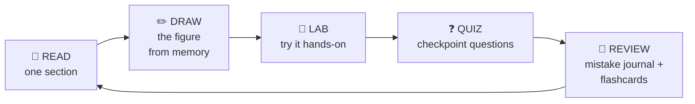

# Chapter 11 — How the Security+ Exam Works & How to Study

**Level 1 · Basic Foundation to Understand to Start**

---

## 🎯 Goal

By the end of this chapter you will know exactly what the Security+ exam looks like, how it's scored, how CompTIA writes its questions (and their traps), and you'll have a **study system** that turns the rest of this book into a pass.

---

## 🏠 Real-Life Story: Training for a Marathon 🏃

Nobody runs a marathon by reading about running. You need:
- **a map of the course** (the exam objectives),
- **a training plan** (a schedule),
- **practice runs** that get longer (quizzes → full mock exams),
- and **rest and review** (spaced repetition).

This chapter is your training plan.

---

## 📖 Part 1 — The Exam at a Glance

## 🖼️ Figure 11.1 — Exam Fact Sheet (SY0-701)

```
 ┌──────────────────────────────────────────────────────────────────────┐
 │  CompTIA Security+  SY0-701                                          │
 ├──────────────────────────────────────────────────────────────────────┤
 │  Questions      Up to 90 (multiple choice + performance-based)       │
 │  Time           90 minutes                                           │
 │  Score scale    100 - 900                                            │
 │  Pass mark      750                                                  │
 │  Delivery       Pearson VUE test center, or online (OnVUE) at home   │
 │  Price          About US$425 (varies by country; see CompTIA store)  │
 │  Valid for      3 years (renew with continuing education)            │
 │  Languages      English + several others                             │
 └──────────────────────────────────────────────────────────────────────┘
```

> 📅 **Version note:** SY0-701 launched in November 2023. The next version, **SY0-801**, is expected to appear around late 2026, with SY0-701 retiring later (likely 2027). Whichever version you take, check the **official exam objectives** PDF on comptia.org before you book. This book covers SY0-701 fully, and Appendix A covers the new AI topics expected in SY0-801.

### The Five Domains (what the questions are about)

| Domain | Weight | ≈ Questions (of 90) | Where in this book |
|---|---|---|---|
| 1.0 General Security Concepts | 12% | ~11 | Ch 12, 13, 18, 19, 28, 33 |
| 2.0 Threats, Vulnerabilities & Mitigations | 22% | ~20 | Ch 14–16, 23–27 |
| 3.0 Security Architecture | 18% | ~16 | Ch 29–32 |
| 4.0 Security Operations | **28%** | ~25 | Ch 34–42 |
| 5.0 Security Program Management & Oversight | 20% | ~18 | Ch 43–48 |

---

## 📖 Part 2 — Question Types

### 1. Multiple Choice — Single Answer

> *A company wants to ensure that emails sent by its CEO cannot later be denied by the CEO. Which of the following provides this?*
> A. Encryption  B. Hashing  **C. Digital signature**  D. Tokenization

### 2. Multiple Choice — Multiple Answers

> *Which of the following are examples of **something you have**? **(Choose two.)***
> **A. Smart card**  B. Fingerprint  **C. Hardware token**  D. PIN  E. Password

The question always tells you how many to pick. Read that part carefully!

### 3. Performance-Based Questions (PBQs) 🧩

Small **simulations** where you *do* something instead of just choosing:

## 🖼️ Figure 11.2 — Typical PBQ Styles

```
 ┌───────────────────────────────┐  ┌───────────────────────────────────────┐
 │ 🔀 DRAG & DROP / MATCHING      │  │ 🧱 FIREWALL RULES                      │
 │                               │  │                                       │
 │  Phishing      ──►  [Email]   │  │  Src IP     Dst IP    Port  Action    │
 │  Vishing       ──►  [Phone]   │  │  ANY        10.0.0.5  443   [ALLOW ▾] │
 │  Smishing      ──►  [SMS]     │  │  ANY        10.0.0.5  23    [DENY  ▾] │
 │  Whaling       ──►  [CEO]     │  │  ...                                  │
 └───────────────────────────────┘  └───────────────────────────────────────┘
 ┌───────────────────────────────┐  ┌───────────────────────────────────────┐
 │ 🗺️ NETWORK DIAGRAM             │  │ 📜 LOG ANALYSIS                        │
 │                               │  │                                       │
 │  Place the WAF, IDS and        │  │  Read these logs. Which host is       │
 │  load balancer in the right    │  │  compromised? What attack is this?    │
 │  spots on the diagram.         │  │  Choose the right fix.                │
 └───────────────────────────────┘  └───────────────────────────────────────┘
```

- There are usually **a few PBQs**, often at the **start** of the exam.
- They take longer and may give **partial credit**.
- ⏱️ **Strategy:** if a PBQ looks long, **flag it, skip it, and come back** after the multiple-choice questions. Don't burn 20 minutes on question 1.

---

## 📖 Part 3 — How Scoring Works

- The score is **scaled** from 100 to 900, and you need **750**. It's not a simple percentage, because some questions are weighted differently. In practice, aim for **85%+ on good practice exams** before booking.
- Some questions may be **unscored** (CompTIA trying out new questions). You can't tell which, so treat every question seriously.
- ✅ **There's no penalty for wrong answers. NEVER leave a question blank.** Guess if you must.
- You get a **pass/fail result immediately** on screen, with a score report showing your weaker areas.

---

## 📖 Part 4 — How CompTIA Writes Questions (and How to Beat Them) 🕵️

## 🖼️ Figure 11.3 — Anatomy of a Question

```
 ┌──────────────────────────────────────────────────────────────────────────────┐
 │ A security analyst notices that several employees received an email that     │ ◄─ SCENARIO
 │ appears to come from the CFO asking them to urgently buy gift cards. The     │    (story with
 │ email address is cfo@examp1e-corp.com.                                       │     clues)
 │                                                                              │
 │ Which of the following BEST describes this attack?                           │ ◄─ KEYWORD
 │                                                                              │    "BEST"
 │   A. Whaling           ◄── distractor: whaling TARGETS executives;           │
 │                            here the executive is being IMPERSONATED          │
 │   B. Business email compromise / impersonation  ◄── ✅ ANSWER                │
 │   C. Vishing           ◄── distractor: that's by PHONE                       │
 │   D. Watering hole     ◄── distractor: that's a compromised WEBSITE          │
 └──────────────────────────────────────────────────────────────────────────────┘
   Clues: "appears to come from the CFO" + "urgently" + look-alike domain "examp1e"
```

### The Magic Keywords 🔑

| Keyword | What it really asks | Tip |
|---|---|---|
| **BEST** | Several answers may work. Pick the **most complete / most effective** | Prefer answers that solve the *root cause* |
| **MOST likely** | Which is most **probable** given the clues | Match the clues in the scenario exactly |
| **FIRST** | What comes **first in a process** | Know the order of processes (incident response, forensics) |
| **NEXT** | Something has happened; what's the **following step**? | Don't skip steps |
| **LEAST** | The *worst* / least effective option | Easy to misread. Slow down! |
| **NOT** / **EXCEPT** | Pick the one that **doesn't** fit | Underline it mentally |

### The 6-Step Method for Every Question

```
   1️⃣ Read the LAST sentence first     → What is actually being asked?
   2️⃣ Read the scenario                → Underline clues (who, what, where, when)
   3️⃣ Predict the answer               → Before looking at the options!
   4️⃣ Eliminate obvious wrong answers  → Usually 2 can go quickly
   5️⃣ Choose between the final two     → Which one matches MORE clues? BEST/FIRST?
   6️⃣ Move on                          → Flag it if unsure; don't get stuck
```

### Common Traps ⚠️

- **Technically true, but doesn't answer the question.** All options might be real security terms. Only one fits the scenario.
- **"Real world" vs "CompTIA world."** Answer by the **book definition**, not by what your company happens to do.
- **Overthinking.** Don't invent details that aren't in the scenario. Use only the information given.
- **Absolute words** like "always," "never," "completely eliminates" are often wrong. Security *reduces* risk; it rarely eliminates it.

### Time Management ⏱️

```
   90 minutes ÷ up to 90 questions  ≈  1 minute each
   ┌───────────┬───────────────────────────────────────────────────┐
   │ 0-5 min   │ Look at the PBQs; flag the long ones              │
   │ 5-60 min  │ All multiple-choice questions (~45-50 s each)     │
   │ 60-80 min │ Return to the flagged PBQs                        │
   │ 80-90 min │ Review flagged MCQs; make sure NOTHING is blank   │
   └───────────┴───────────────────────────────────────────────────┘
```

---

## 📖 Part 5 — Booking & Exam Day 🗓️

1. **Create a CompTIA account** and download the **free exam objectives** and **acronym list** from comptia.org. These are the official "map of the course."
2. **Buy a voucher** from the CompTIA store (student and bundle discounts exist; bundles may include a retake).
3. **Schedule** with **Pearson VUE**: choose a test center, or **OnVUE** online from home.
4. **Retake policy:** if you fail, there's no waiting period before your second attempt. You must wait **14 days** before a third attempt (check comptia.org for the current rules; a new voucher is needed each time).

### Exam-Day Checklist ✅

| Test center | Online (OnVUE) |
|---|---|
| Arrive **15–30 min** early | Run the **system test** days before |
| Bring **valid government photo ID** (name must match registration) | Quiet, private room; **clear desk**; no second monitor |
| Phone/bag go into a locker | Webcam + room scan with your phone; phone away afterwards |
| You get a whiteboard/notepad | Only the on-screen whiteboard |

> 💡 **Brain dump:** In the first minute, write down your **memory sheet** (ports, acronyms, process orders) on the whiteboard/notepad. You'll build this sheet in Chapter 50. (Rules can vary, so follow the proctor's instructions.)

### After You Pass 🎉

- Your certification is valid for **3 years**.
- Renew by earning **50 Continuing Education Units (CEUs)** in that time (training, other certs, conferences) and paying a yearly fee, or by passing a newer version or a higher-level CompTIA exam.

---

## 📖 Part 6 — How to Study: Methods That Actually Work 🧠

Science shows that **re-reading and highlighting don't work well**. These techniques do:

### 1. Active Recall — test yourself instead of re-reading

Close the book and **write or say** everything you remember. Then check. The struggle to remember is what builds memory.

### 2. Spaced Repetition — review just before you forget

## 🖼️ Figure 11.4 — The Forgetting Curve vs Spaced Reviews

```
   Memory
   100% ┤█▇▆▅▄▃▂▁                       Without review: most is forgotten in days
        │        ▁▁▁▁▁▁▁▁▁▁▁▁▁▁
        │
   100% ┤█▇▆▅ █▇▆ █▇▇▆ █▇▇▇▆ ████      With reviews at day 1, 3, 7, 14, 30:
        │    ↑   ↑    ↑     ↑          memory stays high and fades more slowly
        └────┴───┴────┴─────┴──────► time
            D1  D3   D7    D14
```

**Leitner box system** (works with paper cards or apps like **Anki**):

```
   Box 1 (daily) ──right──► Box 2 (every 3 days) ──right──► Box 3 (weekly) ──right──► Box 4 (monthly)
        ▲                          │                             │                         │
        └──────────── wrong answer: back to Box 1 ◄──────────────┴─────────────────────────┘
```

### 3. The Feynman Technique — teach it to a 10-year-old

1. Pick a concept (e.g., "asymmetric encryption").
2. Explain it out loud in **simple words**, as if to a child.
3. Where you get stuck or use jargon, that's your **gap**. Go back and re-learn it.
4. Simplify and use an analogy (this book gives you lots!).

### 4. Draw It ✏️

Every chapter has figures. **Redraw them from memory** on paper. If you can draw the TCP handshake, the OSI model or the DMZ network, you understand them.

### 5. Do It (Labs) 🧪

Hands-on labs (your Chapter 8 lab!) make PBQs feel familiar.

### 6. Mistake Journal 📓

Every wrong practice answer goes into a notebook:

```
   | Date | Question topic      | My answer | Right answer | WHY I was wrong          |
   |------|---------------------|-----------|--------------|--------------------------|
   | 3/12 | Control types       | Detective | Deterrent    | A sign DISCOURAGES; it   |
   |      |                     |           |              | doesn't DETECT anything  |
```

Re-read it weekly. Your mistakes show exactly what to study next.

## 🖼️ Figure 11.5 — The Study Cycle (for every chapter)



---

## 📖 Part 7 — Your Study Toolkit 🧰

| Tool | Use | Cost |
|---|---|---|
| **Official CompTIA exam objectives + acronym list** | The checklist of everything testable | Free |
| **This book** | Learn from zero, with figures | — |
| **Flashcards (Anki / paper)** | Ports, acronyms, definitions | Free |
| **Home lab (VirtualBox + Linux)** | Hands-on practice | Free |
| **Free video courses** (e.g., Professor Messer's free SY0-701 videos) | A second explanation of each objective | Free |
| **Practice exams** | Measure readiness, get used to the wording | Free to paid |
| **Study group / online community** (e.g., r/CompTIA) | Motivation, tips, exam-day experiences | Free |

> ⚠️ **Never use "brain dumps"** (leaked real exam questions). They break CompTIA's rules. You can lose your certification and be banned, and they don't teach you anything.

---

## 📖 Part 8 — Your Personal Weekly Plan 📅

At ~1–1.5 hours per day (see the book plan for the full 18-week schedule):

```
   MON  📖 New chapter section + draw figure
   TUE  📖 New chapter section + lab
   WED  📖 New chapter section + flashcards
   THU  📖 New chapter section + lab
   FRI  ❓ Checkpoint questions + mistake journal
   SAT  🔁 Weekly review: redo last week's wrong answers; 30-question mixed quiz
   SUN  😴 Rest (memory consolidates while you rest!)
```

### Readiness Milestones

| Milestone | Target |
|---|---|
| End of Level 1 | **80%+** on the Level 1 Gate Test |
| End of Level 2 | **75%+** on the vocabulary gate test |
| End of Level 3 | **70%+** on Domains 1–3 |
| Before booking | **85%+** on **two different** full-length practice exams |

---

## 🧠 Memory Tricks

- **"750 to survive, 900 to thrive."**
- **"Flag the PBQ, then come back to me."**
- **"Read the last line first."**
- **"Never blank. Never cram. Space it out."**

---

## ⚠️ Exam Tip (about the exam itself!)

- Read **every word** of the question, especially **NOT, LEAST, FIRST, BEST**.
- If two answers seem right, the **more specific** one that matches **more clues** usually wins.
- Your **first instinct** is usually right. Only change an answer if you find a clear reason.
- **No blanks!** A guess has a 25% chance; a blank has 0%.

---

## 🧪 Try It (30 minutes)

1. Go to **comptia.org**, find **Security+**, and download the **exam objectives PDF** (and the acronym list at the end of it). Skim all 5 domains. Don't worry about understanding them yet!
2. Install **Anki** (free) or get index cards. Make your first **20 flashcards** from Chapter 6's port table.
3. Start your **mistake journal** (a notebook or a spreadsheet).
4. Put your **study schedule** in your calendar: fixed time, fixed place, every day.
5. Take the **Level 1 Gate Test** (next file) and score yourself.

---

## ✅ Checkpoint Questions

1. How many questions (maximum) and how many minutes does SY0-701 have?
2. What score do you need to pass, and on what scale?
3. Is there a penalty for wrong answers?
4. What should you do if a PBQ at the start of the exam looks very long?
5. What does the keyword **FIRST** usually test?
6. Name two study techniques that work better than re-reading.
7. What is a mistake journal for?
8. What score on practice exams should you reach before booking the real exam?
9. Why should you never use exam "brain dumps"?
10. How long is the certification valid, and how do you renew it?

<details>
<summary><b>Show answers</b></summary>

1. Up to **90 questions** in **90 minutes**.
2. **750** on a scale of **100–900**.
3. **No.** Never leave a question blank.
4. **Flag it, skip it, and come back** after the multiple-choice questions.
5. Knowing the **correct order of steps in a process**.
6. E.g., **active recall, spaced repetition, the Feynman technique, drawing figures from memory, hands-on labs.**
7. To record **why** you got questions wrong, so you can target weak areas and avoid repeating mistakes.
8. Around **85%+ on two different full-length** practice exams.
9. They **break CompTIA's rules** (you can lose your certification and be banned), and they don't teach real understanding.
10. **3 years.** Renew with **50 CEUs** (plus the yearly fee), or by passing a newer or higher-level exam.

</details>

---

## 📌 Chapter Summary

| Topic | Key point |
|---|---|
| Format | ≤90 questions, 90 min, MCQ + PBQs |
| Scoring | 750/900 to pass; no penalty for guessing |
| Domains | Security Operations is the biggest (28%) |
| Question style | Watch for BEST / MOST / FIRST / NOT; scenario clues decide the answer |
| Strategy | Read the last line first, predict, eliminate, flag PBQs |
| Study methods | Active recall, spaced repetition, Feynman, drawing, labs, mistake journal |
| Readiness | 85%+ on two full mock exams → book it |

---

## 🎓 End of Level 1!

You've gone from "what is a computer?" to understanding hardware, operating systems, data, networks, protocols, wireless, cloud, the command line and the basics of cybersecurity. That's the foundation the Security+ exam assumes.

**👉 Now take the [Level 1 Gate Test](level-1-gate-test.md).** Score **80% or more** and you're ready for **Level 2: Beginner for the Exam**.
