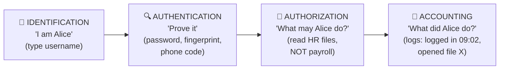

# Chapter 12 — The CIA Triad, Non-Repudiation & AAA

**Level 2 · Beginner for the Exam** · *Exam objective 1.2*

---

## 🎯 Goal

By the end of this chapter you will be able to explain the three goals of security (**Confidentiality, Integrity, Availability**), what **non-repudiation** means, and how **AAA** (**Authentication, Authorization, Accounting**) controls who gets in and what they can do. Almost every Security+ question connects back to these ideas.

---

## 🏠 Real-Life Story: The Bank 🏦

Think about what you expect from your bank:

- **Nobody else can see your balance.** → *Confidentiality*
- **Nobody can secretly change your balance.** → *Integrity*
- **You can withdraw money when you need it.** → *Availability*
- **If you sign a cheque, you can't later say "that wasn't me."** → *Non-repudiation*

And at the bank counter:

- The teller checks your **ID card** → *Authentication* ("Are you really you?")
- The teller checks **which accounts you may use** → *Authorization* ("What are you allowed to do?")
- The bank **records every transaction** → *Accounting* ("What did you do, and when?")

That's the whole chapter in one visit to the bank.

---

## 📖 Part 1 — The CIA Triad

## 🖼️ Figure 12.1 — The Triangle Every Question Comes Back To

```
                           CONFIDENTIALITY
                     "Only the right people SEE it"
                                /\
                               /  \
                              /    \
                             /      \
                            /  DATA  \
                           /          \
                          /____________\
                 INTEGRITY              AVAILABILITY
      "Nobody CHANGES it without     "It's THERE when the
       permission, and we'd know"     right people need it"
```

### 🔒 Confidentiality — keeping secrets secret

**Meaning:** Information is seen **only by people who are allowed** to see it.

| How it's attacked | How it's protected |
|---|---|
| Eavesdropping on network traffic | **Encryption** (Chapter 18) |
| Stealing a laptop | Full-disk encryption |
| Looking over someone's shoulder (shoulder surfing) | Privacy screens, awareness |
| A user reading files they shouldn't | **Access controls**, least privilege |
| Data breach / data exfiltration | Data loss prevention (DLP), classification |

### ✅ Integrity — keeping data accurate and trustworthy

**Meaning:** Data is **not changed** by unauthorized people or by accident, and **if it is changed, we can tell**.

| How it's attacked | How it's protected |
|---|---|
| Changing a payment amount in transit | **Hashing** (Chapter 3), digital signatures |
| Altering logs to hide an attack | Write-once log storage, log hashing |
| Malware modifying system files | File integrity monitoring |
| Tampering with a software update | **Code signing** |

> 💡 Integrity has two halves: **preventing** unauthorized change, *and* **detecting** change when it happens. A hash doesn't stop someone from changing a file, but it tells you the file was changed.

### ⚡ Availability — keeping systems running

**Meaning:** Systems and data are **accessible and working when needed**.

| How it's attacked / harmed | How it's protected |
|---|---|
| Denial-of-service (DoS/DDoS) attack | DDoS protection, firewalls, load balancers |
| Ransomware locking files | **Backups** (tested and kept offline) |
| Power cut, hardware failure | UPS, generators, **redundancy** (RAID, clustering) |
| Natural disaster | Backup sites, disaster recovery plans |

### 🖼️ Figure 12.2 — Which Side Was Hit?

| Event | C | I | A |
|---|:---:|:---:|:---:|
| Hacker reads customer credit-card numbers | ✅ | | |
| Student changes their grade in the school database | | ✅ | |
| Website knocked offline by a flood of traffic | | | ✅ |
| Ransomware encrypts files **and** threatens to leak them | ✅ | | ✅ |
| An employee accidentally deletes the only copy of a report | | ✅ | ✅ |
| Someone intercepts and alters an email before it arrives | | ✅ | |

> ⚠️ **Balance matters.** Security and convenience pull against each other. Adding ten passwords to every file increases confidentiality but hurts availability (people can't get their work done). Good security finds the right balance for each piece of data.

### The Opposite of CIA: DAD

Attackers try to cause **DAD**:

```
   Confidentiality  ◄── opposite ──►  DISCLOSURE   (secrets revealed)
   Integrity        ◄── opposite ──►  ALTERATION   (data changed)
   Availability     ◄── opposite ──►  DESTRUCTION / DENIAL (system unusable)
```

---

## 📖 Part 2 — Non-Repudiation ✍️

**Repudiate** means "to deny." **Non-repudiation** means a person **cannot deny** that they did something, such as sending a message or signing a contract, because there is **proof**.

## 🖼️ Figure 12.3 — Why a Digital Signature Gives Non-Repudiation

```
   Alice signs an email with her PRIVATE key (which only she has)
          │
          ▼
   ┌─────────────────────────────┐
   │  "Transfer $5,000 to Bob"   │
   │  + Alice's digital signature│
   └─────────────────────────────┘
          │
          ▼
   Anyone can check it with Alice's PUBLIC key.
   If it checks out:
     1. It REALLY came from Alice (only her private key could make it)
     2. It was NOT changed (the signature covers the exact content)
     3. Alice CANNOT later say "I never sent that"  ◄── non-repudiation
```

| Gives non-repudiation | Does NOT give non-repudiation (on its own) |
|---|---|
| **Digital signatures** (private key + hash) | Plain hashing (anyone can calculate a hash) |
| Detailed **audit logs** tied to individual accounts | Shared accounts ("admin" used by 5 people) |
| Video of someone signing a paper | Encryption alone (it hides data but doesn't prove who sent it) |

> 🔐 This is why **shared accounts are bad**: if five people use the same "admin" login, you can never prove *which* person did something.

---

## 📖 Part 3 — AAA: Authentication, Authorization, Accounting

Before AAA there's one small step: **identification**, which is simply *claiming* an identity (typing your username).

## 🖼️ Figure 12.4 — The Airport Journey ✈️



| Step | Question | Airport example | Computer example |
|---|---|---|---|
| **Identification** | "Who do you claim to be?" | You say your name | Username, email, badge number |
| **Authentication** | "Prove it." | Passport check | Password, MFA code, fingerprint, certificate |
| **Authorization** | "What are you allowed to do?" | Boarding pass: *this* flight, *this* seat | Permissions: read this folder, not that one |
| **Accounting** | "What did you actually do?" | Flight records, CCTV | Logs, audit trails, session records |

> ⚠️ **Most confused pair:** *Authentication* = proving **who you are**. *Authorization* = deciding **what you can do**. You must be authenticated *before* you can be authorized. Memory trick: auth**N** = ide**N**tity, auth**Z** = permi**Z**ions.

### Authenticating People vs Authenticating Systems

Security+ 701 says AAA covers **people** *and* **systems** (devices, servers, apps).

| Authenticating **people** | Authenticating **systems** |
|---|---|
| Passwords and PINs | **Digital certificates** (a server proves it's really `bank.com`) |
| MFA codes and apps | Device certificates for laptops joining Wi-Fi (**802.1X**, Chapter 30) |
| Biometrics (fingerprint, face) | API keys and tokens for apps talking to each other |
| Smart cards | Machine accounts in a Windows domain |

> 🔐 When your browser shows 🔒 for your bank, the **bank's server has authenticated itself to you** using a certificate. That's system authentication.

### Authorization Models (preview)

How does a system decide "what you may do"? Different **models**:

| Model | Who decides | Everyday example |
|---|---|---|
| **DAC**: Discretionary | The **owner** of the file decides who gets access | Sharing your Google Doc with friends |
| **MAC**: Mandatory | The **system** decides using **labels** (Secret, Top Secret) | Military clearance levels |
| **RBAC**: Role-based | Your **job role** decides | "All nurses can read patient charts" |
| **Rule-based** | **Rules** set by an admin apply to everyone | "No logins after 8 pm" |
| **ABAC**: Attribute-based | Many **attributes** (who, where, when, what device) together | "HR managers, in the office, on a company laptop, 9–5" |

You'll study these in depth in Chapter 39. For now, just recognize the names.

### Accounting: Why Logs Matter

Accounting gives you:
- **Accountability:** people behave better when they know actions are recorded.
- **Investigation:** after an incident, logs show what happened (Chapter 42).
- **Non-repudiation:** logs tied to individual accounts prove who did what.

A common AAA server for networks is **RADIUS** (you met it in Chapter 7 for enterprise Wi-Fi). Another is **TACACS+**, used mostly for logging into network devices such as routers and switches.

---

## 🧠 Memory Tricks

- **CIA = "See it, Change it, Can't get it"**: the three ways data gets hurt.
- **DAD** is the attacker's goal: **D**isclosure, **A**lteration, **D**estruction/Denial.
- **AAA = "Who are you? What can you do? What did you do?"**
- **AuthN = ideNtity. AuthZ = permiZZions.**
- **Non-repudiation = "No take-backs"**, thanks to digital signatures.

---

## ⚠️ Exam Tip

- *"Which security goal is MOST affected by a DDoS attack?"* → **Availability.**
- *"Which provides non-repudiation for an email?"* → **Digital signature** (not encryption, not hashing alone).
- *"A user logs in with a password and is then allowed to read the Finance folder. Which step granted folder access?"* → **Authorization.**
- *"Which AAA component tracks what a user did?"* → **Accounting.**
- *"Hashing a file before and after transfer verifies…"* → **Integrity.**

---

## 🧪 Try It (15 minutes)

1. **Classify 10 headlines.** Search the news for "data breach," "outage," and "tampered." For each story, decide: was C, I or A hit (or several)?
2. **See accounting in action:**
   - Windows: Event Viewer → Windows Logs → Security → look at **4624** (logon) events.
   - Google/Microsoft account: open your security settings → **"Recent activity"/"Your devices."** That's accounting for your own account!
3. **Spot system authentication:** click the 🔒 next to any website address and view the certificate. Which organization does it prove the site belongs to?

---

## ✅ Checkpoint Questions

1. What does each letter of the CIA triad stand for?
2. A hospital's patient records are encrypted. Which CIA goal does this mainly support?
3. Ransomware encrypts files so they can't be opened. Which CIA goal is mainly harmed?
4. What is non-repudiation, and which technology provides it?
5. Why don't shared accounts support non-repudiation?
6. Put these in order: authorization, identification, accounting, authentication.
7. Is entering a password authentication or authorization?
8. Give one example of authenticating a **system** rather than a person.
9. Which authorization model lets the file owner decide who has access?
10. What does DAD stand for?

<details>
<summary><b>Show answers</b></summary>

1. **Confidentiality, Integrity, Availability.**
2. **Confidentiality.**
3. **Availability** (and confidentiality too, if data is also stolen).
4. **Being unable to deny an action**, because there is proof. Provided by **digital signatures** (and individual audit logs).
5. Many people use the same login, so you **can't prove which person** performed an action.
6. **Identification → Authentication → Authorization → Accounting.**
7. **Authentication** (proving who you are).
8. E.g., a **website's TLS certificate**, a **device certificate** for 802.1X Wi-Fi, an **API key** for an app.
9. **DAC** (Discretionary Access Control).
10. **Disclosure, Alteration, Destruction/Denial**: the opposites of C, I and A.

</details>

### 🎯 Exam-Style Practice (multiple choice)

**MC1.** A developer says, "We store a SHA-256 hash of every signed contract, so we can prove which customer sent each one." What is the flaw in this plan?
A. SHA-256 cannot be used on documents  B. Anyone can calculate a hash, so it proves the contract was not changed but not who sent it; a digital signature is needed  C. Hashes provide confidentiality, not integrity  D. Hashes must be stored on paper to count as proof

**MC2.** A hospital gives every nurse read access to patient charts because of their job title, and removes that access when they move to another job. Which authorization model is this?
A. RBAC (role-based)  B. DAC (discretionary)  C. MAC (mandatory)  D. Rule-based

**MC3.** A company allows access to the payroll system only for HR managers, using a company laptop, from inside the office, between 9 a.m. and 5 p.m. Which authorization model BEST fits?
A. DAC  B. MAC  C. RBAC only  D. ABAC (attribute-based)

**MC4.** After a security push, staff must enter three different passwords to open any shared file, and much of their work stops getting done. Which security goal is this over-control harming the MOST?
A. Confidentiality  B. Availability  C. Integrity  D. Non-repudiation

**MC5.** A network team wants one central AAA server that checks and logs administrators who log in to the company's routers and switches. Which protocol is BEST suited to this job?
A. LDAP  B. SNMPv3  C. TACACS+  D. NTP

**MC6.** Attackers steal a retailer's customer list and post it on a public website. Using the DAD model, which attacker goal was achieved?
A. Disclosure  B. Alteration  C. Destruction  D. Denial

<details>
<summary><b>Show multiple-choice answers</b></summary>

| # | Answer | Why |
|---|---|---|
| MC1 | B | A plain hash only proves integrity; non-repudiation needs a digital signature made with the sender's private key. |
| MC2 | A | Access tied to the job role is RBAC; DAC would let the chart's owner decide. |
| MC3 | D | ABAC combines many attributes (role, device, location, time) in one decision; RBAC alone looks only at the role. |
| MC4 | B | Too much friction stops authorized people from getting to their data, which harms availability. |
| MC5 | C | TACACS+ is the AAA protocol mainly used for administrators logging in to network devices; LDAP is a directory lookup protocol. |
| MC6 | A | Disclosure is the opposite of confidentiality: secrets revealed to people who should not see them. |

</details>


---

## 📌 Chapter Summary

| Concept | Meaning | Key tools |
|---|---|---|
| Confidentiality | Only authorized people see data | Encryption, access control |
| Integrity | Data isn't changed undetected | Hashing, digital signatures, code signing |
| Availability | Systems work when needed | Backups, redundancy, DDoS protection |
| Non-repudiation | Can't deny an action | Digital signatures, individual logs |
| Authentication | Prove who you are | Passwords, MFA, biometrics, certificates |
| Authorization | Decide what you may do | Permissions; DAC/MAC/RBAC/ABAC |
| Accounting | Record what you did | Logs, audit trails, RADIUS/TACACS+ |

**Next chapter →** *Chapter 13: Security Controls.* Now that you know *what* we protect, let's sort out the tools we use to protect it.
