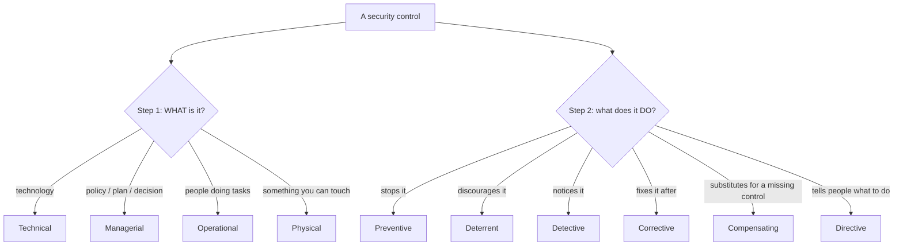

# Chapter 13 — Security Controls

**Level 2 · Beginner for the Exam** · *Exam objective 1.1*

---

## 🎯 Goal

By the end of this chapter you will be able to sort any security control into its **category** (*how* it's done: technical, managerial, operational, physical) and its **type** (*when/why* it acts: preventive, deterrent, detective, corrective, compensating, directive). CompTIA loves this topic, and it's easy marks once the grid is in your head.

---

## 🏠 Real-Life Story: Protecting a Shop 🏪

A shop owner wants to stop shoplifting. Look at all the different things they can do:

| What the shop does | What it does to the thief |
|---|---|
| 📜 Writes a rule: "staff must check bags at the exit" | **Directs** staff behavior |
| 🪧 Puts up a sign: "Shoplifters will be prosecuted" | **Deters**: discourages them from trying |
| 🔒 Locks expensive items in glass cases | **Prevents**: physically stops them |
| 📹 Installs CCTV cameras | **Detects**: records what happened |
| 🚔 Calls the police and recovers the goods | **Corrects**: fixes things after |
| 🧍 Can't afford cameras, so adds an extra staff member on the floor | **Compensates**: an alternative when the ideal control isn't possible |

A **security control** is simply **anything that reduces risk**. Security+ sorts every control in **two different ways** at once.

---

## 📖 Part 1 — The 4 Control CATEGORIES (*how* is it done?)

| Category | Meaning | Examples |
|---|---|---|
| **Technical** (also "logical") | Done by **technology**: hardware/software | Firewalls, encryption, antivirus, MFA, access control lists |
| **Managerial** (also "administrative") | **Decisions and paperwork**: policies, plans, risk decisions | Security policies, risk assessments, hiring procedures, change management |
| **Operational** | Done **by people** in day-to-day work | Security guards doing patrols, awareness training, incident response |
| **Physical** | **Tangible** things in the real world | Fences, locks, doors, bollards, lighting, cameras |

## 🖼️ Figure 13.1 — Who or What Performs the Control?

```
   ┌──────────────┬──────────────────────────────────────────────┐
   │ TECHNICAL    │ A MACHINE does it          (firewall, AV)    │
   ├──────────────┼──────────────────────────────────────────────┤
   │ MANAGERIAL   │ MANAGEMENT decides/writes  (policy, risk     │
   │              │                             assessment)      │
   ├──────────────┼──────────────────────────────────────────────┤
   │ OPERATIONAL  │ PEOPLE do it daily         (guard, training) │
   ├──────────────┼──────────────────────────────────────────────┤
   │ PHYSICAL     │ You can TOUCH it           (fence, lock)     │
   └──────────────┴──────────────────────────────────────────────┘
```

> 💡 **Operational vs Managerial:** *Managerial* is about **planning and oversight** (writing the policy, assessing risk). *Operational* is about **people carrying out tasks** (the guard actually walking the patrol, staff attending training).

---

## 📖 Part 2 — The 6 Control TYPES (*what does it do to the attack?*)

## 🖼️ Figure 13.2 — Where Each Type Acts on the Timeline

```
     BEFORE the attack              DURING the attack        AFTER the attack
   ──────────────────────────────┬────────────────────────┬────────────────────────►
   DIRECTIVE   "Here's the rule" │                        │
   DETERRENT   "Don't even try"  │                        │
   PREVENTIVE  "You can't get in"│                        │
                                 │ DETECTIVE  "We saw it" │
                                 │                        │ CORRECTIVE "We fixed it"
   ─────────────────────────────────────────────────────────────────────────────────
   COMPENSATING: "the ideal control isn't possible, so use this alternative instead"
                 (can act at any point)
```

| Type | Purpose | Examples |
|---|---|---|
| **Preventive** | **Stops** an incident from happening | Firewall rule, door lock, MFA, disabling unused accounts |
| **Deterrent** | **Discourages** attackers (but doesn't physically stop them) | Warning signs, login banners ("Unauthorized access is prosecuted"), visible cameras, lighting |
| **Detective** | **Finds/records** an incident during or after | IDS, log monitoring, motion sensors, audits, CCTV recordings |
| **Corrective** | **Fixes** things and restores normal operation after an incident | Restoring from backup, patching after an attack, antivirus quarantining a file, fire extinguisher |
| **Compensating** | A **substitute** when the preferred control isn't possible or practical | Isolating an old machine that can't be patched; extra monitoring when a system can't do MFA |
| **Directive** | **Tells** people what to do / not do | Policies, "Authorized personnel only" sign, acceptable use policy, procedures |

> ⚠️ **Deterrent vs Preventive:** A *deterrent* makes an attacker **not want** to try (a sign, a barking dog). A *preventive* control makes it **impossible or very hard** even if they try (a locked door). A "Beware of the dog" sign is a deterrent; the locked gate is preventive.

> ⚠️ **Detective vs Corrective:** *Detective* = **noticing** (alarm goes off). *Corrective* = **fixing** (sprinklers put out the fire, backups restore the files).

---

## 📖 Part 3 — The Grid ⭐ (memorize the idea, not every box)

Every control has **one category AND at least one type**. Put them together:

## 🖼️ Figure 13.3 — The 4 × 6 Control Grid

| Type ↓ / Category → | **Technical** | **Managerial** | **Operational** | **Physical** |
|---|---|---|---|---|
| **Preventive** | Firewall blocks a port | Onboarding policy requires background checks | Guard checks IDs at reception | Door lock, bollards |
| **Deterrent** | Login warning banner | Disciplinary policy (demotion/firing) | Visible security patrols | Warning signs, bright lighting |
| **Detective** | IDS alerts, system logs | Reviewing access reports monthly | Guard patrols spotting problems | Motion sensors, CCTV |
| **Corrective** | Restore from backup; AV quarantine | Incident-reporting policy | Incident response team acts | Fire extinguisher, sprinklers |
| **Compensating** | Block a port instead of patching an unpatchable system | Separation of duties when you can't fully monitor | Requiring two staff for a task | Backup generator when mains power fails |
| **Directive** | Pop-up requiring AUP acceptance | Written security policy | Security awareness training | "Authorized personnel only" sign |

### How to Classify Any Control in 2 Steps



### Worked Examples

| Control | Category | Type(s) | Why |
|---|---|---|---|
| Security guard at the gate | Operational *(a person)* or Physical | Preventive, Deterrent, Detective | Stops, discourages *and* notices |
| CCTV camera | Physical | Detective (+ Deterrent if visible) | Records; a visible camera also discourages |
| Antivirus deleting malware | Technical | Corrective (and Preventive when it blocks a download) | Removes the infection |
| Annual risk assessment | Managerial | Detective | *Finds* risks |
| Backup tapes in a vault | Technical/Physical | Corrective (*recovery*) | Used to restore after a loss |
| Login banner | Technical | Deterrent, Directive | Warns and tells users the rules |
| Mandatory vacation policy | Managerial | Detective | Fraud often surfaces when someone else covers the job |

> 💡 Notice that **one control can have more than one type**. On the exam, pick the type that **best** matches what the question describes the control doing.

---

## 📖 Part 4 — Why Compensating Controls Exist

Sometimes the "right" control is impossible:
- A factory machine runs software that **can't be patched**.
- A legacy app **doesn't support MFA**.
- A small company **can't afford** a 24/7 security team.

A **compensating control** reduces the risk another way:

```
   PROBLEM                                 COMPENSATING CONTROL
   ──────────────────────────────────      ─────────────────────────────────────────
   Old Windows PC controls a machine   →   Disconnect it from the internet; put it on
   and can't be patched                     its own isolated network segment
   App can't do MFA                    →   Only allow access from the office network
                                             + extra login monitoring
   One person handles all payments     →   A manager reviews every payment weekly
   (small company)
```

---

## 🧠 Memory Tricks

- **Categories: "MOPT"**: **M**anagerial, **O**perational, **P**hysical, **T**echnical. ("**M**y **O**ld **P**hone **T**alks.")
- **Types in time order:** Directive → Deterrent → Preventive → Detective → Corrective, with Compensating as the stand-in. **"Do Dogs Prevent Dangerous Criminals? Can't!"**
- **Deterrent = "don't want to." Preventive = "can't."**
- **Detective = "saw it." Corrective = "fixed it."**

---

## ⚠️ Exam Tip

- *"A company posts signs warning that the area is monitored. What type of control is this?"* → **Deterrent** (physical category).
- *"An unpatchable legacy system is placed on an isolated VLAN. This is a…"* → **Compensating** control.
- *"Which is a managerial control?"* → Look for **policy, risk assessment, procedure, planning**.
- *"Restoring data from backup after ransomware is a…"* → **Corrective** control.
- Read carefully for **what the control does in the scenario**. The same camera can be detective (reviewing footage) or deterrent (preventing by being seen).

---

## 🧪 Try It (15 minutes)

1. **Control safari at home.** Find 10 security controls in your home or workplace (door lock, Wi-Fi password, smoke alarm, "No entry" sign, antivirus…). For each, write its **category** and **type(s)**.
2. **Fill the grid yourself.** Draw the empty 4 × 6 grid from Figure 13.3 and fill each box with your **own** example, without looking.
3. **Find a compensating control** for this problem: "Our receptionist's PC must run old software that only works on Windows 7."

---

## ✅ Checkpoint Questions

1. Name the four control categories.
2. Name the six control types.
3. A firewall rule blocks Telnet. Category and type?
4. A sign reading "Restricted Area – Authorized Personnel Only." Category and type(s)?
5. What is the difference between a deterrent and a preventive control?
6. Motion sensors in a server room. Category and type?
7. A written acceptable use policy. Category and type?
8. Antivirus removes a virus that already infected a PC. Type?
9. A system can't support encryption, so it's moved to a locked room with no network connection. Type?
10. Security awareness training for all employees. Category?

<details>
<summary><b>Show answers</b></summary>

1. **Technical, Managerial, Operational, Physical.**
2. **Preventive, Deterrent, Detective, Corrective, Compensating, Directive.**
3. **Technical, Preventive.**
4. **Physical, Directive** (and Deterrent).
5. A **deterrent discourages** an attacker from trying. A **preventive control stops** the attack even if they try.
6. **Physical, Detective.**
7. **Managerial, Directive.**
8. **Corrective.**
9. **Compensating.**
10. **Operational** (people carrying it out; the training *program* is decided by management).

</details>

---

## 📌 Chapter Summary

| Dimension | Options | Question it answers |
|---|---|---|
| **Category** | Technical · Managerial · Operational · Physical | *How / by what* is it done? |
| **Type** | Preventive · Deterrent · Detective · Corrective · Compensating · Directive | *What* does it do to the threat? |
| Rule | Every control has one category and one or more types | Pick the **best** fit for the scenario |

**Next chapter →** *Chapter 14: Who Attacks and Why.* Controls protect against someone. Time to meet the attackers.
