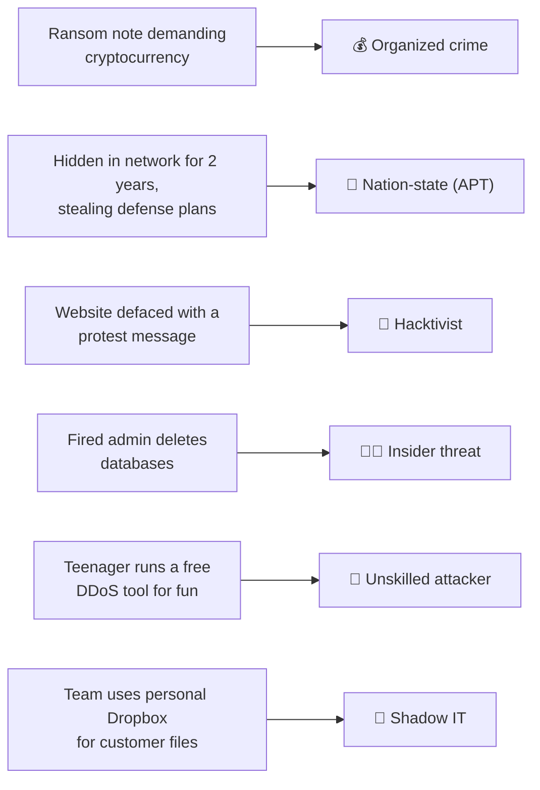

# Chapter 14 — Who Attacks and Why: Threat Actors

**Level 2 · Beginner for the Exam** · *Exam objective 2.1*

---

## 🎯 Goal

By the end of this chapter you will know the **six threat actors** Security+ names (nation-state, unskilled attacker, hacktivist, insider threat, organized crime, shadow IT), how to compare them by their **attributes** (internal/external, resources/funding, sophistication), and the **ten motivations** behind attacks.

---

## 🏠 Real-Life Story: Who Might Break Into a Museum? 🏛️

Imagine a museum with a famous painting. Who might try to get it?

- 🕵️ A **foreign government's spy agency** wants a secret document hidden in the archives. It has unlimited money and patience.
- 🧒 A **bored teenager** saw a "how to pick locks" video and wants to see if it works.
- 📢 A **protest group** wants to throw paint on a painting to make a political point.
- 🧑‍💼 A **museum employee** who was passed over for promotion wants revenge.
- 💰 A **criminal gang** plans a heist to sell the painting.
- 🙈 A **staff member** props open a fire door "to make deliveries easier," without permission.

Each one has **different skills, money and reasons**, so the museum needs different defenses for each. Cybersecurity is the same.

---

## 📖 Part 1 — Attributes: How We Compare Threat Actors

| Attribute | Question | Range |
|---|---|---|
| **Internal / External** | Are they inside the organization (employee, contractor) or outside? | Inside ↔ Outside |
| **Resources / Funding** | How much money, people, time and equipment do they have? | A laptop ↔ A government budget |
| **Level of sophistication / capability** | How skilled are they? Can they create new attacks, or only use other people's tools? | Copy-and-paste ↔ Custom zero-day exploits |

## 🖼️ Figure 14.1 — The Threat Actor Map

```
   SOPHISTICATION / CAPABILITY
   ▲
   │  HIGH                                         ┌──────────────────┐
   │                                               │  NATION-STATE    │
   │                       ┌──────────────────┐    │  (APT)           │
   │                       │ ORGANIZED CRIME  │    └──────────────────┘
   │                       └──────────────────┘
   │        ┌──────────────┐
   │        │  HACKTIVIST  │   ┌───────────────────────────────┐
   │        └──────────────┘   │ INSIDER THREAT (skill varies, │
   │                           │ but has ACCESS already!)      │
   │                           └───────────────────────────────┘
   │  ┌───────────────────┐    ┌──────────────┐
   │  │ UNSKILLED ATTACKER│    │  SHADOW IT   │ (usually not malicious)
   │  └───────────────────┘    └──────────────┘
   │  LOW
   └──────────────────────────────────────────────────────────────►
      LOW                                    HIGH   RESOURCES / FUNDING
```

---

## 📖 Part 2 — The Six Threat Actors

### 🃏 Figure 14.2 — Threat Actor Trading Cards

---

#### 1. 🏴 Nation-State

| | |
|---|---|
| **Who** | Government-backed hacking groups (military or intelligence agencies) |
| **Internal/External** | External |
| **Resources** | 💰💰💰💰💰 Very high |
| **Sophistication** | ⭐⭐⭐⭐⭐ Highest: custom malware, zero-days |
| **Main motivations** | **Espionage**, **war**, disruption, political influence, sometimes money |
| **Typical attack** | Long, hidden campaigns against governments, defense, power grids |
| **Famous example** | SolarWinds supply-chain attack (Chapter 10) |

> **APT = Advanced Persistent Threat.** **A**dvanced (highly skilled), **P**ersistent (stays hidden inside a network for months or years), **T**hreat. Nation-states are the classic APTs. Their goal is usually to **stay unnoticed**, not to cause obvious damage.

---

#### 2. 🧒 Unskilled Attacker (formerly "script kiddie")

| | |
|---|---|
| **Who** | Someone using ready-made tools and scripts **without understanding them** |
| **Internal/External** | Usually external |
| **Resources** | 💰 Very low |
| **Sophistication** | ⭐ Lowest |
| **Main motivations** | Curiosity, bragging rights, **disruption/chaos**, fun |
| **Typical attack** | Running a downloaded DDoS tool or scanner; defacing a website |

> Don't dismiss them: free tools are powerful, and **unpatched systems** are easy targets even for beginners.

---

#### 3. 📢 Hacktivist

| | |
|---|---|
| **Who** | **Hack**er + activ**ist**: attacks for a **cause** (political, social, environmental) |
| **Internal/External** | External (usually) |
| **Resources** | 💰💰 Low to medium (often volunteer groups) |
| **Sophistication** | ⭐⭐–⭐⭐⭐ Varies |
| **Main motivations** | **Philosophical / political beliefs**, getting attention, disruption |
| **Typical attack** | DDoS against a government site, website defacement, leaking stolen documents, publishing people's personal details ("doxxing") |

---

#### 4. 🧑‍💼 Insider Threat

| | |
|---|---|
| **Who** | Current or former **employees, contractors, partners**, anyone with legitimate access |
| **Internal/External** | **Internal** |
| **Resources** | 💰 Usually low, but they **already have access and knowledge** |
| **Sophistication** | Varies, but they know **where the valuable data is** |
| **Main motivations** | **Revenge**, **financial gain**, being bribed or blackmailed, or no motive at all (**accidental** insiders) |
| **Typical attack** | Copying customer data before leaving the job; sabotage; an accidental email to the wrong person |

> ⚠️ Insiders are dangerous because they **bypass the perimeter**: the firewall is designed to stop outsiders, not the person already sitting at a desk. Defenses: **least privilege**, **separation of duties**, **monitoring**, **fast de-provisioning** when someone leaves.

---

#### 5. 💰 Organized Crime

| | |
|---|---|
| **Who** | Professional criminal groups running cybercrime **as a business** |
| **Internal/External** | External |
| **Resources** | 💰💰💰💰 High: they reinvest their profits |
| **Sophistication** | ⭐⭐⭐⭐ High |
| **Main motivations** | **Financial gain** (above all), **blackmail** / extortion |
| **Typical attack** | **Ransomware**, banking trojans, stolen-card fraud, business email compromise |

> Many ransomware gangs run **Ransomware-as-a-Service (RaaS)**: they rent their malware to "affiliates" and take a share of the ransom, like a franchise.

---

#### 6. 🙈 Shadow IT

| | |
|---|---|
| **Who** | Employees using **unapproved technology**: personal cloud storage, unauthorized apps, a Wi-Fi router plugged in under a desk, unapproved AI tools |
| **Internal/External** | **Internal** |
| **Resources / Sophistication** | Varies |
| **Main motivation** | Usually **not malicious**: they just want to **get work done faster** |
| **Why it's a threat** | The security team **doesn't know it exists**, so it isn't patched, monitored or backed up, and data may leak |

> Example: a sales team stores customer lists in a free personal file-sharing account because the company system is slow. Nobody secured that account, and it gets breached.

---

### 🖼️ Figure 14.3 — Side-by-Side Comparison

| Actor | Inside/Outside | Money | Skill | Top motivation |
|---|---|---|---|---|
| Nation-state | Outside | Very high | Very high | Espionage, war |
| Unskilled attacker | Outside | Very low | Very low | Chaos, bragging |
| Hacktivist | Outside | Low–medium | Low–medium | Political/philosophical beliefs |
| Insider threat | **Inside** | Low | Varies | Revenge, money (or accident) |
| Organized crime | Outside | High | High | **Financial gain** |
| Shadow IT | **Inside** | Varies | Varies | Convenience (not malicious) |

---

## 📖 Part 3 — The Ten Motivations

| Motivation | Meaning | Most associated with |
|---|---|---|
| **Data exfiltration** | Stealing data and sending it out of the organization | Organized crime, nation-states, insiders |
| **Espionage** | Spying: secretly gathering information (government or corporate secrets) | Nation-states, competitors |
| **Service disruption** | Knocking systems offline | Hacktivists, nation-states |
| **Blackmail** | "Pay us or we leak/destroy your data" (extortion) | Organized crime |
| **Financial gain** | Making money | Organized crime (also insiders) |
| **Philosophical / political beliefs** | Acting for a cause | Hacktivists |
| **Ethical** | Hacking to **improve** security (with permission, or reporting responsibly) | Ethical hackers / bug bounty hunters |
| **Revenge** | Getting back at someone | Insiders, ex-employees |
| **Disruption / chaos** | Causing trouble for its own sake | Unskilled attackers |
| **War** | Cyberattacks as part of military conflict | Nation-states |

## 🖼️ Figure 14.4 — Match the Clue to the Actor



---

## 🧠 Memory Tricks

- **Six actors: "No Unicorns Have Invaded Our Shed"**: **N**ation-state, **U**nskilled, **H**acktivist, **I**nsider, **O**rganized crime, **S**hadow IT.
- **APT = "Always Persistently Together"**: they stay in your network a long time.
- **Follow the money:** ransom or theft for profit → **organized crime**. Secrets → **nation-state**. A message or cause → **hacktivist**.
- **Shadow IT = "in the shadows, not evil."**

---

## ⚠️ Exam Tip

- *"An attacker has remained undetected in a government network for 18 months. Which actor is MOST likely?"* → **Nation-state / APT.**
- *"Which actor is MOST likely motivated by financial gain?"* → **Organized crime.**
- *"An employee installs an unapproved cloud app to share files."* → **Shadow IT.**
- *"An attacker with low skill uses publicly available tools."* → **Unskilled attacker.**
- *"Which attribute describes whether the actor is an employee?"* → **Internal/external.**

---

## 🧪 Try It (15 minutes)

1. **Read a threat report.** Search for any free annual report, e.g., "Verizon Data Breach Investigations Report summary." What percentage of breaches involved **external** actors vs **internal**? What was the top motivation? (Usually **financial**.)
2. **Look up an APT.** Visit **attack.mitre.org/groups** and open any group. Which country is it linked to? What industries does it target?
3. **Shadow IT check:** list 3 apps or services you've used at work or school without asking IT. What could go wrong with each?

---

## ✅ Checkpoint Questions

1. Name the six threat actors in SY0-701.
2. What does APT stand for, and which actor is most associated with it?
3. Which threat actor is usually **not** malicious?
4. Which actor is most likely to launch ransomware for profit?
5. What are the three attributes used to compare threat actors?
6. A former employee uses a still-active account to delete files. Which actor and which motivation?
7. Which motivation means "spying"?
8. A group DDoSes an oil company's website to protest climate change. Which actor and motivation?
9. Why are insider threats hard to stop with firewalls?
10. What is Ransomware-as-a-Service?

<details>
<summary><b>Show answers</b></summary>

1. **Nation-state, unskilled attacker, hacktivist, insider threat, organized crime, shadow IT.**
2. **Advanced Persistent Threat.** Most associated with **nation-states**.
3. **Shadow IT** (usually employees trying to work faster).
4. **Organized crime.**
5. **Internal/external, resources/funding, level of sophistication/capability.**
6. **Insider threat**, motivated by **revenge**. (Also a failure of de-provisioning!)
7. **Espionage.**
8. **Hacktivist**, motivated by **philosophical/political beliefs**.
9. They're **already inside** with legitimate access. Firewalls mainly protect the perimeter from outsiders.
10. A business model where ransomware developers **rent their malware to affiliates** and share the ransom profits.

</details>

---

## 📌 Chapter Summary

| Actor | One-line description |
|---|---|
| Nation-state | Government-backed, richest and most skilled; espionage/war; APTs |
| Unskilled attacker | Uses others' tools; chaos and bragging |
| Hacktivist | Hacks for a cause |
| Insider threat | Has access already; revenge, money or accidents |
| Organized crime | Cybercrime as a business; ransomware and fraud |
| Shadow IT | Unapproved tech used by staff; risky but not malicious |

**Next chapter →** *Chapter 15: Tricking Humans.* Most of these attackers don't break in. They get *invited* in. Let's see how.
