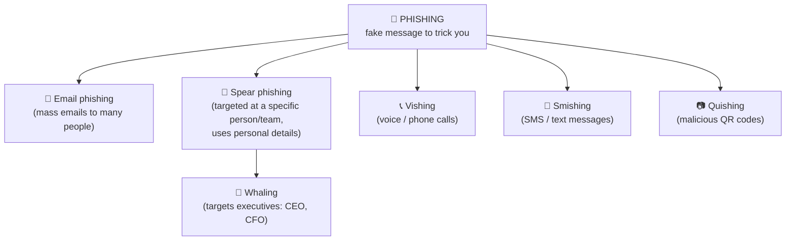
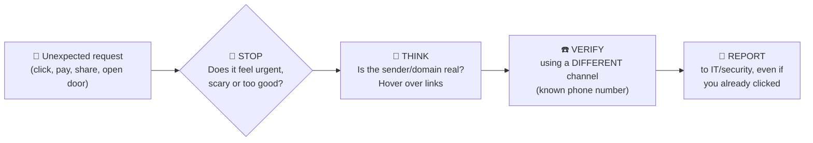

# Chapter 15 — Tricking Humans: Social Engineering

**Level 2 · Beginner for the Exam** · *Exam objectives 2.2 (human vectors) and 5.6*

---

## 🎯 Goal

By the end of this chapter you will recognize every **social engineering** attack named in Security+ (phishing, vishing, smishing, misinformation/disinformation, impersonation, business email compromise, pretexting, watering hole, brand impersonation, typosquatting) plus the classic in-person tricks, and you'll know the **psychological buttons** attackers press.

---

## 🏠 Real-Life Story: The Fake Delivery Driver 📦

A person in a delivery uniform, carrying a big box, walks up to an office door just as an employee badges in.

> "Oh, thanks so much, my hands are full!"

The employee holds the door. The "driver" is now inside, with no badge, no lock-picking and no hacking needed. **They simply asked nicely.**

**Social engineering** is **manipulating people** into giving away information, access or money. It works because humans are naturally **helpful, trusting, busy and afraid of getting in trouble**. It's often the **easiest way in**: why break a strong lock when someone will open the door for you?

---

## 📖 Part 1 — The Psychological Buttons 🧠

Every social-engineering attack presses one or more of these buttons:

| Principle | What the attacker does | Example line |
|---|---|---|
| **Authority** | Pretends to be someone important | "This is the CEO. Do it now." |
| **Intimidation** | Threatens or scares | "Your account will be closed and reported to police." |
| **Urgency** | Rushes you so you don't think | "You have 30 minutes before the deal is lost!" |
| **Scarcity** | "Only a few left / limited time" | "Only 3 free upgrades remaining!" |
| **Consensus / social proof** | "Everyone else already did it" | "All your colleagues have already updated their passwords." |
| **Familiarity / liking** | Acts friendly or as someone you know | "Hi, it's Sam from IT, we met at the party!" |
| **Trust** | Builds a relationship first, then asks | Weeks of friendly chat before asking for a favor |

> 🛑 **Golden rule:** whenever a message makes you feel **rushed, scared, or excited**, **slow down**. That emotion is the attack.

---

## 📖 Part 2 — Phishing and Its Cousins 🎣

**Phishing** = fraudulent messages that pretend to be from a trusted source, to make you **click a link, open an attachment, give credentials or send money**.

## 🖼️ Figure 15.1 — The Phishing Family



| Attack | Channel | Memory trick |
|---|---|---|
| **Phishing** | Email (mass) | "Fishing": cast a wide net |
| **Spear phishing** | Email (targeted) | A spear aims at **one** fish |
| **Whaling** | Email/phone aimed at **executives** | The "big fish" |
| **Vishing** | **V**oice (phone call, voicemail) | **V** = voice |
| **Smishing** | **S**MS text | **S** = SMS |

## 🖼️ Figure 15.2 — Anatomy of a Phishing Email (spot the red flags) 🚩

```
 ┌──────────────────────────────────────────────────────────────────────────┐
 │ From:    "PayPal Security" <security@paypa1-support.com>   [1]           │
 │ To:      undisclosed-recipients                            [2]           │
 │ Subject: URGENT: Your account has been SUSPENDED!!         [3]           │
 ├──────────────────────────────────────────────────────────────────────────┤
 │ Dear Customer,                                             [4]           │
 │                                                                          │
 │ We detected unusual activity. Your account will be permanently           │
 │ closed within 24 hours unless you verify your identity.    [5]           │
 │                                                                          │
 │        [ Verify My Account Now ]                           [6]           │
 │        (link really goes to: http://198.51.100.7/login.php)              │
 │                                                                          │
 │ Attachment: Account_Statement.pdf.exe                      [7]           │
 │                                                                          │
 │ Thank you, PayPal Securty Team                             [8]           │
 └──────────────────────────────────────────────────────────────────────────┘
```

| # | Red flag |
|---|---|
| 1 | **Look-alike sender domain**: `paypa1` uses the number **1** instead of the letter **l** |
| 2 | Not addressed to you personally |
| 3 | **Urgency** and capital letters |
| 4 | Generic greeting ("Dear Customer"): the real company knows your name |
| 5 | **Threat + deadline** (intimidation + urgency) |
| 6 | Button text hides the real link. **Hover over links** to see where they really go: here, a bare IP address over HTTP |
| 7 | **Double extension**: it's a program, not a PDF (Chapter 2) |
| 8 | Spelling mistakes ("Securty") |

> ⚠️ Modern phishing (often written with AI tools) may have **perfect grammar** and your **real name**. Don't rely on spelling mistakes. **Check the sender's domain, hover over links, and verify through a different channel.**

---

## 📖 Part 3 — The Other Social Engineering Attacks

### Impersonation 🎭
Pretending to be **someone else**: IT support, a manager, a delivery person, an auditor, a police officer. *"Hi, I'm from the help desk, I need your password to fix your email."* (Real IT staff **never** need your password.)

### Pretexting 📖
Creating a **made-up story (the "pretext")** to make a request seem legitimate. Impersonation is *who* they pretend to be. Pretexting is the *story* that goes with it.
> *"I'm the new auditor from head office. I need a list of all employees and their emails for the compliance review by Friday."*

### Business Email Compromise (BEC) 💼
An attacker **uses or imitates a real business email account** (often a CEO, CFO, or a supplier) to trick staff into **sending money or sensitive data**.

## 🖼️ Figure 15.3 — A BEC Fraud in 4 Steps

```
   1. Attacker phishes the CFO's      2. Reads the CFO's emails for weeks,
      email password                     learns how payments are approved
              │                                         │
              ▼                                         ▼
   4. Accounts team pays $250,000  ◄── 3. Sends from the REAL CFO account:
      to the attacker's bank account     "Urgent, confidential: pay this new
                                          supplier invoice today. Don't call me,
                                          I'm in meetings all day."
```

**Defense:** always **verify payment changes by phone using a known number** (not the one in the email), require **two-person approval** for payments, and use **MFA** on email.

### Watering Hole Attack 💧
Instead of attacking the victims directly, the attacker **infects a website the victims regularly visit**, like a lion waiting at the watering hole where animals come to drink.

## 🖼️ Figure 15.4 — The Watering Hole

```
     Target: engineers at an aerospace company (hard to attack directly)

     🧑‍🔧 🧑‍🔧 🧑‍🔧  ───── all visit ─────►  🌐 "AeroEngineers Forum" website
                                                    ▲
                                                    │ attacker hacks the forum
                                                    │ and plants malware
                                               🦁 ATTACKER
     Next visit → engineers' PCs get infected → attacker is inside the company
```

### Brand Impersonation 🏷️
Faking a **well-known brand** (bank, Microsoft, Amazon, a delivery company) in emails, fake websites, social media accounts or ads, so victims trust the message.

### Typosquatting ⌨️
Registering domain names that are **common typing mistakes** of real sites, hoping you mistype and land on the fake.

| Real site | Typosquatted examples |
|---|---|
| `google.com` | `gooogle.com`, `goggle.com`, `google.co` |
| `paypal.com` | `paypa1.com`, `paypal-login.com` |
| `microsoft.com` | `rnicrosoft.com` ("r" + "n" looks like "m"!) |

### Misinformation & Disinformation 📰
- **Misinformation** = false information spread **without** intent to deceive (someone shares a rumor they believe).
- **Disinformation** = false information spread **deliberately** to deceive (fake news campaigns, fake "security alerts," influence operations).
> *Memory trick: **Dis**information is **dis**honest on purpose.*

### Classic In-Person & Low-Tech Tricks

| Attack | What happens | Defense |
|---|---|---|
| **Tailgating / piggybacking** | Following someone through a secured door (Chapter 19) | Access control vestibules, "one badge, one person" culture |
| **Shoulder surfing** | Watching someone type a PIN or password | Privacy screens, awareness |
| **Dumpster diving** | Searching the trash for documents, notes, old hard drives | Shredding, secure disposal |
| **Baiting** | Leaving infected USB sticks labelled "Salaries 2026" in the car park | Block USB devices, training |
| **Hoax** | A fake warning ("Delete this file, it's a virus!") that makes users harm their own system | Verify with IT |

---

## 📖 Part 4 — Defending Against Social Engineering 🛡️

## 🖼️ Figure 15.5 — Stop, Think, Verify, Report



| Control | Category (Chapter 13) |
|---|---|
| **Security awareness training** + simulated phishing campaigns | Operational |
| Email filtering, link scanning, attachment sandboxing | Technical |
| **SPF, DKIM, DMARC** to stop spoofed sender domains (Chapter 38) | Technical |
| **MFA**, so a stolen password alone isn't enough | Technical |
| Payment-verification **procedures** (call-back, two approvals) | Managerial |
| A **"Report phishing" button** and a no-blame reporting culture | Operational |

> 💡 **Reporting quickly matters more than never clicking.** If someone clicks and reports within minutes, the security team can reset passwords and block the site before damage spreads. Organizations should **thank** reporters, not punish them.

---

## 🧠 Memory Tricks

- **Vishing = Voice. Smishing = SMS. Whaling = big fish (executives). Spear = one target.**
- **Impersonation = WHO they pretend to be. Pretexting = the STORY they tell.**
- **Watering hole = poison the place they drink.**
- **Typosquatting = squatting on typos.**
- **Disinformation = Deliberate.** Misinformation = Mistaken.
- **Stop, Think, Verify, Report.**

---

## ⚠️ Exam Tip

- *"An employee receives a text message with a link claiming a package is delayed."* → **Smishing.**
- *"Attackers compromise an industry forum frequently visited by their targets."* → **Watering hole.**
- *"The CFO receives a targeted email crafted using details from their LinkedIn profile."* → **Whaling** (spear phishing aimed at an executive).
- *"A caller claims to be from the help desk and asks for a password reset code."* → **Vishing** + **impersonation**.
- *"A domain `arnazon.com` hosts a fake login page."* → **Typosquatting** (and brand impersonation).
- *"An attacker invents a story about being an auditor to obtain an employee list."* → **Pretexting.**
- *"Which is the BEST defense against social engineering?"* → Usually **security awareness training** (plus technical controls).

---

## 🧪 Try It (20 minutes)

1. **Take a free phishing quiz:** search "Google phishing quiz" (Jigsaw) and score yourself.
2. **Inspect a real spam email** in your junk folder (don't click anything!). Find the sender's real domain. Hover over a link and read the true address. Count the red flags.
3. **Check the headers:** in Gmail, open the email → ⋮ → **Show original**. Look for `SPF: FAIL` or `DMARC: FAIL`. That means the sender domain was faked.
4. **Typo hunt:** write 5 typosquat variations of your bank's domain.

---

## ✅ Checkpoint Questions

1. What is social engineering?
2. What is the difference between phishing and spear phishing?
3. Which attack uses phone calls?
4. Which attack targets senior executives?
5. What is the difference between impersonation and pretexting?
6. What is a watering hole attack?
7. Give an example of typosquatting.
8. What is the difference between misinformation and disinformation?
9. Name three psychological principles social engineers use.
10. What is the BEST way to verify an urgent email asking you to change a supplier's bank details?

<details>
<summary><b>Show answers</b></summary>

1. **Manipulating people** into giving up information, access or money.
2. **Phishing** is broad, sent to many people. **Spear phishing** is **targeted** at specific individuals using personal details.
3. **Vishing.**
4. **Whaling.**
5. **Impersonation** is pretending to *be* someone. **Pretexting** is the invented *story/scenario* used to justify the request.
6. Compromising a **website the targets often visit**, so they get infected when they visit it.
7. E.g., `gooogle.com`, `paypa1.com`, `rnicrosoft.com`.
8. **Misinformation** is false but shared **without intent** to deceive. **Disinformation** is spread **deliberately** to deceive.
9. Any three of: **authority, intimidation, urgency, scarcity, consensus/social proof, familiarity, trust.**
10. **Call the supplier using a known, trusted phone number** (not one from the email), and follow the two-person approval procedure.

</details>

---

## 📌 Chapter Summary

| Attack | Key identifier |
|---|---|
| Phishing / spear phishing / whaling | Email: mass / targeted / executives |
| Vishing / smishing | Voice call / SMS |
| Impersonation / pretexting | Fake identity / fake story |
| BEC | Real or faked business email used for payment fraud |
| Watering hole | Infect a site the targets visit |
| Brand impersonation / typosquatting | Fake famous brand / misspelled domain |
| Mis- / disinformation | False info, accidental / deliberate |
| Defense | Training + MFA + email authentication + verify-by-phone + report fast |

**Next chapter →** *Chapter 16: The Malware Zoo.* When the victim clicks, what actually gets installed? Meet the malware family.
