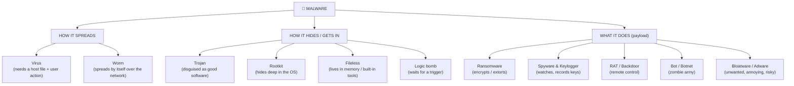

# Chapter 16 — The Malware Zoo

**Level 2 · Beginner for the Exam** · *Exam objective 2.4 (malware attacks)*

---

## 🎯 Goal

By the end of this chapter you will be able to tell apart every malware type named in Security+ (**ransomware, trojan, worm, spyware, bloatware, virus, keylogger, logic bomb, rootkit**) plus a few close relatives (**RAT/backdoor, botnet, fileless malware, adware**), and recognize the **signs** that a computer is infected.

---

## 🏠 Real-Life Story: A Zoo of Troublemakers 🦁

**Malware** = **mal**icious soft**ware**: any program designed to harm, spy, steal or take control. Different malware behaves like different animals:

- Some **need you to carry them** around (a **virus** is like a tick: it needs a host).
- Some **travel by themselves** (a **worm** crawls from garden to garden on its own).
- Some **wear a disguise** (a **trojan** looks like a gift).
- Some **hide in the walls** (a **rootkit** is like a mouse living inside the walls where you can't see it).

The exam often describes **how the malware behaves** and asks you to **name it**. So learn each one by its **behavior**.

---

## 🖼️ Figure 16.1 — The Malware Family Tree



> 💡 Real malware often combines several types: a **trojan** delivers **ransomware** that **spreads like a worm**. The exam asks which **best** describes the behavior in the scenario.

---

## 📖 Part 1 — The Spreaders

### 🦠 Virus
- **Attaches itself to a host** (a program, document or boot sector).
- **Needs a person to run** the infected file to activate and spread.
- When run, it copies itself into other files.
- Types you may hear: **program/file** virus, **boot sector** virus, **macro** virus (inside Office documents), **script** virus.

### 🐛 Worm
- **Self-replicating, standalone.** It needs **no host file and no user action**.
- Spreads across networks by **exploiting vulnerabilities**, so it can spread incredibly fast.
- Example: **WannaCry** (2017) spread through the SMB vulnerability on port 445 (Chapter 10).

## 🖼️ Figure 16.2 — Virus vs Worm

```
   VIRUS: needs a ride                       WORM: travels alone
   ────────────────────                      ─────────────────────
   User opens an infected file               [PC] ──exploit──► [PC] ──exploit──► [PC]
        │                                     │                 │                 │
        ▼                                     ▼                 ▼                 ▼
   [PC] infected ──user shares file──► [PC]  [PC] ──► [PC]      [PC] ──► [PC]      [PC] ...
                                             No clicks needed! Network-speed spread
   Stop it: don't run unknown files,         Stop it: PATCH, firewalls,
   anti-malware                              network segmentation
```

---

## 📖 Part 2 — The Hiders and Sneakers

### 🐴 Trojan (Trojan Horse)
- **Pretends to be useful or harmless** software (a free game, a "cracked" app, a fake invoice, a fake antivirus) but contains malicious code.
- Does **not** self-replicate.
- Named after the wooden horse the Greeks used to sneak soldiers into Troy.

### 🚪 RAT (Remote Access Trojan) and Backdoors
- A **RAT** gives the attacker **full remote control**: see your screen, turn on your webcam, copy files.
- A **backdoor** is any **secret way into a system** that bypasses normal login. It's often left behind by malware (or occasionally by a careless developer).

### 🕳️ Rootkit
- Hides **deep inside the operating system** (often the **kernel**, Chapter 2, or even the firmware/boot process) to give the attacker **ongoing privileged ("root") access**.
- **Hides itself and other malware** from antivirus and from the OS's own tools.
- Very hard to remove. Often the safest fix is to **wipe and reinstall** from known-good media.
- Defenses: **Secure Boot, Measured Boot, TPM** (Chapter 2), EDR.

### 💣 Logic Bomb
- Malicious code that **sits quietly until a trigger condition** is met, then "explodes."
- Triggers: a **date/time** ("on 1 April"), an **event** ("if my name is removed from the payroll"), or an action.
- Classic **insider threat**: a disgruntled admin plants a logic bomb that deletes databases if they're fired.

### 👻 Fileless Malware
- Doesn't install a normal program file on disk. Instead it **lives in memory (RAM)** and **abuses legitimate built-in tools** like **PowerShell** or WMI ("living off the land").
- Hard for traditional file-scanning antivirus to see. **Disappears on reboot**, unless it sets up persistence (e.g., in the Windows registry).
- Defenses: behavior-based **EDR**, PowerShell logging, application control.

---

## 📖 Part 3 — The Payloads: What Malware Does

### 🔐 Ransomware
- **Encrypts your files** (or locks the whole system) and demands a **ransom** (usually cryptocurrency) for the decryption key.
- **Double extortion:** attackers **steal data first**, then encrypt it, threatening to **leak** it if you don't pay.
- Hits **availability** (and confidentiality, with double extortion).

## 🖼️ Figure 16.3 — A Typical Ransomware Attack Timeline

```
 Day 0           Day 1-10                  Day 11              Day 12            Day 12+
 ──┬───────────────┬────────────────────────┬────────────────────┬─────────────────┬──►
   │               │                        │                    │                 │
 Phishing email  Attacker explores         Steals data          Encrypts files    Ransom note:
 or stolen VPN   network, gets admin       (exfiltration)       + deletes         "Pay 20 BTC or
 password        rights, finds backups                          backups           we leak it all"

 Best defenses: MFA, patching, EDR, least privilege, network segmentation, and
 OFFLINE / IMMUTABLE BACKUPS that are tested regularly (so you can recover without paying).
```

> ⚠️ **Paying doesn't guarantee recovery**, and it funds more crime. That's why **backups the attacker can't reach** (offline or immutable, meaning they can't be changed or deleted) are the #1 ransomware defense.

### 👀 Spyware
- **Secretly monitors** what you do: websites visited, messages, location, screenshots, then sends it to the attacker.
- Includes **stalkerware** secretly installed on someone's phone.

### ⌨️ Keylogger
- **Records every keystroke**, capturing passwords, credit-card numbers and messages.
- Can be **software** (malware) or **hardware** (a tiny device plugged between keyboard and computer, Chapter 1).
- Defense: **MFA** (a stolen password alone isn't enough), anti-malware, physical inspection.

### 🤖 Bots and Botnets
- A **bot** is an infected device controlled remotely by an attacker (a "zombie").
- A **botnet** is an **army of thousands or millions of bots**, often including insecure **IoT** devices like cameras and routers.
- Controlled through a **command-and-control (C2)** server.
- Used for **DDoS attacks**, spam, password guessing, cryptocurrency mining.
- Example: the **Mirai** botnet (2016) took over IoT devices using **default passwords** and launched huge DDoS attacks.

## 🖼️ Figure 16.4 — A Botnet

```
                        🦹 Attacker ("bot herder")
                               │
                        🖥️ C2 server  ─── "Attack www.example.com NOW!"
                    ┌──────────┼──────────┬──────────┐
                    ▼          ▼          ▼          ▼
                 camera       PC       router    smart TV          (thousands of
                    │          │          │          │             infected bots)
                    └──────────┴────┬─────┴──────────┘
                                    ▼
                           🎯 www.example.com overwhelmed (DDoS)
```

### 🐌 Bloatware (and Adware)
- **Bloatware:** unwanted software **pre-installed** by the manufacturer or bundled with other software. It wastes space and memory, and every extra program **increases the attack surface** (more code = more possible vulnerabilities).
- **Adware:** shows unwanted ads, sometimes tracks you. Can lead to malicious sites.
- Defense: remove what you don't need (**hardening**, Chapter 27).

### ⛏️ Cryptojacking (bonus)
- Malware that **secretly uses your CPU/GPU to mine cryptocurrency** for the attacker. Sign: computer slow and hot, fans loud, high CPU use.

---

## 🖼️ Figure 16.5 — Master Comparison Table ⭐

| Malware | Self-spreads? | Needs user action? | Main behavior | Key clue in a question |
|---|:---:|:---:|---|---|
| **Virus** | No (via files) | **Yes** | Infects host files | "attached to a file," "user opened" |
| **Worm** | **Yes** | **No** | Spreads over network via vulnerabilities | "spread rapidly with no user interaction" |
| **Trojan** | No | Yes | Disguised as legitimate software | "downloaded a free tool/game," "appeared legitimate" |
| **RAT / Backdoor** | No | Varies | Remote control / secret access | "attacker controls the system remotely" |
| **Rootkit** | No | Varies | Hides deep in OS/kernel/firmware | "hidden from antivirus," "kernel-level," "root access" |
| **Logic bomb** | No | No (trigger) | Waits for a date/event | "on a specific date," "when an employee was fired" |
| **Ransomware** | Sometimes | Varies | Encrypts/locks files, demands payment | "files encrypted," "ransom note," "cryptocurrency" |
| **Spyware** | No | Varies | Monitors activity | "tracking browsing/location" |
| **Keylogger** | No | Varies | Records keystrokes | "passwords captured as typed" |
| **Bot / botnet** | Often | Varies | Remote-controlled army | "many devices," "C2," "DDoS" |
| **Fileless** | Varies | Varies | Lives in memory, uses PowerShell | "no files on disk," "PowerShell," "memory only" |
| **Bloatware** | No | No (pre-installed) | Unwanted bundled software | "pre-installed apps," "came with the laptop" |

---

## 📖 Part 4 — Signs of Infection (Indicators) 🚩

| Symptom | Could indicate |
|---|---|
| Computer suddenly **very slow**, fans loud, high CPU | Cryptojacking, bot activity |
| Files renamed with strange extensions (`.locked`, `.crypt`), ransom note | **Ransomware** |
| **Pop-ups**, browser homepage changed | Adware, browser hijacker |
| **Antivirus disabled** or won't update | Rootkit or other malware protecting itself |
| Unknown programs running, or unknown **outbound connections** (`netstat`, Chapter 9) | RAT, bot, C2 traffic |
| Friends receive messages/emails **you didn't send** | Account compromise, worm |
| **Missing logs** or logs cleared | An attacker covering tracks (Chapter 26) |
| Accounts **locked out** from repeated failed logins | Password attack, or malware guessing passwords |

---

## 📖 Part 5 — Defenses Overview 🛡️

```
   PREVENT                         DETECT                        RECOVER
   ───────────────────────         ───────────────────────       ─────────────────────────
   • Patch OS and apps             • Anti-malware / EDR          • Isolate infected device
   • Least privilege (no admin)    • Log monitoring / SIEM       • Wipe and reimage
   • Email & web filtering         • File integrity monitoring   • Restore from clean,
   • Application allow lists       • Network monitoring (C2)       offline/immutable backups
   • Block USB / macros            • User reports                • Reset passwords
   • Secure Boot, MFA, training
```

---

## 🧠 Memory Tricks

- **Virus = "visitor needs a host." Worm = "wanders on its own."**
- **Trojan = "the gift that bites."**
- **Rootkit = "root-level + kit of hiding tools."**
- **Logic bomb = "IF this happens, THEN boom."**
- **Ransomware = "pay ransom or lose files."**
- **Bloatware = "bloated with junk apps."**
- **Fileless = "no file, lives in RAM, uses PowerShell."**

---

## ⚠️ Exam Tip

- *"Malware spread across the network to hundreds of machines without any user interaction."* → **Worm.**
- *"A user downloaded a free PDF converter; afterwards, an attacker could access the PC remotely."* → **Trojan** (specifically a **RAT**).
- *"Code deleted payroll records on the day an admin's account was disabled."* → **Logic bomb.**
- *"Malware hides from the OS and antivirus by modifying the kernel."* → **Rootkit.**
- *"A new laptop came with many unwanted trial programs."* → **Bloatware.**
- *"Which is the BEST way to recover from ransomware?"* → **Restore from offline/immutable backups.**

---

## 🧪 Try It (20 minutes)

1. **Check a file safely:** visit **virustotal.com** and upload a harmless file you own (or paste a known URL). It's scanned by ~70 antivirus engines. *(Don't upload private documents: uploads can be shared with security researchers.)*
2. **Look for bloatware:** open your list of installed apps (Windows: Settings → Apps; Android: Settings → Apps). How many have you never used? Remove what you don't need.
3. **Check your startup programs:** Windows Task Manager → **Startup apps**. Do you recognize them all?
4. **Test your antivirus safely** with the industry-standard **EICAR test file** (search "EICAR test file"). It's harmless text that all antivirus programs are designed to detect. Watch your antivirus catch it.

---

## ✅ Checkpoint Questions

1. What's the key difference between a virus and a worm?
2. Which malware is disguised as legitimate software?
3. What does a rootkit do, and why is it hard to remove?
4. What triggers a logic bomb?
5. What is double extortion ransomware?
6. Which malware records everything you type?
7. What is a botnet used for?
8. Why is bloatware a security concern?
9. What makes fileless malware hard to detect?
10. What is the single most important control for recovering from ransomware?

<details>
<summary><b>Show answers</b></summary>

1. A **virus** needs a host file and **user action** to spread. A **worm** **self-replicates** across networks with **no user action**.
2. A **trojan.**
3. It hides deep in the OS (kernel/boot/firmware) to keep **privileged access** and **conceal itself** from security tools. It controls what the OS and antivirus can see, so it's often only safely removed by **wiping and reinstalling**.
4. A **specific condition**: a date/time, an event (like an employee being removed from payroll), or an action.
5. Attackers **steal data first**, then encrypt it, and threaten to **publish** it as well as keep it locked.
6. A **keylogger.**
7. **DDoS attacks**, spam, credential-stuffing/password attacks, cryptomining, and more, all controlled through a **C2** server.
8. It's unnecessary software that **increases the attack surface** and may contain vulnerabilities or collect data.
9. It **runs in memory** and **uses legitimate system tools** (like PowerShell), so there's no malicious file on disk for antivirus to scan.
10. **Offline/immutable backups** that are regularly **tested**.

</details>

### 🎯 Exam-Style Practice (multiple choice)

**MC1.** An employee opens a Word attachment and clicks "Enable content." The code inside then copies itself into other documents on the shared drive, and spreads further only when colleagues open those files. Which malware BEST fits?
A. Worm  B. Macro virus  C. Logic bomb  D. Rootkit

**MC2.** Several office PCs run hot with loud fans and CPU use near 100% even when nobody is using them. No files are encrypted and no pop-ups appear. What is MOST likely happening?
A. Cryptojacking  B. Ransomware  C. Adware  D. A logic bomb waiting for its trigger

**MC3.** A company refuses to pay a ransom and restores everything from backups. The attackers then threaten to publish customer records they copied before encrypting the files. What is this tactic called?
A. Bloatware  B. A watering hole  C. Cryptojacking  D. Double extortion

**MC4.** A keylogger on a sales rep's laptop captured their email password. Which control would have made the stolen password alone useless to the attacker?
A. A longer password  B. Hiding file extensions  C. Multifactor authentication  D. Removing bloatware

**MC5.** An analyst confirms that a server is infected with a kernel-level rootkit. What is the BEST way to make the server trustworthy again?
A. Wipe it and reinstall from known-good media  B. Run a quick antivirus scan and keep using it  C. Delete the suspicious files the OS shows  D. Restart the server twice

**MC6.** A "free weather" app secretly takes screenshots and sends the user's browsing history to a remote server, but shows no ads and does not spread. Which malware type BEST fits?
A. Adware  B. Spyware  C. Worm  D. Bloatware

<details>
<summary><b>Show multiple-choice answers</b></summary>

| # | Answer | Why |
|---|---|---|
| MC1 | B | It needs a host file and a user opening it, which is a (macro) virus; a worm spreads with no user action. |
| MC2 | A | Secretly using CPU power to mine cryptocurrency causes heat, noise and high CPU without encrypting anything. |
| MC3 | D | Stealing data before encrypting it, then threatening to leak it, is double extortion; backups don't stop the leak threat. |
| MC4 | C | With MFA a password is only one factor, so a captured password alone cannot log in. |
| MC5 | A | A rootkit controls what the OS and antivirus can see, so the safe fix is a full wipe and reinstall from known-good media. |
| MC6 | B | Secretly monitoring activity and sending it to an attacker is spyware; adware would show unwanted ads. |

</details>


---

## 📌 Chapter Summary

| Group | Members |
|---|---|
| Spreaders | Virus (needs user), worm (spreads alone) |
| Hiders & sneakers | Trojan, RAT/backdoor, rootkit, logic bomb, fileless |
| Payloads | Ransomware, spyware, keylogger, bots/botnets, bloatware/adware, cryptojacking |
| Key defenses | Patching, least privilege, EDR, filtering, training, MFA, **offline/immutable backups** |

**Next chapter →** *Chapter 17: Passwords, Authentication & MFA.* Most malware and phishing is about stealing credentials. Let's make credentials much harder to steal and use.
