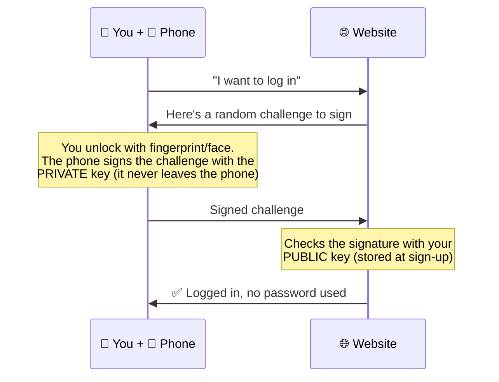

# Chapter 17 — Passwords, Authentication & MFA (Basics)

**Level 2 · Beginner for the Exam** · *Exam objective 4.6 (introduction)*

---

## 🎯 Goal

By the end of this chapter you will know the **authentication factors**, why **multifactor authentication (MFA)** is so powerful, what makes a **good password**, how **password managers**, **passwordless** login and **passkeys** work, and the basics of **biometrics** (including FAR, FRR and CER).

---

## 🏠 Real-Life Story: Getting Into the Bank Vault 🏦

To open a bank's safe-deposit box you might need:
1. To **know** your PIN,
2. To **have** your key,
3. And to **be** recognized by the staff (your face matches your ID).

A thief who steals just your key still can't get in, because they don't know your PIN and don't have your face. **Requiring different kinds of proof** is the whole idea behind multifactor authentication.

---

## 📖 Part 1 — The Authentication Factors

## 🖼️ Figure 17.1 — The Four Factors in Security+ 701

```
   🧠 SOMETHING YOU KNOW       📱 SOMETHING YOU HAVE        👆 SOMETHING YOU ARE         📍 SOMEWHERE YOU ARE
   ─────────────────────       ─────────────────────        ─────────────────────        ──────────────────────
   Password                    Smartphone (app / SMS code)  Fingerprint                  GPS location
   PIN                         Hardware token / key fob     Face                         IP address / country
   Security question answer    Smart card / ID badge        Iris / retina                Being on the office network
   Pattern / passphrase        Security key (USB/NFC)       Voice
```

| Factor | Strength | Weakness |
|---|---|---|
| **Know** | Easy, free | Can be guessed, phished, reused, written down |
| **Have** | Must physically possess it | Can be lost or stolen; SMS can be intercepted (SIM swap, Chapter 7) |
| **Are** (biometric) | Always with you; hard to share | Can't be changed if stolen; false matches; privacy concerns |
| **Somewhere you are** (location) | Adds context ("why is the CFO logging in from abroad at 3 am?") | Can be faked with VPNs; usually used as an **extra** check, not alone |

> 💡 Some books also mention **"something you do"** (how you type or walk) as a behavioral factor. SY0-701 lists the four above.

---

## 📖 Part 2 — Multifactor Authentication (MFA) 🔐

**MFA** = using **two or more DIFFERENT factor types**.

## 🖼️ Figure 17.2 — Is It Really MFA?

| Login method | Factors used | MFA? |
|---|---|:---:|
| Password + PIN | Know + Know | ❌ (same factor twice) |
| Password + security question | Know + Know | ❌ |
| Password + code from phone app | Know + **Have** | ✅ |
| Smart card + PIN | **Have** + Know | ✅ |
| Fingerprint + password | **Are** + Know | ✅ |
| Face unlock on your phone, then a passkey | Have (phone) + Are (face) | ✅ |
| Two different passwords | Know + Know | ❌ |

> ⚠️ **Classic exam trap:** **password + PIN is NOT MFA.** Both are "something you know." Count the **types**, not the number of steps.

### Why MFA Matters So Much

```
   Attacker steals your password (phishing, keylogger, data breach)
                  │
                  ▼
     WITHOUT MFA:  🔓 attacker logs in immediately
     WITH MFA:     🔒 attacker is asked for the code on YOUR phone ── blocked
```

Microsoft has reported that MFA blocks **over 99%** of automated account-compromise attacks. Remember Colonial Pipeline (Chapter 10): **one password, no MFA.**

### MFA Methods (Implementations), from Weaker to Stronger

## 🖼️ Figure 17.3 — The MFA Strength Ladder

```
   STRONGER  ▲   Security key / passkey (FIDO2, e.g. YubiKey)  ← phishing-resistant
             │   Smart card with certificate (PIV/CAC)
             │   Authenticator app with number matching
             │   Authenticator app code (TOTP: 6 digits, changes every 30 s)
             │   Hardware token showing a code (key fob)
             │   Push notification "Approve / Deny"   ← beware "MFA fatigue"
             │   SMS / voice code                      ← SIM swap, interception
   WEAKER    ▼   Email code
```

| Method | How it works | Notes |
|---|---|---|
| **Hard token** | Small physical device showing a changing code, or a USB/NFC **security key** | Strong; security keys resist phishing |
| **Soft token** | Authenticator **app** on your phone (Google/Microsoft Authenticator) | Good; free |
| **TOTP** | **T**ime-based **O**ne-**T**ime **P**assword: new code every ~30 seconds | Most authenticator apps use this |
| **HOTP** | **H**MAC-based OTP: new code each time you press a button (counter-based) | Older key fobs |
| **SMS / voice** | Code sent by text or call | Better than nothing, but vulnerable to **SIM swapping** |
| **Push notification** | "Is this you? Approve / Deny" | Attackers spam pushes until a tired user taps Approve (**MFA fatigue / push bombing**). Fix: **number matching** |
| **Security key (FIDO2/WebAuthn)** | Plug in or tap a key; it checks the website's real address | **Phishing-resistant**: it won't work on a fake site |

---

## 📖 Part 3 — Passwords Done Right 🔑

### Password Concepts in Security+ 701

| Concept | Meaning | Best practice today |
|---|---|---|
| **Length** | Number of characters | **Most important!** Aim for 14+ characters; passphrases are great |
| **Complexity** | Mix of upper/lowercase, numbers, symbols | Helps a little, but long beats complex |
| **Reuse** | Using the same password on multiple sites | **Never reuse.** One breach unlocks everything ("credential stuffing") |
| **Expiration** | Forcing a change after X days | Modern guidance (NIST): **don't force regular changes**; change **when compromise is suspected** |
| **Age** | **Minimum age** stops users changing a password several times in a row to get back to their old one; **maximum age** = expiration | Know both terms for the exam |
| **History** | Remembers old passwords so they can't be reused | Common policy setting |

## 🖼️ Figure 17.4 — Long Beats Complex

```
   Password             Length   Feels...        Reality
   ──────────────────   ──────   ────────────    ─────────────────────────────────────────
   P@ssw0rd!               9     "complex"       ❌ Cracked instantly: it's on every
                                                    attacker's word list
   Tr0ub4dor&3            11     "complex"       ⚠️ Hard to remember, still guessable
   correct horse          28     "simple"        ✅ Very long = huge number of possible
   battery staple                                   combinations. Easy to remember
   (4 random words)

   Every extra character MULTIPLIES the attacker's work (remember key lengths, Chapter 3).
```

> 💡 The best password is one that is **long, unique to each site, and stored in a password manager**, *plus* **MFA** turned on.

### Password Managers 🗄️

- An app that **generates and stores strong, unique passwords** for every site in an **encrypted vault**. You remember **one strong master password** (protected with MFA).
- Examples: Bitwarden, 1Password, built-in browser/OS managers (Apple Passwords, Google Password Manager).
- Bonus: they **won't autofill on a fake look-alike site**, which helps against phishing.

### Passwordless Authentication & Passkeys 🔓

**Passwordless** = logging in **without typing a password at all**:
- **Passkeys (FIDO2/WebAuthn):** your device holds a **private key**; the website holds the matching **public key** (asymmetric crypto, Chapter 18). You unlock with your **fingerprint, face or PIN on the device**. Nothing secret is sent to the website, so **there's nothing to phish or steal from the server**.
- Other examples: Windows Hello, magic links sent by email, smart cards.

## 🖼️ Figure 17.5 — How a Passkey Login Works



---

## 📖 Part 4 — Biometrics Basics 👆

Biometric systems measure physical traits: **fingerprint, face, iris, retina, palm/vein patterns, voice**.

Biometric checks are **never 100% exact**, so systems can make two kinds of mistakes:

| Error | Meaning | Also called | Security impact |
|---|---|---|---|
| **FAR**: False Acceptance Rate | An **impostor is let in** | Type II error | 🔴 **Dangerous** (security failure) |
| **FRR**: False Rejection Rate | The **real user is rejected** | Type I error | 🟡 **Annoying** (convenience failure) |
| **CER**: Crossover Error Rate | The setting where **FAR = FRR** | Equal error rate (EER) | Used to **compare** systems: **lower CER = more accurate** |

## 🖼️ Figure 17.6 — The FAR/FRR Crossover

```
   Error
   rate
    ▲
    │ \  FAR                 FRR  /
    │   \                       /
    │     \                   /
    │       \               /
    │         \           /
    │           \       /
    │             \   /
    │               X                   ← CER: the point where FAR = FRR
    │             /   \                   (a lower crossing point means
    │           /       \                  a more accurate system)
    │         /           \
    │       /               \
    │     /                   \
    └──────────────────────────────────────────────────────►
      Lenient (low sensitivity)        Strict (high sensitivity)

   FAR = impostors accepted:  HIGH when lenient, falls as the system gets stricter
   FRR = real users rejected: LOW when lenient, rises as the system gets stricter
```

- Make the system **stricter** → FAR goes **down** (fewer impostors) but FRR goes **up** (more real users rejected).
- Make it **more lenient** → the opposite.

> ⚠️ **Biometrics can't be changed.** If your password leaks, you change it. If your fingerprint data leaks, you can't get new fingers. That's why biometric data must be stored securely (usually only on the device, as a mathematical template).

---

## 🧠 Memory Tricks

- **Factors: Know, Have, Are, Where.** "**K**ids **H**ave **A**wesome **W**ishes."
- **MFA = different TYPES, not just more steps.**
- **FAR = False Accept = Fraudster gets in (bad). FRR = False Reject = Frustrated real user.**
- **CER = Crossover. Lower is better.**
- **Long > complex. Unique > clever. Manager + MFA = best.**
- **TOTP = Time. HOTP = Hit the button (counter).**

---

## ⚠️ Exam Tip

- *"A user logs in with a password and a PIN. Is this MFA?"* → **No.** Both are something you know.
- *"Which MFA method is MOST resistant to phishing?"* → **FIDO2 security key / passkey.**
- *"A user keeps receiving approval prompts they didn't request."* → **MFA fatigue / push bombing** attack.
- *"Which metric is BEST for comparing the accuracy of two biometric systems?"* → **CER** (lower is better).
- *"Which password setting prevents users from cycling back to an old password immediately?"* → **Minimum password age** (plus password history).
- *"Which factor is a smart card?"* → **Something you have.**

---

## 🧪 Try It (20 minutes)

1. **Turn on MFA** for your email account using an **authenticator app** (not SMS if you can avoid it). This is the single best thing you can do for your own security today.
2. **Install a password manager** (e.g., Bitwarden, free). Save three accounts and let it generate new 20-character passwords for them.
3. **Create a passkey** for a site that supports it (Google, Microsoft, Apple, GitHub…). Then log in with your fingerprint or face instead of a password.
4. **Check password strength (safely):** never type real passwords into random websites. Instead, compare two made-up examples, like "Summer2025!" vs "violin-cactus-harbor-lamp", on a reputable estimator (e.g., Bitwarden's password strength tool).

---

## ✅ Checkpoint Questions

1. Name the four authentication factors in SY0-701.
2. Is "password + security question" multifactor? Why or why not?
3. Which factor type is a fingerprint? A hardware token? A GPS location?
4. Why is SMS considered a weaker MFA method?
5. What is MFA fatigue, and what feature helps prevent it?
6. Which is more important for a strong password: length or complexity?
7. Why is password reuse dangerous?
8. What does a password manager do?
9. What does FAR measure, and why is a high FAR dangerous?
10. What does a lower CER tell you about a biometric system?

<details>
<summary><b>Show answers</b></summary>

1. **Something you know, something you have, something you are, somewhere you are.**
2. **No.** Both are **something you know**.
3. Fingerprint = **something you are**. Hardware token = **something you have**. GPS location = **somewhere you are**.
4. Codes can be stolen through **SIM swapping**, interception, or malware on the phone.
5. Attackers **spam push approval requests** until the user taps "Approve." **Number matching** (and limiting prompts) helps prevent it.
6. **Length.**
7. If one site is breached, attackers try the same username and password on other sites (**credential stuffing**).
8. It **generates and securely stores** strong, unique passwords in an encrypted vault, and fills them in only on the correct sites.
9. FAR measures **how often impostors are wrongly accepted**. A high FAR means **unauthorized people get in**.
10. The system is **more accurate** overall.

</details>

---

## 📌 Chapter Summary

| Topic | Key point |
|---|---|
| Factors | Know · Have · Are · Somewhere you are |
| MFA | ≥ 2 **different** factor types; blocks most account takeovers |
| Strongest MFA | FIDO2 security keys / passkeys (phishing-resistant) |
| Weaker MFA | SMS (SIM swap), push without number matching (MFA fatigue) |
| Passwords | Length > complexity; never reuse; use a manager; change when compromised |
| Passwordless | Passkeys use public/private keys; nothing to phish |
| Biometrics | FAR (impostor in) vs FRR (real user out); CER compares systems, lower is better |

**Next chapter →** *Chapter 18: Cryptography Made Simple.* Passkeys, HTTPS, encrypted disks: all of them run on cryptography. Let's open the lockbox.
