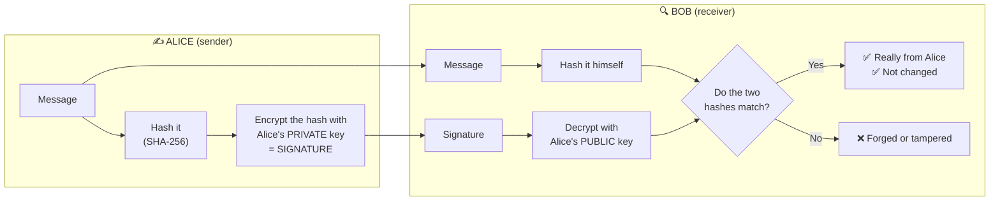

# Chapter 18 — Cryptography Made Simple

**Level 2 · Beginner for the Exam** · *Exam objective 1.4 (introduction)*

---

## 🎯 Goal

By the end of this chapter you will understand the basic words of cryptography (**plaintext, ciphertext, key, algorithm**), the difference between **symmetric** and **asymmetric** encryption, how **hashing** and **digital signatures** fit in, and why real systems (like HTTPS) **combine** them. The deep dive comes later in Chapters 28 and 49.

---

## 🏠 Real-Life Story: Passing Notes in Class ✉️

You want to pass a secret note to your friend across the classroom. It goes through five other students' hands, and any of them could read it.

So you and your friend agree on a secret rule beforehand: **"shift every letter forward by 3"**.

```
   Your message (plaintext):     H  E  L  L  O
   Shift each letter by +3:      ↓  ↓  ↓  ↓  ↓
   What others see (ciphertext): K  H  O  O  R
```

Your friend shifts each letter back by 3 and reads "HELLO." The other students see only "KHOOR."

This is the **Caesar cipher**, used by Julius Caesar over 2,000 years ago. It's far too easy to break today, but it shows every part of cryptography:
- the **message** (plaintext),
- the **scrambled message** (ciphertext),
- the **method** (shift letters) = the **algorithm**,
- the **secret** (the number 3) = the **key**.

---

## 📖 Part 1 — The Vocabulary

## 🖼️ Figure 18.1 — Encryption and Decryption

```
                 KEY 🔑                                   KEY 🔑
                   │                                        │
                   ▼                                        ▼
   PLAINTEXT ──► [ ENCRYPT ] ──► CIPHERTEXT ──(network)──► [ DECRYPT ] ──► PLAINTEXT
   "Pay $100"    (algorithm)     "x9#Lq!2@"                (algorithm)     "Pay $100"
```

| Word | Meaning |
|---|---|
| **Plaintext** | The original, readable data |
| **Ciphertext** | The scrambled, unreadable result |
| **Encryption** | Turning plaintext into ciphertext |
| **Decryption** | Turning ciphertext back into plaintext |
| **Algorithm (cipher)** | The mathematical recipe (e.g., AES, RSA). **Public**: everyone knows how it works |
| **Key** | The **secret** value that controls the algorithm. **Security depends on keeping the key secret** |
| **Key length** | Size of the key in bits. Longer = more possible keys = harder to brute-force (Chapter 3) |
| **Cryptanalysis** | The study of breaking ciphers |

> 💡 **Kerckhoffs's principle:** a good system stays secure even if **everyone knows the algorithm**. Only the **key** must be secret. "Secret algorithms" (security through obscurity) are a bad idea.

---

## 📖 Part 2 — Symmetric Encryption: One Shared Key 🔑

**Symmetric** = the **same key** is used to **encrypt and decrypt**.

## 🖼️ Figure 18.2 — The Lockbox with Two Copies of the Same Key

```
        Alice                                                Bob
         🔑 ───── same key, copied and shared beforehand ───── 🔑
         │                                                    │
   "Hi Bob" ──► 🔒 lock with key ──► 📦 ──network──► 📦 ──► 🔓 unlock with SAME key ──► "Hi Bob"
```

| ✅ Strengths | ❌ Weaknesses |
|---|---|
| **Very fast**: great for large amounts of data (whole disks, video streams) | **Key distribution problem**: how do you safely get the key to the other person in the first place? |
| Short keys are strong (AES-256) | **Doesn't scale**: every pair of people needs their own key |
| | No **non-repudiation**: both sides hold the same key, so you can't prove *which* one sent a message |

**Examples:** **AES** (Advanced Encryption Standard, today's standard: 128, 192 or 256-bit keys), **ChaCha20**. Old and weak: **DES**, **3DES**, **RC4**.

### The Scaling Problem

```
   Number of keys needed so every pair can talk privately = n × (n − 1) ÷ 2

   People (n)    Keys needed
   ──────────    ───────────
        2              1
        4              6
       10             45
      100          4,950
    1,000        499,500
```

---

## 📖 Part 3 — Asymmetric Encryption: A Key Pair 🔑🗝️

**Asymmetric** (also called **public-key cryptography**) uses **two mathematically linked keys**:
- a **public key**: share it with **everyone**,
- a **private key**: keep it **secret**, never share it.

What one key locks, **only the other key** of the pair can unlock.

## 🖼️ Figure 18.3 — The Open Padlock Analogy 🔓

```
   Bob hands out OPEN PADLOCKS (his PUBLIC key) to anyone who asks.
   Only Bob has the KEY that opens them (his PRIVATE key).

   Alice:  "Hi Bob" ──► puts it in a box ──► snaps Bob's open padlock shut 🔒
                                                     │
                                                     ▼  (anyone can see the box,
                                                         nobody else can open it,
                                                         not even Alice!)
   Bob:    uses his PRIVATE key 🗝️ ──► opens the box ──► "Hi Bob"
```

**Rule 1 (confidentiality):** to send Bob a secret, **encrypt with Bob's PUBLIC key**. Only **Bob's PRIVATE key** can decrypt it.

| ✅ Strengths | ❌ Weaknesses |
|---|---|
| **Solves key distribution**: public keys can be shared openly | **Much slower** than symmetric (not good for bulk data) |
| **Scales**: each person needs only one key pair (2 keys) | Needs larger keys (RSA 2048+ bits) |
| Enables **digital signatures** and **non-repudiation** | Must trust that a public key really belongs to Bob → **certificates & PKI** (Chapter 28) |

**Examples:** **RSA**, **ECC** (Elliptic Curve Cryptography: same strength with **much smaller keys**, great for phones and IoT), **Diffie-Hellman** (used to **agree on a shared key** over an open network).

## 🖼️ Figure 18.4 — Symmetric vs Asymmetric ⭐

| | **Symmetric** | **Asymmetric** |
|---|---|---|
| Keys | **One shared secret key** | **Key pair**: public + private |
| Speed | **Fast** | **Slow** |
| Best for | Bulk data (files, disks, streams) | Key exchange, digital signatures, small data |
| Key distribution | Hard (must share the secret safely) | Easy (public key can be shared openly) |
| Non-repudiation | ❌ | ✅ (with signatures) |
| Examples | AES, ChaCha20 (old: DES, 3DES, RC4) | RSA, ECC, Diffie-Hellman |
| Analogy | One house key, copied for both people | Open padlocks for everyone, one private key |

---

## 📖 Part 4 — Hashing (Quick Recap from Chapter 3) 👆

- A **hash** is a **fixed-length fingerprint** of data, made by a one-way function.
- **No key**, **can't be reversed**, and a tiny change gives a totally different hash.
- Provides **integrity** (proves data hasn't changed).
- Examples: **SHA-256**, **SHA-3**. Broken/old: **MD5**, **SHA-1**.
- **Passwords** should be stored as **salted hashes** (a **salt** is a random value added to each password before hashing, so identical passwords get different hashes). Details in Chapter 28.

---

## 📖 Part 5 — Digital Signatures ✍️ (Asymmetric Used Backwards)

**Rule 2 (signatures):** to prove a message came from Alice, Alice **signs with her PRIVATE key**. **Anyone** verifies with **Alice's PUBLIC key**.

## 🖼️ Figure 18.5 — How a Digital Signature Works



A digital signature gives you **three things at once**:
1. **Authentication**: it really came from Alice.
2. **Integrity**: it wasn't changed (the hash would differ).
3. **Non-repudiation**: Alice can't deny sending it (only she has her private key).

> ⚠️ A signature does **not** hide the message (no confidentiality). To hide *and* sign, you do both.

## 🖼️ Figure 18.6 — Which Key Do I Use? ⭐⭐ (very common exam question)

| I want to… | Use whose key? | Which key? |
|---|---|---|
| **Encrypt** a message **to** Bob (confidentiality) | **Bob's** (receiver's) | **Public** |
| **Decrypt** a message sent to me | **My own** | **Private** |
| **Sign** a message (prove it's from me) | **My own** (sender's) | **Private** |
| **Verify** Alice's signature | **Alice's** (sender's) | **Public** |

> 🧠 **Trick:** "**Encrypt with THEIR public, sign with YOUR private.**"

---

## 📖 Part 6 — Putting It Together: Hybrid Encryption (How HTTPS Works) 🌐

Asymmetric is great for sharing keys but slow. Symmetric is fast but hard to share. So real systems **use both**:

## 🖼️ Figure 18.7 — The Hybrid Approach

```
   STEP 1 (asymmetric, slow, done once):
      Your browser and the website use public-key crypto (e.g. Diffie-Hellman + the
      site's certificate) to safely AGREE on a brand-new random SESSION KEY.

   STEP 2 (symmetric, fast, used for everything else):
      All the actual web traffic is encrypted with that session key using AES.

      🔑 asymmetric = the secure envelope that delivers the key
      ⚡ symmetric  = the fast lock used for the real data
```

This is how **TLS/HTTPS**, VPNs, and secure messaging apps work. (Full TLS handshake in Chapter 49.)

---

## 📖 Part 7 — Where Encryption Is Used: Data States

| Data state | Meaning | Example protection |
|---|---|---|
| **At rest** | Stored on a disk, USB stick, database, backup tape | **Full-disk encryption** (BitLocker, FileVault), database encryption |
| **In transit** (in motion) | Moving across a network | **TLS/HTTPS**, **VPN** (IPsec), SSH |
| **In use** | Being processed in memory (RAM/CPU) | Hardest to protect: **secure enclaves**, memory protection (Chapter 28) |

More on data states in Chapter 21.

---

## 🧠 Memory Tricks

- **Symmetric = Same key. Asymmetric = A pair.**
- **Encrypt with THEIR public. Sign with YOUR private.**
- **Symmetric = fast & bulk. Asymmetric = slow & key exchange/signatures.**
- **AES = "Always Encrypt Stuff"** (today's symmetric standard).
- **ECC = "Extra Compact Crypto"** (small keys, same strength, good for mobile/IoT).
- **Signature = Authentication + Integrity + Non-repudiation** ("**AIN**'t deniable").

---

## ⚠️ Exam Tip

- *"Which key does Alice use to sign a document?"* → **Alice's private key.**
- *"Which key encrypts a message so only Bob can read it?"* → **Bob's public key.**
- *"Which type of encryption is BEST for encrypting a large hard drive?"* → **Symmetric (AES).**
- *"Which algorithm is BEST for mobile devices with limited processing power?"* → **ECC.**
- *"What is the main disadvantage of symmetric encryption?"* → **Key distribution / scalability.**
- *"Which provides integrity but NOT confidentiality?"* → **Hashing** (or a digital signature alone).

---

## 🧪 Try It (20 minutes)

1. **Caesar cipher by hand:** encrypt your name with a shift of 5. Then decrypt a friend's. How many possible keys are there? (Only 25, which is why it's so easy to brute-force!)
2. **Real AES on Linux/macOS** (in your lab VM):
   ```bash
   echo "Meet at noon" > secret.txt
   openssl enc -aes-256-cbc -pbkdf2 -salt -in secret.txt -out secret.enc   # asks for a password
   cat secret.enc                                                           # gibberish!
   openssl enc -d -aes-256-cbc -pbkdf2 -in secret.enc                       # decrypts with the same password
   ```
   That's **symmetric** encryption: the same password encrypts and decrypts. (Notice the encrypted file starts with the word `Salted__`: OpenSSL adds a random **salt**, so encrypting the same text twice gives different ciphertext.)
3. **Make an asymmetric key pair** (`ssh-keygen` is already built into Windows 10/11 PowerShell, macOS and Linux):
   ```bash
   ssh-keygen -t ed25519 -f mykey    # creates mykey (PRIVATE) and mykey.pub (PUBLIC)
   cat mykey.pub                     # safe to share
   ```
   Notice which file you're told to keep secret.
4. **Turn on disk encryption:** check that **BitLocker** (Windows) or **FileVault** (Mac) is on. That's protection for data **at rest**.

---

## ✅ Checkpoint Questions

1. What is the difference between plaintext and ciphertext?
2. In cryptography, what must be kept secret: the algorithm or the key?
3. What is the main advantage and the main disadvantage of symmetric encryption?
4. How many keys does asymmetric encryption use per person, and what are they called?
5. To send Bob a confidential message, which key do you encrypt with?
6. To digitally sign a message, which key do you use?
7. Which three things does a digital signature provide?
8. Why do HTTPS and VPNs use both asymmetric and symmetric encryption?
9. Name one symmetric algorithm and two asymmetric algorithms.
10. How many symmetric keys are needed for 10 people to each talk privately with each other?

<details>
<summary><b>Show answers</b></summary>

1. **Plaintext** is readable original data. **Ciphertext** is the scrambled, encrypted version.
2. **The key.** Algorithms are public (Kerckhoffs's principle).
3. Advantage: **fast**. Disadvantage: **key distribution/scalability** (sharing the secret key safely; many keys needed).
4. **Two:** a **public key** and a **private key**.
5. **Bob's public key.**
6. **Your own private key.**
7. **Authentication, integrity and non-repudiation.**
8. Asymmetric **safely exchanges a session key**; symmetric then **encrypts the bulk data quickly**. That combines the strengths of both (hybrid encryption).
9. Symmetric: **AES** (or ChaCha20). Asymmetric: **RSA, ECC** (also Diffie-Hellman for key exchange).
10. 10 × 9 ÷ 2 = **45 keys.**

</details>

### 🎯 Exam-Style Practice (multiple choice)

**MC1.** A vendor says its product is secure "because nobody knows how our encryption algorithm works." What is the BEST critique?
A. Secret algorithms are always stronger than public ones  B. A good system should stay secure even if the algorithm is public; only the key should need to be secret  C. The algorithm should be shared, but the key should be published too  D. Encryption is not needed if the algorithm is secret

**MC2.** A software company digitally signs every update. Before installing an update, each customer's computer checks the signature. Which key does the customer's computer use?
A. The software company's public key  B. The software company's private key  C. The customer's own private key  D. A shared symmetric key sent with the update

**MC3.** A 100-person company stops using a separate symmetric key for every pair of employees and gives each employee an asymmetric key pair instead. How many keys are needed in total now?
A. 100  B. 4,950  C. 9,900  D. 200

**MC4.** Alice digitally signs an email to Bob but does not encrypt it. An attacker intercepts it on the network. What can the attacker do?
A. Nothing, because signed messages are unreadable  B. Change the message without Bob noticing  C. Read the message, because a signature does not provide confidentiality  D. Recover Alice's private key from the signature

**MC5.** Two users happen to choose the same password, yet the hashes stored in the database are completely different. What is the MOST likely reason?
A. A random salt was added to each password before hashing  B. The passwords were encrypted with AES instead  C. MD5 was used, and it gives random results  D. The database is corrupted

**MC6.** Why is the Caesar cipher so easy for an attacker to break?
A. It uses asymmetric keys that are too long  B. There are only 25 possible keys, so every one can be tried quickly  C. It cannot be decrypted, even by the receiver  D. It needs a certificate that expires

<details>
<summary><b>Show multiple-choice answers</b></summary>

| # | Answer | Why |
|---|---|---|
| MC1 | B | Kerckhoffs's principle: algorithms are public, and security depends only on the key; hiding the algorithm is security through obscurity. |
| MC2 | A | Signatures are made with the signer's private key and verified with the signer's public key, which anyone may have. |
| MC3 | D | Each person needs one key pair (2 keys), so 100 × 2 = 200; 4,950 is what pairwise symmetric keys would need. |
| MC4 | C | A signature gives authentication, integrity and non-repudiation, but not secrecy; changes would be detected when Bob verifies. |
| MC5 | A | A salt is a random value added to each password before hashing, so identical passwords produce different hashes. |
| MC6 | B | A shift of 1–25 gives a tiny keyspace, so brute force takes seconds; modern ciphers have astronomically many keys. |

</details>


---

## 📌 Chapter Summary

| Concept | Key point |
|---|---|
| Algorithm vs key | Algorithm is public; **key is secret** |
| Symmetric | One shared key; fast; AES; hard to distribute keys |
| Asymmetric | Public + private key pair; slow; RSA, ECC, DH; enables signatures |
| Hashing | One-way fingerprint; integrity; SHA-256 |
| Digital signature | Sign with **your private**, verify with **sender's public**; gives authentication, integrity, non-repudiation |
| Hybrid | Asymmetric exchanges the key, symmetric encrypts the data (HTTPS) |
| Data states | At rest, in transit, in use |

**Next chapter →** *Chapter 19: Physical Security.* All this math is useless if someone can just walk in and carry the server away.
