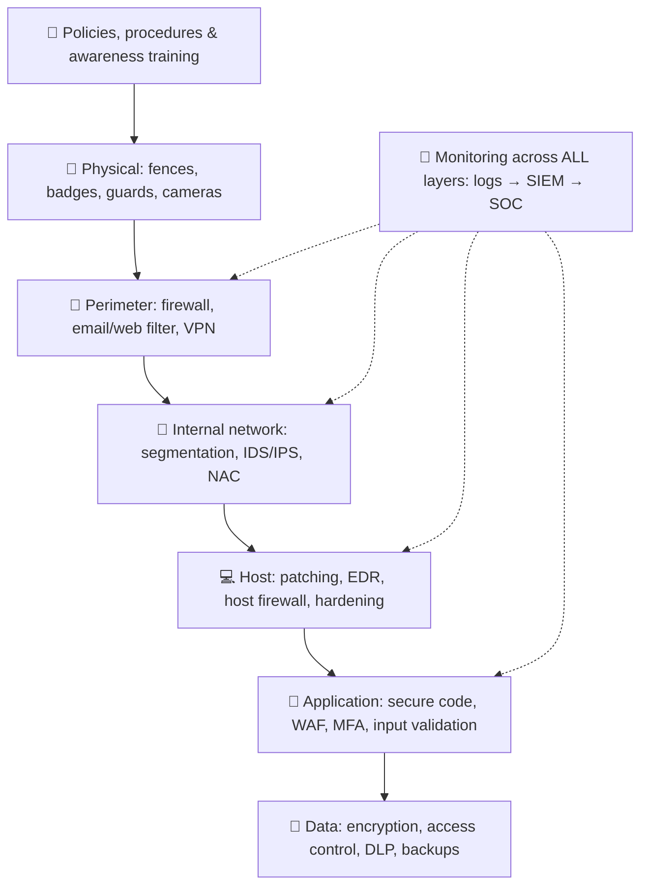

# Chapter 20 — Defense in Depth & Your First Security Tools

**Level 2 · Beginner for the Exam** · *Introduces objectives 2.5, 3.2, 4.4 and 4.5*

---

## 🎯 Goal

By the end of this chapter you will understand **defense in depth** (layered security) and know what the most common security tools do: **firewalls, antivirus/anti-malware, EDR, IDS vs IPS, VPNs, proxies, web/email filters, network segmentation, honeypots, SIEM, backups and patching**. These names appear throughout the exam, so learn the basic job of each now.

---

## 🏠 Real-Life Story: The Castle, Again 🏰

No castle relied on a single wall. Look at all the layers:

## 🖼️ Figure 20.1 — The Castle Model of Defense in Depth

```
   CASTLE PART                       SECURITY EQUIVALENT
   ───────────────────────────────   ────────────────────────────────────────────────
   Moat around the castle        →   Firewall at the network edge
   Gatehouse checking visitors   →   Authentication / MFA / access control
   Inner walls splitting areas   →   Network segmentation (VLANs, zones)
   Lookouts on the towers        →   IDS / IPS / SIEM monitoring
   Guards inside each room       →   Endpoint protection (antivirus / EDR)
   Treasure in a locked vault    →   Encryption of the data itself
   Rules for the soldiers        →   Policies, training, awareness
   Spare food and water stores   →   Backups and disaster recovery
   A fake treasure room as bait  →   Honeypot
```

**Defense in depth** = **multiple layers of different controls**, so if one fails, others still protect you. No single control is ever perfect.

## 🖼️ Figure 20.2 — Why Layers Work: The "Swiss Cheese" Model 🧀

```
   Attack ──►  [ Layer 1  o     ]  [ Layer 2     o  ]  [ Layer 3  o     ]  ──► 💎 Data
               (training)          (email filter)       (MFA)

   Every layer has holes (weaknesses). An attack only succeeds if the holes in
   EVERY layer happen to line up. Adding layers makes that very unlikely.
```

---

## 📖 Part 1 — Network Security Tools 🌐

### Firewall 🧱
A firewall **allows or blocks traffic based on rules**: source/destination IP, port, protocol, and (in advanced firewalls) the application or user.

## 🖼️ Figure 20.3 — A Simple Firewall Rule Table

```
   #   Action   Source         Destination      Port   Protocol   Why
   ──  ──────   ────────────   ──────────────   ────   ────────   ───────────────────────
   1   ALLOW    Any            Web server       443    TCP        Public website (HTTPS)
   2   ALLOW    Admin subnet   Web server       22     TCP        Admins manage via SSH
   3   DENY     Any            Any              23     TCP        Block Telnet everywhere
   4   DENY     Any            Any              Any    Any        Block everything else
   Rules are checked TOP to BOTTOM; the FIRST match wins. Rule 4 shows the
   "IMPLICIT DENY": most firewalls block anything not allowed even if you never
   write this rule. Admins often add it anyway so blocked traffic gets logged.
```

| Firewall kind | Works at | Notes |
|---|---|---|
| **Packet-filtering** (stateless) | Layers 3–4 (IP, port) | Simple, fast, checks each packet alone |
| **Stateful** | Layers 3–4 + remembers connections | Knows which replies belong to allowed conversations |
| **NGFW**: Next-Generation Firewall | Up to **Layer 7** | Understands **applications** ("block Facebook games, allow Facebook chat"), often includes IPS |
| **WAF**: Web Application Firewall | Layer 7, **web traffic only** | Protects websites from **SQL injection, XSS** (Chapter 24) |
| **Host-based firewall** | On one computer | Windows Defender Firewall, Linux `ufw`/`iptables` |

> 💡 **Implicit deny** = "anything not explicitly allowed is blocked." It's a core firewall principle and a favorite exam answer.

### IDS vs IPS 👀🛑

| | **IDS**: Intrusion **Detection** System | **IPS**: Intrusion **Prevention** System |
|---|---|---|
| What it does | **Watches** traffic and **alerts** on suspicious activity | Watches **and blocks** suspicious traffic automatically |
| Placement | **Passive**: gets a *copy* of traffic (tap / mirror port) | **Inline**: traffic flows *through* it |
| Control type | **Detective** | **Preventive** |
| Risk | Attack still gets through (only alerts) | A false positive can **block legitimate traffic** |
| Analogy | Security camera + alarm | Guard who tackles the intruder |

## 🖼️ Figure 20.4 — Passive vs Inline

```
   IDS (passive, out of band)                 IPS (inline)

   Internet ──► Firewall ──► Switch ──► LAN    Internet ──► Firewall ──► IPS ──► LAN
                               │                                         │
                               └─copy─► IDS ──► 🚨 alert                 └─ blocks bad
                                                                             traffic itself
```

**How they detect attacks:**
- **Signature-based:** matches known attack patterns, like antivirus. Good for known threats; misses new ones.
- **Anomaly/behavior-based:** learns what's "normal" and alerts on unusual activity. Can catch new attacks, but gives more **false positives**.

> Also: **NIDS/NIPS** watch the **network**; **HIDS/HIPS** run on a **single host**.

### VPN — Virtual Private Network 🚇
Creates an **encrypted tunnel** over an untrusted network (like the internet or café Wi-Fi).
- **Remote-access VPN:** an employee at home connects securely to the office network.
- **Site-to-site VPN:** connects two offices' networks permanently.
- Common technologies: **IPsec**, **TLS/SSL VPN**, WireGuard.

## 🖼️ Figure 20.5 — The VPN Tunnel

```
   🏠 Home laptop ════════════ encrypted tunnel ═════════════ 🏢 Office VPN gateway ── 🗄️ files
                  (passes through the public internet, but
                   eavesdroppers see only scrambled data)
```

### Proxy Server 🔁
A **middleman** that makes web requests **on your behalf**. Companies use **forward proxies** to **filter and log** employee web browsing (block malicious or inappropriate sites) and to cache content. (Reverse proxies sit in front of web servers, Chapter 30.)

### Web Filter & DNS Filter 🚫
Block access to **known-malicious or unwanted websites** by URL, category ("gambling," "malware"), or reputation. A **DNS filter** simply refuses to look up bad domain names.

### Email Security Gateway 📧
Scans incoming email for **spam, phishing links and malicious attachments** before they reach users. Often opens attachments in a **sandbox** (a safe, isolated test environment) first.

### Network Segmentation 🧩
Splitting a network into **separate zones** (often using **VLANs**: Virtual LANs) so a compromise in one zone can't easily spread to another.

## 🖼️ Figure 20.6 — Flat Network vs Segmented Network

```
   FLAT (bad): everything can talk to everything     SEGMENTED (good): firewalled zones

   💻 💻 💻 🗄️ 📷 🖨️ 🏭                              [ Staff PCs ]──┐
   (one infected camera can reach the                [ Servers   ]──┼── FIREWALL rules
    database server directly)                        [ IoT/Cams  ]──┤   between zones
                                                     [ Guests    ]──┘
                                                     (an infected camera stays stuck
                                                      in the IoT zone)
```

---

## 📖 Part 2 — Endpoint (Device) Security Tools 💻

An **endpoint** is any device at the "end" of the network: laptops, desktops, servers, phones.

| Tool | What it does |
|---|---|
| **Antivirus / anti-malware** | Scans files for **known malware signatures** and some suspicious behavior; quarantines or deletes threats |
| **EDR**: Endpoint Detection & Response | Next-generation: **records activity** on each device (processes, connections, file changes), **detects suspicious behavior** (even fileless malware), and lets responders **isolate the device remotely** and investigate |
| **XDR**: Extended Detection & Response | EDR extended across endpoints **plus** network, email, cloud and identity data |
| **Host-based firewall** | Firewall on the device itself |
| **HIPS** | Host-based intrusion prevention |
| **Patch management** | Keeps OS and apps updated, closing known vulnerabilities |
| **Application allow list** | **Only approved programs can run.** Everything else is blocked (very strong against malware) |
| **Full-disk encryption** | Protects data if the device is lost or stolen |

> 💡 **Allow list vs block list (deny list):** a **block list** is like a "banned guests" list at a party: everyone gets in *except* listed troublemakers (new troublemakers get in!). An **allow list** is a **guest list**: *only* named people get in. Allow lists are more secure but need more management.

---

## 📖 Part 3 — Monitoring & Detection 🔭

### Logs and SIEM 📊
Every device produces **logs**. A **SIEM** (**S**ecurity **I**nformation and **E**vent **M**anagement, pronounced "sim") **collects logs from everywhere**, **correlates** them, and **raises alerts**.

## 🖼️ Figure 20.7 — The SIEM Funnel

```
   Firewall logs ─┐
   Server logs  ──┤
   EDR alerts   ──┤──► [ SIEM: collect → normalize → correlate → alert ] ──► 🧑‍💻 SOC analyst
   Cloud logs   ──┤        "5 failed logins on server A, then a
   Badge logs   ──┘         successful login from a new country"
                            = one meaningful ALERT instead of 5,000 noisy lines
```

### Honeypots (and Friends) 🍯
A **decoy** system designed to **attract attackers** and **detect** them. No legitimate user should ever touch it, so **any activity is suspicious**.

| Deception tool | What it is |
|---|---|
| **Honeypot** | A fake server that looks valuable |
| **Honeynet** | A whole network of honeypots |
| **Honeyfile** | A fake file ("passwords.xlsx") that triggers an alert when opened |
| **Honeytoken** | Fake data (a fake account, API key or database record) that alerts when used |

(More in Chapter 33.)

---

## 📖 Part 4 — The Basics That Matter Most 🧹

Fancy tools fail without the basics. Most breaches still come from these gaps:

| Basic | Why it matters |
|---|---|
| **Patching** | Closes known holes (WannaCry, Equifax: Chapter 10) |
| **Least privilege** | Limits damage when an account is compromised |
| **MFA** | Stops most stolen-password attacks |
| **Backups (offline/immutable, tested)** | Recovery from ransomware and disasters |
| **Hardening** | Remove unneeded software/services, change **default passwords** |
| **Asset inventory** | You can't protect what you don't know you have |
| **Training** | People are the first line of defense |

## 🖼️ Figure 20.8 — The Defense-in-Depth Stack



---

## 🧠 Memory Tricks

- **IDS = "I Detect Stuff." IPS = "I Prevent Stuff."**
- **IDS is passive (copy). IPS is inline (in the path).**
- **WAF = "Web App's Firewall"** (stops SQL injection/XSS).
- **Allow list = guest list. Block list = banned list.**
- **SIEM = "See It, Evaluate, Me alert."** It collects and correlates logs.
- **Honey = sweet bait for attackers.**
- **Implicit deny = "If it's not on the list, it's not getting in."**

---

## ⚠️ Exam Tip

- *"Which device can BLOCK malicious traffic in real time?"* → **IPS** (inline).
- *"Which device only ALERTS and is connected to a mirror port?"* → **IDS.**
- *"Which BEST protects a web application from SQL injection?"* → **WAF** (plus input validation).
- *"Which tool collects and correlates logs from many sources?"* → **SIEM.**
- *"What is the last rule in most firewall ACLs?"* → **Implicit deny** (deny all).
- *"Which control BEST stops unapproved software from running?"* → **Application allow list.**
- *"Which provides an encrypted tunnel for remote workers?"* → **VPN.**

---

## 🧪 Try It (20 minutes)

1. **Check your host firewall:** Windows → *Windows Security → Firewall & network protection*. Is it on for all profiles? On Linux, run `sudo ufw status`.
2. **Check your antivirus/EDR:** Windows Security → *Virus & threat protection* → when was the last scan, and are definitions up to date?
3. **Write firewall rules on paper** for a small company with: a public web server (HTTPS), an email server (SMTP), and admins who need SSH from one office subnet. Remember to end with **implicit deny**.
4. **Try a DNS filter:** set your home router's (or one device's) DNS to a filtering service such as **Quad9 (9.9.9.9)**, which blocks known-malicious domains.

---

## ✅ Checkpoint Questions

1. What is defense in depth?
2. What is the difference between an IDS and an IPS?
3. Which detection method can find brand-new attacks, and what's its downside?
4. What does "implicit deny" mean?
5. What does a WAF protect, and what attacks does it stop?
6. What does a VPN provide?
7. How is EDR more capable than traditional antivirus?
8. What does a SIEM do?
9. Why does network segmentation help?
10. What is a honeypot, and why is any activity on it suspicious?

<details>
<summary><b>Show answers</b></summary>

1. Using **multiple layers of different security controls**, so if one fails, others still protect the asset.
2. An **IDS detects and alerts** (passive). An **IPS detects and blocks** (inline).
3. **Anomaly/behavior-based** detection. Downside: **more false positives**.
4. **Any traffic not explicitly allowed is denied.**
5. It protects **web applications**, stopping attacks like **SQL injection and cross-site scripting (XSS)**.
6. An **encrypted tunnel** across an untrusted network (confidentiality and integrity in transit).
7. EDR **records and analyzes behavior** on endpoints, detects unknown/fileless threats, and supports **investigation and remote response** (e.g., isolating a device).
8. It **collects, normalizes and correlates logs** from many sources and **raises alerts**.
9. It **contains** a compromise in one zone and stops attackers moving freely across the network.
10. A **decoy system** to attract and detect attackers. No legitimate user should ever use it, so **any** interaction is suspicious.

</details>

### 🎯 Exam-Style Practice (multiple choice)

**MC1.** A firewall has these rules, in order: Rule 1 `DENY Any → Any, TCP 443`; Rule 2 `ALLOW Any → Web server, TCP 443`. What happens to HTTPS traffic from the internet to the web server?
A. It is blocked, because the first matching rule wins  B. It is allowed, because the more specific rule wins  C. It is allowed, because ALLOW rules always beat DENY rules  D. It is logged but neither allowed nor blocked

**MC2.** A new IPS is placed inline. The next morning the payroll application stops working because the IPS blocked its normal traffic as "suspicious." What does this show?
A. A false negative letting an attack through  B. A false positive blocking legitimate traffic, a known risk of inline prevention  C. That the IPS is really an IDS  D. That signature-based detection is turned off

**MC3.** On a flat network, malware on an infected smart camera was able to reach the database server directly. Which change BEST stops this from happening again?
A. Installing antivirus on the camera  B. Replacing the camera with a newer model  C. Adding a honeypot  D. Segmenting the network into zones (for example VLANs) with firewall rules between them

**MC4.** A security team puts a file named `passwords.xlsx` on a file share. No one has a reason to open it, and opening it triggers an alert. What is this file?
A. A honeyfile  B. A honeynet  C. A block list  D. A signature

**MC5.** A firewall lets reply traffic back into the network only when the reply belongs to a connection that was started from inside. Which kind of firewall is this?
A. A stateless packet filter  B. A stateful firewall  C. A web application firewall  D. A forward proxy

**MC6.** A company wants to allow staff to use a social media site's chat feature but block the games on the same site. Which tool BEST does this?
A. A stateless packet-filtering firewall  B. A DNS filter  C. A next-generation firewall (NGFW)  D. A site-to-site VPN

<details>
<summary><b>Show multiple-choice answers</b></summary>

| # | Answer | Why |
|---|---|---|
| MC1 | A | Firewall rules are checked top to bottom and the first match wins, so Rule 1 blocks the traffic before Rule 2 is reached. |
| MC2 | B | An inline IPS can block legitimate traffic when it raises a false positive; an IDS would only have alerted. |
| MC3 | D | Segmentation keeps a compromised device stuck in its own zone so it cannot reach servers freely. |
| MC4 | A | A honeyfile is bait data that alerts when opened; a honeynet is a whole network of honeypots. |
| MC5 | B | A stateful firewall remembers connections and allows only replies that belong to them; a stateless filter checks each packet alone. |
| MC6 | C | An NGFW understands applications at Layer 7, so it can allow one feature of a site and block another; a DNS filter can only block the whole domain. |

</details>


---

## 📌 Chapter Summary

| Tool | One-line job |
|---|---|
| Firewall / NGFW / WAF | Allow or block traffic by rules / by app / for websites |
| IDS / IPS | Detect & alert / detect & block |
| VPN | Encrypted tunnel over untrusted networks |
| Proxy, web & DNS filter | Control and filter web access |
| Email gateway | Stop phishing and malicious attachments |
| Segmentation (VLANs) | Contain attackers in zones |
| Antivirus / EDR / XDR | Protect and investigate endpoints |
| Allow list | Only approved software runs |
| SIEM | Collect and correlate logs, alert |
| Honeypot / honeyfile / honeytoken | Bait to detect attackers |
| Basics | Patch, least privilege, MFA, backups, hardening, inventory, training |

**Next chapter →** *Chapter 21: Data Basics.* All these layers protect one thing in the end: data. Let's learn its types, labels and states.
