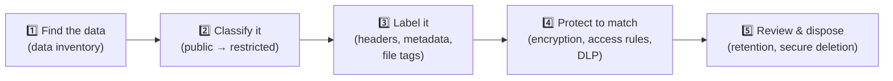

# Chapter 21 — Data Basics: Types, Classifications & States

**Level 2 · Beginner for the Exam** · *Exam objective 3.3 (introduction)*

---

## 🎯 Goal

By the end of this chapter you will know the **data types** named in Security+ (regulated, trade secret, intellectual property, legal, financial, human- and non-human-readable), how organizations **classify** data (public, private, sensitive, confidential, restricted, critical), the three **data states** (at rest, in transit, in use), and the ideas of **data sovereignty** and **geolocation**.

---

## 🏠 Real-Life Story: Sorting Your Mail 📬

When you sort your mail at home, you don't treat every envelope the same way:

- 📰 **Pizza menus and adverts:** anyone can see them. Straight to recycling.
- 🧾 **Utility bills:** a bit private, kept in a drawer.
- 🏦 **Bank statements and tax documents:** private, locked in a filing cabinet, **shredded** when no longer needed.
- 🛂 **Your passport:** very sensitive, kept in a safe.

You've just **classified** your data and given each group a **different level of protection**. Organizations do exactly the same, at a much larger scale. **You can't protect everything at the maximum level**, because it costs too much. So you first find out **what you have** and **how valuable it is**.

---

## 📖 Part 1 — Data Types 🗂️

| Data type | Meaning | Examples |
|---|---|---|
| **Regulated** | Data protected **by law or regulation**, with legal penalties if mishandled | Health records (HIPAA), card data (PCI DSS), EU personal data (GDPR) |
| **Trade secret** | Confidential business information that gives a **competitive advantage**, protected by keeping it secret | A recipe (e.g., a famous soft-drink formula), a search algorithm, customer lists |
| **Intellectual property (IP)** | Creations of the mind protected by **patents, copyrights and trademarks** | Software source code, designs, inventions, logos, books |
| **Legal information** | Data related to legal matters | Contracts, court documents, legal advice, records under **legal hold** |
| **Financial information** | Data about money | Bank account numbers, payroll, credit cards, company financial reports |
| **Human-readable** | Data people can read directly | Documents, emails, spreadsheets |
| **Non-human-readable** | Data only machines can read or process | Barcodes, QR codes, encrypted data, compiled program files, database binary files |

### Personal Data Acronyms You'll See

| Term | Meaning | Example |
|---|---|---|
| **PII**: Personally Identifiable Information | Any data that can **identify a person** | Name + birth date, national ID / Social Security number, passport number, email, phone |
| **PHI**: Protected Health Information | Health data linked to a person (US: HIPAA) | Medical records, test results, insurance details |
| **Cardholder data** (PCI) | Payment card information | Card number, expiry date, CVV |

> 🔐 **Why non-human-readable still matters:** a **QR code** or **barcode** can hold PII or a malicious link. "I can't read it" doesn't mean "nobody can read it."

---

## 📖 Part 2 — Data Classification 🏷️

**Classification** = labeling data by **how sensitive or important it is**, so everyone knows **how to handle it**.

## 🖼️ Figure 21.1 — The Classification "Traffic Light" (commercial organizations)

```
   ┌──────────────────────────────────────────────────────────────────────────┐
   │ RESTRICTED   Highest sensitivity. Severe damage if leaked. Very few      │
   │              people. e.g. merger plans, encryption keys, source code     │
   ├──────────────────────────────────────────────────────────────────────────┤
   │ CONFIDENTIAL Serious damage if leaked. Need-to-know only.                │
   │              e.g. customer data, employee salaries, contracts            │
   ├──────────────────────────────────────────────────────────────────────────┤
   │ SENSITIVE /  Internal use. Some damage if leaked.                        │
   │ PRIVATE      e.g. internal emails, personal data of staff, org charts    │
   ├──────────────────────────────────────────────────────────────────────────┤
   │ PUBLIC       No harm if shared. Approved for everyone.                   │
   │              e.g. marketing brochures, website content, press releases   │
   └──────────────────────────────────────────────────────────────────────────┘
        ▲ MORE protection, fewer people, more cost as you go UP
```

| Classification (SY0-701 terms) | Simple meaning |
|---|---|
| **Public** | Anyone may see it. No harm if disclosed |
| **Private** | Personal or internal information (e.g., about employees or customers) not for outsiders |
| **Sensitive** | Would cause harm if disclosed; requires protection (often used for PII) |
| **Confidential** | Serious harm if disclosed; strict need-to-know |
| **Restricted** | Highest commercial level; very tightly limited; severe harm if disclosed |
| **Critical** | Data the organization **can't operate without**. Here the focus is **availability** (e.g., the production database, order-processing data) |

> ⚠️ Exact labels **vary between organizations**. The exam cares that you understand the **idea**: higher classification → stronger protection and fewer people with access.

### Government / Military Labels (for comparison)

```
   TOP SECRET      → exceptionally grave damage to national security
   SECRET          → serious damage
   CONFIDENTIAL    → damage
   UNCLASSIFIED    → no damage (may still be "sensitive but unclassified")
```

### Why Classify?



- Tells staff **how to handle** each document.
- Lets tools like **DLP (Data Loss Prevention)** automatically **block** "Confidential" files from being emailed outside the company.
- Puts **money where it matters**: the strongest (most expensive) controls go on the most valuable data.

---

## 📖 Part 3 — The Three Data States ⭐

Data is always in one of three states, and **each needs different protection**.

## 🖼️ Figure 21.2 — A Customer Record's Journey

```
   AT REST                       IN TRANSIT                      IN USE
   (stored)                      (moving)                        (being processed)

   💾 Database disk   ──────►    🌐 Network cable / Wi-Fi  ──►    🧠 RAM + CPU of the app
   on the server                 to the user's browser           server, or the open
                                                                 document on a laptop

   Protect with:                 Protect with:                   Protect with:
   • Full-disk encryption        • TLS / HTTPS                   • Access controls
   • Database encryption         • VPN / IPsec                   • Secure enclaves / trusted
   • File permissions            • SSH, SFTP                       execution environments
   • Physical security           • Email encryption              • Memory protection
   • Backups (encrypted!)                                        • Screen privacy, clean desk
```

| State | Also called | Example | Main protection |
|---|---|---|---|
| **At rest** | Stored | Files on a laptop SSD, database, backup tape, USB stick, cloud storage | **Encryption at rest** (BitLocker, FileVault, database encryption) |
| **In transit** | In motion | Email crossing the internet, web traffic, file upload | **Encryption in transit** (TLS, VPN, SSH) |
| **In use** | In processing | Spreadsheet open in Excel; data being calculated in memory | Hardest to protect: **access controls, secure enclaves**, memory protections |

> 💡 Data **must usually be decrypted to be used**. That's why "in use" is the hardest state to protect, and why malware that reads **RAM** (memory scrapers) is dangerous.

---

## 📖 Part 4 — Data Sovereignty & Geolocation 🌍

- **Data sovereignty:** data is subject to the **laws of the country where it is stored** (or, under some laws, where the people it describes live). Example: EU personal data stored on servers in another country must still meet **GDPR** rules, and some countries **require** certain data to stay inside their borders.
- **Geolocation:** the physical **location** of data or users. Companies may use **geographic restrictions**: storing data only in specific regions, or blocking logins from certain countries.

## 🖼️ Figure 21.3 — Why Location Matters

```
   🇪🇺 A European company's customer data
          │
          ├──► stored in EU cloud region ✅        (GDPR rules clearly met)
          │
          └──► copied to a server in another country ⚠️
                 → whose laws apply? Can that country's government demand access?
                 → may need special legal agreements, or may be forbidden
```

> 🔐 When choosing a cloud provider, companies pick the **region** where data is stored for this reason.

---

## 📖 Part 5 — Ways to Protect Data (Preview of Chapter 31)

| Method | Simple meaning | Example |
|---|---|---|
| **Encryption** | Scramble with a key | AES-encrypted database |
| **Hashing** | One-way fingerprint | Stored password hashes |
| **Masking** | Hide part of the data when displayed | `**** **** **** 4821` |
| **Tokenization** | Replace sensitive data with a **random token**; the real value is stored safely elsewhere | Card `4111…1111` → token `tok_8f3K…` |
| **Obfuscation** | Make data hard to understand | Scrambled code, data hidden in images (steganography) |
| **Segmentation** | Keep sensitive data in separate, protected network zones | Card data only on the PCI network segment |
| **Permission restrictions** | Limit who can access | Only HR can open salary files |
| **Geographic restrictions** | Limit where data is stored or accessed from | EU-only cloud region |

---

## 📖 Part 6 — Data Roles (Preview of Chapter 43)

| Role | Responsibility |
|---|---|
| **Data owner** | A senior person **accountable** for the data; decides its classification and who gets access |
| **Data custodian / steward** | Handles the **day-to-day care**: backups, applying access rules, storage (often IT) |
| **Data controller** | (Privacy law) decides **why and how** personal data is processed |
| **Data processor** | (Privacy law) processes personal data **on behalf of** the controller (e.g., a payroll company) |
| **Data subject** | The **person the data is about** |

---

## 🧠 Memory Tricks

- **States: "Resting, Traveling, Working"** = at rest, in transit, in use.
- **In use is the hardest**: the data has to be "unlocked" to work on it.
- **Classification ladder (low → high): "People Should Consider Restricting"**: Public → Sensitive/Private → Confidential → Restricted. **Critical** = "can't live without it" (availability).
- **Trade secret = kept secret. IP = protected by law (patent/copyright/trademark).**
- **Sovereignty = "the data obeys the land it lives in."**

---

## ⚠️ Exam Tip

- *"A laptop's hard drive is encrypted. Which data state is protected?"* → **At rest.**
- *"TLS protects data in which state?"* → **In transit.**
- *"Which data state is MOST difficult to protect?"* → **In use.**
- *"A company must keep EU citizens' data within the EU."* → **Data sovereignty** (geographic restriction).
- *"A soft-drink recipe that gives a company its competitive edge."* → **Trade secret.**
- *"Health records protected by law."* → **Regulated** data (PHI).
- *"Displaying only the last four digits of a card number."* → **Masking.**

---

## 🧪 Try It (15 minutes)

1. **Classify your own data.** List 10 files or accounts you have (photos, ID scans, school work, bank app…). Give each a classification: public / private / sensitive / confidential / restricted / critical. Which ones need encryption and backups?
2. **Find data at rest protection:** check whether your phone is encrypted (most modern phones are, once a screen lock is set) and whether your laptop has BitLocker/FileVault on.
3. **See data in transit protection:** open any website, click the 🔒, and check that the connection uses **TLS 1.2 or 1.3**.
4. **Spot masking:** find an online account or receipt that shows only part of your card number or email (e.g., `j***@example.com`).

---

## ✅ Checkpoint Questions

1. What makes data "regulated"?
2. What is the difference between a trade secret and intellectual property protected by a patent?
3. Give two examples of PII.
4. Put these in order from least to most sensitive: confidential, public, restricted, sensitive.
5. What does the "critical" classification focus on?
6. Name the three data states and one protection for each.
7. Which data state is the hardest to protect, and why?
8. What is data sovereignty?
9. What is the difference between masking and tokenization?
10. Who is accountable for classifying a set of data: the data owner or the data custodian?

<details>
<summary><b>Show answers</b></summary>

1. It's **protected by laws or regulations** (e.g., HIPAA, PCI DSS, GDPR), with penalties for mishandling.
2. A **trade secret** is protected by **keeping it secret**. A **patent** protects an invention **by law**, but the invention is published.
3. E.g., **full name with date of birth, national ID/Social Security number, passport number, email address, phone number, home address.**
4. **Public → sensitive → confidential → restricted.**
5. **Availability**: data the organization can't function without.
6. **At rest** (disk encryption), **in transit** (TLS/VPN), **in use** (access controls / secure enclaves).
7. **In use**: data usually must be **decrypted** to be processed, so it's exposed in memory.
8. Data is **subject to the laws of the country** where it's stored (or where its subjects live).
9. **Masking** hides part of the value when **displayed** (`****4821`). **Tokenization** **replaces** the value with a random token and stores the real value elsewhere.
10. The **data owner.**

</details>

### 🎯 Exam-Style Practice (multiple choice)

**MC1.** A payment app replaces each card number with a random value such as `tok_8f3K…` and keeps the real card numbers in a separate, tightly secured vault. Which protection method is this?
A. Masking  B. Hashing  C. Tokenization  D. Obfuscation

**MC2.** A company's order-processing database holds nothing secret, but the business stops completely if it is unavailable for even an hour. Which classification BEST fits this data?
A. Public  B. Restricted  C. Confidential  D. Critical

**MC3.** A warehouse prints QR codes on shipping labels. Each code holds the customer's name and home address. Which statement is MOST accurate?
A. The QR codes still contain PII and need protecting, even though people cannot read them directly  B. QR codes are non-human-readable, so they cannot contain personal data  C. QR codes are automatically encrypted  D. Only trade secrets can be stored in QR codes

**MC4.** The finance director decides who may access the general ledger. The IT team runs the nightly backups and applies those access rules. Which role does the IT team play?
A. Data owner  B. Data subject  C. Data custodian / steward  D. Data controller

**MC5.** A company outsources its payroll. The payroll provider handles employees' personal data only on the company's instructions. Which role does the payroll provider have under privacy law?
A. Data owner  B. Data subject  C. Data controller  D. Data processor

**MC6.** A DLP tool automatically blocks any email that carries a "Confidential" file to an outside address. What must the company have done FIRST for this to work?
A. Encrypted every email  B. Classified and labeled its data  C. Moved all data to a public cloud  D. Turned off TLS on the mail server

<details>
<summary><b>Show multiple-choice answers</b></summary>

| # | Answer | Why |
|---|---|---|
| MC1 | C | Tokenization swaps the real value for a random token and stores the real value elsewhere; masking only hides part of it on screen. |
| MC2 | D | "Critical" is about availability, meaning data the organization cannot operate without, even if it is not secret. |
| MC3 | A | Non-human-readable does not mean safe: a phone can read a QR code instantly, so the name and address are still PII. |
| MC4 | C | The custodian/steward handles day-to-day care such as backups and applying access rules; the director is the data owner. |
| MC5 | D | A processor handles personal data on behalf of the controller, which decides why and how it is processed. |
| MC6 | B | DLP can only act on labels it can see, so data must be classified and labeled before rules can block it. |

</details>


---

## 📌 Chapter Summary

| Topic | Key points |
|---|---|
| Data types | Regulated · trade secret · IP · legal · financial · human/non-human-readable |
| Personal data | PII, PHI, cardholder data |
| Classifications | Public · private · sensitive · confidential · restricted · critical |
| Data states | **At rest** (disk encryption) · **in transit** (TLS/VPN) · **in use** (hardest) |
| Location | Data sovereignty and geolocation/geographic restrictions |
| Protection methods | Encryption, hashing, masking, tokenization, obfuscation, segmentation, permissions |

**Next chapter →** *Chapter 22: Introduction to Policies, Risk & Compliance.* Who decides how data must be handled, and what happens if they don't? Welcome to governance.
