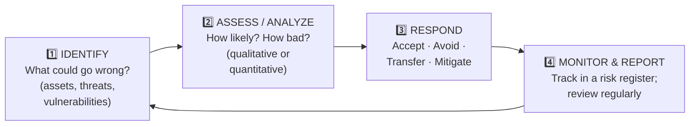

# Chapter 22 — Introduction to Policies, Risk & Compliance

**Level 2 · Beginner for the Exam** · *Introduces objectives 5.1, 5.2 and 5.4*

---

## 🎯 Goal

By the end of this chapter you will understand the "rules" side of security: the difference between **policies, standards, procedures and guidelines**, what an **acceptable use policy (AUP)** is, the basic **risk management** steps and the four **risk responses** (accept, avoid, transfer, mitigate), and what **compliance** means, with the main laws and standards named (**GDPR, HIPAA, PCI DSS, SOX** and others). Domain 5 is **20%** of the exam, and this chapter is its foundation.

---

## 🏠 Real-Life Story: School Rules 🏫

Think about how a school is run:

| At school | In security | What it is |
|---|---|---|
| "Students must behave safely and respectfully." | **Policy** | A **high-level goal/rule** from leadership. *What* and *why* |
| "Uniform: navy jumper, black shoes, no trainers." | **Standard** | A **specific, mandatory** requirement that supports the policy |
| "Fire drill: leave by door B, line up on the field, teacher takes register." | **Procedure** | **Step-by-step** instructions. *How* |
| "Tip: pack your bag the night before." | **Guideline** | **Recommended**, optional advice |

Security governance uses exactly the same four layers.

---

## 📖 Part 1 — The Governance Documents

## 🖼️ Figure 22.1 — The Governance Pyramid

```
                         /\
                        /  \
                       /    \             POLICY     "We protect customer data."
                      /POLICY\                       High-level, approved by senior
                     /________\                      management. MANDATORY.
                    /          \
                   /  STANDARD  \         STANDARD   "Passwords: 14+ characters,
                  /______________\                   MFA required, AES-256 for laptops."
                 /                \                  Specific. MANDATORY.
                /    PROCEDURE     \      PROCEDURE  "To reset a password: 1. Verify ID
               /____________________\                by call-back 2. … 3. …"
              /                      \               Step-by-step. MANDATORY.
             /       GUIDELINE        \   GUIDELINE  "Consider using a password manager."
            /__________________________\             Recommendations. OPTIONAL.
```

| Document | Answers | Mandatory? | Example |
|---|---|:---:|---|
| **Policy** | **What** must be done and **why** | ✅ | Information security policy, AUP |
| **Standard** | **Which specific** technology/settings/levels | ✅ | Password standard, encryption standard |
| **Procedure** | **How**, step by step | ✅ | Onboarding procedure, incident response **playbook** |
| **Guideline** | **Advice / best practice** | ❌ | "Tips for working safely while travelling" |

> ⚠️ **Exam trap:** guidelines are the **only optional** one. If a question says "recommended, not required," the answer is **guideline**.

### Common Security Policies (SY0-701 names)

| Policy | Purpose |
|---|---|
| **AUP**: Acceptable Use Policy | **What users may and may not do** with company systems (no personal crypto mining, no sharing passwords, no illegal downloads). Users usually **sign/accept** it |
| **Information security policy** | The organization's overall security goals and responsibilities |
| **Business continuity (BC) policy** | How the business **keeps running** during a disruption |
| **Disaster recovery (DR) policy** | How IT systems are **restored** after a disaster |
| **Incident response (IR) policy** | How security incidents are handled (Chapter 41) |
| **SDLC policy**: Software Development Life Cycle | How software is built securely |
| **Change management policy** | How changes to systems are requested, approved, tested and recorded (Chapter 33) |

### Common Standards
**Password**, **access control**, **physical security** and **encryption** standards: specific, measurable rules (e.g., "all laptops use AES-256 full-disk encryption").

### Common Procedures
**Change management**, **onboarding/offboarding** (giving and removing access when people join/leave), and **playbooks** (step-by-step response guides, e.g., "phishing playbook").

---

## 📖 Part 2 — Personnel Policies (People Rules) 👥

| Practice | What it means | Why it helps |
|---|---|---|
| **Least privilege** | Minimum access needed | Limits damage |
| **Separation of duties** | Split critical tasks between people (one creates a payment, another approves it) | Prevents a single person committing fraud |
| **Job rotation** | Staff periodically switch roles | Fraud gets noticed by the next person; cross-training |
| **Mandatory vacation** | Staff must take time off (often 1–2 weeks in a row) | Hidden fraud surfaces while someone else does their job |
| **Background checks** | Verify history before hiring | Reduce insider risk |
| **Onboarding** | Accounts, training, signing the AUP and NDA | Start securely |
| **Offboarding** | **Disable accounts immediately**, collect badges/devices | Prevent revenge or misuse (remember Colonial Pipeline's old VPN account!) |
| **NDA**: Non-Disclosure Agreement | Legal promise not to share confidential information | Protects secrets |

---

## 📖 Part 3 — Risk Management Basics ⚖️

Recall from Chapter 10: **Risk = Likelihood × Impact.** **Risk management** is the ongoing process of finding, measuring and dealing with risks.

## 🖼️ Figure 22.2 — The Risk Management Cycle



### The Four Risk Responses ⭐⭐ (very commonly tested)

| Response | Meaning | Real-life example | IT example |
|---|---|---|---|
| **Mitigate** (reduce) | Add controls to **lower** likelihood or impact | Install a smoke alarm and sprinklers | Patch servers, add MFA, add a firewall |
| **Transfer** (share) | **Shift** the financial impact to someone else | Buy **house insurance** | Buy **cyber insurance**; outsource to a provider under contract |
| **Avoid** | **Stop doing** the risky activity entirely | Don't go mountain climbing | Shut down an old, insecure service; don't store card numbers at all |
| **Accept** | **Acknowledge** the risk and do nothing more (cost of fixing > potential loss) | Don't insure a cheap old bicycle | Accept the small risk of an internal test server with no sensitive data |

> 🔐 **Exceptions and exemptions** are formal ways of **accepting** a risk, e.g., "this legacy system is exempt from the patching standard until 2027, approved by the CIO."

> ⚠️ **Transferring risk doesn't transfer responsibility.** If a company's outsourced provider leaks customer data, the **company** is still accountable to its customers and regulators. Insurance covers the money, not the reputational damage.

> ⚠️ **Ignoring** a risk (never even looking at it) is **not** the same as accepting it. Acceptance is a **conscious, documented decision**.

### Risk Appetite vs Risk Tolerance (intro)

- **Risk appetite:** how much risk an organization is **willing to take on** to reach its goals. SY0-701 names three styles: **expansionary** (willing to take more risk to grow, like a startup), **conservative** (avoids risk, like a bank) and **neutral** (in between).
- **Risk tolerance:** how much **variation** from that it can **put up with** before acting.

### The Risk Register 📋

A **risk register** is a list (often a spreadsheet) tracking each risk:

```
| ID | Risk                          | Likelihood | Impact | Rating | Owner      | Response | Status      |
|----|-------------------------------|------------|--------|--------|------------|----------|-------------|
| R1 | Ransomware on file servers    | Medium     | High   | HIGH   | IT Mgr     | Mitigate | Backups+EDR |
| R2 | Laptop theft                  | High       | Medium | HIGH   | IT Mgr     | Mitigate | FDE rollout |
| R3 | Data center flood             | Low        | High   | MEDIUM | Facilities | Transfer | Insurance   |
| R4 | Old intranet page defaced     | Low        | Low    | LOW    | Web team   | Accept   | Reviewed    |
```

### Qualitative vs Quantitative (preview of Chapter 44)

- **Qualitative:** uses **words/ratings** (Low/Medium/High, 1–5). Quick, based on judgment.
- **Quantitative:** uses **numbers/money** (e.g., "this risk will cost us about $50,000 a year"). You'll learn the formulas (SLE, ARO, ALE) in Chapter 44.

---

## 📖 Part 4 — Compliance 📜

**Compliance** = **following the laws, regulations, contracts and standards** that apply to your organization, and being able to **prove** it (through audits and reports).

## 🖼️ Figure 22.3 — Who Makes the Rules?

```
   LAWS & REGULATIONS          INDUSTRY STANDARDS              FRAMEWORKS (guidance)
   (government, mandatory)     (required by contract)          (voluntary best practice,
                                                                 often used to comply)
   GDPR, HIPAA, SOX,           PCI DSS (card payments)         NIST CSF, ISO/IEC 27001,
   GLBA, CCPA, national laws                                    CIS Controls
```

### Key Regulations and Standards to Recognize

| Name | Where / who | Protects | One-line summary |
|---|---|---|---|
| **GDPR**: General Data Protection Regulation | **European Union** (applies to anyone processing EU residents' data) | Personal data / privacy | Strong privacy rights (incl. **right to be forgotten**); big fines; breach notification within 72 hours |
| **HIPAA**: Health Insurance Portability and Accountability Act | **USA**, healthcare | **PHI** (health information) | Hospitals, insurers and their partners must protect patient data |
| **PCI DSS**: Payment Card Industry Data Security Standard | **Global**, anyone handling **payment cards** | Cardholder data | Required by the card brands through contracts; not a government law |
| **SOX**: Sarbanes-Oxley Act | **USA**, public companies | **Financial reporting** integrity | Accurate financial records and controls; executives accountable |
| **GLBA**: Gramm-Leach-Bliley Act | **USA**, financial institutions | Customers' financial data | Banks must explain and protect how they share customer data |
| **CCPA / CPRA** | **California, USA** | Consumer privacy | Californians' rights over their personal data |
| **FERPA** | USA, education | Student records | Protects student education records |

### Consequences of Non-Compliance

- 💸 **Fines** (GDPR fines can reach **€20 million or 4% of global annual turnover**, whichever is higher)
- ⚖️ **Sanctions** and legal action
- 📉 **Reputational damage** (lost customers and trust)
- 🚫 **Loss of license** (e.g., losing the right to process card payments)
- 📄 **Contractual impacts** (partners can end contracts)

### Due Diligence vs Due Care

- **Due diligence:** **investigating and understanding** risks *before* acting (e.g., researching a vendor's security before signing).
- **Due care:** **acting responsibly** and doing what a reasonable organization would do to protect people and data (e.g., actually applying patches and training staff).

> 🧠 *Diligence = Do research. Care = Carry it out.*

---

## 🧠 Memory Tricks

- **Policy → Standard → Procedure → Guideline**: "**P**lease **S**tick **P**urple **G**um" (only the **G**uideline is optional).
- **Policy = WHAT/WHY. Standard = WHICH. Procedure = HOW. Guideline = SHOULD.**
- **Risk responses: "ATMA"**: **A**ccept, **T**ransfer, **M**itigate, **A**void. *Insurance = Transfer. Stop doing it = Avoid. Add controls = Mitigate. Do nothing (on purpose) = Accept.*
- **GDPR = EU privacy. HIPAA = health. PCI DSS = cards. SOX = financial reports.**
- **Separation of duties = "no one person holds both keys."**

---

## ⚠️ Exam Tip

- *"A company buys cyber insurance."* → **Transfer.**
- *"A company stops offering a risky online service."* → **Avoid.**
- *"A company installs EDR on all laptops to reduce malware risk."* → **Mitigate.**
- *"Management decides the cost of a control is higher than the possible loss and documents the decision."* → **Accept.**
- *"Which document gives step-by-step instructions?"* → **Procedure.**
- *"Which document is optional/recommended?"* → **Guideline.**
- *"Which document do users sign to agree to the rules for using company IT?"* → **AUP.**
- *"A retailer that processes credit cards must comply with…"* → **PCI DSS.**
- *"One employee requests payments and another approves them."* → **Separation of duties.**

---

## 🧪 Try It (20 minutes)

1. **Read a real AUP:** search "acceptable use policy" plus the name of a university. List 5 things it forbids. Would you have broken any of them?
2. **Write your own policy pyramid** for your home Wi-Fi:
   - Policy: "Our home network must be protected from intruders."
   - Standard: "WPA3, 20-character passphrase, router firmware updated monthly."
   - Procedure: "How to give a guest Wi-Fi access: 1… 2… 3…"
   - Guideline: "Consider using the guest network for smart TVs."
3. **Make a mini risk register** with 4 risks from your own life (phone stolen, laptop dies, email hacked, house flood). Choose a response for each: accept, avoid, transfer or mitigate.
4. **Look at a GDPR fine:** search "largest GDPR fines." Which company, how much, and why?

---

## ✅ Checkpoint Questions

1. Put these in order from highest-level to most detailed: procedure, policy, guideline, standard.
2. Which of the four documents is optional?
3. What is an AUP?
4. What is separation of duties, and what does it prevent?
5. Why is mandatory vacation a security control?
6. Name the four risk responses and give an example of each.
7. Does buying insurance remove the company's responsibility for a breach?
8. What is the difference between qualitative and quantitative risk analysis?
9. Which regulation protects health information in the USA? Which protects personal data in the EU?
10. What is the difference between due diligence and due care?

<details>
<summary><b>Show answers</b></summary>

1. **Policy → standard → procedure → guideline** (guidelines are advice that sits alongside the others).
2. The **guideline.**
3. An **Acceptable Use Policy**: rules for what users may and may not do with the organization's systems and data.
4. **Splitting a critical task between two or more people**, so **no single person can commit fraud** or a serious error alone.
5. Someone else performs the employee's duties while they're away, so **hidden fraud or misuse is more likely to be discovered**.
6. **Mitigate** (add MFA), **transfer** (buy cyber insurance), **avoid** (stop the risky activity), **accept** (document and live with a low risk).
7. **No.** It transfers **financial** impact, but the company stays **accountable** (legal and reputational).
8. **Qualitative** uses ratings like low/medium/high. **Quantitative** uses numbers and money values.
9. **HIPAA** (US health). **GDPR** (EU personal data).
10. **Due diligence** = researching and understanding risks before acting. **Due care** = actually taking reasonable protective actions.

</details>

### 🎯 Exam-Style Practice (multiple choice)

**MC1.** A document says, "All company laptops must use AES-256 full-disk encryption, and passwords must be at least 14 characters." Which type of governance document is this MOST likely?
A. Policy  B. Standard  C. Procedure  D. Guideline

**MC2.** A factory machine cannot be patched. The CIO signs a formal exemption from the patching standard until 2027, after reviewing the risk. Which risk response does this exemption represent?
A. Accept  B. Avoid  C. Transfer  D. Mitigate

**MC3.** A publicly traded US company must prove that its financial reports are accurate and that controls protect how they are produced. Which law applies MOST directly?
A. HIPAA  B. GDPR  C. FERPA  D. SOX

**MC4.** A fast-growing startup's leaders say they are willing to take on extra risk if it helps them win market share quickly. Which risk appetite does this describe?
A. Conservative  B. Neutral  C. Expansionary  D. Risk avoidance

**MC5.** Before signing a contract, a company reads a cloud vendor's security audit reports and asks detailed questions about how customer data is protected. What is this an example of?
A. Due diligence  B. Due care  C. Risk transfer  D. Job rotation

**MC6.** A system administrator resigns, and today is their last day. Which action is MOST important when they leave?
A. Asking them to sign a new AUP  B. Disabling their accounts immediately and collecting their badge and devices  C. Moving them to a different role for a week  D. Sending them on mandatory vacation

<details>
<summary><b>Show multiple-choice answers</b></summary>

| # | Answer | Why |
|---|---|---|
| MC1 | B | A standard sets specific, mandatory settings and levels that support a policy; the policy states the high-level goal. |
| MC2 | A | Exceptions and exemptions are formal, documented ways of accepting a risk; nothing is reduced, stopped or insured. |
| MC3 | D | SOX (Sarbanes-Oxley) covers the integrity of public companies' financial reporting; HIPAA covers health data. |
| MC4 | C | An expansionary appetite accepts more risk to grow; a conservative one, like a bank, avoids risk. |
| MC5 | A | Researching and understanding risks before acting is due diligence; due care is actually carrying out the protections. |
| MC6 | B | Offboarding must remove access at once so the account cannot be misused later, as happened with Colonial Pipeline's old VPN account. |

</details>


---

## 📌 Chapter Summary

| Topic | Key point |
|---|---|
| Governance documents | Policy (what/why) → Standard (which) → Procedure (how) → Guideline (optional advice) |
| Key policies | AUP, infosec, BC, DR, IR, SDLC, change management |
| People controls | Least privilege, separation of duties, job rotation, mandatory vacation, on/offboarding |
| Risk process | Identify → assess → respond → monitor (risk register) |
| Risk responses | **Accept, avoid, transfer, mitigate** |
| Compliance | GDPR (EU privacy), HIPAA (US health), PCI DSS (cards), SOX (financial reporting), GLBA, CCPA |
| Due diligence vs due care | Research first vs act responsibly |

---

## 🎓 End of Level 2!

You now know the **core vocabulary of all five exam domains**: CIA and AAA, control types, threat actors, social engineering, malware, authentication, cryptography, physical security, defensive tools, data, and governance. When you read any Security+ question, you should be able to say **which topic it's about**.

**👉 Now take the [Level 2 Gate Test](level-2-gate-test.md).** Score **75% or more** and you're ready for **Level 3: Can Score ~40% in the Exam**.
