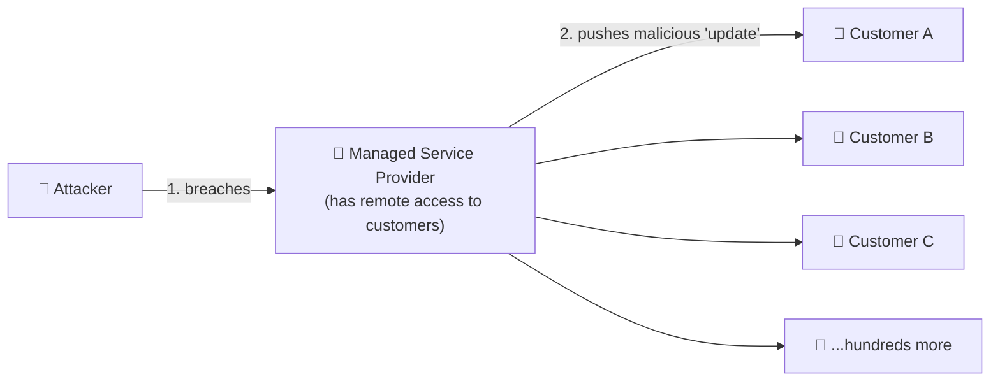

# Chapter 23 — Threat Vectors & Attack Surfaces

**Level 3 · Can Score ~40%** · *Exam objective 2.2*

---

## 🎯 Goal

By the end of this chapter you will be able to name every **threat vector** in Security+ (the *paths* attackers use to get in) and explain what an organization's **attack surface** is and how to **shrink** it. Vectors covered: message-based, image-based, file-based, voice call, removable devices, vulnerable software, unsupported systems, unsecure networks, open service ports, default credentials, supply chain, and human vectors.

---

## 🏠 Real-Life Story: Every Door and Window 🏠

A burglar looking at your house doesn't only think about the front door. They see:
- the front door, the back door, the garage door,
- every window (including the tiny bathroom one),
- the dog flap,
- the spare key under the flowerpot,
- the builder who has a copy of your key,
- and the friendly neighbor who might let them in "to collect a parcel."

Each of these is a **vector** (a path in). **All of them together** are your **attack surface**. More doors and windows = more chances for the burglar.

## 🖼️ Figure 23.1 — Doors Into the Company

```
                         ┌────────────────────────────────────────┐
     Email / SMS / IM ──►│                                        │◄── Phone calls (vishing)
     Images & files   ──►│                                        │◄── USB sticks & cables
     Old/unpatched    ──►│            THE  ORGANIZATION           │◄── Open ports on servers
     software            │                                        │
     Unsupported (EOL)──►│                                        │◄── Default passwords
     systems             │                                        │
     Wi-Fi/Bluetooth/ ──►│                                        │◄── Vendors, MSPs, suppliers
     wired networks      └────────────────────────────────────────┘    (supply chain)
                                         ▲
                                         └── People (social engineering, Chapter 15)

   ATTACK SURFACE = the sum of ALL these entry points.
   Security goal: make the surface as SMALL as possible and guard what remains.
```

---

## 📖 Part 1 — Vector vs Attack Surface

| Term | Meaning | Analogy |
|---|---|---|
| **Threat vector** (attack vector) | The **path or method** an attacker uses to reach a target | One specific window |
| **Attack surface** | **All** the points where an attacker could try to enter or extract data | All doors, windows and keys together |

> 💡 **Reducing the attack surface** is one of the most powerful ideas in security: turn off what you don't need, close ports, remove software, retire old systems, limit who has access. If a door doesn't exist, nobody can break it.

---

## 📖 Part 2 — Message-Based Vectors 📨

| Vector | How it's used | Defense |
|---|---|---|
| **Email** | Phishing links, malicious attachments, BEC (Chapter 15) | Email gateway, sandboxing, SPF/DKIM/DMARC, training |
| **SMS** (texts) | Smishing links, fake 2FA requests | User awareness, mobile threat defense, MDM |
| **Instant messaging (IM)** | Malicious links in Teams/Slack/WhatsApp; compromised colleague accounts | Link scanning, restricting external chat, MFA |

> ⚠️ Attackers increasingly move to SMS and chat apps because **company email filters are good** but phones and chat often have **fewer controls**, and people trust messages from "colleagues."

---

## 📖 Part 3 — Image-Based and File-Based Vectors 🖼️📄

### Image-based
- Malicious code hidden inside image files, or images that **exploit bugs in image-processing software**.
- **QR codes** in emails or posters ("quishing") that lead to phishing sites.
- **Steganography**: secret data hidden inside a normal-looking picture (Chapter 28).
- Images of text used to **bypass email filters** that only scan words.

### File-based
- Documents with **macros** (`.docm`, `.xlsm`), PDFs with embedded scripts, compressed archives (`.zip`, `.iso`) hiding executables, shortcut files (`.lnk`), scripts (`.js`, `.vbs`, `.ps1`).

## 🖼️ Figure 23.2 — How a Malicious Document Attacks

```
   📧 "Invoice_June.docm" ──► user opens it ──► "Enable Content to view this document"
                                                           │
                                          user clicks ─────┘
                                                           ▼
                                          macro runs PowerShell ──► downloads malware
                                                                        │
                                                                        ▼
                                                              ransomware / RAT installed

   Defenses: block macros from the internet (now the default in Microsoft Office),
   attachment sandboxing, application allow lists, user training.
```

---

## 📖 Part 4 — Voice Call Vector 📞

- **Vishing** calls, fake tech-support calls, robocalls.
- **Deepfake voices**: AI can now clone a manager's voice from a few seconds of audio ("This is the CEO, I need an urgent transfer").
- **Caller ID spoofing** makes calls look like they come from a trusted number.
- Defense: **call-back verification** on known numbers, code words for sensitive requests, training.

---

## 📖 Part 5 — Removable Devices 🔌

| Device | Risk |
|---|---|
| **USB flash drives** | Malware (baiting: "Salaries_2026" stick in the car park); data theft (copying files out) |
| **Malicious USB cables / devices** | Look like normal charging cables but contain a tiny computer that **types commands like a keyboard** |
| **External hard drives, SD cards** | Malware; lost devices containing unencrypted data |
| **Air-gapped networks** | Removable media is often the **only** way in. The **Stuxnet** worm reached isolated industrial systems this way |

**Defenses:** disable USB storage through group policy/MDM, allow only company-encrypted drives, scan media, use **data loss prevention (DLP)**, and train users not to plug in unknown devices.

---

## 📖 Part 6 — Vulnerable Software 🐛

Software with security flaws (bugs attackers can exploit). Security+ mentions **client-based vs agentless**:

| | **Client-based** (agent-based) | **Agentless** |
|---|---|---|
| Meaning | Software **installed on the device** (an app, a security agent, a VPN client) | Nothing installed: accessed through a **browser**, or managed remotely over the network |
| Vector risk | The installed client itself can contain vulnerabilities and must be **patched on every device** | Fewer installed components, but relies on the **server/web app** and network protocols being secure |
| Example | A desktop VPN client with a known flaw | A web-based admin portal |

> 💡 The fix for vulnerable software is **patch management** + **inventory** (know what's installed) + **removing what you don't need**.

---

## 📖 Part 7 — Unsupported Systems and Applications 🧓

- **End-of-life (EOL) / end-of-support** systems no longer get security patches (Chapter 2).
- Examples: Windows 7, old Linux versions, ancient Java, discontinued router firmware, a medical device built on an old OS.
- Every new vulnerability found in them **stays open forever**.

**Defenses (if you can't replace them yet):** **isolate** them (separate network segment, no internet), extra monitoring, strict access controls. These are **compensating controls** (Chapter 13). Then plan their replacement.

---

## 📖 Part 8 — Unsecure Networks 📶

| Network | Risk | Defense |
|---|---|---|
| **Wireless** | Open or WEP/WPA networks, evil twins, rogue APs, eavesdropping (Chapter 7) | WPA3-Enterprise, wireless IDS, VPN on public Wi-Fi |
| **Wired** | Anyone plugging into an open wall port in a lobby/meeting room gets onto the LAN | **802.1X port authentication** (NAC), disable unused switch ports, port security |
| **Bluetooth** | Bluesnarfing, unauthorized pairing, vulnerable Bluetooth stacks | Turn off when unused, non-discoverable mode, patch |

## 🖼️ Figure 23.3 — The Unprotected Wall Port

```
   🏢 Company lobby
   ┌────────────────────────────────────────────────┐
   │  chairs   [ network wall port ] ◄── visitor    │
   │                 │                plugs in a    │
   │                 │                laptop        │
   └─────────────────┼──────────────────────────────┘
                     ▼
              WITHOUT 802.1X: visitor is now INSIDE the corporate LAN
              WITH    802.1X: port stays closed until the device authenticates
```

---

## 📖 Part 9 — Open Service Ports 🚪

Every **listening port** (Chapter 5) is a door into a service. Unneeded open ports = unnecessary attack surface.

```
   $ nmap 203.0.113.25
   PORT     STATE  SERVICE
   21/tcp   open   ftp          ← plaintext, is it even needed?
   22/tcp   open   ssh
   23/tcp   open   telnet       ← plaintext admin access: close it!
   80/tcp   open   http
   443/tcp  open   https
   3389/tcp open   ms-wbt-server (RDP)   ← exposed to the internet: huge brute-force target
```

**Defense:** close or firewall every port that isn't needed. Expose admin ports (SSH/RDP) only via **VPN** or a **jump server** (Chapter 30). Scan yourself regularly.

---

## 📖 Part 10 — Default Credentials 🔑

Many devices ship with **known default usernames and passwords** (`admin/admin`, `admin/password`, `root/root`). Lists of defaults are freely available online.

- The **Mirai** botnet (Chapter 16) infected hundreds of thousands of IoT devices simply by trying ~60 default username/password pairs.
- Applies to routers, cameras, printers, databases, admin consoles and cloud services.

**Defense:** **change every default password at installation** (make it part of the setup procedure), disable default accounts, and scan for default credentials.

---

## 📖 Part 11 — Supply Chain 🔗

Your security depends on everyone who provides you with products and services.

| Supply-chain vector | Example |
|---|---|
| **MSPs** (Managed Service Providers) | An attacker breaches an IT support company and uses its remote-management tool to push ransomware to **all its customers** at once (this happened in the **Kaseya VSA** attack, 2021) |
| **Vendors** | A software vendor's update is poisoned (**SolarWinds**, 2020) |
| **Suppliers** | Hardware arrives with tampered firmware or counterfeit chips; a supplier with network access is phished (the **Target** breach of 2013 started with stolen credentials from an HVAC contractor) |

## 🖼️ Figure 23.4 — One Breach, Many Victims



**Defenses:** vendor risk assessments (Chapter 45), least-privilege access for vendors, monitoring third-party connections, verifying software signatures, a **software bill of materials (SBOM)** listing every component in the software you use.

---

## 📖 Part 12 — Human Vectors (Recap) 🧠

Covered in Chapter 15: phishing, vishing, smishing, misinformation/disinformation, impersonation, BEC, pretexting, watering hole, brand impersonation, typosquatting. **People are part of the attack surface too**, and training "shrinks" that part of it.

---

## 🖼️ Figure 23.5 — Reducing the Attack Surface: Checklist

| Vector | Shrink it by… |
|---|---|
| Message-based | Filters, SPF/DKIM/DMARC, training |
| Image/file-based | Block macros, sandbox attachments, allow lists |
| Voice | Call-back verification, training |
| Removable devices | Disable USB storage, DLP, encryption |
| Vulnerable software | Patch, inventory, uninstall unused apps |
| Unsupported systems | Replace; meanwhile isolate (compensating control) |
| Unsecure networks | WPA3, 802.1X, VPN, disable unused wall ports |
| Open ports | Close unneeded; VPN/jump server for admin |
| Default credentials | Change at install; disable default accounts |
| Supply chain | Vendor assessments, least privilege, SBOM, signature checks |
| Humans | Awareness training, phishing simulations |

---

## 🧠 Memory Tricks

- **Vector = one path. Surface = all paths.**
- **"MIF-VR-VU-UN-OD-S-H"** is hard to remember, so think of the **house**: messages (letterbox), images/files (parcels), voice (doorbell), removable devices (things left on the doorstep), software & EOL systems (old rotten windows), networks (unlocked gates), open ports (open doors), default credentials (key under the mat), supply chain (the builder's spare key), humans (the friendly neighbor).
- **Default password = key under the doormat.** Everyone knows where to look.

---

## ⚠️ Exam Tip

- *"An attacker gained access to many customers by compromising their shared IT provider."* → **Supply chain (MSP).**
- *"A security audit finds Telnet and FTP listening on a web server."* → **Open service ports.** Disable unneeded services.
- *"IoT cameras were compromised using the factory login."* → **Default credentials.**
- *"Employees connect to an access point in a café."* → **Unsecure network** (wireless).
- *"A medical device runs an OS that no longer receives patches."* → **Unsupported system.** Isolate it (compensating control).
- *"Which BEST reduces the attack surface of a server?"* → **Disable unnecessary services/ports and remove unneeded software.**

---

## 🧪 Try It (20 minutes)

1. **Map your own attack surface:** list every way someone could get into *your* digital life: email, phone number, social media, home Wi-Fi, router admin page, laptop USB ports, cloud accounts, apps on your phone. Mark which ones you could remove or lock down.
2. **Scan your lab VM** (Chapter 8) with `nmap -sV <vm-ip>`. For each open port, ask: is it needed? Turn off one service you don't need and scan again.
3. **Look up default credentials:** search "default password" plus your router's brand. Then make sure yours is changed!
4. **Read about Kaseya VSA (2021)** and write 3 sentences on how one MSP breach affected over a thousand businesses.

---

## ✅ Checkpoint Questions

1. What is the difference between a threat vector and an attack surface?
2. Name the three message-based vectors.
3. Why are macros in documents a common file-based vector?
4. What is the difference between client-based and agentless software?
5. How should an organization protect a system that is end-of-life but can't be replaced yet?
6. Which control stops a visitor from plugging a laptop into a lobby wall port and joining the LAN?
7. Why are open service ports a risk?
8. How did the Mirai botnet spread so easily?
9. Give three examples of supply-chain vectors.
10. What is an SBOM?

<details>
<summary><b>Show answers</b></summary>

1. A **vector** is one path/method of attack. The **attack surface** is the **total** of all possible entry points.
2. **Email, SMS, instant messaging.**
3. Macros can **run code** (e.g., PowerShell) when a user clicks "Enable Content," downloading or installing malware.
4. **Client-based** software is **installed on the device** (an agent/app). **Agentless** means **nothing is installed**: access through a browser or remote management.
5. **Isolate it** (separate segment, no internet), restrict access, add monitoring. These are compensating controls. Then plan replacement.
6. **802.1X port-based authentication** (NAC), or disabling unused switch ports.
7. Each listening port is a **service an attacker can probe and exploit**. Unneeded ones add attack surface for no benefit.
8. It tried **default usernames and passwords** on IoT devices.
9. E.g., a **compromised MSP**, a **poisoned vendor software update**, **tampered hardware from a supplier**, a **supplier's stolen credentials**.
10. A **Software Bill of Materials**: a list of all the components and libraries inside a piece of software, so you can spot vulnerable ones.

</details>

---

## 📌 Chapter Summary

| Vector | Key example | Key defense |
|---|---|---|
| Message-based | Phishing email, smishing, malicious IM links | Filtering, email authentication, training |
| Image/file-based | QR phishing, macro documents | Block macros, sandboxing |
| Voice call | Vishing, deepfake voice | Call-back verification |
| Removable devices | Infected USB, malicious cables | Disable USB storage, DLP |
| Vulnerable software | Unpatched client apps | Patching, inventory |
| Unsupported systems | EOL OS in a medical device | Isolate, replace |
| Unsecure networks | Open Wi-Fi, open wall ports, Bluetooth | WPA3, 802.1X, VPN |
| Open ports | Telnet/RDP exposed | Close ports, VPN/jump server |
| Default credentials | admin/admin | Change at install |
| Supply chain | MSP, vendor, supplier compromise | Vendor risk management, SBOM |

**Next chapter →** *Chapter 24: Vulnerability Types.* Vectors are the doors. Now let's look closely at the **weaknesses** behind them: buffer overflows, SQL injection, XSS and more.
