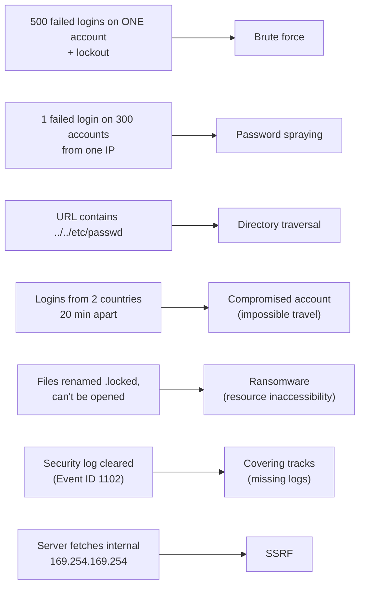

# Chapter 26 — Application, Password, Crypto & Physical Attacks + Indicators of Compromise

**Level 3 · Can Score ~40%** · *Exam objective 2.4 (the rest)*

---

## 🎯 Goal

By the end of this chapter you will recognize the remaining attacks in objective 2.4:
- **Application attacks:** injection, buffer overflow, replay, privilege escalation, forgery (CSRF/SSRF), directory traversal
- **Cryptographic attacks:** downgrade, collision, birthday
- **Password attacks:** spraying, brute force (plus dictionary and rainbow tables)
- **Physical attacks:** brute force, RFID cloning, environmental

You'll also learn the **nine indicators of malicious activity** that analysts look for: account lockout, concurrent session usage, blocked content, impossible travel, resource consumption, resource inaccessibility, out-of-cycle logging, published/documented, and missing logs.

---

## 🏠 Real-Life Story: The Detective's Clue Board 🕵️

A detective doesn't see the burglar break in. They find **clues**: a broken lock, muddy footprints, a missing vase, a guard's logbook with a page torn out. In cybersecurity, these clues are called **indicators**. Half of this chapter is about the attacks; the other half is about the **clues they leave behind**. Security+ loves to give you the clues and ask, *"What happened?"*

---

## 📖 Part 1 — Application Attacks 🧩

### 1. Injection 💉
Sending **malicious input that the application executes as commands**. The family includes:
- **SQL injection** (Chapter 24): attacks the database
- **Command injection**: attacks the operating system (`; rm -rf /` typed into a form that runs a system command)
- **LDAP injection, XML injection**: attack directory and XML processing
- **Fix for all of them:** **input validation**, **parameterized** interfaces, least privilege

### 2. Buffer Overflow
Covered in Chapter 24: too much data overwrites neighboring memory. Indicator: application **crashes** with memory errors; strange long input strings (`AAAAAAAA…`) in logs.

### 3. Replay
Covered in Chapter 25: capturing and resending valid data (tokens, transactions). At the application layer this might mean **resubmitting a captured payment request**. Fix: nonces, timestamps, session expiry.

### 4. Privilege Escalation ⬆️
Gaining **more access than you're supposed to have**.

## 🖼️ Figure 26.1 — Vertical vs Horizontal Escalation

```
                          👑 Admin / root
                              ▲
                              │  VERTICAL escalation
                              │  (normal user → admin)
                              │  e.g., exploiting an OS bug to get SYSTEM rights
                              │
   👤 Alice (user) ───────────┴──────────────► 👤 Bob (user)
                    HORIZONTAL escalation
                    (same level, but someone ELSE's data)
                    e.g., changing ?account=1001 to ?account=1002 in a URL
```

- Indicators: a standard account suddenly running admin tools, new admin accounts appearing, users accessing other users' records.
- Defenses: patching, least privilege, proper **authorization checks on every request**, monitoring privileged groups.

### 5. Forgery: CSRF and SSRF 🎭

| | **CSRF**: Cross-Site Request Forgery | **SSRF**: Server-Side Request Forgery |
|---|---|---|
| Who is tricked? | The **user's browser** | The **server** |
| How | While you're logged in to your bank, a malicious site secretly makes **your browser** send a request to the bank ("transfer $1,000"). The bank sees your valid session cookie and obeys | The attacker gives a web app a URL to fetch (e.g., "load profile picture from…"), but points it at **internal systems** the attacker can't reach directly (e.g., the cloud metadata service `169.254.169.254`, which can reveal credentials) |
| Defense | **Anti-CSRF tokens** (a secret random value in every form), SameSite cookies, re-authentication for sensitive actions | **Validate/allow-list URLs** the server may fetch, block internal addresses, network segmentation |

## 🖼️ Figure 26.2 — CSRF vs SSRF

```
   CSRF:  🦹 evil site ──"hidden form"──► 👩 victim's browser ──(sends cookie)──► 🏦 bank.example
                                         "transfer $1000 to Mallory"                ✔ obeys

   SSRF:  🦹 attacker ──"fetch http://10.0.0.5/admin"──► 🌐 web server ──► 🔒 internal admin panel
                                                         (server makes the     (only reachable from
                                                          request for them)     inside the network)
```

### 6. Directory Traversal 📁

Using `../` ("go up one folder") in a file path to **escape the intended folder** and read files elsewhere on the server.

## 🖼️ Figure 26.3 — Climbing Out of the Web Folder

```
   Intended:   https://site.example/view?file=report.pdf
               → /var/www/files/report.pdf ✔

   Attack:     https://site.example/view?file=../../../etc/passwd
               → /var/www/files/../../../etc/passwd
               → /etc/passwd  😱  (system user list)

        /                       ← reached by climbing up 3 levels
        ├── etc/passwd          ← stolen
        └── var/
            └── www/
                └── files/      ← where the app expected to stay
```

- Indicators in logs: `../`, `..\`, or encoded versions such as `%2e%2e%2f`.
- Defenses: input validation, never use raw user input in file paths, an allow-list of filenames, run the web server with least privilege.

---

## 📖 Part 2 — Cryptographic Attacks 🔐

| Attack | What happens | Example | Defense |
|---|---|---|---|
| **Downgrade** | Forcing two parties to use an **older, weaker** protocol or cipher | **POODLE** (2014) forced connections down to SSL 3.0; SSL stripping (Chapter 25) | **Disable old protocols** (SSL, TLS 1.0/1.1); TLS 1.3 has built-in downgrade protection |
| **Collision** | Finding **two different inputs with the same hash** | MD5 collisions used to forge certificates; **SHA-1** collision ("SHAttered", 2017) | Use **SHA-256** or stronger |
| **Birthday** | A math shortcut that makes **finding collisions much easier** than expected | Takes roughly **2^(n/2)** tries for an n-bit hash, not 2^n | Use **long** hashes (256-bit+) |

## 🖼️ Figure 26.4 — The Birthday Paradox 🎂

```
   How many people must be in a room for a 50% chance that TWO share a birthday?

   Most people guess ~183 (half of 365).   The real answer: only 23!  (50.7%)

   Why? You're not matching ONE specific birthday. ANY pair can match,
   and 23 people make 253 possible pairs.

   Same with hashes: finding ANY two inputs with the same hash needs only
   about 2^(n/2) attempts:
        128-bit hash (MD5)   → ~2^64 tries   (feasible for well-funded attackers)
        256-bit hash (SHA-256) → ~2^128 tries (impossible in practice)
```

> 💡 **Why collisions matter:** digital signatures sign the **hash** (Chapter 18). If an attacker can make a malicious file with the **same hash** as a legitimate one, the signature appears valid on the malicious file.

---

## 📖 Part 3 — Password Attacks 🔑

## 🖼️ Figure 26.5 — Brute Force vs Password Spraying

```
   BRUTE FORCE (one account, MANY passwords)        SPRAYING (MANY accounts, FEW passwords)

   alice : aaaa  ✘                                   alice : Spring2026!  ✘
   alice : aaab  ✘                                   bob   : Spring2026!  ✘
   alice : aaac  ✘                                   carol : Spring2026!  ✔  ← one hit!
   alice : ...   ✘  (thousands of tries)             dave  : Spring2026!  ✘
   🔒 ACCOUNT LOCKED after 5 failures                 (1 try per account = NO lockouts)

   Indicator: many failures on ONE account,          Indicator: ONE failure on MANY accounts
   lockouts                                          from the same source, at the same time
```

| Attack | How it works | Defense |
|---|---|---|
| **Brute force (online)** | Try every combination against the live login page | **Account lockout**, rate limiting, MFA, CAPTCHA |
| **Brute force (offline)** | Steal the **password hash file** and guess at full speed on the attacker's own hardware (no lockouts!) | **Strong hashing** with **salts** and **key stretching** (bcrypt, PBKDF2, Argon2, Chapter 28); long passwords |
| **Password spraying** | Try a **few common passwords** against **many accounts** to stay under lockout limits | MFA, banned-password lists, monitoring for failures across many accounts |
| **Dictionary attack** | Try words from a list of common passwords (`123456`, `password`, `qwerty`) | Banned-password lists, long passphrases |
| **Credential stuffing** | Reuse username/password pairs **leaked from other sites** | MFA, unique passwords, breached-password checks |
| **Rainbow tables** | Pre-computed tables of hash → password for fast lookup | **Salting** (each password gets a random salt, so pre-computed tables are useless) |

---

## 📖 Part 4 — Physical Attacks 🚪

| Attack | What happens | Defense |
|---|---|---|
| **Brute force (physical)** | Forcing doors, breaking windows, smashing locks, prying open cabinets | Strong doors/locks, bollards, sensors, guards, cameras |
| **RFID cloning** | Copying an access badge's RFID signal with a hidden reader (sometimes from a few cm away in a crowd or lift), then writing it onto a blank card | Encrypted smart cards (not simple 125 kHz proximity cards), badge + PIN, RFID-blocking sleeves |
| **Environmental** | Attacking the **environment** systems depend on: cutting power, disabling HVAC so servers overheat, causing water damage, fire | UPS/generators, environmental monitoring (temperature, water sensors), physical protection of utilities |

---

## 📖 Part 5 — The Nine Indicators of Malicious Activity ⭐⭐

These are **clues** that something malicious is happening. Learn each with an example.

## 🖼️ Figure 26.6 — The Indicator Clue Board

| # | Indicator | What it looks like | Possible cause |
|---|---|---|---|
| 1 | **Account lockout** | Users suddenly locked out; many lockouts at once | **Brute-force** attack; attacker deliberately locking out accounts (a DoS) |
| 2 | **Concurrent session usage** | The same account logged in from **two places at once** (e.g., office PC *and* a foreign IP) | **Stolen credentials / session hijacking** |
| 3 | **Blocked content** | Firewall/proxy/email gateway logs show repeated attempts to reach blocked sites or download blocked files | Malware trying to contact C2; a user (or attacker) trying to exfiltrate data |
| 4 | **Impossible travel** | Logins from **London at 09:00 and Tokyo at 09:20** | **Compromised account** (or a VPN; investigate!) |
| 5 | **Resource consumption** | CPU, memory, disk or bandwidth unexpectedly very high | Cryptojacking, DDoS, malware, data exfiltration |
| 6 | **Resource inaccessibility** | Files or systems can't be opened or reached | **Ransomware** (files encrypted), DoS |
| 7 | **Out-of-cycle logging** | Logs generated at **unusual times**: activity at 3 am, or log entries outside normal schedules | Attacker activity outside business hours |
| 8 | **Published / documented** | The attack or a data leak is **already public**: your data appears on a leak site, a researcher reports it, or the news covers it | A breach you hadn't detected yourself |
| 9 | **Missing logs** | **Gaps** in logs, or logs deleted/cleared (e.g., Windows Event ID **1102**: "audit log cleared") | An attacker **covering their tracks** |

## 🖼️ Figure 26.7 — Impossible Travel

```
   🗺️
      🇬🇧 London ●  09:00 login (Alice, office IP)
                     \
                      \   9,600 km in 20 minutes?
                       \  That would need ~28,800 km/h!
                        ●  🇯🇵 Tokyo  09:20 login (Alice, unknown IP)

   → Credentials are almost certainly being used by someone else.
   → Action: lock the account, force password reset + MFA re-registration, investigate.
```

> 💡 **Missing logs** is sneaky: the clue is what's **NOT** there. If the security log for a server suddenly has a 6-hour gap, or a "log cleared" event appears, treat it as an incident.

---

## 🖼️ Figure 26.8 — Match the Clue to the Attack (practice)



---

## 🧠 Memory Tricks

- **Brute force = one door, many keys. Spraying = many doors, one key.**
- **Vertical = climb UP the ladder. Horizontal = walk ACROSS to the neighbor's.**
- **CSRF = the Client (browser) is tricked. SSRF = the Server is tricked.**
- **`../` = "dot-dot-slash, climbing out."**
- **Birthday = 23 people, 50% chance; hash collision needs only 2^(n/2) tries.**
- **Salt beats rainbow tables.**
- **Indicators: "A CB IR ROPM"** is hard, so picture a detective's board with **L**ockouts, **T**win sessions, **B**locked content, a **P**lane (impossible travel), a hot **CPU**, a **L**ocked file, a **3 am clock**, a **N**ewspaper (published), and a **torn logbook** (missing logs).

---

## ⚠️ Exam Tip

- *"Many accounts each have one or two failed logins from the same IP within minutes."* → **Password spraying.**
- *"A web log shows `GET /download?file=../../../../windows/win.ini`."* → **Directory traversal.**
- *"A standard user exploited a flaw to run commands as SYSTEM."* → **Privilege escalation** (vertical).
- *"An attacker forced the connection to use SSL 3.0."* → **Downgrade attack.**
- *"Which BEST protects stored passwords against rainbow tables?"* → **Salting.**
- *"A user's account is active in two countries simultaneously."* → **Concurrent session usage / impossible travel.** Compromised credentials.
- *"The Security event log shows Event ID 1102."* → Log cleared, i.e., **missing logs** (covering tracks).

---

## 🧪 Try It (25 minutes)

1. **PortSwigger Web Security Academy** (free): complete the first **directory traversal** lab and the first **CSRF** lab.
2. **See salting yourself** (Linux/macOS):
   ```bash
   openssl passwd -6 -salt AAAA mypassword
   openssl passwd -6 -salt BBBB mypassword
   ```
   Same password, different salts → **completely different hashes**. That's why rainbow tables fail.
3. **Check a password against breaches safely:** visit haveibeenpwned.com/Passwords. It uses a privacy-preserving method (k-anonymity) that only sends part of the hash. Try a weak one like `password123`.
4. **Find an "impossible travel" alert:** in your Google or Microsoft account security page, look at recent sign-in locations. Would you notice an unexpected country?

---

## ✅ Checkpoint Questions

1. What's the difference between vertical and horizontal privilege escalation?
2. Explain CSRF in one sentence, and give one defense.
3. What does SSRF target, and why is the address `169.254.169.254` interesting to attackers in the cloud?
4. What string in a URL suggests directory traversal?
5. What is a downgrade attack? Give an example.
6. Why do birthday attacks make collisions easier to find?
7. How does password spraying avoid account lockouts?
8. What defeats rainbow tables?
9. What is impossible travel, and what does it usually indicate?
10. Why is "missing logs" an important indicator?

<details>
<summary><b>Show answers</b></summary>

1. **Vertical** = gaining **higher** privileges (user → admin). **Horizontal** = accessing **another user's** resources at the **same** privilege level.
2. A malicious site makes the **victim's logged-in browser** send an unwanted request to a trusted site. Defense: **anti-CSRF tokens** (or SameSite cookies, re-authentication).
3. It tricks the **server** into making requests for the attacker, often to **internal** systems. `169.254.169.254` is the **cloud metadata service**, which can reveal credentials and configuration.
4. **`../`** (or `..\`, or encoded `%2e%2e%2f`).
5. Forcing a connection to use an **older, weaker protocol or cipher**. E.g., **POODLE** forcing SSL 3.0, or **SSL stripping** to HTTP.
6. Finding **any** two matching inputs needs only about **2^(n/2)** attempts for an n-bit hash, far fewer than 2^n.
7. It tries **only one or a few passwords per account**, spread across many accounts, so no single account hits the lockout threshold.
8. **Salting** (random salt per password), ideally with **key stretching**.
9. Logins from **locations too far apart** to travel between in the time elapsed. Usually indicates **compromised credentials**.
10. Attackers often **delete or stop logs to hide their actions**. Gaps or "log cleared" events can reveal an intrusion.

</details>

---

## 📌 Chapter Summary

| Group | Members | Key defense |
|---|---|---|
| Application | Injection, buffer overflow, replay, privilege escalation, CSRF/SSRF, directory traversal | Input validation, authorization checks, tokens |
| Cryptographic | Downgrade, collision, birthday | Disable old protocols; SHA-256+ |
| Password | Brute force, spraying, dictionary, stuffing, rainbow tables | MFA, lockout, salting + key stretching |
| Physical | Brute force, RFID cloning, environmental | Strong locks, encrypted badges, environmental monitoring |
| Indicators | Lockout, concurrent sessions, blocked content, impossible travel, resource consumption/inaccessibility, out-of-cycle logging, published, missing logs | Monitoring, SIEM, alerting |

**Next chapter →** *Chapter 27: Mitigation Techniques & Hardening.* Now that you can recognize attacks, let's lock the system down before they happen.
