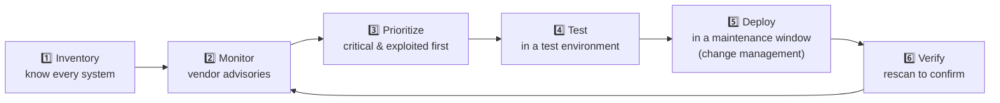

# Chapter 27 — Mitigation Techniques & Hardening

**Level 3 · Can Score ~40%** · *Exam objective 2.5*

---

## 🎯 Goal

By the end of this chapter you will know the mitigation techniques Security+ lists (**segmentation, access control (ACLs, permissions), application allow list, isolation, patching, encryption, monitoring, least privilege, configuration enforcement, decommissioning**) and the **hardening techniques** (**encryption, installing endpoint protection, host-based firewall, HIPS, disabling ports/protocols, changing default passwords, removing unnecessary software**). You'll also be able to pick the **best** mitigation for a given attack.

---

## 🏠 Real-Life Story: Child-Proofing a House 👶

When a baby starts crawling, parents "harden" the house:
- **Remove** sharp and dangerous things they don't need (removing unnecessary software).
- Put **covers on unused plug sockets** (disabling unused ports).
- Add **gates** between rooms (segmentation).
- Lock the medicine cabinet and keep the key with the adults (least privilege, access control).
- Keep a **list of approved snacks** (allow list).
- Check on the baby with a **monitor** (monitoring).
- Replace broken toys and **fix loose cabinet doors** right away (patching).

**Hardening** = **reducing the attack surface** and making a system as secure as possible **before** anything goes wrong.

---

## 📖 Part 1 — The Mitigation Techniques

### 1. Segmentation 🧩
Divide the network into **zones** (VLANs, subnets, cloud security groups) with **controlled** traffic between them.
- Limits **lateral movement**: an attacker who compromises one zone can't easily reach others.
- Example: put card-payment systems in their own segment (required by PCI DSS); IoT devices in another; guests in another.

### 2. Access Control 🔐
- **ACL (Access Control List):** a list of rules saying **who/what may access what**. ACLs exist on **routers/firewalls** (allow/deny traffic by IP, port, protocol) and on **files/folders** (allow/deny users).
- **Permissions:** the specific rights granted (read, write, execute, modify, full control; Chapter 2).

## 🖼️ Figure 27.1 — Network ACL Example

```
   ACL on the router between the "Staff" VLAN and the "Servers" VLAN

   #   Action   Source            Destination       Port       Comment
   10  PERMIT   10.10.0.0/24      10.20.0.10        443/tcp    Staff → web app
   20  PERMIT   10.10.0.0/24      10.20.0.20        445/tcp    Staff → file server
   30  PERMIT   10.10.5.0/28      10.20.0.0/24      22/tcp     IT admins → SSH to servers
   40  DENY     any               any               any        Deny all else (log it)
```

Rules are read **top to bottom**, and the **first match wins**. Most firewalls also have an invisible **implicit deny** at the end (anything not allowed is blocked). Rule 40 writes that deny out **explicitly** so blocked traffic gets logged.

### 3. Application Allow List ✅
Only **pre-approved applications** may run; everything else is blocked (Chapter 20). Excellent against malware and unauthorized software. (The opposite, a **block list / deny list**, blocks only known-bad apps.)

### 4. Isolation 🏝️
**Completely separating** a system so it can't communicate with others. Stronger than segmentation.
- **Quarantining** an infected laptop (EDR "isolate host" button).
- Running suspicious files in a **sandbox**.
- Keeping an **unpatchable legacy system** off the network.
- **Air-gapped** networks (physically disconnected, Chapter 29).

### 5. Patching 🩹
Applying vendor fixes for vulnerabilities. A good patch process:



### 6. Encryption 🔒
Protect data **at rest** (full-disk, database), **in transit** (TLS, VPN), and where possible **in use** (Chapters 18, 21, 28).

### 7. Monitoring 🔭
Collect and review logs and alerts (SIEM, EDR, IDS) to **detect** what prevention misses.

### 8. Least Privilege 🔑
Every user, process and service gets **only the minimum access needed**, and only **for as long as needed**.
- Daily work on a standard account; separate admin accounts only for admin tasks.
- Service accounts with narrow rights, not "Domain Admin."

### 9. Configuration Enforcement 📏
Define a **secure baseline** configuration and **automatically enforce** it so systems can't drift into insecure states.
- Tools: **Group Policy** (Windows), MDM profiles (mobile), configuration management (Ansible, Puppet), cloud policy engines.
- Benchmarks: **CIS Benchmarks** and DISA **STIGs** give recommended secure settings for each OS/app.

### 10. Decommissioning 🗑️
Securely **retiring** systems and data that are no longer needed:
- Remove from the network and from DNS/firewall rules.
- Revoke its accounts, certificates and API keys.
- **Sanitize or destroy** storage (Chapter 35).
- Update the asset inventory.
> ⚠️ Forgotten, still-running "zombie" servers are a classic breach source: unpatched, unmonitored, but still connected.

---

## 📖 Part 2 — Hardening Techniques (for a single system) 🛠️

## 🖼️ Figure 27.2 — The Server Before and After Hardening

```
   BEFORE (default install)                        AFTER (hardened)
   ──────────────────────────────────────          ──────────────────────────────────────
   ✘ Admin password: admin/admin                   ✔ Default passwords changed, default
                                                     accounts disabled
   ✘ Telnet, FTP, SMBv1, print spooler running     ✔ Unneeded services/ports/protocols OFF
   ✘ 40 pre-installed apps & sample websites       ✔ Unnecessary software REMOVED
   ✘ No antivirus                                   ✔ Endpoint protection (EDR) installed
   ✘ Firewall off                                   ✔ Host-based firewall ON, deny by default
   ✘ No intrusion prevention                        ✔ HIPS enabled
   ✘ Disk unencrypted                               ✔ Full-disk encryption ON
   ✘ Last patched: never                            ✔ Fully patched, auto-updates managed
   Attack surface: HUGE                             Attack surface: SMALL
```

| Hardening technique | What to do | Why |
|---|---|---|
| **Encryption** | Full-disk encryption, encrypted protocols only | Protects data if stolen or intercepted |
| **Install endpoint protection** | Antivirus/EDR on every endpoint | Detect and stop malware |
| **Host-based firewall** | Turn on; allow only needed inbound ports | Blocks network attacks even inside the LAN |
| **HIPS**: Host-based Intrusion Prevention System | Monitor the host for malicious behavior and block it | Stops exploits and suspicious changes |
| **Disable ports/protocols** | Turn off unused services; disable insecure protocols (Telnet, FTP, SMBv1, TLS 1.0) | Fewer doors |
| **Change default passwords** | At installation, every time | Defaults are public knowledge |
| **Removal of unnecessary software** | Uninstall bloatware, unused tools, sample apps | Less code = fewer vulnerabilities |

> 💡 Hardening applies to **every** device type: workstations, servers, network devices, cloud resources, mobile devices, IoT, ICS. (Specific targets are covered in Chapter 34.)

---

## 📖 Part 3 — Choosing the Right Mitigation 🎯

The exam often describes a problem and asks for the **BEST** mitigation. Match the **root cause**.

## 🖼️ Figure 27.3 — Problem → Best Mitigation ⭐

| Problem in the scenario | BEST mitigation |
|---|---|
| Malware spreading from infected workstations to servers | **Segmentation** |
| Users installing unapproved games and tools | **Application allow list** |
| A specific infected laptop must not talk to anything | **Isolation** (quarantine) |
| A known vulnerability with an available fix | **Patching** |
| Laptops lost on trains | **Encryption** (full-disk) |
| Attacks are happening but nobody notices | **Monitoring** (SIEM/EDR) |
| Every employee is a local admin | **Least privilege** |
| Systems keep drifting from secure settings | **Configuration enforcement** |
| An old server is no longer needed but still online | **Decommissioning** |
| IoT cameras still use factory login | **Change default passwords** |
| Telnet found open on routers | **Disable ports/protocols** (use SSH) |
| A legacy system can't be patched | **Isolation / segmentation** (compensating control) |

---

## 🧠 Memory Tricks

- **Mitigations: "SAAI PEM LCD"**: **S**egmentation, **A**ccess control, **A**llow list, **I**solation, **P**atching, **E**ncryption, **M**onitoring, **L**east privilege, **C**onfiguration enforcement, **D**ecommissioning.
- **Hardening: "Every Endpoint Has Firewalls, Disabled ports, Default passwords changed, Debris removed"**: Encryption, Endpoint protection, HIPS, Firewall, Disable ports, Default passwords, Delete unnecessary software.
- **Segmentation = gates between rooms. Isolation = the room has no doors at all.**

---

## ⚠️ Exam Tip

- *"Which would BEST prevent malware on a compromised IoT camera from reaching the finance servers?"* → **Segmentation.**
- *"Which hardening step addresses the Mirai-style threat?"* → **Changing default passwords.**
- *"An admin wants to ensure only approved executables run on kiosks."* → **Application allow list.**
- *"A server is being retired. What must happen to its storage?"* → **Sanitize/destroy** as part of **decommissioning**.
- *"Which tool can enforce password and screen-lock settings across all Windows PCs?"* → **Group Policy** (configuration enforcement).
- Distinguish **segmentation** (controlled traffic between zones) from **isolation** (no traffic at all).

---

## 🧪 Try It (30 minutes)

1. **Harden your lab VM** (Chapter 8):
   - Ubuntu: `sudo apt update && sudo apt upgrade` (patch) → `sudo ufw enable` and `sudo ufw default deny incoming` (host firewall) → `sudo ss -tulpn` (list listening services) → disable one you don't need with `sudo systemctl disable --now <service>`.
   - Scan before and after with `nmap` from another VM. Count the open ports.
2. **Read a CIS Benchmark:** download the free CIS Benchmark for your OS (cisecurity.org, free with registration). Pick 5 recommendations and check whether your PC follows them.
3. **Windows:** search for **"Local Security Policy"** (Pro editions) and look at Account Lockout Policy and Password Policy. That's configuration enforcement on one machine.

---

## ✅ Checkpoint Questions

1. What is the difference between segmentation and isolation?
2. Give two places where ACLs are used.
3. Why is an application allow list stronger than a block list?
4. List the six steps of a good patch process.
5. What is configuration enforcement, and name one tool that does it.
6. What should happen when a server is decommissioned?
7. Name the seven hardening techniques in SY0-701.
8. What does HIPS do?
9. A legacy SCADA controller can't be patched. What mitigation fits BEST?
10. Why is "remove unnecessary software" a security measure?

<details>
<summary><b>Show answers</b></summary>

1. **Segmentation** divides the network into zones with **controlled** traffic between them. **Isolation** **completely cuts off** a system from others.
2. On **network devices** (routers/firewalls: allow/deny traffic) and on **files/folders** (allow/deny users).
3. It blocks **everything not explicitly approved**, including brand-new malware a block list wouldn't know about.
4. **Inventory → monitor advisories → prioritize → test → deploy (change management/maintenance window) → verify.**
5. Automatically applying and maintaining a **secure baseline** configuration. Tools: **Group Policy**, MDM, Ansible/Puppet, cloud policy engines.
6. Remove it from the network and DNS/firewall rules, **revoke accounts/certificates/keys**, **sanitize or destroy storage**, update inventory.
7. **Encryption, installing endpoint protection, host-based firewall, HIPS, disabling ports/protocols, changing default passwords, removing unnecessary software.**
8. It **monitors a single host for malicious activity and blocks** it.
9. **Isolation / segmentation** (a compensating control), plus monitoring.
10. Every program can contain vulnerabilities. **Less software = smaller attack surface.**

</details>

---

## 📌 Chapter Summary

| Mitigation | One-liner |
|---|---|
| Segmentation | Zones with controlled traffic |
| Access control | ACLs + permissions |
| Allow list | Only approved apps run |
| Isolation | Fully cut off (quarantine, sandbox, air gap) |
| Patching | Fix known flaws via a tested process |
| Encryption | Protect data at rest/in transit |
| Monitoring | Detect what prevention misses |
| Least privilege | Minimum access, minimum time |
| Configuration enforcement | Lock in secure baselines (GPO, CIS) |
| Decommissioning | Retire securely, sanitize storage |
| Hardening | Encrypt, EDR, host firewall, HIPS, disable ports, change defaults, remove software |

**Next chapter →** *Chapter 28: PKI, Certificates & Applied Cryptography.* Encryption keeps appearing as a mitigation. Time to see how keys and certificates are managed in the real world.
