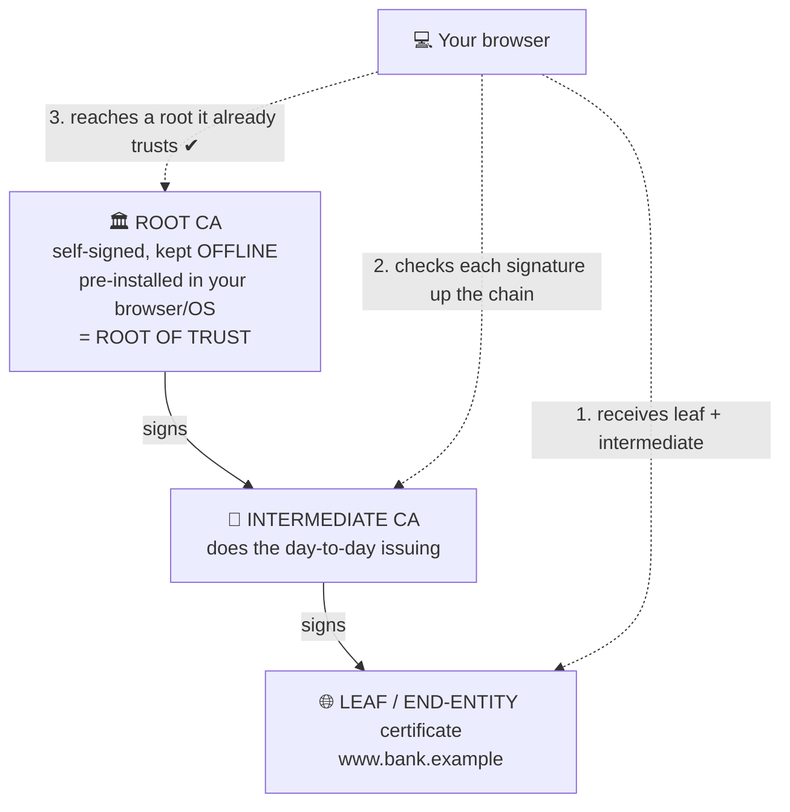

# Chapter 28 — PKI, Certificates & Applied Cryptography

**Level 3 · Can Score ~40%** · *Exam objective 1.4*

---

## 🎯 Goal

By the end of this chapter you will cover all of objective 1.4:
- **PKI**: public key, private key, **key escrow**
- **Encryption levels**: full-disk, partition, file, volume, database, record; transport encryption; key exchange; algorithms; key length
- **Tools**: **TPM, HSM, key management system, secure enclave**
- **Obfuscation**: **steganography, tokenization, data masking**
- **Hashing, salting, digital signatures, key stretching, blockchain, open public ledger**
- **Certificates**: **certificate authorities, CRLs, OCSP, self-signed, third-party, root of trust, CSR generation, wildcard**

---

## 🏠 Real-Life Story: The Passport Office 🛂

How does a border officer in another country know your passport is real? They've never met you.

- Your **government** (a trusted authority) **checked your identity** and **issued** the passport.
- The passport has **security features** (signatures, holograms) that are very hard to fake.
- The officer **trusts your government**, so they trust the passport.
- If your passport is **stolen**, it's put on a **cancelled list**, and officers check that list.

The internet works the same way. A website's **certificate** is its passport, a **Certificate Authority (CA)** is the government that issues it, and **CRLs/OCSP** are the cancelled-passport list. The whole system is called **PKI**.

---

## 📖 Part 1 — PKI: Public Key Infrastructure 🏛️

**PKI** = the **people, policies, hardware, software and procedures** used to **create, manage, distribute, use, store and revoke** digital certificates and public/private keys.

Recall from Chapter 18:
- **Public key**: share with everyone. Used to **encrypt to you** and to **verify your signatures**.
- **Private key**: keep secret. Used to **decrypt** and to **sign**.

The problem PKI solves: *"How do I know this public key really belongs to bank.example and not an attacker?"* **Answer: a certificate, signed by a CA I trust.**

### Key Escrow 🔐
**Key escrow** = a **copy of a key is held by a trusted third party** (or a secure internal system) so it can be **recovered** if needed. Examples: the employee leaves, a key is lost, or there's a legal requirement to access encrypted data.
- ✔ Prevents permanent data loss.
- ✘ The escrow itself must be extremely well protected, since it holds copies of everyone's keys.
> 💡 Example: your company stores **BitLocker recovery keys** in Active Directory or the cloud. That's key escrow.

---

## 📖 Part 2 — Digital Certificates 📜

A **digital certificate** (format **X.509**) **binds a public key to an identity**, and is **digitally signed by a CA**.

## 🖼️ Figure 28.1 — What's Inside a Certificate

```
   ┌──────────────────────────────────────────────────────────────┐
   │  X.509 CERTIFICATE                                           │
   │  Subject:        CN = www.bank.example                       │
   │  Subject Alt Names (SAN): bank.example, www.bank.example     │
   │  Issuer:         Example Trusted CA - Intermediate 2         │
   │  Valid from:     2026-01-10   to   2027-01-10                │
   │  Serial number:  4F:9A:...                                   │
   │  Public key:     RSA 2048-bit / ECC P-256                    │
   │  Key usage:      Digital signature, key encipherment         │
   │  ──────────────────────────────────────────────────────────  │
   │  CA's DIGITAL SIGNATURE over all of the above                │
   └──────────────────────────────────────────────────────────────┘
```

### Certificate Authorities and the Chain of Trust ⛓️

## 🖼️ Figure 28.2 — The Chain of Trust



| Term | Meaning |
|---|---|
| **Certificate Authority (CA)** | Trusted organization that **verifies identity and issues/signs certificates** |
| **Root CA** | The top of the chain. Its certificate is **self-signed** and **pre-installed** in operating systems and browsers. Kept **offline** for safety |
| **Intermediate CA** | Signed by the root; issues certificates to customers, so the root stays offline |
| **Root of trust** | The starting point everything else is trusted from: the root CA certificate (and, in hardware, a **TPM/HSM**) |
| **Third-party certificate** | Issued by a **public, commercial CA** (e.g., DigiCert, Let's Encrypt): trusted by everyone's browser automatically |
| **Self-signed certificate** | Signed by **its own private key**, with no CA. Fine for internal testing; browsers show **warnings** because nobody vouches for it |
| **Internal / private CA** | A company's own CA for internal systems; trusted only by company devices it's been installed on |

### Getting a Certificate: The CSR 📝

## 🖼️ Figure 28.3 — Certificate Signing Request (CSR) Flow

```
   1. Web admin generates a KEY PAIR on the server
         private key 🔑 ── stays on the server, never sent anywhere
         public key  🗝️
   2. Admin creates a CSR = public key + identity info (domain, organization),
      signed with the private key to prove possession
   3. CSR ──────────────────────────────► 🏛️ CA
   4. CA VALIDATES identity (domain ownership, organization checks)
   5. CA signs and returns the CERTIFICATE ◄───────────
   6. Admin installs the certificate (+ intermediate chain) on the server
```

> ⚠️ The **private key never leaves** the server (or HSM). The CA only ever sees the **public key** inside the CSR.

### Certificate Types You Should Recognize

| Type | Meaning | Example |
|---|---|---|
| **Wildcard** | Covers **all first-level subdomains** of a domain | `*.example.com` covers `www.`, `mail.`, `shop.example.com`, but **not** `a.b.example.com` or `example.com` itself |
| **SAN** (Subject Alternative Name) | Lists **multiple specific names** in one certificate | `example.com`, `example.net`, `www.example.org` |
| **Code-signing** | Proves software came from the publisher and wasn't modified | Signed Windows installers |
| **Email (S/MIME)** | Signs/encrypts email | |
| **User / machine** | Authenticates a person or device (802.1X, VPN) | Device certificates for Wi-Fi |
| **Domain-validated (DV) / Organization-validated (OV) / Extended Validation (EV)** | How thoroughly the CA checked the requester | DV = domain control only; EV = strict business checks |

> 🔐 **Wildcard risk:** if the private key of a wildcard certificate is stolen, the attacker can impersonate **every** subdomain.

### Revocation: Cancelling a Certificate 🚫

If a private key is **stolen**, or a certificate was issued by mistake, the CA **revokes** it before its expiry date.

| | **CRL**: Certificate Revocation List | **OCSP**: Online Certificate Status Protocol |
|---|---|---|
| How | CA publishes a **list** of revoked serial numbers; clients **download the whole list** | Client **asks** the CA's OCSP responder about **one certificate**: "good / revoked / unknown?" |
| Analogy | A printed list of stolen passports, updated periodically | Phoning the passport office to check one passport |
| Pros/cons | Can be **large** and **out of date** between updates | **Real-time** and lightweight, but the CA sees which sites you visit |

**OCSP stapling:** the **web server** fetches its own OCSP response and "staples" it to the TLS handshake, which is faster and more private for users.

**Certificate pinning:** an app is hard-coded to accept only a **specific** certificate or public key for a server, which defends against fraudulent certificates.

---

## 📖 Part 3 — Encryption Levels 💽

Where exactly do you apply encryption?

## 🖼️ Figure 28.4 — From Biggest to Smallest

```
   ┌───────────────────────── FULL-DISK (FDE) ──────────────────────────┐
   │  everything on the physical drive, incl. OS & temp files           │
   │  (BitLocker, FileVault, LUKS)                                      │
   │   ┌──────────── PARTITION ─────────────┐ ┌──── VOLUME ─────────┐   │
   │   │ one section of the disk (e.g. D:)  │ │ a logical storage   │   │
   │   │                                    │ │ area (may span      │   │
   │   │   ┌────── FILE ──────┐             │ │ disks)              │   │
   │   │   │ individual files │             │ └─────────────────────┘   │
   │   │   │ (EFS, 7-Zip AES) │             │                           │
   │   │   └──────────────────┘             │                           │
   │   └────────────────────────────────────┘                           │
   └────────────────────────────────────────────────────────────────────┘
   DATABASE: the whole database (Transparent Data Encryption, TDE)
   RECORD:   specific rows or COLUMNS (e.g. only the credit-card column)
```

| Level | What's encrypted | Typical use |
|---|---|---|
| **Full-disk** | Entire drive | Laptops (protects lost/stolen devices) |
| **Partition** | One partition | Encrypting a data partition only |
| **Volume** | A logical volume | Servers, external drives (e.g., VeraCrypt volume) |
| **File** | Individual files/folders | Sharing a protected file |
| **Database** | Whole database at rest (TDE) | Protects database files and backups |
| **Record / column** | Specific sensitive fields | Credit-card or national-ID columns |

> ⚠️ **FDE protects data when the device is OFF/locked.** Once the user logs in, files are decrypted for use. Malware running as the logged-in user can still read them. Record/file-level encryption adds protection **while the system is running**.

### Transport / Communication Encryption
Protects data **in transit**: **TLS** (HTTPS, secure email), **IPsec** (VPNs), **SSH**, **WPA3** (Wi-Fi).

### Key Exchange, Algorithms & Key Length (quick recap)
- **Key exchange:** safely agreeing on a shared secret over an open network, e.g., **Diffie-Hellman (DH/ECDHE)** or by encrypting a session key with RSA (Chapter 18).
- **Algorithms:** symmetric **AES**; asymmetric **RSA, ECC**; hashing **SHA-2/SHA-3**.
- **Key length:** longer = stronger, but comparisons only make sense **within the same algorithm type**. AES-256 is very strong; RSA needs **2048+ bits**; ECC gets similar strength with ~256-bit keys.

---

## 📖 Part 4 — Cryptographic Tools 🧰

| Tool | What it is | Where | Analogy |
|---|---|---|---|
| **TPM**: Trusted Platform Module | A small **chip on the motherboard** that securely stores keys, records **Measured Boot** values (working alongside UEFI **Secure Boot**), and ties disk encryption to that specific computer | Laptops, desktops, servers | A tiny safe soldered into one house |
| **HSM**: Hardware Security Module | A **dedicated, tamper-resistant device** (appliance or PCIe card, or a cloud service) that **generates, stores and uses keys** at high speed. Keys never leave it | CAs, banks, payment systems, large websites | A bank vault with its own guards |
| **KMS**: Key Management System | Software/service that manages the **whole key lifecycle**: create, store, rotate, revoke, audit (often backed by HSMs) | Cloud (AWS KMS, Azure Key Vault), enterprises | The key-control office with a logbook |
| **Secure enclave** | A **protected, isolated area inside a processor** that runs sensitive operations, shielded even from the main OS | Apple Secure Enclave (Face ID/Touch ID data), Intel SGX, ARM TrustZone | A locked room inside the chef's kitchen that even the chef can't enter |

> 🧠 **TPM vs HSM:** **TPM** = built into **one** device, protects **that** device. **HSM** = **separate, high-performance** device for protecting **lots of keys** for **many** systems.

---

## 📖 Part 5 — Obfuscation 🫥

**Obfuscation** = making data **hard to understand or find**, without necessarily encrypting it.

| Technique | How it works | Example |
|---|---|---|
| **Steganography** | **Hiding** data **inside** other data (images, audio, video) so nobody knows it's there | A secret message hidden in the least significant bits of a photo's pixels |
| **Tokenization** | Replacing sensitive data with a **random token**. The real value is stored in a secure **token vault** | Card `4111 1111 1111 1111` → token `tkn_9XQ2...`. Payment systems store tokens, not cards |
| **Data masking** | **Hiding part** of the data when it's displayed or copied | `XXX-XX-6789`, `j***@example.com`, test databases with fake names |

> 💡 **Tokenization vs encryption:** encrypted data can be decrypted with the key (mathematically related). A token has **no mathematical relationship** to the original. Only the vault can map it back. That's why tokenization **reduces PCI DSS scope**: systems holding only tokens don't hold card data.

---

## 📖 Part 6 — Hashing, Salting & Key Stretching 🧂

### Hashing (recap)
One-way, fixed-length fingerprint (SHA-256). Used for **integrity** and **password storage**.

### Salting
A **salt** is a **random value added to each password before hashing**, stored alongside the hash.

## 🖼️ Figure 28.5 — Why Salt Matters

```
   WITHOUT SALT                               WITH SALT
   alice : hash("Summer2026")  = 7b1f...      alice : salt=Q9x2, hash("Q9x2Summer2026") = a03c...
   bob   : hash("Summer2026")  = 7b1f...      bob   : salt=Lm7P, hash("Lm7PSummer2026") = 5e91...
            ▲ identical hashes!                        ▲ different hashes for the same password
   ✘ Attacker sees Alice & Bob share a         ✔ Can't spot shared passwords
     password                                  ✔ Pre-computed RAINBOW TABLES are useless
   ✘ Rainbow table lookup cracks both            (attacker must start from scratch for each salt)
```

### Key Stretching
Deliberately making the hashing **slow** by running it **thousands of times** (or requiring lots of memory), so each password guess costs the attacker much more time.
- Algorithms: **PBKDF2**, **bcrypt**, **scrypt**, **Argon2**.
- A legitimate login is barely slowed (one hash takes milliseconds), but an attacker trying **billions** of guesses is slowed enormously.

> 🧠 **Salting defeats pre-computation (rainbow tables). Key stretching defeats speed (brute force).** Use both.

### Digital Signatures (recap)
Hash the message, then sign the hash with the **sender's private key**. Gives authentication, integrity and non-repudiation (Chapter 18).

---

## 📖 Part 7 — Blockchain & Open Public Ledger ⛓️

- A **blockchain** is a **chain of blocks**, where each block contains data plus the **hash of the previous block**.
- Change any old block and its hash changes, which **breaks every block after it**. Tampering is obvious.
- An **open public ledger** is a blockchain record that is **distributed** to many participants and **publicly viewable**: everyone has a copy, so nobody can secretly rewrite history.

## 🖼️ Figure 28.6 — Blocks Chained by Hashes

```
   ┌──────────────────┐     ┌──────────────────┐     ┌──────────────────┐
   │ BLOCK 1          │     │ BLOCK 2          │     │ BLOCK 3          │
   │ data: A pays B 5 │     │ data: B pays C 2 │     │ data: C pays D 1 │
   │ prev hash: 0000  │◄────│ prev hash: 8f3a  │◄────│ prev hash: c71e  │
   │ my hash:   8f3a  │     │ my hash:   c71e  │     │ my hash:   09bd  │
   └──────────────────┘     └──────────────────┘     └──────────────────┘
   Change block 1's data → its hash is no longer 8f3a → block 2's "prev hash" no
   longer matches → the chain is visibly broken.  (INTEGRITY through hashing)
```

Uses: cryptocurrencies, supply-chain tracking, tamper-evident records.

---

## 🧠 Memory Tricks

- **CA = Certificate Authority = passport office.** Root CA = the top government, kept **offline**.
- **CSR = "Certificate, Sign this Request"** (contains the **public** key only).
- **CRL = a downloaded List. OCSP = an Online question.**
- **Wildcard = `*.` = one level of subdomains.**
- **TPM = inside one PC. HSM = a dedicated vault for many keys. Secure enclave = a locked room inside the CPU.**
- **Steganography = hidden in plain sight (inside a picture).**
- **Token = a cloakroom ticket.** It's worthless without the cloakroom (vault).
- **Salt → stops rainbow tables. Stretch → slows brute force.**

---

## ⚠️ Exam Tip

- *"Which component stores BitLocker keys and verifies boot integrity on a laptop?"* → **TPM.**
- *"A bank needs high-performance, tamper-resistant storage for thousands of keys."* → **HSM.**
- *"Which allows a browser to check a single certificate's status in real time?"* → **OCSP.**
- *"A certificate for `*.example.com`."* → **Wildcard.**
- *"A user sees a browser warning on an internal site whose certificate wasn't issued by a CA."* → **Self-signed certificate.**
- *"Which replaces card numbers with random values stored in a vault?"* → **Tokenization.**
- *"Hiding a message in an image file."* → **Steganography.**
- *"Which technique makes each password hash unique even when passwords are the same?"* → **Salting.**
- *"Which makes brute-forcing password hashes slower?"* → **Key stretching** (bcrypt/PBKDF2).
- *"What must be sent to a CA to get a certificate?"* → **CSR** (containing the **public** key).
- *"Which key does a CA use to sign a certificate?"* → The **CA's private key**. Browsers check that signature with the **CA's public key** (found in the CA's own certificate).
- *"A user's private key was stolen. What should happen FIRST to the certificate?"* → **Revoke it** (so it appears on the CRL/OCSP), then issue a new key pair and certificate.
- *"Encrypted data must stay recoverable if an employee leaves or loses a key."* → **Key escrow.**

---

## 🧪 Try It (30 minutes)

1. **Inspect a certificate chain:** click the 🔒 on any HTTPS site → view certificate → find the **root**, **intermediate** and **leaf**. Note the issuer, the validity dates and the SAN list.
2. **Make a key pair and a CSR** (Linux/macOS/lab VM):
   ```bash
   openssl req -new -newkey rsa:2048 -nodes -keyout my.key -out my.csr -subj "/CN=www.mylab.example"
   openssl req -in my.csr -noout -text | head -20      # see what a CA would receive
   ```
3. **Make a self-signed certificate** and see why browsers distrust it:
   ```bash
   openssl req -x509 -newkey rsa:2048 -nodes -keyout self.key -out self.crt -days 30 -subj "/CN=test.local"
   openssl x509 -in self.crt -noout -subject -issuer    # Subject == Issuer → self-signed!
   ```
4. **Check your TPM** (Windows): press `Win + R` → `tpm.msc`.
5. **Try steganography:** search "online steganography tool," hide a short message in a picture, then extract it.

---

## ✅ Checkpoint Questions

1. What problem does PKI solve?
2. What is key escrow, and what's its main risk?
3. Why are root CAs kept offline?
4. What does a CSR contain, and what does it NOT contain?
5. What's the difference between a CRL and OCSP?
6. Which names does `*.shop.example` cover? Does it cover `shop.example`?
7. What's the difference between a TPM and an HSM?
8. What is a secure enclave?
9. How does tokenization differ from encryption?
10. What do salting and key stretching each protect against?

<details>
<summary><b>Show answers</b></summary>

1. Proving that a **public key really belongs** to a specific identity, using certificates signed by trusted CAs.
2. Storing a **copy of keys with a trusted party** for recovery. Risk: the escrow becomes a **high-value target** holding many keys.
3. If the root's private key were stolen, **every certificate under it** would be untrustworthy. Keeping it offline protects it. Intermediates do the daily issuing.
4. It contains the **public key** and **identity information**, signed with the private key. It does **not** contain the **private key**.
5. A **CRL** is a **downloaded list** of revoked certificates. **OCSP** is a **real-time query** about one certificate's status.
6. Single-level subdomains such as `www.shop.example`, `api.shop.example`. It does **not** cover `shop.example` itself (or `a.b.shop.example`).
7. A **TPM** is a chip **built into one device** to protect that device's keys and boot integrity. An **HSM** is a **dedicated, high-performance, tamper-resistant** device that manages keys for many systems.
8. An **isolated, protected area inside a processor** that runs sensitive operations (e.g., biometric matching), shielded even from the main OS.
9. A **token has no mathematical link** to the original value; the mapping lives only in the token vault. **Encrypted** data can be decrypted with the key.
10. **Salting** defeats **rainbow tables** and hides identical passwords. **Key stretching** slows down **brute-force/dictionary** guessing.

</details>

---

## 📌 Chapter Summary

| Topic | Key points |
|---|---|
| PKI | Certificates bind public keys to identities; key escrow for recovery |
| Certificates | Root CA (offline, root of trust) → intermediate → leaf; third-party vs self-signed; CSR; wildcard vs SAN |
| Revocation | CRL (list) vs OCSP (real-time); OCSP stapling |
| Encryption levels | Full-disk, partition, volume, file, database, record; transport (TLS/IPsec) |
| Tools | TPM (one device), HSM (vault for many keys), KMS (lifecycle), secure enclave (inside CPU) |
| Obfuscation | Steganography, tokenization, masking |
| Password storage | Hash + **salt** + **key stretching** (bcrypt, PBKDF2, Argon2) |
| Blockchain | Hash-linked blocks; open public ledger = tamper-evident, shared |

**Next chapter →** *Chapter 29: Architecture Models.* Cloud, containers, serverless, IoT, SCADA: where do all these systems live, and what does each design mean for security?
