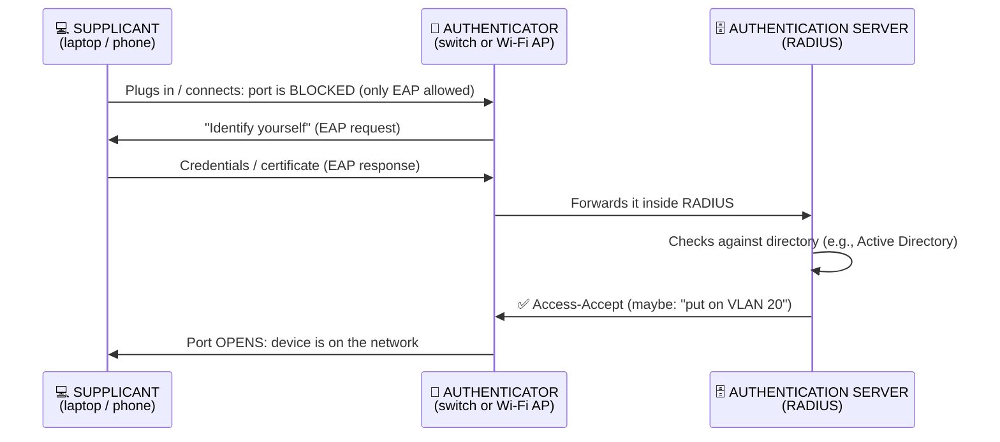

# Chapter 30 — Securing Enterprise Infrastructure

**Level 3 · Can Score ~40%** · *Exam objective 3.2*

---

## 🎯 Goal

By the end of this chapter you will be able to design and explain a secure enterprise network:
- **Infrastructure considerations:** device placement, security zones, attack surface, connectivity, failure modes (fail-open/fail-closed), active vs passive, inline vs tap/monitor
- **Network appliances:** jump server, proxy server, IDS/IPS, load balancer, sensors
- **Port security:** 802.1X, EAP
- **Firewall types:** WAF, UTM, NGFW, Layer 4 vs Layer 7
- **Secure communication/access:** VPN, remote access, tunneling (TLS, IPsec), SD-WAN, SASE
- **Selecting effective controls**

---

## 🏠 Real-Life Story: Designing an Airport ✈️

An airport is a masterclass in security zones:
- **Public zone:** car park, check-in hall. Anyone can enter.
- **Security checkpoint:** scanners and guards **inspect everything** passing through (a firewall/IPS).
- **Departure lounge:** only passengers with boarding passes (authenticated users).
- **Airside / restricted zone:** only staff with special badges (privileged access).
- **Control tower:** highly restricted; very few people (the most critical systems).
- **Staff entrance:** a separate, tightly controlled door for crews (a jump server for admins).

Each zone has a **different trust level**, and every **crossing point** between zones is controlled. Enterprise networks are designed the same way.

---

## 📖 Part 1 — Security Zones & Device Placement 🗺️

## 🖼️ Figure 30.1 — A Classic Enterprise Network ⭐ (learn to redraw this!)

```
                               🌍 INTERNET (untrusted)
                                      │
                              ┌───────┴────────┐
                              │ EDGE FIREWALL  │  (NGFW/UTM)
                              │ + IPS (inline) │
                              └───┬────────┬───┘
                                  │        │
          ┌───────────────────────┘        └──────────────────────────┐
          │                                                           │
 ┌────────┴──────────────── SCREENED SUBNET (DMZ) ───────┐            │
 │  Load balancer ─► Web servers (behind a WAF)          │            │
 │  Reverse proxy · Email gateway · Public DNS · VPN     │            │
 └───────────────────────────────────────────────────────┘            │
                                                                       │
                                                         ┌─────────────┴──────────┐
                                                         │  INTERNAL FIREWALL     │
                                                         └───┬──────────┬─────────┘
                                                             │          │
                                  ┌──────────────────────────┘          └──────────────────┐
                    ┌─────────────┴──────────────┐                   ┌─────────────────────┴──┐
                    │ INTERNAL LAN (trusted)     │                   │ DATA CENTER ZONE       │
                    │ Staff PCs · printers       │                   │ Databases · AD · files │
                    │ Forward proxy for web      │                   │ Reached by admins ONLY │
                    │ 802.1X on every port       │                   │ through a JUMP SERVER  │
                    └────────────────────────────┘                   └────────────────────────┘
          + separate GUEST Wi-Fi and IoT segments that can reach ONLY the internet
          + IDS SENSORS on taps/SPAN ports watching traffic in each zone
```

| Term | Meaning |
|---|---|
| **Security zone** | A network area grouping systems with the **same trust level and security needs** (internet, screened subnet, internal, data center, guest, IoT, management) |
| **Screened subnet** (formerly **DMZ**) | A zone **between** the internet and the internal network for **public-facing servers**. If a web server is hacked, the attacker still has another firewall to get through |
| **Device placement** | Putting each control **where it can see and stop the right traffic**: WAF in front of web servers, IPS at the edge, sensors in each zone, jump server at the entrance to the admin zone |
| **Attack surface** | Fewer zone crossings and fewer exposed services = smaller attack surface |
| **Connectivity** | How zones and sites connect (internet, VPN, MPLS (a private, carrier-managed WAN link), SD-WAN, cloud links). Every connection must be secured and monitored |

---

## 📖 Part 2 — Failure Modes & Device Attributes ⚙️

### Fail-Open vs Fail-Closed

When a security device **breaks or loses power**, what happens to the traffic?

| Mode | Behavior when it fails | Favors | Example |
|---|---|---|---|
| **Fail-open** | Traffic **passes through** unchecked | **Availability** | An IPS on a hospital network: better to let traffic through than stop patient systems |
| **Fail-closed** | Traffic is **blocked** | **Security / confidentiality** | A firewall protecting a bank's payment system: nothing gets through if it fails |

> 💡 In **physical** security the words are often **fail-safe** (doors **unlock** on power loss so people can escape a fire, prioritizing **life safety**) and **fail-secure** (doors **stay locked**, prioritizing security). Life safety always wins for emergency exits.

### Active vs Passive Devices

| | **Active** | **Passive** |
|---|---|---|
| Meaning | Can **take action** on traffic (block, drop, modify) | **Only observes** and reports |
| Examples | IPS, firewall, WAF | IDS, network sensors, packet capture |

### Inline vs Tap/Monitor

## 🖼️ Figure 30.2 — Inline vs Tap/Monitor

```
   INLINE (traffic must pass THROUGH the device)
   Internet ───► [ IPS ] ───► LAN       ✔ can block    ✘ if it fails/slows, traffic is affected

   TAP / MONITOR (device gets a COPY of the traffic)
   Internet ───────────────► LAN
                   │
              [TAP or SPAN/mirror port] ───► [ IDS / sensor ]   ✔ no impact on traffic
                                                               ✘ can only ALERT, not block
```

- **Network TAP:** a hardware device that copies all traffic on a cable.
- **SPAN / port mirroring:** a switch feature that copies traffic from some ports to a monitoring port.

---

## 📖 Part 3 — Network Appliances 🧰

### Jump Server (Jump Box / Bastion Host) 🪜
A **single, hardened, heavily monitored server** that administrators must log into **first** before reaching sensitive systems.

```
   👩‍💻 Admin ──(VPN + MFA)──► 🪜 JUMP SERVER ──(SSH/RDP)──► 🗄️ servers in the secure zone
                             (hardened, logged,             (accept admin connections
                              session recording)             ONLY from the jump server)
```
- ✅ One controlled entry point, easy to monitor and audit.
- ⚠️ It's a high-value target, so harden it, require MFA, and log everything.

### Proxy Server 🔁

| Type | Sits in front of | Purpose |
|---|---|---|
| **Forward proxy** | **Users/clients** going out to the internet | URL filtering, malware scanning, logging, caching, hiding internal IPs |
| **Reverse proxy** | **Servers** receiving requests from the internet | Hides internal servers, TLS termination, load distribution, WAF functions |
| **Transparent proxy** | (forward proxy) Users don't need to configure anything; traffic is intercepted automatically | Easy deployment |

### IDS/IPS (recap from Chapter 20)
**IDS** = passive, detects, alerts (tap). **IPS** = active, inline, blocks. Detection: **signature**-based (known patterns) vs **anomaly/behavior**-based (deviations from normal).

### Load Balancer ⚖️
Spreads incoming requests across **multiple servers**, for **availability** and **performance**.
- **Active/active:** all servers serve traffic. **Active/passive:** standby servers take over if the active one fails.
- Scheduling methods: **round-robin** (take turns), **least connections**, weighted.
- **Persistence (sticky sessions / affinity):** keep a user on the same server during a session.
- Often also does **TLS offloading** (decrypting HTTPS itself so the servers don't have to) and health checks, and helps absorb DoS attacks.

### Sensors 📡
Devices or agents that **collect data** for monitoring: network sensors on taps, IDS sensors in each zone, NetFlow collectors, environmental sensors. They feed the **SIEM**.

---

## 📖 Part 4 — Port Security: 802.1X and EAP 🔌

**802.1X** = **port-based network access control (NAC)**. A device **can't use the network port (wired or wireless)** until it **authenticates**.

## 🖼️ Figure 30.3 — The Three Players of 802.1X



**EAP (Extensible Authentication Protocol)** is the **framework** for carrying authentication inside 802.1X. Common methods:

| EAP method | How it authenticates | Strength |
|---|---|---|
| **EAP-TLS** | **Certificates on both** client and server | ⭐ Strongest (no passwords); needs PKI |
| **PEAP** | Server certificate creates a TLS tunnel; user sends **password** inside it | Common, good |
| **EAP-TTLS** | Similar to PEAP (TLS tunnel, then inner authentication) | Good |
| **EAP-FAST** | Cisco; uses a Protected Access Credential (PAC) instead of certificates | Good |

Other port-security features on switches: **disable unused ports**, **MAC limiting/sticky MAC**, **DHCP snooping**, **Dynamic ARP Inspection** (Chapter 25).

---

## 📖 Part 5 — Firewall Types 🧱

| Type | Works at | What it understands | Best for |
|---|---|---|---|
| **Layer 4 firewall** (stateful/packet filter) | Transport layer | IPs, **ports**, protocols, connection state | Fast basic filtering ("allow TCP 443") |
| **Layer 7 firewall** (application-layer) | Application layer | **Applications and content** ("allow Teams but block file uploads") | Granular control |
| **NGFW**: Next-Generation Firewall | Up to Layer 7 | **App awareness**, user identity, integrated **IPS**, TLS inspection, threat intelligence | Modern enterprise edge |
| **UTM**: Unified Threat Management | Multiple layers | **All-in-one box**: firewall + IPS + antivirus + web/content filter + VPN + spam filter | Small/medium businesses (simple, one device) |
| **WAF**: Web Application Firewall | Layer 7 (HTTP/HTTPS) | **Web attacks**: SQLi, XSS, CSRF, bad bots | Protecting **web apps/APIs** |

> 🧠 **NGFW vs UTM:** both combine features. **UTM** = "Swiss-army knife" for smaller organizations (convenience; can become a performance bottleneck). **NGFW** = high-performance, application-aware enterprise firewall. **WAF** = only protects **web applications**.

---

## 📖 Part 6 — Secure Communication & Access 🚇

### VPN and Remote Access
- **Remote-access VPN:** individual users → company network (client software or browser).
- **Site-to-site VPN:** office network ↔ office network (always on, between gateways).
- **Full tunnel:** **all** of the user's traffic goes through the company (better visibility and control). **Split tunnel:** only company traffic goes through the VPN; internet traffic goes direct (faster, less visibility).

### Tunneling Protocols

**TLS** (used by SSL/TLS VPNs, HTTPS): works through firewalls easily (port 443); good for remote users.

**IPsec** (Layer 3: protects all IP traffic) has two protocols and two modes:

| IPsec part | Meaning |
|---|---|
| **AH** (Authentication Header) | **Integrity and authentication** only, **no encryption** |
| **ESP** (Encapsulating Security Payload) | **Encryption** + integrity + authentication (the one normally used) |
| **IKE** (Internet Key Exchange) | Negotiates keys and security settings |
| **Transport mode** | Encrypts **only the payload**; original IP header stays. Host-to-host |
| **Tunnel mode** | Encrypts the **entire original packet** and adds a new IP header. Gateway-to-gateway (site-to-site VPNs) |

## 🖼️ Figure 30.4 — IPsec Transport vs Tunnel Mode

```
   Original packet:         [ IP header | TCP | DATA ]

   TRANSPORT mode (ESP):    [ IP header | ESP hdr | ███ TCP + DATA (encrypted) ███ | ESP trailer ]
                              ▲ original header visible

   TUNNEL mode (ESP):       [ NEW IP hdr | ESP hdr | ███ IP header + TCP + DATA (encrypted) ███ | ESP trailer ]
                              ▲ only gateway addresses visible; the real endpoints are hidden
```

### SD-WAN: Software-Defined Wide Area Network 🛣️
Uses software to **intelligently route traffic between branch offices and the cloud** over several connections (broadband, 4G/5G, MPLS private links), choosing the best path for each application.
- ✅ Cheaper and faster than old private WAN links; good for cloud apps.
- ⚠️ Branches now connect **directly to the internet**, so security must travel with the traffic. That leads to SASE.

### SASE: Secure Access Service Edge (pronounced "sassy") ☁️🛡️
**SASE** = **SD-WAN + cloud-delivered security**, combined into one service delivered from the cloud **close to the user**, wherever they are.

## 🖼️ Figure 30.5 — From "Backhaul Everything" to SASE

```
   OLD WAY: all traffic travels back to HQ to be inspected   NEW WAY: SASE
   🏠 home user ─┐                                           🏠 home user ──┐
   🏪 branch    ─┼──► 🏢 HQ firewall ──► ☁️ cloud apps        🏪 branch     ──┼──► ☁️ SASE cloud ──► ☁️ apps / internet
   ✈️ traveller ─┘   (slow, bottleneck)                      ✈️ traveller  ──┘    (firewall-as-a-service,
                                                                                  secure web gateway, CASB,
                                                                                  zero-trust network access,
                                                                                  SD-WAN, all near the user)
```

SASE commonly includes: **FWaaS** (firewall as a service), **SWG** (secure web gateway), **CASB** (cloud access security broker: controls use of cloud apps), and **ZTNA** (zero trust network access, Chapter 33).

---

## 📖 Part 7 — Selecting Effective Controls 🎯

When the exam asks which control to choose, think:
1. **What's the asset and its zone?** (public web server → screened subnet + WAF)
2. **What's the threat?** (SQLi → WAF + input validation; rogue devices → 802.1X)
3. **Prevent or detect?** (must block → inline IPS; must not disrupt → passive IDS)
4. **What happens if it fails?** (fail-open for availability, fail-closed for security)
5. **Defense in depth:** layer more than one control.

## 🖼️ Figure 30.6 — Requirement → Control ⭐

| Requirement | Best control |
|---|---|
| Protect a public web app from SQLi/XSS | **WAF** (in front of the web servers) |
| Admins must reach servers through one audited point | **Jump server** |
| Stop unknown devices plugging into wall ports | **802.1X / NAC** |
| Filter and log staff web browsing | **Forward proxy / secure web gateway** |
| Spread traffic across web servers and survive one failing | **Load balancer** |
| Detect attacks without any risk of blocking traffic | **IDS on a tap/SPAN** (passive) |
| Block attacks in real time at the edge | **IPS inline** / **NGFW** |
| Small business wants one all-in-one security box | **UTM** |
| Connect two offices securely over the internet | **Site-to-site IPsec VPN (tunnel mode)** |
| Secure many branches and remote users with cloud-delivered security | **SASE** (with SD-WAN) |
| Public servers must be separated from the internal LAN | **Screened subnet (DMZ)** |

---

## 🧠 Memory Tricks

- **Screened subnet = the airport check-in hall**: public-facing, but not inside.
- **Fail-open = Open for business (availability). Fail-closed = Closed for safety (security).**
- **Inline = in the line of fire (can block). Tap = takes a copy (only watches).**
- **802.1X trio: Supplicant (Supplies credentials) → Authenticator (the switch/AP doorman) → Authentication server (RADIUS decides).**
- **EAP-TLS = certificates on both ends = strongest.**
- **AH = Authentication Header (no encryption). ESP = Encrypts Secret Payload.**
- **Tunnel mode = whole packet in a tunnel. Transport mode = just the cargo.**
- **SASE = SD-WAN + Security As a Service at the Edge.**

---

## ⚠️ Exam Tip

- *"Where should a public web server be placed?"* → **Screened subnet (DMZ).**
- *"An IPS must not interrupt hospital traffic if it fails."* → Configure it to **fail-open.**
- *"Which component in 802.1X is the switch?"* → **Authenticator.** The laptop = **supplicant**; RADIUS = **authentication server**.
- *"Which EAP method requires certificates on both client and server?"* → **EAP-TLS.**
- *"Which IPsec protocol provides encryption?"* → **ESP** (AH does not encrypt).
- *"Which device protects web applications specifically?"* → **WAF.**
- *"A company wants to combine SD-WAN with cloud-delivered security for remote users."* → **SASE.**
- *"Administrators must connect through a single hardened host to manage servers."* → **Jump server.**

---

## 🧪 Try It (30 minutes)

1. **Draw Figure 30.1 from memory.** Then place these on it: WAF, IPS, jump server, forward proxy, load balancer, IDS sensor, RADIUS server, VPN concentrator.
2. **Set up a free firewall in your lab** (optional, advanced): install **pfSense** or **OPNsense** in VirtualBox with two network adapters (WAN/LAN), and create one allow rule plus a deny-all rule.
3. **See your VPN/tunnel options:** on Windows, Settings → Network & internet → VPN. On your phone, find the VPN settings. Which protocols are listed (IKEv2 = IPsec; L2TP/IPsec; SSL)?
4. **Wireshark challenge:** capture traffic while visiting an HTTPS site and filter `tls.handshake`. You're watching a TLS tunnel being built.

---

## ✅ Checkpoint Questions

1. What is a screened subnet, and what belongs in it?
2. Explain fail-open vs fail-closed with an example of each.
3. What's the difference between inline and tap/monitor placement?
4. Why use a jump server?
5. What's the difference between a forward proxy and a reverse proxy?
6. Name the three 802.1X roles.
7. Which EAP method is strongest, and why?
8. Compare NGFW, UTM and WAF.
9. What's the difference between IPsec transport mode and tunnel mode?
10. What is SASE, and why did it emerge?

<details>
<summary><b>Show answers</b></summary>

1. A network zone **between the internet and the internal network** for **public-facing services**: web servers, email gateways, reverse proxies, public DNS, VPN endpoints.
2. **Fail-open** lets traffic pass when the device fails (e.g., an IPS protecting availability in a hospital). **Fail-closed** blocks traffic (e.g., a firewall protecting a payment system).
3. **Inline** devices sit **in the traffic path** and can block. **Tap/monitor** devices receive a **copy** and can only observe/alert.
4. It provides **one hardened, monitored, audited entry point** for administrative access to sensitive systems.
5. A **forward proxy** acts for **internal users** going out (filtering/logging). A **reverse proxy** sits in front of **servers** receiving requests from outside (hiding servers, TLS termination, load distribution).
6. **Supplicant** (client device), **authenticator** (switch/AP), **authentication server** (RADIUS).
7. **EAP-TLS.** It uses **certificates on both sides** (mutual authentication) and no passwords to steal.
8. **NGFW:** high-performance, application-aware enterprise firewall with IPS. **UTM:** all-in-one security appliance (firewall, IPS, AV, filtering, VPN) for smaller organizations. **WAF:** protects **web applications** from web attacks like SQLi/XSS.
9. **Transport** encrypts only the **payload** (original IP header visible), host-to-host. **Tunnel** encrypts the **entire original packet** and adds a new header, gateway-to-gateway.
10. **SD-WAN combined with cloud-delivered security** (FWaaS, SWG, CASB, ZTNA) near the user. It emerged because users and apps moved to the **cloud and remote work**, making "backhaul everything to HQ" slow and ineffective.

</details>

### 🎯 Exam-Style Practice (multiple choice)

**MC1.** While connected to the VPN, remote staff must have ALL of their traffic, including general web browsing, pass through the company's web filter. Which VPN setting is required?
A. Split tunnel  B. Full tunnel  C. IPsec transport mode  D. A site-to-site tunnel

**MC2.** A company wants internet users to reach several internal web servers through one front-end system that hides the servers' addresses and handles TLS for them. Which appliance BEST fits?
A. Reverse proxy  B. Forward proxy  C. Transparent proxy for staff browsing  D. Network TAP

**MC3.** Two servers in the same data center must protect the traffic between them with IPsec. The original IP headers may stay visible. Which IPsec mode fits BEST?
A. Tunnel mode  B. AH only, with no ESP  C. Split tunnel mode  D. Transport mode

**MC4.** Customers of an online shop behind a load balancer keep losing the items in their carts, because each click may go to a different web server. Which load-balancer setting BEST fixes this?
A. Round-robin scheduling  B. Fail-closed mode  C. Persistence (sticky sessions / session affinity)  D. TLS offloading

**MC5.** A data center's emergency exit doors must unlock automatically during a power failure so that people can escape a fire. What is this design called?
A. Fail-safe  B. Fail-secure  C. Fail-closed  D. Inline

**MC6.** Company Wi-Fi uses a server certificate to build an encrypted TLS tunnel, and users then type their domain password inside that tunnel. No client certificates are used. Which EAP method is this MOST likely?
A. EAP-TLS  B. PEAP  C. EAP with MAC filtering  D. WPS

<details>
<summary><b>Show multiple-choice answers</b></summary>

| # | Answer | Why |
|---|---|---|
| MC1 | B | A full tunnel sends all of the user's traffic through the company; a split tunnel sends internet traffic directly, skipping the filter. |
| MC2 | A | A reverse proxy sits in front of servers, hiding them and terminating TLS; a forward proxy acts for internal users going out. |
| MC3 | D | Transport mode encrypts only the payload and keeps the original header, which suits host-to-host links; tunnel mode suits gateway-to-gateway VPNs. |
| MC4 | C | Persistence keeps a user on the same server for the whole session, so the session data (the cart) is not lost. |
| MC5 | A | Fail-safe doors unlock on power loss because life safety comes first; fail-secure doors stay locked. |
| MC6 | B | PEAP uses only a server certificate to build the tunnel and then a password inside it; EAP-TLS needs certificates on both sides. |

</details>


---

## 📌 Chapter Summary

| Area | Key items |
|---|---|
| Zones & placement | Internet → screened subnet → internal → data center; guest/IoT segments |
| Failure modes | Fail-open (availability) vs fail-closed (security) |
| Device attributes | Active vs passive; inline vs tap/SPAN |
| Appliances | Jump server, forward/reverse proxy, IDS/IPS, load balancer, sensors |
| Port security | 802.1X (supplicant, authenticator, RADIUS) + EAP (EAP-TLS strongest) |
| Firewalls | Layer 4 vs Layer 7, NGFW, UTM, WAF |
| Secure access | VPN (remote/site-to-site, full/split), TLS, IPsec (AH/ESP, transport/tunnel), SD-WAN, SASE |

**Next chapter →** *Chapter 31: Protecting Data.* The network is built. Now let's focus on protecting the most valuable thing flowing through it.
