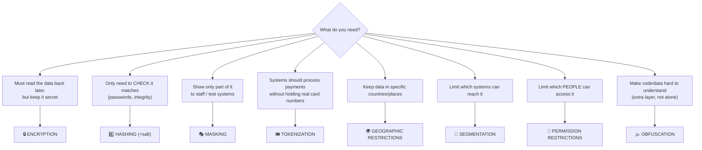

# Chapter 31 — Protecting Data

**Level 3 · Can Score ~40%** · *Exam objective 3.3*

---

## 🎯 Goal

By the end of this chapter you will master objective 3.3. Chapter 21 introduced **data types**, **classifications** and **data states**. Now you'll go deeper on the general data considerations (**data states, data sovereignty, geolocation**) and the **methods to secure data**: **geographic restrictions, encryption, hashing, masking, tokenization, obfuscation, segmentation, permission restrictions**. You'll also learn to choose the right method for a scenario.

---

## 🏠 Real-Life Story: One Credit Card, Six Protections 💳

Follow one credit card number through an online shop:

1. You type it in → it travels to the shop **encrypted** (TLS).
2. The shop's payment system swaps it for a **token**, so the shop's database never stores the real number.
3. The customer service screen shows only `**** **** **** 4821` (**masking**).
4. The payment servers live in their own **segment** of the network.
5. Only 3 people in finance have **permission** to see full payment records.
6. The data is stored only in data centers in the customer's country (**geographic restriction**).

Six different methods, each protecting the data in a different way. Choosing the **right method for the right job** is what this chapter teaches.

---

## 📖 Part 1 — Quick Recap: Types and Classifications

| Data types (Ch 21) | Classifications (Ch 21) |
|---|---|
| Regulated · trade secret · intellectual property · legal · financial · human-readable / non-human-readable | Public · private · sensitive · confidential · restricted · critical |

> 🔑 **The classification decides the protection.** Public data may need only integrity protection. Restricted data may need encryption, tokenization, strict permissions **and** geographic restrictions.

---

## 📖 Part 2 — General Data Considerations

### Data States (deeper look)

## 🖼️ Figure 31.1 — Matching Protection to State

```
   ┌──────────────────┬────────────────────────────────┬────────────────────────────────┐
   │ STATE            │ THREATS                        │ PROTECTIONS                    │
   ├──────────────────┼────────────────────────────────┼────────────────────────────────┤
   │ AT REST          │ stolen laptops/disks/backups,  │ full-disk / database / file    │
   │ (stored)         │ unauthorized file access       │ encryption, permissions, TPM   │
   ├──────────────────┼────────────────────────────────┼────────────────────────────────┤
   │ IN TRANSIT       │ eavesdropping, on-path,        │ TLS, IPsec VPN, SSH, SFTP,     │
   │ (moving)         │ tampering                      │ WPA3, email encryption         │
   ├──────────────────┼────────────────────────────────┼────────────────────────────────┤
   │ IN USE           │ memory scraping malware,       │ secure enclaves, least         │
   │ (processing)     │ screen capture, insiders       │ privilege, masking on screen,  │
   │                  │                                │ DLP, process isolation         │
   └──────────────────┴────────────────────────────────┴────────────────────────────────┘
```

### Data Sovereignty 🏛️
Data is subject to the **laws of the country where it is stored or processed** (and some laws follow the **person**, wherever the data goes, e.g., GDPR for EU residents).
- Consequences: some data **must stay in-country** (data localization laws); foreign governments may be able to **demand access** to data stored on their soil; cross-border transfers may need legal agreements.

### Geolocation 📍
The **physical location** of data, devices or users, determined by IP address, GPS or Wi-Fi.
- Used to **enforce rules** ("block logins from countries we don't operate in"), detect **impossible travel** (Chapter 26), and choose **cloud regions**.
- ⚠️ IP-based location can be **spoofed with VPNs**, so treat it as one signal among many.

---

## 📖 Part 3 — The Eight Methods to Secure Data ⭐

### 1. Geographic Restrictions 🌍
Limit **where data may be stored or accessed from**.
- Store EU customer data only in EU cloud regions.
- **Geofencing:** allow access only when a device is inside a defined area (e.g., the hospital campus).
- Block logins from high-risk countries.

### 2. Encryption 🔒
Transform data so **only key holders can read it** (Chapters 18, 28). **Reversible with the key.**
- Use for: data at rest and in transit, backups, anything sensitive that must be **read again** later.
- Remember: protecting the **keys** (HSM/KMS) is as important as the encryption itself.

### 3. Hashing #️⃣
One-way fingerprint. **Not reversible.**
- Use for: **verifying integrity** (file downloads, evidence) and **storing passwords** (with salt + key stretching).
- ❌ Not for data you need to read back (you can't "unhash" a customer's address).

### 4. Masking 🎭
**Hide part** of the data, usually when it's **displayed** or copied to **non-production** systems.
- `XXX-XX-6789`, `j***@example.com`, `**** **** **** 4821`.
- **Static masking:** permanently replaces data in a copy (e.g., a test database with fake names).
- **Dynamic masking:** hides data **on the fly** depending on who is viewing (support staff see `****4821`; the fraud team sees the full number).

### 5. Tokenization 🎟️
Replace sensitive data with a **random token**. The real value lives in a secure **token vault**.
- Used heavily for **payment cards** (and mobile wallets like Apple Pay / Google Pay).
- **Reduces compliance scope:** systems that only hold tokens aren't holding card data.

### 6. Obfuscation 🌫️
Make data or code **hard to understand**: renaming variables in code to nonsense, scrambling, **steganography** (hiding data inside other files). It slows attackers down, but **on its own it's not strong protection** ("security through obscurity").

### 7. Segmentation 🧩
Store sensitive data on **separate network segments or systems** with strict controls between them: the card-processing environment, an HR database zone, a research enclave.
- Limits who and what can even **reach** the data, and shrinks the breach impact.

### 8. Permission Restrictions 🔑
Grant access based on **least privilege** and **need-to-know**, using access control models (RBAC, ABAC, etc., Chapter 39), file/database permissions and regular **access reviews**.

## 🖼️ Figure 31.2 — The Same Card Number, Four Ways ⭐

```
   Original:      4111 1111 1111 1111

   ENCRYPTED:     U2FsdGVkX19vJ3kH9Yz...     → reversible WITH THE KEY
   HASHED:        9bbef194...(64 hex chars)  → NOT reversible (good for checking, not reading)
   MASKED:        **** **** **** 1111        → partly hidden for display
   TOKENIZED:     tkn_7Hq2Lr9Pz              → random substitute; real value only in the vault
```

### Which Method When? ⭐

## 🖼️ Figure 31.3 — Decision Guide



---

## 📖 Part 4 — Supporting Tools 🛠️

| Tool | What it does |
|---|---|
| **DLP**: Data Loss Prevention | Detects and **blocks sensitive data leaving** the organization (emails with card numbers, uploads of "Confidential" files, copying to USB). Works on endpoints, networks, email and cloud |
| **Data classification/labeling tools** | Tag files ("Confidential") so DLP and access rules can act on them |
| **CASB**: Cloud Access Security Broker | Controls and monitors how staff use **cloud apps** (blocks uploading sensitive files to personal cloud storage) |
| **Rights management (IRM/DRM)** | Protection that **travels with the file**: "can view, can't print or forward," even after it's emailed out |
| **Backups (encrypted)** | Protect availability, while keeping confidentiality |

## 🖼️ Figure 31.4 — DLP in Action

```
   👩 Employee emails "customers.xlsx" (contains 5,000 card numbers) to personal Gmail
            │
            ▼
   🛡️ DLP scans the attachment → finds patterns matching card numbers + "Confidential" label
            │
            ├──► ⛔ BLOCKS the email
            ├──► 💬 tells the user why ("This file contains payment card data")
            └──► 📒 alerts the security team / SIEM
```

---

## 🧠 Memory Tricks

- **Encryption = locked box (key opens it). Hashing = fingerprint (can't rebuild the person). Masking = sunglasses (partly hidden). Tokenization = cloakroom ticket (worthless without the cloakroom).**
- **Sovereignty = "data obeys local laws." Geolocation = "where is it right now?"**
- **Segmentation limits SYSTEMS. Permissions limit PEOPLE.**
- **Obfuscation alone ≠ security** (an extra layer only).

---

## ⚠️ Exam Tip

- *"A company wants call-center staff to see only the last four digits of card numbers."* → **Masking.**
- *"A retailer wants to reduce PCI DSS scope by not storing card numbers."* → **Tokenization.**
- *"Passwords must be stored so that even administrators can't read them."* → **Hashing** (salted, key-stretched).
- *"Customer data must remain within national borders to comply with law."* → **Geographic restrictions** (data sovereignty).
- *"Developers need realistic test data without real customer identities."* → **Masking** (static data masking).
- *"Which control prevents an employee from emailing a spreadsheet of social security numbers externally?"* → **DLP.**
- *"Which is reversible: hashing or encryption?"* → **Encryption** (with the key).

---

## 🧪 Try It (20 minutes)

1. **Hash vs encrypt vs encode** in your lab VM:
   ```bash
   echo -n "4111111111111111" | sha256sum                                    # hash: one-way
   echo -n "4111111111111111" | openssl enc -aes-256-cbc -pbkdf2 -a -pass pass:demo   # encrypt
   echo -n "4111111111111111" | base64                                       # encode (NOT security!)
   ```
   Which of these could you turn back into the original, and how?
2. **Spot masking and tokenization in your life:** check a receipt, bank app or phone wallet. Apple Pay / Google Pay use a **device account number (token)** instead of your real card number.
3. **Check your cloud region:** if you use Google Drive, iCloud or OneDrive, search where your data is stored. Does your country require local storage for any data?

---

## ✅ Checkpoint Questions

1. What's the difference between data sovereignty and geolocation?
2. Which data state is protected by TLS? Which by full-disk encryption?
3. Why is hashing unsuitable for protecting a customer's address that staff need to read?
4. What's the difference between static and dynamic masking?
5. Why does tokenization reduce PCI DSS scope?
6. Is obfuscation a strong protection on its own? Why or why not?
7. How does segmentation protect data?
8. What does DLP do?
9. A hospital wants doctors' tablets to access patient records only while inside the hospital. Which method fits?
10. Which method is reversible: encryption, hashing or tokenization? (More than one may apply.)

<details>
<summary><b>Show answers</b></summary>

1. **Sovereignty** = which **country's laws** apply to the data. **Geolocation** = the **physical location** of data/devices/users.
2. TLS protects data **in transit**. Full-disk encryption protects data **at rest**.
3. Hashing is **one-way**, so the address could never be read back.
4. **Static** masking permanently changes data in a **copy** (e.g., test databases). **Dynamic** masking hides data **in real time** based on who is viewing.
5. Systems store **tokens instead of real card numbers**, so they aren't holding cardholder data and fall outside much of the compliance scope.
6. **No.** It only makes data/code **harder to understand** and doesn't stop a determined attacker. Use it only as an extra layer.
7. It places sensitive data in **separate zones** with strict controls, limiting which systems (and attackers) can reach it.
8. It **detects and blocks sensitive data leaving** the organization through email, web, USB or cloud, and alerts security.
9. **Geographic restriction / geofencing.**
10. **Encryption** (with the key) and **tokenization** (via the token vault). **Hashing is not reversible.**

</details>

---

## 📌 Chapter Summary

| Method | Reversible? | Best for |
|---|---|---|
| Geographic restrictions | n/a | Sovereignty, location-based access |
| Encryption | ✅ with key | Confidentiality at rest/in transit |
| Hashing | ❌ | Integrity, password storage |
| Masking | Partly (display) | Showing partial data; test data |
| Tokenization | ✅ via vault | Payment data; scope reduction |
| Obfuscation | Varies | Extra layer only |
| Segmentation | n/a | Limiting which systems can reach data |
| Permission restrictions | n/a | Limiting which people can access data |

**Next chapter →** *Chapter 32: Resilience & Recovery.* Protecting data also means making sure it **survives** disasters. Let's build systems that bounce back.
