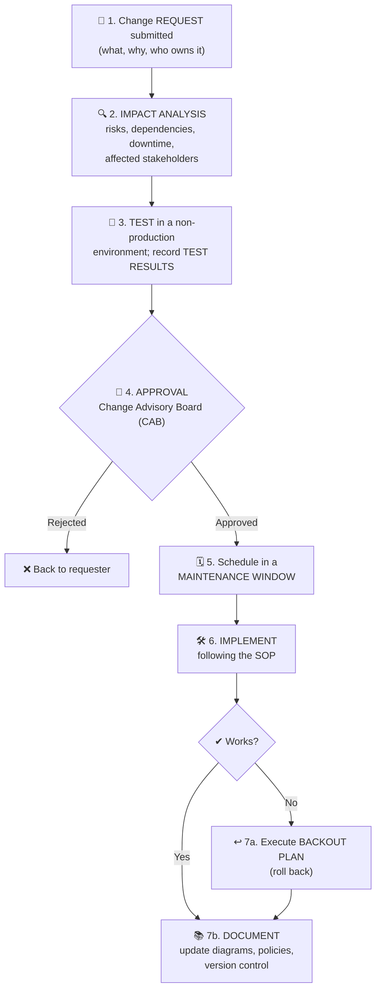

# Chapter 33 — Change Management, Gap Analysis, Zero Trust & Deception

**Level 3 · Can Score ~40%** · *Exam objectives 1.3 and 1.2 (gap analysis, zero trust, deception and disruption)*

---

## 🎯 Goal

By the end of this chapter you will understand:
- **Change management:** approval process, ownership, stakeholders, impact analysis, test results, backout plan, maintenance window, standard operating procedure; technical implications (allow/deny lists, restricted activities, downtime, service and application restarts, legacy applications, dependencies); documentation and version control
- **Gap analysis**
- **Zero trust:** the **control plane** (adaptive identity, threat scope reduction, policy-driven access control, Policy Administrator, Policy Engine) and the **data plane** (implicit trust zones, subject/system, Policy Enforcement Point)
- **Deception and disruption technology:** honeypot, honeynet, honeyfile, honeytoken

---

## 🏠 Real-Life Story: Renovating a Hospital 🏥

You can't just knock down a wall in a hospital on a Tuesday afternoon. First you:
- **ask permission** from the hospital board (approval),
- check **what's behind the wall**: power cables for the operating theater? (impact analysis, dependencies),
- **schedule** it for a quiet night (maintenance window),
- have a **plan to put things back** if something goes wrong (backout plan),
- **update the building plans** afterwards (documentation).

That's **change management**. And the hospital's security? A modern hospital doesn't trust anyone just because they're inside the building. Every door checks your badge, every time, and only opens the rooms your job needs. That's **zero trust**.

---

## 📖 Part 1 — Change Management 🔄

**Change management** = a formal process to **request, review, approve, test, implement and document** changes to systems, so changes don't cause outages or security holes.

> 🔐 **Why it's a security topic:** unauthorized or careless changes cause **misconfigurations** (the #1 vulnerability, Chapter 24), outages (availability), and gaps attackers exploit. It also helps detect **unauthorized changes**: anything not in the change record is suspicious.

## 🖼️ Figure 33.1 — The Change Management Process



### Business Processes (SY0-701 terms)

| Term | Meaning |
|---|---|
| **Approval process** | Formal sign-off before a change happens, often by a **Change Advisory Board (CAB)** |
| **Ownership** | A named person **responsible** for the change and its outcome |
| **Stakeholders** | Everyone **affected** by the change (users, business owners, other IT teams) who must be informed or consulted |
| **Impact analysis** | Assessing **what could go wrong**: risk, affected systems, downtime, security implications |
| **Test results** | Evidence the change worked correctly in a **test/staging** environment |
| **Backout plan** | Step-by-step instructions to **undo** the change if it fails (the "rollback plan") |
| **Maintenance window** | An agreed **time slot** (often nights/weekends) when changes are allowed, to minimize disruption |
| **Standard operating procedure (SOP)** | Documented, repeatable **step-by-step instructions** for performing routine changes the same way every time |

> 💡 Many organizations classify changes: **standard** (pre-approved, low-risk, routine), **normal** (needs CAB review), **emergency** (urgent fix, fast-tracked, documented afterwards).

### Technical Implications ⚙️

| Implication | What to consider |
|---|---|
| **Allow lists / deny lists** | A new app or server may need to be **added to allow lists** (firewall rules, application allow lists), or it will be blocked. Old entries should be **removed** |
| **Restricted activities** | Limit **what the implementer may do** during the change (only the approved scope, nothing extra) |
| **Downtime** | Will the service be unavailable? For how long? Who must be told? |
| **Service restart** | Some changes need a **service** (e.g., the web service) restarted, which briefly interrupts users |
| **Application restart** | Some need the **whole application** restarted, which may be longer and affect sessions |
| **Legacy applications** | Old apps may **break** with new patches/settings, need special testing, or can't be changed at all |
| **Dependencies** | Other systems that **rely on** the changed system (a database upgrade may break 5 apps that use it). Map them first! |

## 🖼️ Figure 33.2 — Dependencies: Why One Change Can Break Five Things

```
                         ┌─────────────────────┐
                         │ DATABASE SERVER     │  ← change: upgrade the database version
                         └──────────┬──────────┘
            ┌──────────────┬────────┴───────┬───────────────┐
            ▼              ▼                ▼               ▼
       [HR portal]   [Payroll app]   [Website login]  [Reporting tool]
       (needs old    (works fine)    (new TLS setting (legacy app:
        driver!)                      needed)          unsupported!)
   Impact analysis must find these BEFORE the change.
```

### Documentation & Version Control 📚
- **Updating diagrams** (network maps, data flows) after every change. Out-of-date diagrams mislead incident responders.
- **Updating policies/procedures** if the change affects how things are done.
- **Version control:** track every version of code, configurations and documents (e.g., with **Git**), so you can see **who changed what, when and why**, and **roll back** to a known-good version.

---

## 📖 Part 2 — Gap Analysis 📏

**Gap analysis** = comparing **where you are now** (current security state) with **where you want or need to be** (a target such as a framework, regulation or policy), and listing the **gaps** to close.

## 🖼️ Figure 33.3 — Mind the Gap

```
   CURRENT STATE                          TARGET STATE (e.g., NIST CSF, ISO 27001, PCI DSS)
   ─────────────────────────              ─────────────────────────────────────────────
   ✔ Firewalls in place                    ✔ Firewalls in place
   ✘ MFA only for admins           ─GAP─►  ✔ MFA for ALL users
   ✘ Backups never tested          ─GAP─►  ✔ Quarterly restore tests
   ✘ No asset inventory            ─GAP─►  ✔ Complete, up-to-date inventory
   ✘ Training once at hiring       ─GAP─►  ✔ Annual training + phishing simulations

   Output: a prioritized ROADMAP of projects to close each gap (with owners, budget, deadlines)
```

---

## 📖 Part 3 — Zero Trust 🚫🤝

### The Old Way: Castle-and-Moat 🏰
Traditional security trusted everything **inside** the network perimeter. Once an attacker got past the firewall (phishing, VPN password), they could **move freely**.

### The New Way: "Never Trust, Always Verify" 🔍
**Zero trust** assumes the network is **already compromised**. **No user, device or connection is trusted automatically** because of its location. **Every request** is authenticated, authorized and checked **every time**, with the **least privilege** needed.

## 🖼️ Figure 33.4 — Perimeter vs Zero Trust

```
   PERIMETER (castle & moat)                      ZERO TRUST
   ┌────────────── INSIDE = TRUSTED ───────┐      Every request, every time:
   │  PC ──► server: free movement once    │      👤 who are you? (strong auth + MFA)
   │  inside                               │      💻 is your device healthy & managed?
   │  attacker (got in via phishing)       │      📍 where/when? is this normal for you?
   │     ──► server, server, server        │      🎯 access to THIS app only, for THIS session
   └───────────────────────────────────────┘      → no implicit trust from network location
   🧱 one big wall
```

### The Zero Trust Architecture (NIST SP 800-207) ⭐

Zero trust splits into two planes, like SDN (Chapter 29):
- **Control plane** = the **decision-making** "brain."
- **Data plane** = where the **actual traffic** flows and decisions are **enforced**.

## 🖼️ Figure 33.5 — Zero Trust Components

```
   ┌──────────────────────────────── CONTROL PLANE ("decides") ───────────────────────────┐
   │                                                                                      │
   │   ┌──────────────────────┐   tells   ┌────────────────────────┐                      │
   │   │  POLICY ENGINE (PE)  │ ────────► │ POLICY ADMINISTRATOR   │                      │
   │   │  makes the decision: │           │ (PA): carries out the  │                      │
   │   │  grant / deny / step │           │ decision, sets up or   │                      │
   │   │  up, using policies, │           │ tears down the session,│                      │
   │   │  identity, device    │           │ issues tokens/creds    │                      │
   │   │  health, threat intel│           └───────────┬────────────┘                      │
   │   └──────────────────────┘                       │ instructs                         │
   │      (PE + PA together = Policy Decision Point, PDP)                                 │
   └──────────────────────────────────────────────────┼───────────────────────────────────┘
                                                      ▼
   ┌──────────────────────────────── DATA PLANE ("does") ─────────────────────────────────┐
   │                                                                                      │
   │   SUBJECT / SYSTEM ──────► POLICY ENFORCEMENT POINT (PEP) ──────► RESOURCE           │
   │   (user + device           the "gatekeeper": allows,             (inside an          │
   │    requesting access)      blocks or ends the connection          IMPLICIT TRUST     │
   │                            as instructed                          ZONE, kept as      │
   │                                                                   small as possible) │
   └──────────────────────────────────────────────────────────────────────────────────────┘
```

### Control Plane Terms

| Term | Meaning |
|---|---|
| **Adaptive identity** | Authentication that **adapts to context and risk**: location, device, time, behavior. An unusual login gets extra checks (step-up MFA) or is denied |
| **Threat scope reduction** | **Limit the "blast radius"**: least privilege, micro-segmentation (very small segments around individual servers or workloads), short sessions, so a compromised account can reach very little |
| **Policy-driven access control** | Access decisions are made by **centrally defined policies** (who, what, when, where, which device), not by network location |
| **Policy Engine (PE)** | The component that **makes the decision** (grant/deny) using policy plus inputs (identity, device posture, threat intel, logs) |
| **Policy Administrator (PA)** | **Executes the decision**: establishes or shuts down the connection between subject and resource, issuing session credentials/tokens |

### Data Plane Terms

| Term | Meaning |
|---|---|
| **Subject / system** | The **user** (subject) and **device/system** requesting access |
| **Policy Enforcement Point (PEP)** | The **gatekeeper** that sits in the path and **enforces** the decision: allows, monitors or terminates the connection |
| **Implicit trust zone** | The area **behind** the PEP where the resource lives and some trust is assumed. Zero trust aims to make these zones **as small as possible** (ideally just the resource itself) |

> 🧠 **PE decides, PA arranges, PEP enforces.** Like a nightclub: the **manager** decides who's allowed (PE), the **booking desk** puts your name on tonight's list (PA), and the **bouncer** at the door checks it (PEP).

### Zero Trust in Practice
- **ZTNA (Zero Trust Network Access)** replaces broad VPN access with **per-application** access (often part of **SASE**, Chapter 30).
- **MFA everywhere**, device health checks, **micro-segmentation**, continuous monitoring, least privilege.

---

## 📖 Part 4 — Deception & Disruption Technology 🍯

Deception tools are **fake resources** that **legitimate users have no reason to touch**. Any interaction is a **high-confidence alert**, and attackers waste time on decoys.

| Tool | What it is | Example | Alert when… |
|---|---|---|---|
| **Honeypot** | A **decoy system** that looks real and vulnerable | A fake "old Windows file server" | Anyone connects to it |
| **Honeynet** | A **network of honeypots** simulating a realistic environment | A fake department network with servers and workstations | Any activity inside it |
| **Honeyfile** | A **decoy file** with a tempting name | `Passwords_2026.xlsx`, `Merger_Plans_CONFIDENTIAL.docx` on a file share | The file is opened, copied or moved |
| **Honeytoken** | **Fake data/credential** planted somewhere | A fake admin account, fake API key in code, fake customer record in a database, fake AWS key | The token is **used** anywhere (e.g., someone tries to log in with the fake account) |

## 🖼️ Figure 33.6 — A Honeytoken Tripwire

```
   🍯 Security team plants a fake AWS access key inside an internal code repository:
        AWS_KEY = "AKIA-FAKE-HONEYTOKEN-123"   (works nowhere; monitored everywhere)

   🦹 Attacker breaks into the repository, finds the key, tries to use it
        │
        ▼
   🚨 INSTANT ALERT: "Honeytoken used from IP 198.51.100.77"
       → we now know: the repo is compromised, and we know the attacker's IP
```

> 💡 **Benefits:** very **few false positives** (legit users never touch decoys), early warning, intelligence about attacker techniques, attackers' time wasted. **Cautions:** a honeypot must be **isolated** so it can't become a launch pad into real systems.

**Disruption** also includes tactics like **fake DNS entries**, **sinkholing** (redirecting malicious domains to a controlled server), and presenting **fake telemetry** that confuses attackers' reconnaissance.

---

## 🧠 Memory Tricks

- **Change management steps: "Request → Analyze → Test → Approve → Schedule → Implement → (Back out) → Document."** Say "**RAT-ASID**."
- **Backout plan = the undo button.**
- **Gap analysis = "where we are vs where we should be."**
- **Zero trust = "Never trust, always verify."**
- **PE decides · PA arranges · PEP enforces** (manager · booking desk · bouncer).
- **Control plane = brain. Data plane = muscle.**
- **Honey-pot (system), -net (network), -file (document), -token (fake credential/data).**

---

## ⚠️ Exam Tip

- *"A change failed and must be reversed. Which document is needed?"* → **Backout plan.**
- *"Who formally approves changes?"* → **Change Advisory Board (CAB)** (approval process).
- *"A database upgrade broke three applications nobody considered."* → Failure of **impact analysis / dependency** mapping.
- *"Comparing current controls against the NIST framework to find missing ones."* → **Gap analysis.**
- *"Which zero trust component makes the access decision?"* → **Policy Engine.**
- *"Which zero trust component allows or blocks the actual connection?"* → **Policy Enforcement Point.**
- *"Authentication requirements change based on the user's location and device."* → **Adaptive identity.**
- *"A fake credentials file is placed on a share to detect intruders."* → **Honeyfile.** (Fake *credentials used* elsewhere → **honeytoken**.)
- *"A decoy server designed to attract attackers."* → **Honeypot.**

---

## 🧪 Try It (25 minutes)

1. **Write a change request** for "enable MFA for all staff email accounts." Include: owner, stakeholders, impact analysis, test plan, maintenance window, backout plan and documentation updates.
2. **Personal gap analysis:** compare your own setup with this target: *MFA on all accounts, password manager, encrypted laptop, 3-2-1 backups, automatic updates*. List your gaps and fix one today.
3. **Create a free honeytoken:** visit **canarytokens.org** (a free, legitimate service by Thinkst) and make a "Word document" or "web bug" token sent to your own email. Open the document and watch the alert arrive. That's exactly how honeyfiles work.
4. **Draw Figure 33.5 from memory** and label PE, PA, PEP, subject and resource.

---

## ✅ Checkpoint Questions

1. Why is change management a security control and not just an IT process?
2. What is a backout plan?
3. What's the purpose of a maintenance window?
4. Give three technical implications to consider before a change.
5. Why should diagrams and documentation be updated after a change?
6. What is gap analysis?
7. What's the core idea of zero trust?
8. What's the difference between the Policy Engine and the Policy Administrator?
9. What does the Policy Enforcement Point do?
10. What's the difference between a honeyfile and a honeytoken?

<details>
<summary><b>Show answers</b></summary>

1. It prevents **misconfigurations and unauthorized changes** (major causes of vulnerabilities and outages), ensures security is **reviewed** before changes, and makes unauthorized changes **easier to detect**.
2. A documented procedure to **undo/roll back** a change if it fails.
3. A **pre-agreed time** for making changes that **minimizes disruption** to users and the business.
4. Any three of: **allow/deny list updates, restricted activities, downtime, service restart, application restart, legacy application compatibility, dependencies.**
5. Out-of-date documentation **misleads** administrators and incident responders, and diagrams must reflect reality for troubleshooting, audits and security reviews.
6. Comparing the **current security state** against a **desired/required state** (framework, regulation, policy) to identify missing controls and build a roadmap.
7. **Never trust, always verify.** No implicit trust based on network location; every access request is authenticated, authorized and continuously evaluated with least privilege.
8. The **Policy Engine decides** whether access is granted. The **Policy Administrator carries out** that decision by establishing or terminating the session (issuing credentials/tokens).
9. It **sits in the data path and enforces** the decision: allowing, monitoring or terminating the connection between subject and resource.
10. A **honeyfile** is a **decoy file** that alerts when opened. A **honeytoken** is **fake data or a fake credential** that alerts when it is **used** (e.g., a fake API key or account).

</details>

---

## 📌 Chapter Summary

| Topic | Key points |
|---|---|
| Change management | Request → impact analysis → test → CAB approval → maintenance window → implement (SOP) → backout if needed → document; ownership and stakeholders |
| Technical implications | Allow/deny lists, restricted activities, downtime, service/app restarts, legacy apps, dependencies |
| Documentation | Update diagrams, policies, procedures; version control |
| Gap analysis | Current vs target state → roadmap |
| Zero trust | Never trust, always verify; control plane (adaptive identity, threat scope reduction, policy-driven access, **PE**, **PA**) and data plane (subject/system, **PEP**, implicit trust zones) |
| Deception | Honeypot, honeynet, honeyfile, honeytoken: low false positives, early warning |

---

## 🎓 End of Level 3!

You have now covered **every objective in Domains 1, 2 and 3**: general security concepts, threats, vulnerabilities and mitigations, and security architecture. That's **52% of the exam**. Together with Level 2's vocabulary for Domains 4 and 5, you can now answer a large share of "identify the attack" and "which control fits" questions.

**👉 Now take the [Level 3 Gate Test](level-3-gate-test.md)** (90 questions). Score **70% or more** and you're ready for **Level 4: Advanced Knowledge, 100% Exam Pass**.
