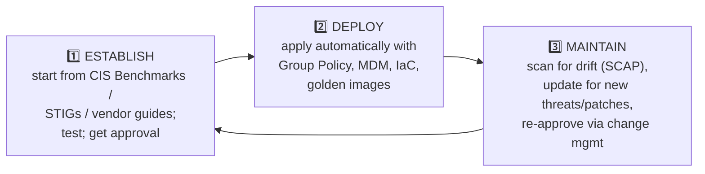

# Chapter 34 — Secure Baselines, Hardening Targets, Wireless, Mobile & Application Security

**Level 4 · Advanced Knowledge** · *Exam objective 4.1*

---

## 🎯 Goal

By the end of this chapter you will be able to apply common security techniques to computing resources:
- **Secure baselines:** establish, deploy, maintain
- **Hardening targets:** mobile devices, workstations, switches, routers, cloud infrastructure, servers, ICS/SCADA, embedded systems, RTOS, IoT devices
- **Wireless devices:** installation considerations (site surveys, heat maps); wireless security settings (WPA3, AAA/RADIUS, cryptographic and authentication protocols)
- **Mobile solutions:** MDM; deployment models (BYOD, COPE, CYOD); connection methods (cellular, Wi-Fi, Bluetooth)
- **Application security:** input validation, secure cookies, static code analysis, code signing
- **Sandboxing** and **monitoring**

This objective says "Given a scenario, **apply**…", so expect scenario questions and PBQs.

---

## 🏠 Real-Life Story: The Franchise Restaurant 🍔

A burger franchise with 500 restaurants doesn't let each manager invent their own kitchen rules. Head office writes **one standard setup**: fridge at 4 °C, fryer at 175 °C, hand-washing every 30 minutes. Every new restaurant is **built to that standard** (deploy), and inspectors visit regularly to make sure nobody has drifted (maintain). When the standard improves, every kitchen is updated.

That standard is a **secure baseline**, and the same idea applies to every computer, switch, phone and cloud server you run.

---

## 📖 Part 1 — Secure Baselines 📏

A **secure baseline** = a documented, approved set of **minimum security settings** for a type of system (e.g., "Windows 11 workstation baseline," "Linux web server baseline").

## 🖼️ Figure 34.1 — The Baseline Lifecycle



| Phase | What happens | Tools |
|---|---|---|
| **Establish** | Decide the settings: start from trusted references such as **CIS Benchmarks** (from the Center for Internet Security) or **DISA STIGs** (Security Technical Implementation Guides from the US Defense Information Systems Agency), adjust for your needs, **test**, document and approve | CIS-CAT, vendor security guides |
| **Deploy** | Push the baseline consistently to every system | **Group Policy** (Windows), **MDM** profiles (phones), **Ansible/Puppet**, **IaC** (Infrastructure as Code, Chapter 29) templates, **golden images** (pre-hardened OS images) |
| **Maintain** | Detect **configuration drift**, re-apply settings, update the baseline when software or threats change | **SCAP** scanners (Chapter 37), configuration management tools, change management |

> 💡 **Configuration drift** = systems slowly moving away from the baseline as people "temporarily" change settings. Maintaining the baseline means finding and fixing that drift.

---

## 📖 Part 2 — Hardening Targets 🎯

Every device type needs its own hardening checklist. These are the targets SY0-701 names:

## 🖼️ Figure 34.2 — Hardening Cheat Sheet by Target ⭐

| Target | Key hardening steps |
|---|---|
| **Mobile devices** | Screen lock + strong PIN/biometrics, full-device encryption, OS updates, MDM enrolment, block side-loading, remote wipe, disable unused radios |
| **Workstations** | Patch OS/apps, EDR, host firewall, standard (non-admin) users, disable USB storage, full-disk encryption, remove bloatware, screen lock timeout |
| **Switches** | Change default creds, SSH instead of Telnet, disable unused ports, **port security / 802.1X**, VLANs, DHCP snooping, Dynamic ARP Inspection, separate management VLAN, update firmware |
| **Routers** | Change default creds, SSH/HTTPS management only, ACLs, disable unused services, secure routing protocols (authentication), firmware updates, log to syslog |
| **Cloud infrastructure** | MFA on all accounts (especially root/admin), least-privilege IAM roles, no public storage by default, encryption, logging enabled (e.g., cloud audit logs), security groups, **CSPM** (cloud security posture management) scans |
| **Servers** | Minimal install (only needed roles), patching, disable unneeded services/ports, host firewall, EDR/HIPS, strong admin auth, centralized logging, file integrity monitoring |
| **ICS/SCADA** | Network isolation from IT, strict access control, allow lists, monitor OT traffic, vendor-approved patches only, physical security |
| **Embedded systems** | Change defaults, firmware updates when available, disable unneeded features, segment them |
| **RTOS** | Isolation, vendor-supported updates, minimal interfaces, secure design (security can't add delays) |
| **IoT devices** | Change default passwords, separate IoT network/VLAN, update firmware, disable UPnP and unneeded cloud features, buy from vendors with update policies |

> 🔐 The pattern is the same everywhere: **change defaults → remove what's not needed → patch → restrict access → encrypt → log/monitor → segment what can't be secured.**

---

## 📖 Part 3 — Wireless Devices 📶

### Installation Considerations

**Site survey** = a planned inspection of the physical location **before and after** installing Wi-Fi, to decide **where access points go**, which **channels** to use, and to find **interference** and **rogue APs**.

**Heat map** = a colour-coded map of **signal strength** across the floor plan.

## 🖼️ Figure 34.3 — A Wi-Fi Heat Map

```
   Office floor plan (signal strength)          Legend:
   ┌──────────────────────────────────────┐     ### strong  (close to AP)
   │ ###### ++++++        ++++++ ######   │     +++ good
   │ ##AP1# ++++++ ...... ++++++ #AP2##   │     ... weak
   │ ###### ++++++ ...... ++++++ ######   │         (blank) no signal: DEAD ZONE
   │ ++++++ ......        ...... ++++++   │
   │ ......     DEAD ZONE        ......   │  → add an AP here?
   │ ++++++ ......        ...... ++++++   │
   │ ###### ++++++ ...... ++++++ ######   │
   │ ##AP3# ++++++        ++++++ #AP4##   │     ######### signal leaking into the
   └──────────────────────────────────────┘     car park → reduce power/move AP
   ######### ######### (car park)
```

Security uses of surveys/heat maps:
- Find **coverage leaking outside** the building (attackers can connect from the car park). Reduce transmit power or move APs.
- Detect **rogue APs** and **interference**.
- Choose **non-overlapping channels** (1, 6, 11 on 2.4 GHz) for performance.

### Wireless Security Settings

| Setting | Recommendation |
|---|---|
| **WPA3** | Use **WPA3** (**SAE**, Simultaneous Authentication of Equals, for personal; **WPA3-Enterprise** with 802.1X for businesses). Disable WEP/WPA/TKIP and WPS |
| **AAA / RADIUS** | Enterprise Wi-Fi authenticates each user through **RADIUS** (802.1X), giving per-user accounting and easy revocation (Chapters 7, 30) |
| **Cryptographic protocols** | WPA2 uses **CCMP (AES)**. WPA3 uses **CCMP/GCMP** (WPA3-Enterprise 192-bit mode uses **GCMP-256**). Never TKIP or WEP's RC4 |
| **Authentication protocols** | **EAP methods** via 802.1X: **EAP-TLS** (certificates, strongest), **PEAP**, **EAP-TTLS**. **SAE** for WPA3-Personal |
| (also) | Separate **guest network**, management frame protection (802.11w), strong passphrases if PSK is unavoidable |

---

## 📖 Part 4 — Mobile Solutions 📱

### MDM: Mobile Device Management
Central software that **enrols, configures, monitors and secures** phones and tablets.

## 🖼️ Figure 34.4 — What MDM Can Do

```
                             ┌──────────────────────────┐
                             │       MDM SERVER         │
                             └────────────┬─────────────┘
       push policies / apps / certificates │  receive compliance status
          ┌────────────────────┬───────────┼──────────────┬────────────────────┐
          ▼                    ▼           ▼              ▼                    ▼
   Enforce PIN &        Encrypt device   Push/allow     Detect jailbreak/   REMOTE WIPE
   screen lock          & storage        approved apps  root → block        (full or just
                                         (app allow     access              the company
                                         list)                              container)
   Also: geofencing, disable camera in secure areas, push Wi-Fi/VPN settings,
   CONTAINERIZATION (separate "work" and "personal" profiles on one phone)
```

Related terms you may see: **MAM** (Mobile *Application* Management: manages only company apps) and **UEM** (Unified Endpoint Management: one console for phones, laptops and desktops).

### Deployment Models

| Model | Who owns/chooses | Company control | Privacy for user | Cost to company |
|---|---|---|---|---|
| **BYOD**: Bring Your Own Device | Employee owns it | **Lowest** (usually only a work container) | Highest | Lowest |
| **COPE**: Corporate-Owned, Personally Enabled | **Company owns**; personal use allowed | **High** | Medium | High |
| **CYOD**: Choose Your Own Device | Employee **chooses from an approved list**; company owns it | High | Medium | High |
| (also) **COBO**: Corporate-Owned, Business Only | Company owns; work use only | Highest | Lowest | High |

> 💡 BYOD risks: mixed personal and company data, unpatched devices, lost devices, and **privacy issues** if the company wipes the whole phone. Fix: **containerization/MAM** so only the work part is controlled and wiped.

### Connection Methods

| Method | Risks | Controls |
|---|---|---|
| **Cellular** (4G/5G) | Bypasses company network controls; SIM swapping; fake base stations | MDM, VPN, eSIM controls |
| **Wi-Fi** | Rogue/evil-twin APs, open networks | WPA3, VPN on public Wi-Fi, MDM Wi-Fi profiles, disable auto-join to open networks |
| **Bluetooth** | Bluesnarfing, unauthorized pairing | Non-discoverable mode, MDM can disable it |

---

## 📖 Part 5 — Application Security 🧑‍💻

| Technique | What it does | Stops |
|---|---|---|
| **Input validation** | Check **all** input against what's expected (type, length, format, allowed characters), done **on the server side** (client-side checks can be bypassed) | Injection (SQLi, command), XSS, buffer overflows |
| **Secure cookies** | Cookie flags: **Secure** (only sent over HTTPS), **HttpOnly** (JavaScript can't read it), **SameSite** (not sent with cross-site requests) | Session theft via XSS, interception, CSRF |
| **Static code analysis (SAST)** | Scans **source code without running it** to find bugs (hard-coded passwords, unsafe functions) | Coding flaws found **early** in development |
| **Dynamic analysis (DAST)** | Tests the **running** application from outside (e.g., web vulnerability scanners, **fuzzing** with random input) | Runtime flaws (more in Chapter 36) |
| **Code signing** | Developer **digitally signs** the code with a private key; users/OS verify with the certificate | Tampered or fake software, malicious updates |

## 🖼️ Figure 34.5 — A Secure Cookie

```
   Set-Cookie: sessionId=8f3k2LqZ; Secure; HttpOnly; SameSite=Strict; Max-Age=1800
                                    │       │         │                │
                                    │       │         │                └ expires in 30 min
                                    │       │         └ not sent on cross-site requests (anti-CSRF)
                                    │       └ JavaScript can't read it (limits XSS cookie theft)
                                    └ only travels over HTTPS (no sniffing)
```

> 🔐 **Server-side validation is mandatory.** An attacker can bypass browser (client-side) checks with tools like a proxy. Client-side validation is only for user convenience.

---

## 📖 Part 6 — Sandboxing & Monitoring 🏖️

**Sandboxing** = running code in an **isolated, restricted environment** where it can't harm the real system.
- Browsers sandbox each tab; phones sandbox each app.
- Email gateways **detonate** suspicious attachments in a sandbox to watch what they do.
- Developers test new code in sandboxes.

**Monitoring** = continuously watching systems (logs, EDR, SIEM, file integrity) to detect drift and attacks, covered in Chapter 37.

---

## 🧠 Memory Tricks

- **Baseline: "Establish, Deploy, Maintain"**: like a franchise: design the kitchen, build it everywhere, inspect it regularly.
- **Hardening pattern: "Defaults, Diet, Patch, Lock, Encrypt, Watch, Wall"**: change defaults, remove extras, patch, restrict access, encrypt, monitor, segment.
- **Site survey = walk the floor. Heat map = the coloured picture of signal.**
- **BYOD = Bring Your Own. COPE = Company Owns, Personal Enabled. CYOD = Choose from the list.**
- **Cookie flags: "S-H-S": Secure (HTTPS), HttpOnly (no JS), SameSite (no cross-site).**
- **SAST = Static = source code. DAST = Dynamic = running app.**

---

## ⚠️ Exam Tip

- *"A company wants employees to pick from three approved phone models that the company buys."* → **CYOD.**
- *"Wi-Fi signal is detectable in the parking lot."* → Use a **site survey/heat map** and **reduce AP power** or reposition APs.
- *"Which cookie attribute prevents JavaScript from reading the session cookie?"* → **HttpOnly.**
- *"Which control ensures software hasn't been modified since the developer released it?"* → **Code signing.**
- *"Which tool finds hard-coded credentials in source code before compilation?"* → **Static code analysis.**
- *"A BYOD phone is lost. How can the company remove its data without erasing personal photos?"* → **MDM selective wipe** of the work container.
- *"Which is the BEST starting point for a server's secure baseline?"* → **CIS Benchmark / vendor hardening guide.**

---

## 🧪 Try It (30 minutes)

1. **Run a free baseline check:** download **CIS-CAT Lite** (free from cisecurity.org) and scan your PC. Look at your score and three failed items.
2. **Wi-Fi heat map:** use a free phone app (e.g., a "Wi-Fi analyzer" or "heat map" app) and walk around your home. Where is the signal weakest? Does it reach the street?
3. **Inspect cookies:** in your browser's developer tools (F12 → Application/Storage → Cookies), look at a site's cookies. Which have **Secure**, **HttpOnly** and **SameSite** set?
4. **Check a code signature:** Windows → right-click any installer `.exe` → Properties → **Digital Signatures** tab. Who signed it?

---

## ✅ Checkpoint Questions

1. What are the three phases of managing a secure baseline?
2. What is configuration drift?
3. Name three hardening steps for a network switch.
4. What two things does a site survey help with from a security point of view?
5. What's the difference between BYOD, COPE and CYOD?
6. What is containerization on a mobile device?
7. Why must input validation be done on the server side?
8. What do the Secure, HttpOnly and SameSite cookie flags do?
9. What's the difference between static and dynamic code analysis?
10. What is sandboxing, and give one example.

<details>
<summary><b>Show answers</b></summary>

1. **Establish, deploy, maintain.**
2. Systems gradually **moving away from their approved secure configuration** through ad-hoc changes.
3. Any three of: change default credentials, use SSH (not Telnet), disable unused ports, enable port security/802.1X, use VLANs, enable DHCP snooping/Dynamic ARP Inspection, separate management VLAN, update firmware.
4. Finding where **signal leaks outside** the building, and detecting **rogue APs/interference** (plus correct AP placement and channels).
5. **BYOD:** employee-owned. **COPE:** company-owned, personal use allowed. **CYOD:** employee chooses from an approved list of company-owned devices.
6. Separating **work apps/data** from **personal apps/data** on the same device, so the company controls (and can wipe) only the work part.
7. Client-side checks can be **bypassed** by attackers (e.g., with an intercepting proxy). Only the server can be trusted.
8. **Secure:** only sent over HTTPS. **HttpOnly:** JavaScript can't access it. **SameSite:** not sent with cross-site requests (helps against CSRF).
9. **Static** analysis examines **source code without running it**. **Dynamic** analysis tests the **running application**.
10. Running code in an **isolated environment** so it can't affect the real system. E.g., detonating email attachments in a sandbox, browser tab sandboxing.

</details>

---

## 📌 Chapter Summary

| Area | Key points |
|---|---|
| Secure baselines | Establish (CIS/STIG) → deploy (GPO, MDM, IaC, golden images) → maintain (drift detection, updates) |
| Hardening targets | Mobile, workstations, switches, routers, cloud, servers, ICS/SCADA, embedded, RTOS, IoT |
| Wireless | Site surveys + heat maps; WPA3, RADIUS, CCMP/GCMP, EAP-TLS/PEAP, SAE |
| Mobile | MDM (wipe, encryption, containerization); BYOD/COPE/CYOD; cellular, Wi-Fi, Bluetooth risks |
| App security | Server-side input validation, secure cookies, SAST/DAST, code signing |
| Sandboxing & monitoring | Isolate untrusted code; watch everything |

**Next chapter →** *Chapter 35: Asset Management.* You can only harden what you know you own. Let's track every device from purchase to shredder.
