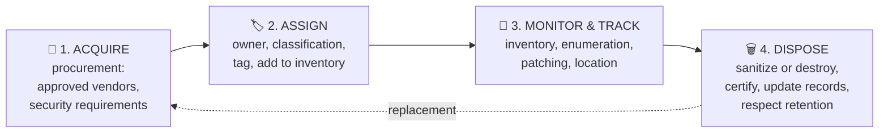

# Chapter 35 — Asset Management

**Level 4 · Advanced Knowledge** · *Exam objective 4.2*

---

## 🎯 Goal

By the end of this chapter you will be able to explain the security side of managing **hardware, software and data assets** through their whole life:
- **Acquisition/procurement process**
- **Assignment/accounting:** ownership, classification
- **Monitoring/asset tracking:** inventory, enumeration
- **Disposal/decommissioning:** sanitization, destruction, certification, data retention

---

## 🏠 Real-Life Story: The School Library 📚

A good library knows:
- **Which books it buys**, and from whom (it doesn't accept boxes of random books from strangers).
- **Who has borrowed each book** right now.
- **Where every book is**, thanks to a catalogue and regular stock checks.
- **What to do with damaged old books**: remove them from the catalogue and recycle them properly.

If the library lost track of its books, it couldn't tell whether one was stolen. **IT asset management** is the same thing, but the "books" are laptops, servers, software licences and databases full of customer data. **You can't protect what you don't know you have.**

---

## 🖼️ Figure 35.1 — The Asset Lifecycle



---

## 📖 Part 1 — Acquisition / Procurement 🛒

Security starts **before** anything is bought.

| Practice | Why |
|---|---|
| **Buy from approved, reputable vendors/channels** | Avoid counterfeit or tampered hardware (supply-chain risk, Chapter 23) |
| **Include security requirements** in purchasing | E.g., "must support MFA, receive security patches for 5 years, encrypt data at rest" |
| **Check vendor support lifetime** | Avoid buying products near **end-of-life** |
| **Security review of software/SaaS** before purchase | Stops shadow IT and risky apps (Chapter 45 covers vendor assessments) |
| **Licence management** | Unlicensed software is a legal risk; pirated software often contains malware |

---

## 📖 Part 2 — Assignment & Accounting 🏷️

Once an asset arrives it must be **recorded and assigned**.

### Ownership
Every asset needs a named **owner**: the person or team **accountable** for it (its security, patching, who may access it, and its eventual disposal).
- Hardware: often the user's manager or the IT team.
- Data: the **data owner** (a senior business person, Chapter 43).
- Without an owner, nobody patches it, nobody notices when it's misused, and nobody retires it.

### Classification
Assets are classified by **how sensitive or critical** they are (Chapter 21): a laptop used by the finance director that holds **confidential** data needs stronger controls than a reception kiosk.
- Classification drives: encryption requirements, who may use it, how it's disposed of, and patch priority.

### Asset Tags & Records

```
   ┌──────────────────────────────────────────────────┐
   │  ASSET RECORD                                    │
   │  Asset tag:       LT-2026-00418  (barcode/RFID)  │
   │  Type:            Laptop, Dell Latitude 7450     │
   │  Serial number:   9XK2L83                        │
   │  Assigned to:     A. Khan (Finance)              │
   │  Owner:           Finance Manager                │
   │  Classification:  Confidential                   │
   │  Location:        London office / remote         │
   │  Purchase date:   2026-02-14   Warranty: 3 yrs   │
   │  Encryption:      BitLocker ON (key escrowed)    │
   │  Status:          In use                         │
   └──────────────────────────────────────────────────┘
```

---

## 📖 Part 3 — Monitoring & Asset Tracking 📡

### Inventory
A complete, up-to-date **list of all assets**: hardware, software (and versions), cloud resources, data stores. Usually kept in a **CMDB** (Configuration Management Database) or asset management system.

### Enumeration
**Actively discovering** what's really on the network, to compare against the inventory:
- **Network scans** (Nmap, vulnerability scanners) find devices and open services.
- **Agents** on endpoints report installed software and versions.
- **Cloud APIs** list every running cloud resource.
- **NAC** (802.1X) records every device that connects.

## 🖼️ Figure 35.2 — Inventory vs Reality

```
   INVENTORY (what we THINK we have)          ENUMERATION (what's REALLY there)
   ───────────────────────────────            ───────────────────────────────────
   web-01   ✔                                  web-01   ✔
   web-02   ✔                                  web-02   ✔
   db-01    ✔                                  db-01    ✔
   (retired) old-ftp                           old-ftp  ⚠️ STILL ONLINE! (zombie server)
                                               ???      ⚠️ unknown Raspberry Pi in the
                                                           server room (rogue device/
                                                           shadow IT)

   The DIFFERENCE between the two lists is where attackers hide.
```

### Other Tracking Methods
- **Barcodes/RFID tags**, **GPS tracking** for vehicles or high-value equipment.
- **MDM** location and compliance reports for phones.
- **Software inventory/licence tools** to spot unapproved software.

> 🔐 Asset inventory feeds **vulnerability management** (Chapter 36): when a new vulnerability is announced, you need to know **instantly** which of your systems run the affected software.

---

## 📖 Part 4 — Disposal & Decommissioning 🗑️

When an asset reaches end of life, its **data** must not leave with it. Thousands of second-hand drives sold online have been found still holding company and personal data.

### Sanitization vs Destruction

**Sanitization** = removing data so it **can't be recovered**, while the device may be **reused**. The US standard **NIST SP 800-88** defines three levels:

## 🖼️ Figure 35.3 — The Sanitization Ladder (NIST 800-88)

```
   STRONGER ▲
            │  DESTROY   Physically destroy the media. Device can't be reused.
            │            Shredding · pulverizing · disintegrating · incinerating · melting
            │
            │  PURGE     Make recovery impossible even with LAB techniques.
            │            Cryptographic erase (destroy the encryption key) · secure-erase
            │            firmware commands · degaussing (magnetic media)
            │
            │  CLEAR     Overwrite data so normal tools can't recover it.
            │            Overwriting with zeros/patterns · factory reset
   WEAKER   ▼
```

| Method | How it works | Notes |
|---|---|---|
| **Overwriting / wiping** | Write zeros or patterns over every sector | Fine for HDDs; **less reliable on SSDs** (spare/hidden blocks) |
| **Secure erase (firmware command)** | The drive's own command to erase all blocks, including hidden ones | Good for SSDs |
| **Cryptographic erase (crypto-shredding)** | If the drive was encrypted, **destroy the key**. The remaining data is unreadable | Fast; works well for SSDs and cloud storage |
| **Degaussing** | A strong magnetic field scrambles **magnetic** media (HDDs, tapes) | **Does NOT work on SSDs or flash** (not magnetic). Usually ruins the HDD |
| **Shredding / pulverizing / incineration** | Physical **destruction** | Most certain; for highly sensitive data or failed drives |

> ⚠️ **Deleting files or formatting a drive is NOT sanitization.** It only removes the "index"; the data stays until overwritten and can be recovered with free tools.

### Certification 📜
When a third-party company destroys or sanitizes your media, they provide a **certificate of destruction/sanitization**: documented **proof** of what was destroyed, how, when and by whom. It's essential for **audits and compliance**.

### Data Retention ⏳
Not everything should be destroyed immediately:
- **Laws and regulations** may require keeping data for a minimum time (financial records, medical records, emails).
- **Legal hold** (Chapter 41): data relevant to a lawsuit **must not be destroyed**.
- But **keeping data too long** increases risk and may break privacy laws (GDPR's storage-limitation principle).
- A **data retention policy** defines **how long** each type of data is kept, and how it's **securely disposed of** afterwards.

## 🖼️ Figure 35.4 — Decommissioning Checklist

```
   ☐ Confirm data retention requirements / legal holds (keep what must be kept)
   ☐ Back up / migrate any data still needed
   ☐ Remove from network, DNS, monitoring, firewall rules, load balancers
   ☐ Revoke accounts, certificates, API keys and licences tied to it
   ☐ Sanitize (clear/purge) or destroy the storage media
   ☐ Obtain a certificate of destruction/sanitization
   ☐ Update the inventory/CMDB: status = disposed
```

---

## 🧠 Memory Tricks

- **Lifecycle: "Buy, Badge, Babysit, Bin"**: acquire, assign, monitor, dispose.
- **Inventory = the list. Enumeration = going out and counting.**
- **NIST 800-88: Clear → Purge → Destroy** (weakest to strongest): "**C**an't **P**ossibly **D**ig it up."
- **Degaussing = magnets → only magnetic media (HDD, tape), never SSD.**
- **Crypto-erase = throw away the only key to the safe.**
- **Certificate of destruction = the receipt that proves it.**

---

## ⚠️ Exam Tip

- *"Which method is NOT effective for sanitizing SSDs?"* → **Degaussing.**
- *"A company wants proof that a vendor destroyed its old drives."* → **Certificate of destruction.**
- *"Encrypted cloud volumes must be sanitized quickly."* → **Cryptographic erase.**
- *"An unknown device is discovered during a network scan that isn't in the inventory."* → The scan was **enumeration**. Investigate the **rogue/unmanaged** device.
- *"Who is accountable for an asset's security?"* → The **asset/data owner.**
- *"Legal counsel says certain emails must be kept for a lawsuit."* → **Legal hold** overrides normal retention/disposal.
- *"Which provides the MOST assurance that data on a failed hard drive can't be recovered?"* → **Physical destruction** (shredding/pulverizing).

---

## 🧪 Try It (20 minutes)

1. **Make your personal asset inventory:** list every device you own (phones, laptops, tablets, routers, smart devices, old drives in drawers). For each, note: owner, sensitivity, encrypted? still patched?
2. **Enumerate your home network:** log into your router and view "connected devices" (or run `nmap -sn 192.168.1.0/24` on your own home/lab network, replacing the range with yours). Do you recognize every device?
3. **Prepare an old phone for disposal:** check that it's encrypted (most modern phones are), sign out of all accounts, then **factory reset**. Because the data was encrypted, the reset destroys the key: a **cryptographic erase**.
4. **Look at NIST SP 800-88:** search "NIST SP 800-88" and find the Clear / Purge / Destroy definitions. (Revision 1 has a media-by-media table in its Appendix A; if you find it, look up the recommended method for a USB flash drive. Newer revisions keep the same three levels.)

---

## ✅ Checkpoint Questions

1. Name the four stages of the asset lifecycle in SY0-701.
2. Why should security requirements be part of procurement?
3. Why does every asset need an owner?
4. What's the difference between inventory and enumeration?
5. What is a CMDB?
6. Name NIST 800-88's three sanitization levels from weakest to strongest.
7. Why isn't degaussing suitable for SSDs?
8. What is cryptographic erase?
9. What is a certificate of destruction for?
10. Why might data NOT be destroyed when an asset is decommissioned?

<details>
<summary><b>Show answers</b></summary>

1. **Acquisition/procurement, assignment/accounting, monitoring/asset tracking, disposal/decommissioning.**
2. To avoid buying **insecure, unsupported or counterfeit** products, and to make sure products meet security needs (patching, MFA, encryption) **before** they enter the environment.
3. So someone is **accountable** for its security, access, patching and eventual disposal.
4. **Inventory** is the **recorded list** of assets. **Enumeration** is **actively discovering** what actually exists (scans, agents, APIs) to verify and update that list.
5. A **Configuration Management Database**: a central store of IT assets, their configurations and relationships.
6. **Clear → Purge → Destroy.**
7. SSDs store data in **flash memory, not magnetically**, so a magnetic field doesn't erase them.
8. **Destroying the encryption key** of encrypted media, which makes the remaining encrypted data unreadable.
9. It is **documented proof** that media was destroyed/sanitized (what, how, when, by whom), needed for audits and compliance.
10. **Data retention** requirements (laws/regulations) or a **legal hold** may require keeping it.

</details>

---

## 📌 Chapter Summary

| Stage | Key actions |
|---|---|
| Acquisition | Approved vendors, security requirements, support lifetime, software review |
| Assignment | Owner, classification, asset tag, record |
| Monitoring | Inventory (CMDB) + enumeration (scans, agents, APIs); find rogue and zombie assets |
| Disposal | Clear/purge/destroy (NIST 800-88); degaussing only for magnetic media; crypto-erase; certificate of destruction; respect retention and legal holds |

**Next chapter →** *Chapter 36: Vulnerability Management.* With a full inventory in hand, let's find, score and fix weaknesses across it.
