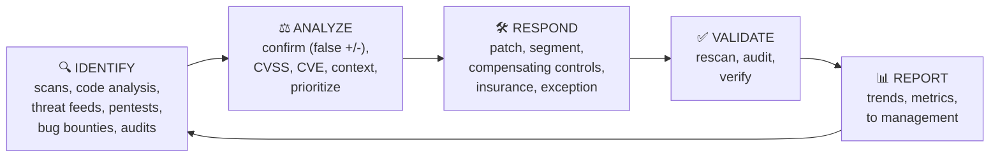

# Chapter 36 — Vulnerability Management

**Level 4 · Advanced Knowledge** · *Exam objective 4.3*

---

## 🎯 Goal

By the end of this chapter you will be able to run the **vulnerability management** cycle:
- **Identification:** vulnerability scans; application security (static analysis, dynamic analysis, package monitoring); threat feeds (OSINT, proprietary/third-party, information-sharing organizations, dark web); penetration testing; responsible disclosure and bug bounty programs; system/process audits
- **Analysis:** confirmation (false positive, false negative), prioritization, **CVSS**, **CVE**, vulnerability classification, exposure factor, environmental variables, industry/organizational impact, risk tolerance
- **Response & remediation:** patching, insurance, segmentation, compensating controls, exceptions and exemptions
- **Validation:** rescanning, audit, verification
- **Reporting**

---

## 🏠 Real-Life Story: The Building Inspector 🏗️

A building inspector visits an apartment block every year. They:
1. **Find** problems (a cracked step, a broken fire door, faulty wiring),
2. **Judge** how serious each one is (faulty wiring beats a squeaky door),
3. Get them **fixed**, or put up a temporary barrier if the fix must wait,
4. **Come back to check** the fix worked,
5. **Write a report** for the owners.

That's vulnerability management: **find → analyze → fix → verify → report**, again and again, because new problems appear every day.

## 🖼️ Figure 36.1 — The Vulnerability Management Cycle



---

## 📖 Part 1 — Identification Methods 🔍

### 1. Vulnerability Scans 🖥️
Automated tools (e.g., Nessus, Qualys, OpenVAS) compare systems against a database of **known vulnerabilities**.

| Scan option | Meaning | Trade-off |
|---|---|---|
| **Credentialed** (authenticated) | Scanner **logs in** to the system | Much **more accurate** and detailed: sees installed software and patch levels |
| **Non-credentialed** | Scans from outside, like an attacker would | Shows the **attacker's view**; misses internal issues; more false positives |
| **Agent-based** | Software on each host reports back | Works for laptops that are off-network |
| **Agentless** | Scanned over the network | Nothing to install |
| **Intrusive / non-intrusive** | Intrusive scans try to exploit; non-intrusive just check | Intrusive can crash systems: schedule carefully |
| **Internal / external** | From inside the network vs from the internet | Need both views |

### 2. Application Security Testing 🧪

| Method | What it does |
|---|---|
| **Static analysis (SAST)** | Examines **source code** without running it |
| **Dynamic analysis (DAST)** | Tests the **running** application (web app scanners, **fuzzing**: feeding random/malformed input to find crashes) |
| **Package monitoring** | Tracks the **third-party libraries/packages** your software uses and alerts when one has a known vulnerability (software composition analysis, SBOMs). Remember **Log4Shell** |

### 3. Threat Feeds 📰
Streams of information about **current threats, vulnerabilities and indicators of compromise (IoCs)**: malicious IPs, domains and file hashes.

| Feed source | Examples |
|---|---|
| **OSINT** (Open-Source Intelligence) | Free, public: CISA KEV catalog, vendor advisories, security blogs, abuse.ch |
| **Proprietary / third-party** | Paid commercial feeds from security vendors |
| **Information-sharing organizations** | **ISACs** (Information Sharing and Analysis Centers) for each industry (finance, health, energy), plus government CERTs |
| **Dark web** | Monitoring criminal forums and markets for leaked company credentials, data for sale, or planned attacks |

> Feeds are often shared in standard formats: **STIX** (describes threat information) carried over **TAXII** (the transport protocol).

### 4. Penetration Testing 🥷
Ethical hackers **actively exploit** vulnerabilities (with permission) to show real impact (Chapter 47). A scan says "the door *might* be unlocked"; a pentest **walks through it**.

### 5. Responsible Disclosure & Bug Bounty Programs 🐛💰
- **Responsible (coordinated) disclosure program:** a public way for outside researchers to **report vulnerabilities privately** so the company can fix them before details become public (often via a `security.txt` file on the website).
- **Bug bounty program:** the company **pays rewards** for valid vulnerabilities (e.g., via HackerOne, Bugcrowd).

### 6. System / Process Audits 📋
Reviewing configurations, access rights and processes against policies or benchmarks finds weaknesses that scanners miss (e.g., "ex-employees still have accounts").

---

## 📖 Part 2 — Analysis ⚖️

### Confirmation: False Positives & False Negatives

## 🖼️ Figure 36.2 — The Truth Table

```
                              REALITY
                      Vulnerable          Not vulnerable
                  ┌───────────────────┬────────────────────┐
   SCANNER  Flag  │ TRUE POSITIVE ✔   │ FALSE POSITIVE ✘   │  wasted time chasing
   SAYS           │ (real, found)     │ (alarm, but fine)  │  a non-issue
                  ├───────────────────┼────────────────────┤
            Clean │ FALSE NEGATIVE ✘✘ │ TRUE NEGATIVE ✔    │
                  │ (real, MISSED!)   │ (fine, and clean)  │
                  └───────────────────┴────────────────────┘
   FALSE NEGATIVES are the most dangerous: a real hole nobody knows about.
```

- **Reduce false positives:** credentialed scans, verify manually, tune the scanner.
- **Reduce false negatives:** credentialed scans, up-to-date plugins, multiple methods (scans + pentests + code analysis).

### CVE and CVSS ⭐

| | **CVE**: Common Vulnerabilities and Exposures | **CVSS**: Common Vulnerability Scoring System |
|---|---|---|
| What | A **unique ID** for each publicly known vulnerability | A **severity score from 0.0 to 10.0** |
| Example | `CVE-2021-44228` (Log4Shell) | 10.0 Critical |
| Purpose | Everyone talks about the **same** vulnerability | Helps **prioritize** |
| Run by | MITRE (with CVE Numbering Authorities); details in the **NVD** (US National Vulnerability Database) | FIRST.org |

## 🖼️ Figure 36.3 — CVSS Severity Bands

```
   0.0      0.1 ─────── 3.9   4.0 ─────── 6.9   7.0 ─────── 8.9   9.0 ────── 10.0
   NONE         LOW               MEDIUM            HIGH            CRITICAL
   ░░░░         ▒▒▒▒▒▒            ▓▓▓▓▓▓▓▓          ████████        ██████████
```

CVSS base score factors include **attack vector** (network, adjacent, local, physical), **attack complexity**, **privileges required**, **user interaction**, and **impact on confidentiality, integrity and availability**.

### Context Changes Everything 🧭

A CVSS 9.8 isn't always your top priority, and a 6.5 isn't always low. Adjust with:

| Factor | Question | Example |
|---|---|---|
| **Vulnerability classification** | What type is it? (RCE, privilege escalation, info disclosure, DoS) | Remote code execution beats information disclosure |
| **Exposure factor** | How much of the asset's value would be lost if exploited? (%) | A flaw exposing the entire customer database = high EF |
| **Environmental variables** | Is the system **internet-facing**? Behind a WAF? Is the vulnerable feature even enabled? Is there an **exploit in the wild** (e.g., in CISA KEV)? | Same CVE: urgent on a public web server, minor on an isolated lab PC |
| **Industry/organizational impact** | What would exploitation mean for **this** business and its regulators? | A hospital's patient system vs a cafeteria menu server |
| **Risk tolerance** | How much risk is management willing to accept? | Low tolerance → patch faster, wider |

## 🖼️ Figure 36.4 — Prioritization Example

| Finding | CVSS | Internet-facing? | Exploited in the wild? | Asset criticality | **Priority** |
|---|:---:|:---:|:---:|:---:|:---:|
| RCE in VPN gateway | 9.8 | ✅ | ✅ (in KEV) | Critical | **1: patch today** |
| SQLi in customer portal | 8.6 | ✅ | ❌ | High | **2** |
| Kernel priv-esc on file server | 7.8 | ❌ | ✅ | High | **3** |
| RCE in isolated lab printer | 9.1 | ❌ | ❌ | Low | **4** |
| Info disclosure on intranet wiki | 5.3 | ❌ | ❌ | Low | **5** |

---

## 📖 Part 3 — Response & Remediation 🛠️

| Option | When to use | Example |
|---|---|---|
| **Patching** | A fix exists. **The preferred option** | Apply the vendor update in the next maintenance window (or as an emergency change) |
| **Segmentation** | Can't patch yet; reduce exposure | Move the vulnerable system to an isolated VLAN |
| **Compensating controls** | Alternative protection while the real fix isn't possible | WAF rule (virtual patch) blocking the exploit pattern; disabling the vulnerable feature; extra monitoring |
| **Insurance** | Transfer residual financial risk | Cyber insurance covers losses if exploited |
| **Exceptions / exemptions** | Formally **accept** the risk for a period, with approval and review date | "Legacy app server exempt from patch standard until migration in Q3, approved by CISO" |

> 💡 **Exception vs exemption:** an **exception** usually means a temporary, approved deviation from a policy for a specific case (with compensating controls and an end date). An **exemption** usually means the system is **released from** the requirement altogether. Both are forms of **risk acceptance** and must be **documented, approved and reviewed**.

---

## 📖 Part 4 — Validation of Remediation ✅

**Never assume a fix worked.**

| Method | What it means |
|---|---|
| **Rescanning** | Run the scanner again to confirm the vulnerability is gone |
| **Audit** | An independent review confirming the remediation and process were done correctly |
| **Verification** | Manually test or check versions/configuration (e.g., confirm the patch version is installed, try the exploit in a test) |

---

## 📖 Part 5 — Reporting 📊

Reports turn scan data into **decisions**:
- **Technical reports** for IT teams: list of findings, affected hosts, fix steps.
- **Executive reports** for management: risk trends, % of critical vulns fixed on time, overdue items, compliance status.
- Useful metrics: **mean time to remediate**, number of open critical/high findings, **SLA** compliance (e.g., criticals fixed within 7 days).

## 🖼️ Figure 36.5 — A Simple Executive Dashboard

```
   Open vulnerabilities by severity           Mean time to remediate (days)
   CRITICAL ███ 3                             Jan ██████████████ 28
   HIGH     ████████ 8                        Feb ██████████ 20
   MEDIUM   ████████████████████ 20           Mar ██████ 12        ← improving ✔
   LOW      ███████████████████████████ 27
   SLA: 92% of critical findings fixed within 7 days (target 95%)
```

---

## 🧠 Memory Tricks

- **Cycle: "I Am Reading Vulnerability Reports"**: Identify, Analyze, Respond, Validate, Report.
- **CVE = the vulnerability's Name tag. CVSS = its Score (0–10).**
- **CVSS bands: 0 none, 0.1–3.9 low, 4–6.9 medium, 7–8.9 high, 9–10 critical.**
- **False negative = the scanner said "all clear" but it wasn't: the scariest one.**
- **Credentialed scan = the inspector gets the keys and looks inside every room.**
- **Can't patch? "Segment, Compensate, Insure, or Except."**

---

## ⚠️ Exam Tip

- *"A scan reports a vulnerability, but investigation shows the patch is already installed."* → **False positive.**
- *"Which scan type gives the MOST accurate results about installed patches?"* → **Credentialed scan.**
- *"Which identifier uniquely names a publicly known vulnerability?"* → **CVE.**
- *"A CVSS score of 7.5 falls into which band?"* → **High.**
- *"A vendor patch isn't available; the company adds a WAF rule blocking the exploit."* → **Compensating control.**
- *"After patching, what should the team do NEXT?"* → **Rescan / verify** (validation).
- *"A company pays outside researchers for reporting flaws."* → **Bug bounty program.**
- *"Industry-specific threat information shared among banks."* → **ISAC** (information-sharing organization).

---

## 🧪 Try It (30 minutes)

1. **Look up a CVE:** visit **nvd.nist.gov**, search `CVE-2021-44228`. Read its CVSS score, vector string and affected products.
2. **Check CISA KEV:** visit the **Known Exploited Vulnerabilities** catalog. Find any entry affecting software you use, and check whether you've patched it.
3. **Run a vulnerability scan in your lab:** install **OpenVAS/Greenbone Community Edition** (or use Nessus Essentials, free for 16 IPs) and scan your Metasploitable lab VM (never real systems you don't own). Sort the findings by CVSS.
4. **Find a security.txt:** visit `https://www.google.com/.well-known/security.txt`. That's a responsible-disclosure contact file.

---

## ✅ Checkpoint Questions

1. Name the five stages of the vulnerability management cycle.
2. Why do credentialed scans produce fewer false positives?
3. What's the difference between SAST, DAST and package monitoring?
4. Name four sources of threat feeds.
5. What's the difference between a false positive and a false negative, and which is more dangerous?
6. What's the difference between CVE and CVSS?
7. Which CVSS range is "Critical"?
8. Give two environmental variables that could raise a vulnerability's priority.
9. If a patch can't be applied, list three alternative responses.
10. Name three ways to validate remediation.

<details>
<summary><b>Show answers</b></summary>

1. **Identify, analyze, respond/remediate, validate, report.**
2. They **log in** and can see actual installed software and patch levels, instead of guessing from the outside.
3. **SAST** checks source code without running it. **DAST** tests the running app. **Package monitoring** watches third-party libraries/dependencies for known vulnerabilities.
4. **OSINT, proprietary/third-party, information-sharing organizations (ISACs), dark web** monitoring.
5. A **false positive** reports a vulnerability that isn't real. A **false negative** misses a real vulnerability. **False negatives are more dangerous.**
6. **CVE** is a **unique identifier** for a vulnerability. **CVSS** is a **severity score** (0–10).
7. **9.0–10.0.**
8. E.g., the system is **internet-facing**, the vulnerability is **actively exploited** (in KEV), the asset holds **critical/sensitive data**, there are **no mitigating controls** (no WAF/segmentation).
9. Any three of: **segmentation, compensating controls (e.g., virtual patching/WAF, disabling the feature), insurance, formal exception/exemption** (risk acceptance).
10. **Rescanning, audit, verification** (manual testing/version checks).

</details>

---

## 📌 Chapter Summary

| Stage | Key items |
|---|---|
| Identify | Scans (credentialed/non-credentialed, agent/agentless), SAST/DAST/package monitoring, threat feeds (OSINT, proprietary, ISACs, dark web), pentests, bug bounties, audits |
| Analyze | Confirm (false +/−), **CVE** (ID), **CVSS** (0–10), classification, exposure factor, environment, organizational impact, risk tolerance |
| Respond | **Patch** first; else segment, compensating controls, insurance, exception/exemption |
| Validate | Rescan, audit, verify |
| Report | Technical + executive reports; metrics like mean time to remediate |

**Next chapter →** *Chapter 37: Alerting & Monitoring.* Vulnerability scans are snapshots. Monitoring watches 24/7. Let's build the SOC's eyes and ears.
