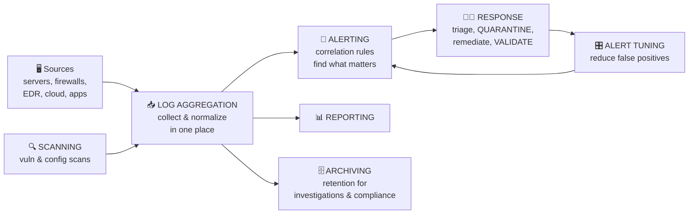

# Chapter 37 — Alerting & Monitoring

**Level 4 · Advanced Knowledge** · *Exam objective 4.4*

---

## 🎯 Goal

By the end of this chapter you will understand how a security operations center (SOC) **watches** an organization:
- **Monitoring computing resources:** systems, applications, infrastructure
- **Activities:** log aggregation, alerting, scanning, reporting, archiving, alert response and remediation/validation (quarantine, alert tuning)
- **Tools:** **SCAP**, **benchmarks**, **agents/agentless**, **SIEM**, **antivirus**, **DLP**, **SNMP traps**, **NetFlow**, **vulnerability scanners**

---

## 🏠 Real-Life Story: The Shopping Mall Control Room 🎥

In a big mall's control room, guards watch **hundreds of camera feeds**, door alarms, fire sensors and radio calls. Nobody can stare at everything at once, so the system **highlights what matters**: "Door 14 forced open at 02:13" or "Smoke sensor in Store 22." Guards then **respond**, **record** what happened, and **adjust** the alarms that keep going off for no reason.

A **SOC** does the same for computers: **collect** signals from everywhere, **highlight** the important ones (alerts), **respond**, **tune**, and **keep records**.

---

## 📖 Part 1 — What We Monitor 🖥️

| Resource | Examples of what to watch |
|---|---|
| **Systems** | Servers, workstations, phones: CPU/memory/disk, logins, processes, services, file changes, patch status |
| **Applications** | Web apps, databases, email, SaaS: errors, authentication events, admin actions, unusual queries |
| **Infrastructure** | Firewalls, routers, switches, wireless, cloud platforms, power and cooling: traffic flows, config changes, interface status |

---

## 📖 Part 2 — Monitoring Activities 🔄

## 🖼️ Figure 37.1 — From Raw Logs to Action



| Activity | Meaning |
|---|---|
| **Log aggregation** | **Collecting** logs from many sources into a central place, and **normalizing** them (putting different formats into a common structure) so they can be searched and correlated |
| **Alerting** | Generating **notifications** when rules or analytics detect suspicious activity (e.g., "10 failed logins then a success from a new country") |
| **Scanning** | Regular **vulnerability and configuration scans** that feed findings into monitoring |
| **Reporting** | Summaries for analysts, managers and auditors (dashboards, compliance reports) |
| **Archiving** | **Storing logs long-term** (often cheaper, slower storage) to meet **retention** requirements and support future investigations. Attacks are often discovered months later! |
| **Alert response and remediation/validation** | Investigate the alert, act on it, and **confirm** the problem is fixed |
| **Quarantine** | **Isolating** a suspicious file, email or device so it can't do harm while being investigated (e.g., EDR isolates a laptop; email gateway quarantines a message) |
| **Alert tuning** | Adjusting rules and thresholds to **reduce false positives** (noise) **without** creating false negatives |

> ⚠️ **Alert fatigue:** when analysts receive thousands of meaningless alerts, they start ignoring them, and the real attack gets missed. **Tuning** is essential.

---

## 📖 Part 3 — The Tools 🧰

### SIEM: Security Information and Event Management 📊
The **central brain** of monitoring:
- **Collects and aggregates** logs from everywhere
- **Normalizes** them into a common format
- **Correlates** events across sources (a firewall event + a login event + an EDR event = one incident)
- **Alerts**, provides **dashboards**, supports **searches/investigations**, **retains** logs, and produces **compliance reports**

## 🖼️ Figure 37.2 — SIEM Correlation in Action

```
   Separate events (each looks harmless alone):
   09:01  VPN log       alice logged in from 203.0.113.50 (new country)
   09:03  AD log        alice added to "Domain Admins"
   09:05  File server   alice copied 12 GB from \\finance\
   09:06  Firewall      12 GB uploaded to an unknown cloud storage site

   SIEM correlation rule:
   "New-country login + privilege change + large data transfer within 10 min"
        ──► 🚨 HIGH SEVERITY ALERT: possible account takeover + data exfiltration
```

Examples: Splunk, Microsoft Sentinel, IBM QRadar, Elastic Security, Wazuh (open source).

### SCAP: Security Content Automation Protocol 📏
A **set of open standards** (from NIST) that lets tools **automatically check** systems against **security configuration baselines** and known vulnerabilities, in a **common machine-readable format**.
- Includes standards such as **XCCDF** (checklists), **OVAL** (system state checks), **CVE** (vulnerability IDs), **CVSS** (scores), **CPE** (product names).
- Why it matters: tools from different vendors can **share the same benchmark checks** and produce comparable results. It's used for **compliance scanning** and **detecting configuration drift**.

### Benchmarks 📐
**Published secure configuration guides**, e.g., **CIS Benchmarks** and **DISA STIGs**. Monitoring/scanning tools (often via SCAP) compare systems to the benchmark and report deviations.

### Agents vs Agentless 🕵️

| | **Agent-based** | **Agentless** |
|---|---|---|
| How | Software installed on each device collects data and sends it | Data collected **remotely** (over the network, via APIs, WMI, SSH, syslog) |
| ✅ | Deep visibility; works when the device is off-network; real-time | Nothing to install or maintain; good for devices that can't run agents |
| ⚠️ | Must be deployed and updated everywhere; uses device resources | Less detail; needs network access and credentials |

### Antivirus 🛡️
Endpoint malware detection (signatures + heuristics). Its alerts (malware found, quarantined) feed the SIEM. Modern environments use **EDR** (Chapter 38) for deeper behavior monitoring.

### DLP: Data Loss Prevention 🚫
Monitors data **in motion, at rest and in use** for sensitive content (card numbers, health data, "Confidential" labels) and **blocks/alerts** on policy violations (Chapter 31).

### SNMP Traps 📟
**SNMP** (Simple Network Management Protocol) monitors network devices.
- **Polling:** the manager regularly **asks** devices for status (UDP **161**).
- **Trap:** the device **sends an alert on its own** when something happens (UDP **162**), e.g., "interface down," "CPU over 90%," "fan failed."
- Use **SNMPv3** (authentication + encryption). v1/v2c send community strings in plaintext.

## 🖼️ Figure 37.3 — SNMP Polling vs Trap

```
   POLLING (manager asks, port 161)              TRAP (device tells, port 162)
   📊 NMS ──"how's your CPU?"──► 🔀 router        🔀 router ──"⚠️ link DOWN!"──► 📊 NMS
   📊 NMS ◄──"CPU 35%"──────────  🔀 router        (immediate, unprompted alert)
```

### NetFlow 🌊
Records **metadata about network conversations** ("**who talked to whom, when, how much**"), **not the content**.

```
   NetFlow record (simplified):
   Start      Src IP          Dst IP          Src Port  Dst Port  Proto  Bytes      Packets
   02:14:07   10.0.5.23       198.51.100.9    51522     443       TCP    8.2 GB     5,912,334
                                                                         ▲ huge upload at 2 a.m.
                                                                           → possible exfiltration
```
- ✅ Lightweight, great for spotting **unusual traffic patterns**, exfiltration, scanning, DDoS, C2 beaconing.
- ⚠️ No payload. You see **that** 8 GB left, not **what** it was (for that you need a **packet capture**, Chapter 42).
- Related: **sFlow** and **IPFIX** are similar standards.

### Vulnerability Scanners 🔍
Regularly scan systems (Chapter 36). Their findings feed the SIEM and dashboards, so analysts can see, for example, that an alert targets a **vulnerable** host and treat it as higher priority.

## 🖼️ Figure 37.4 — Which Tool Answers Which Question? ⭐

| Question | Tool |
|---|---|
| "Show me all security events in one place and correlate them" | **SIEM** |
| "Do our servers match the CIS benchmark?" | **SCAP** scanner + **benchmarks** |
| "Did a router's interface just go down?" | **SNMP trap** |
| "Which internal host sent 8 GB to an external IP last night?" | **NetFlow** |
| "Did someone try to email a file full of card numbers?" | **DLP** |
| "Is there malware on this laptop?" | **Antivirus/EDR** |
| "Which systems have unpatched critical CVEs?" | **Vulnerability scanner** |

---

## 🧠 Memory Tricks

- **SIEM = "See It, Evaluate, Make alerts"**: collect, correlate, alert.
- **SCAP = "Standard Checks Automatically Performed"** against benchmarks.
- **SNMP: 161 = I ask you (poll). 162 = you tell me (trap).**
- **NetFlow = the phone bill** (who called whom, how long), **not the recording** of the call (that's a packet capture).
- **Tune alerts or drown in noise.**

---

## ⚠️ Exam Tip

- *"Which tool aggregates and correlates logs from many sources?"* → **SIEM.**
- *"Which provides a standardized way to check systems against configuration benchmarks?"* → **SCAP.**
- *"A network device sends an unsolicited message when its fan fails."* → **SNMP trap.**
- *"Which data source shows traffic volume between hosts without packet contents?"* → **NetFlow.**
- *"Analysts ignore alerts because 95% are false positives. What should be done?"* → **Alert tuning.**
- *"An infected email is held so it can't reach users while it's analyzed."* → **Quarantine.**
- *"Logs must be kept for 7 years for compliance."* → **Archiving** (retention).

---

## 🧪 Try It (30 minutes)

1. **Build a mini SIEM:** install **Wazuh** (free, open-source SIEM/XDR) in your lab, or use the free tier of **Splunk** / **Elastic**. Send your lab VMs' logs to it and search for failed logins.
2. **Create a failed-login alert:** in your SIEM, make a rule: "more than 5 failed logins for one user in 2 minutes." Trigger it from your lab by typing a wrong password 6 times.
3. **Look at real flow data:** on Linux, run `sudo tcpdump -i any -q -c 20` to see connection summaries, then compare with full packets (`tcpdump -X`): metadata vs content.
4. **Run a SCAP scan:** on an Ubuntu/RHEL lab VM, install **OpenSCAP** (`oscap`) and run a profile scan against a CIS or STIG profile. Read the HTML report.

---

## ✅ Checkpoint Questions

1. What's the difference between log aggregation and archiving?
2. Why is alert tuning important?
3. What does quarantine mean in monitoring?
4. Name four things a SIEM does.
5. What is SCAP used for?
6. What are CIS Benchmarks and STIGs?
7. Compare agent-based and agentless monitoring.
8. What's the difference between SNMP polling and a trap, and which ports do they use?
9. What does NetFlow show, and what doesn't it show?
10. A SOC wants to know whether an attacked server was already vulnerable. Which tool's data helps?

<details>
<summary><b>Show answers</b></summary>

1. **Aggregation** collects logs from many sources into one place (for search and correlation). **Archiving** stores logs long-term to meet **retention** requirements.
2. Too many false positives cause **alert fatigue**, and real attacks get missed. Tuning reduces noise while keeping real detections.
3. **Isolating** a suspicious file, message or device so it can't cause harm while being investigated.
4. Any four of: **collect/aggregate, normalize, correlate, alert, dashboards/reporting, search/investigate, retain logs, compliance reporting.**
5. **Automated, standardized checking** of systems against security configuration baselines and known vulnerabilities.
6. **Published secure configuration guides (benchmarks)**: CIS from the Center for Internet Security; STIGs from the US Defense Information Systems Agency (DISA).
7. **Agent-based:** software on each device; deeper data, works off-network, but must be deployed and maintained. **Agentless:** collected remotely; nothing to install, but less detail.
8. **Polling:** the manager asks devices (UDP **161**). **Trap:** the device sends an unsolicited alert (UDP **162**).
9. It shows **who talked to whom, when, which ports and how much data** (metadata). It does **not** show the **content/payload**.
10. The **vulnerability scanner** (its findings, often correlated in the SIEM).

</details>

---

## 📌 Chapter Summary

| Item | One-liner |
|---|---|
| Monitor | Systems, applications, infrastructure |
| Activities | Aggregate, alert, scan, report, archive, respond (quarantine), validate, tune |
| SIEM | Collect + normalize + correlate + alert + retain |
| SCAP + benchmarks | Automated, standardized configuration/vulnerability checks (CIS, STIG) |
| Agents vs agentless | Deep and installed vs remote and lightweight |
| Antivirus / DLP | Malware detection / sensitive data leak prevention |
| SNMP traps | Device-initiated alerts (UDP 162); use SNMPv3 |
| NetFlow | Traffic metadata: who, when, how much |
| Vulnerability scanners | Known weaknesses that feed prioritization |

**Next chapter →** *Chapter 38: Enhancing Enterprise Capabilities.* Time to tune the actual defenses: firewall rules, IDS signatures, web filters, SPF/DKIM/DMARC, NAC, EDR/XDR and UBA.
