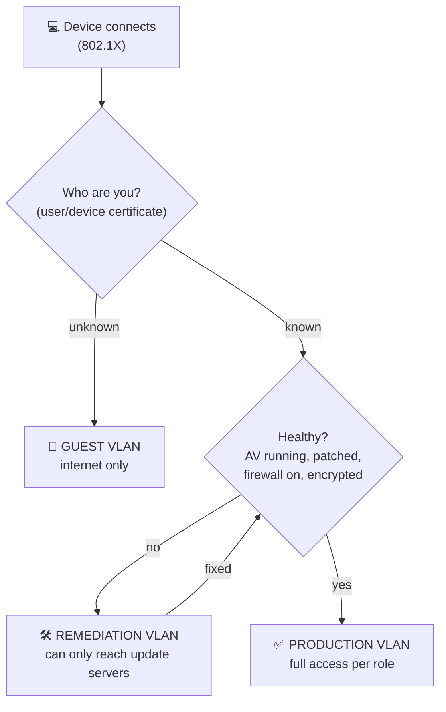

# Chapter 38 — Enhancing Enterprise Security Capabilities

**Level 4 · Advanced Knowledge** · *Exam objective 4.5*

---

## 🎯 Goal

This objective is "Given a scenario, **modify** enterprise capabilities," so expect PBQs. By the end of this chapter you will be able to configure and choose:
- **Firewall:** rules, access lists, ports/protocols, screened subnets
- **IDS/IPS:** trends, signatures
- **Web filter:** agent-based, centralized proxy, URL scanning, content categorization, block rules, reputation
- **Operating system security:** Group Policy, SELinux
- **Secure protocols:** protocol selection, port selection, transport method
- **DNS filtering**
- **Email security:** **DMARC, DKIM, SPF**, gateway
- **File integrity monitoring, DLP, NAC, EDR/XDR, user behavior analytics**

---

## 🏠 Real-Life Story: Upgrading a Shop's Security 🏪

A shop owner gets robbed and upgrades their security piece by piece:
- New **rules** for the guard at the door: "staff entrance only for staff, deliveries only before 9 am" (**firewall rules**).
- A guard who knows the **faces of known shoplifters** (**IDS signatures**) and spots **odd behavior** (**trends/UBA**).
- A **list of banned suppliers** (**web/DNS filtering**).
- A **seal on the safe** that shows if anyone opened it (**file integrity monitoring**).
- Checking **every letter's postmark and signature** (**SPF/DKIM/DMARC**).
- A rule that only **staff in uniform** may enter the stockroom (**NAC**).

Each upgrade **modifies a capability** to close a specific gap.

---

## 📖 Part 1 — Firewall Rules 🧱

A firewall rule matches traffic on **source, destination, port, protocol** (and on NGFWs: application, user) and takes an **action** (allow/deny/drop, log).

### Rule-Writing Principles ⭐
1. **Rules are processed top to bottom; the first match wins.** Put **specific** rules **above** general ones.
2. **Implicit deny** at the end: anything not allowed is blocked.
3. **Least privilege:** allow only the needed source, destination and port, never "any/any."
4. **Log** denied traffic (and important allowed traffic).
5. Review rules regularly; remove unused ones.
6. Consider **egress (outbound)** rules too, not just inbound. They stop malware calling home.

## 🖼️ Figure 38.1 — PBQ-Style Rule Set (screened subnet)

```
   Scenario: Web server 172.16.10.10 sits in the SCREENED SUBNET (DMZ).
             DB server 10.0.20.5 is INTERNAL. Admins are on 10.0.99.0/24.

   #  Action  Source           Destination      Port/Proto   Purpose
   1  ALLOW   any              172.16.10.10     443/TCP      Public HTTPS to the web server
   2  ALLOW   172.16.10.10     10.0.20.5        1433/TCP     Web server → database (only it)
   3  ALLOW   10.0.99.0/24     172.16.10.10     22/TCP       Admin SSH from admin subnet only
   4  DENY    any              172.16.10.10     80/TCP       No plaintext HTTP (or redirect)
   5  DENY    any              10.0.0.0/8       any          Nothing else from DMZ/internet inward
   6  DENY    any              any              any          IMPLICIT DENY (log)
```

### Common Rule Mistakes (PBQ favorites)

| Mistake | Why it's wrong | Fix |
|---|---|---|
| `ALLOW any any any` at the top | Everything is allowed: the later DENY rules never match | Delete it; use specific rules |
| A broad DENY **above** a specific ALLOW | The ALLOW is never reached | Move specific rules up |
| Allowing **Telnet (23)/FTP (21)** for admin | Plaintext credentials | Use **SSH (22)/SFTP** |
| Allowing **RDP (3389) from the internet** | Brute-force target | VPN or jump server only |
| No logging | Can't investigate | Log denies |

> **Access lists (ACLs)** on routers/switches use the same logic (Chapter 27). **Ports/protocols:** know the master table in Chapter 6.

---

## 📖 Part 2 — IDS/IPS: Signatures & Trends 👀

| Detection | How it works | Strengths / weaknesses |
|---|---|---|
| **Signatures** | Match traffic against **known attack patterns** | ✅ accurate for known attacks; ❌ blind to new ones; must be **updated** constantly |
| **Trends / anomaly (behavior)** | Learn a **baseline** of normal traffic and alert on **deviations** (sudden spikes, new protocols, odd hours) | ✅ can catch new attacks; ❌ more false positives; needs tuning |

```
   Example signature (Snort/Suricata-style, simplified):
   alert tcp any any -> $WEB_SERVERS 80 (msg:"SQL injection attempt"; content:"UNION SELECT"; nocase; sid:1000001;)
   └─────┘ └─┘ └─────┘ └────────────────┘   └──────────────────────────┘ └──────────────────┘
   action  proto  src     destination+port         alert text              pattern to match
```

**Modifying the capability:** update signature feeds, **enable** relevant rule sets, **disable/tune** noisy ones, switch an IDS to **IPS (inline blocking)** once tuned, and watch **trend** dashboards.

---

## 📖 Part 3 — Web Filtering 🌐

| Feature | Meaning |
|---|---|
| **Agent-based** | Filtering software installed **on each device**, so it works **anywhere** (home, café), not just on the office network |
| **Centralized proxy** | All web traffic goes through a **central proxy/secure web gateway** that filters it. Easy to manage, but only covers traffic that passes through it |
| **URL scanning** | Checking the requested **URL** against lists/analysis (and scanning the page content) before allowing it |
| **Content categorization** | Sites grouped into **categories** (gambling, malware, social media, news), then whole categories are allowed/blocked |
| **Block rules** | Specific rules: block categories, domains, file types (e.g., `.exe` downloads), or times of day |
| **Reputation** | Each site/domain/IP gets a **risk score** based on age, history and threat intel. Newly registered or low-reputation domains get blocked |

## 🖼️ Figure 38.2 — Agent-Based vs Centralized Proxy

```
   CENTRALIZED PROXY                                  AGENT-BASED
   🏢 office PCs ──► [ PROXY / SWG ] ──► 🌍           💻 laptop at home ──[agent filters locally]──► 🌍
   ✔ one place to manage                              💻 laptop in café  ──[agent]──────────────────► 🌍
   ✘ laptops off-network bypass it                    ✔ protection follows the device
                                                      ✘ agent must be installed/updated everywhere
```

---

## 📖 Part 4 — Operating System Security 🖥️

### Group Policy (Windows) 📜
**Group Policy Objects (GPOs)** in Active Directory **push security settings** to thousands of Windows computers and users at once: password and lockout policies, disabling USB storage, firewall settings, screen-lock timeouts, software restrictions, audit policies. It's the main **configuration enforcement** tool for Windows (Chapter 27).

### SELinux (Linux) 🐧
**Security-Enhanced Linux** adds **mandatory access control (MAC)** to Linux. Every process and file gets a **security label (context)**, and a **policy** strictly controls what each process may access, even if it runs as root.
- Example: even if an attacker hijacks the **web server process**, SELinux stops it from reading `/etc/shadow` or users' home folders, because the web server's label isn't allowed to.
- Modes: **Enforcing** (blocks and logs), **Permissive** (only logs, for troubleshooting), **Disabled**.
- (AppArmor is a similar system used on Ubuntu.)

---

## 📖 Part 5 — Implementing Secure Protocols 🔐

When modifying a system, choose:

| Decision | Good choice | Avoid |
|---|---|---|
| **Protocol selection** | SSH, HTTPS (TLS 1.2/1.3), SFTP/FTPS, LDAPS, SNMPv3, IMAPS/POP3S, SMTPS/STARTTLS, DNSSEC/DoH/DoT, SRTP | Telnet, HTTP, FTP, LDAP, SNMPv1/v2c, POP3/IMAP, SSL/TLS 1.0–1.1 |
| **Port selection** | Use the secure protocol's standard port (443, 22, 636, 993, 995…); **close** the insecure port in the firewall | Leaving both 389 *and* 636 open "just in case" |
| **Transport method** | Encrypt the **transport** (TLS, IPsec VPN, SSH tunnel). For site-to-site links, IPsec tunnel mode; for apps, TLS | Sending sensitive data over unencrypted channels |

> Master port table: Chapter 6, Figure 6.5.

---

## 📖 Part 6 — DNS Filtering 🧭

The DNS resolver **refuses to resolve** known-malicious or unwanted domains (or returns a block page), stopping malware downloads, phishing sites and **C2 callbacks** for **every device** that uses that resolver, with no agent needed.
- Examples: Quad9, Cisco Umbrella, Cloudflare for Teams, Pi-hole at home.
- ⚠️ Can be bypassed by hard-coded IPs or encrypted DNS (DoH) to an outside resolver, so block unapproved DoH/DNS.

---

## 📖 Part 7 — Email Security: SPF, DKIM, DMARC ⭐⭐

Plain SMTP lets anyone **fake the "From" address**. Three **DNS TXT records** fix this:

## 🖼️ Figure 38.3 — Three Checkpoints for a Letter

```
   📧 Email claims to be from: ceo@example.com          Receiving server checks:

   1️⃣ SPF  (Sender Policy Framework)
       "Is the SENDING SERVER's IP allowed to send mail for example.com?"
       DNS TXT example.com:   v=spf1 ip4:203.0.113.25 include:_spf.mailhost.example -all
                                                                                 └ "-all" = reject all others

   2️⃣ DKIM (DomainKeys Identified Mail)
       "Is the message DIGITALLY SIGNED by example.com, and unchanged in transit?"
       Header:  DKIM-Signature: d=example.com; s=sel1; b=Kx9...  (signature)
       DNS TXT sel1._domainkey.example.com:  v=DKIM1; k=rsa; p=MIIBIj...  (public key)

   3️⃣ DMARC (Domain-based Message Authentication, Reporting & Conformance)
       "What should I DO if SPF/DKIM fail (or don't match the From domain)? Who do I report to?"
       DNS TXT _dmarc.example.com:  v=DMARC1; p=reject; rua=mailto:dmarc-reports@example.com
                                                └ none / quarantine / reject
```

| Record | Checks | Gives |
|---|---|---|
| **SPF** | The **sending server's IP** is on the domain's approved list | Stops random servers sending as your domain |
| **DKIM** | A **digital signature** (private key on the sending server, public key in DNS) | **Integrity** + proof the domain authorized the message |
| **DMARC** | That SPF and/or DKIM **pass AND align** with the visible **From** domain; sets the **policy** (`none` → monitor, `quarantine` → spam folder, `reject` → block) and **reporting** | Enforcement + visibility of who sends as your domain |

> 🧠 **SPF = "Sender's server Permitted?"  DKIM = "Digitally Signed?"  DMARC = "Decide what to do + report."**

### Email Gateway 📨
A **secure email gateway** filters all mail: spam and phishing detection, **attachment sandboxing**, **URL rewriting/scanning**, SPF/DKIM/DMARC checks, DLP for outgoing mail, and banner warnings ("⚠️ External sender").

---

## 📖 Part 8 — Other Capabilities 🧰

### File Integrity Monitoring (FIM) 🔏
Takes **hashes** of important files (system binaries, configuration files, web pages) and **alerts when they change** unexpectedly.
- Detects rootkits, web defacement, unauthorized config changes. Required by **PCI DSS**.
- Examples: Tripwire, OSSEC/Wazuh, Windows' built-in tools.

### DLP 🚫
Detects and blocks sensitive data leaving (Chapter 31): endpoint DLP (USB, printing, clipboard), network DLP (email, web uploads), cloud DLP.

### NAC: Network Access Control 🚪
Decides **whether a device may join the network**, and **where**, based on **identity and health (posture)**.

## 🖼️ Figure 38.4 — NAC Posture Check



- **Agent-based NAC:** a persistent or dissolvable (temporary) agent checks device health. **Agentless NAC:** checks via the network/directory.

### EDR / XDR 🧠
- **EDR** (Endpoint Detection & Response): continuously **records endpoint activity**, detects suspicious **behavior** (not just signatures), and enables **response**: isolate the host, kill processes, roll back changes, collect forensic data.
- **XDR** (Extended Detection & Response): correlates detections across **endpoints + network + email + cloud + identity** into unified incidents.

### UBA / UEBA: User (and Entity) Behavior Analytics 📈
Uses machine learning to learn each **user's normal behavior** and flag **anomalies**:
- "Bob normally downloads 50 MB/day; today he downloaded 40 GB."
- "This account logs in at 3 am from a new country and accesses HR files it never touched before."
- Great for **insider threats** and **compromised accounts**.

---

## 🖼️ Figure 38.5 — Scenario → Capability to Modify ⭐

| Scenario | Modify / add |
|---|---|
| Spoofed emails appear to come from your own domain | **SPF + DKIM + DMARC (p=reject)** |
| Laptops at home visit malicious sites | **Agent-based web filter** or **DNS filtering** |
| Malware connects to known C2 domains | **DNS filtering**, egress firewall rules, IPS signatures |
| Web root files changed by an attacker | **File integrity monitoring** |
| Unpatched personal laptops plug into office ports | **NAC** with posture checks |
| Linux web server compromise must not reach other files | **SELinux (enforcing)** |
| 5,000 Windows PCs need USB storage disabled | **Group Policy** |
| An employee is slowly exfiltrating data | **UBA** + **DLP** |
| Need to isolate an infected laptop remotely | **EDR** |
| New attack type not caught by signatures | **Anomaly/trend-based IDS**, UBA, EDR behavior detection |

---

## 🧠 Memory Tricks

- **Firewall: "Specific on top, deny at the bottom."**
- **Signatures = known faces. Trends = odd behavior.**
- **Web filter: agent = travels with the laptop; proxy = stays in the office.**
- **GPO = Windows' remote control. SELinux = Linux's strict labels (MAC).**
- **SPF = Server Permitted? DKIM = Digitally signed? DMARC = Decide + report.**
- **FIM = a tamper seal on files.**
- **NAC = "No healthy device, no access."**
- **UBA = "That's not like you, Bob."**

---

## ⚠️ Exam Tip

- *"Which DNS record lists the mail servers allowed to send for a domain?"* → **SPF.**
- *"Which provides a digital signature to verify an email's integrity and domain?"* → **DKIM.**
- *"Which tells receivers to reject messages that fail authentication, and sends reports?"* → **DMARC.**
- *"A firewall rule allowing SSH is never matched."* → Check rule **order**: a broader DENY is above it.
- *"Which Linux feature restricts a compromised service even if it runs as root?"* → **SELinux.**
- *"Unexpected changes to system files must trigger alerts."* → **File integrity monitoring.**
- *"Devices without current antivirus should be placed in a remediation network."* → **NAC.**
- *"A user suddenly accesses 10× more data than usual at odd hours."* → **UBA** detects it.

---

## 🧪 Try It (30 minutes)

1. **Check a domain's email security:** run `nslookup -type=TXT google.com` (SPF) and `nslookup -type=TXT _dmarc.google.com` (DMARC). What's their DMARC policy (`p=`)?
2. **Read your own email headers:** in Gmail → ⋮ → **Show original**. Find the SPF, DKIM and DMARC results.
3. **Write a firewall rule set** for: public HTTPS web server in the DMZ, web server → internal DB on 3306, admin SSH from 10.1.1.0/24 only, everything else denied. Then compare with Figure 38.1.
4. **SELinux in your lab** (Fedora/RHEL/Rocky VM): run `getenforce` and `ls -Z /var/www` to see security contexts.
5. **FIM by hand:** `sha256sum /etc/hosts > baseline.txt`, edit `/etc/hosts`, then `sha256sum -c baseline.txt`. You just did file integrity monitoring.

---

## ✅ Checkpoint Questions

1. Why should specific firewall rules come before general ones?
2. What's the difference between signature-based and trend/anomaly-based detection?
3. Compare agent-based web filtering with a centralized proxy.
4. What do content categorization and reputation mean in web filtering?
5. What does Group Policy do?
6. What does SELinux add to Linux, and what are its three modes?
7. Explain SPF, DKIM and DMARC in one sentence each.
8. What does file integrity monitoring detect?
9. What does NAC check before granting access?
10. What's the difference between EDR, XDR and UBA?

<details>
<summary><b>Show answers</b></summary>

1. Firewalls process rules **top-down and stop at the first match**, so a general rule placed first would override the specific one.
2. **Signature**-based matches **known attack patterns**. **Anomaly/trend**-based flags **deviations from a learned baseline**, which can catch new attacks but produces more false positives.
3. **Agent-based** filtering runs on each device and protects it **anywhere**. A **centralized proxy** filters traffic passing through the office gateway: easier to manage, but off-network devices bypass it.
4. **Categorization** groups sites by type (gambling, malware…) so whole categories can be blocked. **Reputation** scores sites by their risk/history to block suspicious ones.
5. It **centrally pushes and enforces security settings** to Windows computers and users in Active Directory.
6. **Mandatory access control** via security labels/policies that confine processes even when running as root. Modes: **enforcing, permissive, disabled**.
7. **SPF:** lists the servers allowed to send mail for a domain. **DKIM:** digitally signs messages so receivers can verify the domain and integrity. **DMARC:** tells receivers what to do when SPF/DKIM fail or don't align (none/quarantine/reject) and sends reports.
8. **Unexpected changes to important files** (by comparing hashes to a baseline).
9. The device's **identity** (who/what it is) and **health/posture** (patches, AV, firewall, encryption), then it places the device in the right network.
10. **EDR:** behavior monitoring and response on **endpoints**. **XDR:** extends detection and correlation across **endpoints, network, email, cloud and identity**. **UBA:** learns **user behavior** baselines and flags anomalies.

</details>

---

## 📌 Chapter Summary

| Capability | Key points |
|---|---|
| Firewall | Specific → general, implicit deny, least privilege, log, egress rules, screened subnet |
| IDS/IPS | Signatures (known) + trends/anomalies (unknown); tune, then block |
| Web filter | Agent vs proxy; URL scanning, categories, block rules, reputation |
| OS security | Group Policy (Windows), SELinux (Linux MAC) |
| Secure protocols | Choose secure protocol + port + encrypted transport |
| DNS filtering | Block bad domains for every device |
| Email | **SPF** (servers), **DKIM** (signature), **DMARC** (policy + reports), secure gateway |
| FIM / DLP / NAC | Tamper alerts / leak prevention / admission by identity + health |
| EDR / XDR / UBA | Endpoint behavior + response / cross-domain correlation / user anomalies |

**Next chapter →** *Chapter 39: Identity & Access Management (Deep Dive).* Almost every attack ends with "and then they logged in." Let's master identity.
