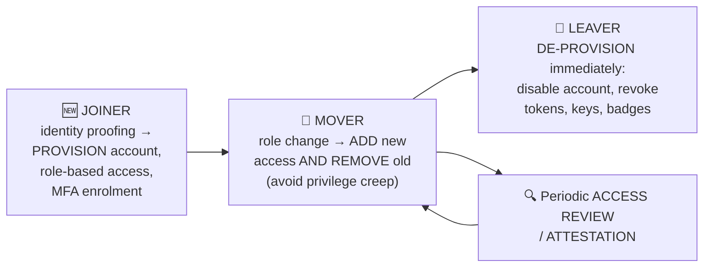
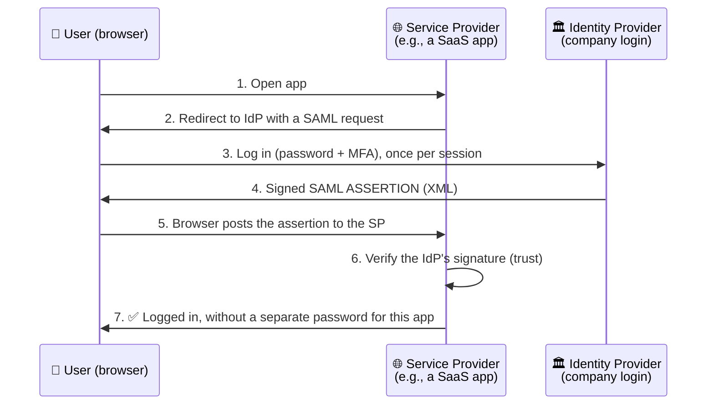

# Chapter 39 — Identity & Access Management (Deep Dive)

**Level 4 · Advanced Knowledge** · *Exam objective 4.6*

---

## 🎯 Goal

By the end of this chapter you will be able to implement and maintain IAM:
- **Provisioning/de-provisioning** user accounts; **permission assignments** and their implications; **identity proofing**
- **Federation**; **single sign-on (SSO)**: **LDAP, OAuth, SAML** (plus OpenID Connect and Kerberos); **interoperability**; **attestation**
- **Access controls:** mandatory, discretionary, role-based, rule-based, attribute-based, time-of-day restrictions, least privilege
- **MFA** implementations and factors; **password concepts**; password managers; passwordless
- **Privileged access management (PAM):** just-in-time permissions, password vaulting, ephemeral credentials

---

## 🏠 Real-Life Story: The Theme Park Wristband 🎢

At a big theme park:
- At the gate, staff **check your ID and ticket** and give you a **wristband** (identity proofing + authentication).
- The wristband works at **every ride** without showing your ID again (**single sign-on**).
- It also works at the **partner water park next door**, because the two parks **trust each other's wristbands** (**federation**).
- A **gold wristband** gets you into the VIP lounge; a child's band blocks the adult rides (**access control**).
- When you leave, the band is **deactivated** (**de-provisioning**).
- Staff who open the cash office get a key **only for 10 minutes**, signed out from a **locked key box** (**privileged access management**).

---

## 📖 Part 1 — The Identity Lifecycle 🔄

## 🖼️ Figure 39.1 — Joiner, Mover, Leaver



| Term | Meaning |
|---|---|
| **Identity proofing** | **Verifying a person really is who they claim** *before* creating their identity: checking government ID, a video check, HR records, background checks |
| **Provisioning** | **Creating** accounts and granting the right access (ideally **automated** from HR data and **role-based**) |
| **De-provisioning** | **Disabling/removing** accounts and access when someone leaves or no longer needs it. **Must be fast**: stale accounts are a top attack path (Colonial Pipeline!) |
| **Permission assignments & implications** | Every permission granted is **risk**. Too many permissions = bigger blast radius if the account is compromised. Watch for **privilege creep**: people collecting access as they move between roles |
| **Attestation** | Regular **formal confirmation** (usually by managers/data owners) that each user's access is **still needed and appropriate**: "access reviews/recertification." (The word also describes devices proving their health/identity, e.g., TPM-based device attestation) |

> ⚠️ **Disable first, delete later.** When someone leaves, **disable** the account immediately (keeping it for investigations/data ownership), then delete per policy.

---

## 📖 Part 2 — Directory Services & SSO Protocols 🗂️

### LDAP: Lightweight Directory Access Protocol 📒
A protocol for **reading and searching directory services** (the "phone book" of users, groups and computers), e.g., **Microsoft Active Directory**.
- Port **389** (LDAP), **636** (**LDAPS**, LDAP over TLS: use this!).
- Entries are named with **distinguished names (DNs)**:

```
   CN=Alice Khan, OU=Finance, DC=example, DC=com
   │              │           └────────────┴── domain components (example.com)
   │              └── organizational unit (department)
   └── common name (the object)
```

### Kerberos 🎟️
The default authentication protocol in **Windows Active Directory** domains. It uses **tickets** instead of sending passwords around.

## 🖼️ Figure 39.2 — Kerberos in Three Steps

```
   👩 User                          🏛️ KDC (Key Distribution Center = domain controller)
                                       ├── AS  (Authentication Service)
                                       └── TGS (Ticket-Granting Service)

   1. User logs in ──────────────► AS checks password ──► gives a TGT
                                   ("Ticket-Granting Ticket": proof you logged in, time-limited)
   2. User wants the file server ─► presents TGT to TGS ──► gets a SERVICE TICKET for the file server
   3. User presents the service ticket to the 🗄️ file server ──► access granted. No password sent!

   Notes: port 88 · tickets have TIMESTAMPS → clocks must be in sync (≈5 min) → NTP matters
          · this ticket system gives SSO inside the Windows domain
```

### SAML: Security Assertion Markup Language 🌐
An **XML-based** standard for **web SSO**, especially between **organizations** (federation). It's used heavily for **enterprise SaaS** logins.

| SAML role | Meaning |
|---|---|
| **Principal** | The user |
| **Identity Provider (IdP)** | Authenticates the user and issues a signed **assertion** ("this is Alice, she's in Finance") (e.g., Microsoft Entra ID, Okta) |
| **Service Provider (SP)** | The application the user wants (e.g., Salesforce), which **trusts** the IdP's assertion |

## 🖼️ Figure 39.3 — SAML SSO Flow



### OAuth 2.0: Delegated Authorization 🔑
OAuth is about **authorization**, not authentication. It lets you grant an app **limited access to your resources on another service, without giving it your password**, using **access tokens**.

> 🚗 **The valet key analogy:** you give the valet a special key that can **drive** the car but **not open the boot or glove box**. OAuth tokens are "valet keys" with limited **scopes** (e.g., "read calendar" but not "send email").

Example: a photo-printing website asks, *"Allow PrintMe to view your Google Photos?"* You click **Allow** → Google gives PrintMe a **token** with only `photos.read` access. PrintMe never sees your Google password.

### OpenID Connect (OIDC) 🆔
**OIDC adds authentication on top of OAuth 2.0.** It provides an **ID token** (a signed **JWT**: JSON Web Token) saying *who* the user is. It's behind "**Sign in with Google/Microsoft/Apple**" buttons.

## 🖼️ Figure 39.4 — SSO & Federation Protocols Compared ⭐

| Protocol | Purpose | Format | Typical use |
|---|---|---|---|
| **LDAP/LDAPS** | **Directory lookups** (users, groups); simple auth binds | Binary protocol | Apps querying Active Directory |
| **Kerberos** | **Authentication** + SSO within a domain | Tickets | Windows AD networks |
| **SAML 2.0** | **Authentication + authorization assertions** for web SSO/federation | **XML** | Enterprise SaaS SSO |
| **OAuth 2.0** | **Delegated authorization** (access tokens, scopes) | JSON/tokens | API access ("allow this app to…") |
| **OpenID Connect** | **Authentication** layer on OAuth | **JWT** ID token | "Sign in with Google," mobile apps |
| **RADIUS** | Central AAA for **network access** (Wi-Fi, VPN) | UDP 1812/1813 | 802.1X |
| **TACACS+** | Central AAA for **device administration** | TCP 49, encrypts the whole payload | Logging into routers/switches |

### Federation 🤝
**Federation** = **trust between separate organizations' identity systems**, so users from one can access resources in another **using their home credentials**. Examples: a university's staff using a partner's research portal with their own university login; employees using SaaS apps via the company IdP. Implemented with **SAML** or **OIDC**.

### Interoperability 🔌
Using **standard protocols** (SAML, OIDC, OAuth, LDAP, SCIM for automated provisioning) so identity systems and applications from **different vendors work together**. Without interoperability, every app needs its own separate accounts.

> 💡 **SSO benefits:** fewer passwords (less reuse), one place to enforce MFA, instant de-provisioning everywhere. **Risk:** the IdP is a **single point of failure/compromise**. Protect it with strong MFA and monitoring.

---

## 📖 Part 3 — Access Control Models ⭐⭐

## 🖼️ Figure 39.5 — The Models with Everyday Examples

| Model | Who decides access | How | Everyday example | IT example |
|---|---|---|---|---|
| **MAC**: Mandatory | **The system / central authority** | **Labels**: data has a **classification**, users have a **clearance**; access only if clearance ≥ classification (and need-to-know) | Military "Secret" documents | SELinux, government systems |
| **DAC**: Discretionary | **The owner** of the resource | Owner sets the permissions (ACLs) | Sharing your Google Doc with friends | Windows NTFS file sharing by owners |
| **RBAC**: Role-based | **Admins**, by **job role** | Permissions attach to **roles**; users get roles | "All nurses can read patient charts" | AD groups like "HR-Staff" |
| **Rule-based** | **Admins**, via **rules** that apply to everyone | If-then rules (often from firewalls/ACLs) | "No entry after 10 pm" | Firewall ACLs, "block logins from outside the country" |
| **ABAC**: Attribute-based | **Policies** evaluating many **attributes** | Combines user, resource, action and environment attributes | "Managers in HR, on a company laptop, during work hours, from the office, can approve leave" | Cloud IAM policies, zero trust |

Plus two controls that apply across models:
- **Time-of-day restrictions:** access only at certain times (e.g., payroll system 08:00–18:00 on weekdays).
- **Least privilege:** the minimum needed, always.

> 🧠 **How to tell RBAC from rule-based:** RBAC asks **"what's your job?"** Rule-based asks **"does this request break a rule?"** (and the rule applies to **everyone** equally).
> 🧠 **MAC vs DAC:** **M**andatory = the **M**achine/authority decides by labels; users **can't** change it. **D**iscretionary = the owner's **D**ecision.

---

## 📖 Part 4 — MFA & Passwords (Recap + Implementation) 🔐

From Chapter 17:
- **Factors:** something you **know**, **have**, **are**; **somewhere you are**.
- **Implementations:** **biometrics**; **hard tokens** (key fobs, smart cards, **security keys** like FIDO2); **soft tokens** (authenticator apps, TOTP); SMS/voice (weaker).
- **Password best practices:** **length** (most important), complexity, no **reuse**, **expiration** (modern guidance: change on compromise rather than on a timer), **age** (minimum age stops rapid cycling back to an old password).
- **Password managers** and **passwordless** (passkeys/FIDO2, Windows Hello, smart cards).

---

## 📖 Part 5 — Privileged Access Management (PAM) 👑

**Privileged accounts** (domain admins, root, cloud admins, service accounts) are the **keys to the kingdom**. Attackers hunt for them. **PAM tools** protect them.

| PAM feature | What it does | Analogy |
|---|---|---|
| **Just-in-time (JIT) permissions** | Admin rights are granted **only when needed, for a limited time** (e.g., 1 hour, after approval), then removed automatically. No **standing** admin privileges | A key signed out for 10 minutes |
| **Password vaulting** | Privileged passwords are stored in a **secure vault**. Admins **check them out**; the vault can **rotate** the password after each use; sessions can be **recorded** | A locked key cabinet with a sign-out log |
| **Ephemeral credentials** | **Short-lived, single-use** credentials or certificates created for one task/session and then **expiring** | A visitor pass valid only today |

## 🖼️ Figure 39.6 — Standing Privilege vs Just-in-Time

```
   STANDING PRIVILEGE (risky)                 JUST-IN-TIME + VAULT (PAM)
   ──────────────────────────                 ─────────────────────────────────────────────
   alice = Domain Admin 24/7/365              alice = normal user
   → if phished at ANY time,                  → requests admin for "patch server X" (ticket #451)
     attacker gets full control               → approved → vault issues a temporary credential,
                                                valid 60 min, session RECORDED
                                              → after 60 min: access removed, password ROTATED
                                              → phishing alice later gets the attacker nothing
```

Other privileged-access practices: **separate admin accounts** (never browse email as admin), **MFA** for all privileged access, **jump servers** (Chapter 30), **session recording**, **monitoring** of privileged groups.

---

## 🧠 Memory Tricks

- **Joiner–Mover–Leaver: provision → adjust (remove old!) → de-provision fast.**
- **Attestation = managers "attest" that access is still right.**
- **LDAP = the phone book. Kerberos = the ticket booth. SAML = the XML passport for web apps. OAuth = the valet key. OIDC = OAuth + "who are you" (ID token).**
- **SAML: IdP vouches, SP trusts.**
- **MAC = labels. DAC = owner. RBAC = job. Rule-based = rules for all. ABAC = many attributes.**
- **PAM trio: JIT (temporary), Vault (locked & rotated), Ephemeral (expires).**

---

## ⚠️ Exam Tip

- *"Users log in once and access multiple SaaS apps; the company's IdP sends XML assertions."* → **SAML** (SSO/federation).
- *"A website lets users 'Sign in with Google' and receives an ID token."* → **OpenID Connect.**
- *"A third-party app gets limited access to a user's calendar without the user's password."* → **OAuth.**
- *"Access is granted based on clearance levels and data classification labels."* → **MAC.**
- *"File owners decide who can access their files."* → **DAC.**
- *"Access depends on department, device compliance, location and time together."* → **ABAC.**
- *"Admins receive elevated rights only for the duration of an approved task."* → **Just-in-time permissions.**
- *"Privileged passwords are stored, checked out and rotated automatically."* → **Password vaulting.**
- *"Managers periodically confirm their team members' access."* → **Attestation** (access review).
- *"Kerberos authentication fails across the domain after a time change."* → **Clock skew**: fix **NTP**.

---

## 🧪 Try It (30 minutes)

1. **See OAuth consent in action:** go to your Google account → Security → **Third-party apps with account access**. Each app there was given an **OAuth token** with specific **scopes**. Remove any you no longer use.
2. **Decode a JWT:** paste a sample token from **jwt.io** into its debugger (use the site's example, never a real token). Look at the header, payload (claims) and signature.
3. **SAML tracer:** install a "SAML tracer" browser extension, then log in to any SAML-based app (many schools/companies use one) and view the XML assertion.
4. **Lab:** in Windows Server (free evaluation) set up Active Directory, create an OU, a user and a group, and browse it with an LDAP tool (e.g., `ldp.exe`).

---

## ✅ Checkpoint Questions

1. What is identity proofing, and when does it happen?
2. What is privilege creep, and which process prevents it?
3. Why should de-provisioning be immediate?
4. What's the difference between authentication (OIDC) and authorization (OAuth)?
5. In SAML, what do the IdP and SP do?
6. What is federation?
7. Which port does Kerberos use, and why does time synchronization matter?
8. Compare MAC, DAC, RBAC, rule-based and ABAC in one line each.
9. Name the three PAM features in SY0-701 and describe each.
10. Why is SSO a double-edged sword?

<details>
<summary><b>Show answers</b></summary>

1. **Verifying that a person is who they claim to be** (ID documents, background/HR checks) **before** an identity/account is created for them.
2. **Accumulating access** as people change roles without removing old permissions. Prevented by **removing old access on role changes** and by **periodic access reviews/attestation**.
3. Stale accounts of departed users are **easy targets** (and can be misused by the ex-employee). Immediate disabling closes that hole.
4. **OAuth** grants **delegated authorization** (access tokens/scopes to resources). **OIDC** adds **authentication** (an ID token saying who the user is).
5. The **IdP authenticates** the user and issues a signed assertion. The **SP trusts** the assertion and grants access to its application.
6. **Trust between different organizations' identity systems**, letting users access partner resources with their home credentials.
7. **Port 88.** Tickets include **timestamps**, so clocks must be closely synchronized (typically within 5 minutes) or authentication fails.
8. **MAC:** system enforces labels/clearances. **DAC:** owner decides. **RBAC:** permissions by job role. **Rule-based:** admin-defined rules apply to everyone. **ABAC:** policies evaluate multiple attributes (user, resource, environment).
9. **Just-in-time permissions** (temporary elevation when needed), **password vaulting** (secure storage, check-out, rotation, session recording), **ephemeral credentials** (short-lived credentials that expire after use).
10. It **reduces passwords** and centralizes MFA and de-provisioning, but the **IdP becomes a single point of failure/compromise**: one stolen session could unlock many apps.

</details>

---

## 📌 Chapter Summary

| Area | Key points |
|---|---|
| Lifecycle | Identity proofing → provisioning → changes (avoid privilege creep) → **fast de-provisioning**; attestation/access reviews |
| Protocols | LDAP(S) directory · Kerberos tickets · **SAML** (XML web SSO, IdP/SP) · **OAuth** (delegated authorization) · **OIDC** (authentication, JWT) · RADIUS/TACACS+ |
| Federation & interoperability | Cross-organization trust via standards |
| Access models | MAC, DAC, RBAC, rule-based, ABAC + time-of-day + least privilege |
| MFA/passwords | Factors, tokens, security keys, length > complexity, managers, passwordless |
| PAM | **JIT**, **vaulting**, **ephemeral credentials**, separate admin accounts, session recording |

**Next chapter →** *Chapter 40: Automation & Orchestration.* With thousands of accounts and alerts, humans need help. Let's let the machines do the repetitive work, safely.
