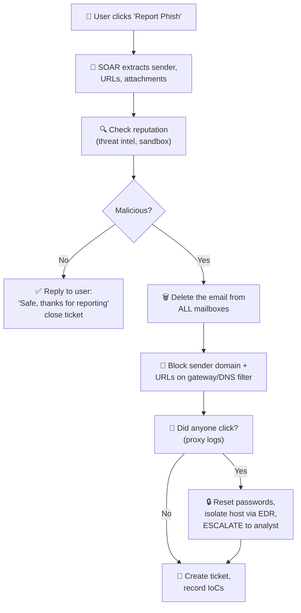

# Chapter 40 — Automation & Orchestration

**Level 4 · Advanced Knowledge** · *Exam objective 4.7*

---

## 🎯 Goal

By the end of this chapter you will be able to explain why automation and orchestration matter for secure operations:
- **Use cases:** user provisioning, resource provisioning, guard rails, security groups, ticket creation, escalation, enabling/disabling services and access, continuous integration and testing, integrations and APIs
- **Benefits:** efficiency/time saving, enforcing baselines, standard infrastructure configurations, scaling in a secure manner, employee retention, reaction time, workforce multiplier
- **Other considerations:** complexity, cost, single point of failure, technical debt, ongoing supportability

---

## 🏠 Real-Life Story: The Automatic Car Wash 🚗

A hand car wash needs five people, takes 30 minutes, and every car comes out slightly different. An automatic car wash runs **the same steps, in the same order, every time**, in 5 minutes, day and night, while one attendant watches.

But if the machine is **set up wrongly**, it scratches **every** car. If it **breaks**, **nothing** gets washed. And someone must **maintain** it forever. That's automation: **fast, consistent and scalable, but it needs care.**

- **Automation** = making **one task** run by itself (e.g., "disable this account").
- **Orchestration** = **coordinating many automated tasks across different systems** into a complete workflow (e.g., "when an employee leaves: disable the account in AD → revoke SaaS access → remove from VPN → collect the laptop ticket → notify the manager").

---

## 📖 Part 1 — SOAR and Playbooks 🤖

**SOAR** = **S**ecurity **O**rchestration, **A**utomation and **R**esponse. A SOAR platform connects security tools (SIEM, EDR, firewall, email, ticketing) through **APIs** and runs **playbooks** automatically.

- **Playbook** = a defined **response workflow** for a type of incident (what to check, what to do, who to tell). It can be manual, automated or a mix.
- **Runbook** = detailed, step-by-step **technical** instructions for a specific task (often automated).

## 🖼️ Figure 40.1 — An Automated Phishing Playbook



**Time comparison:** a human analyst might need 30–60 minutes per reported phish; the playbook does the routine part in **seconds**, 24/7, and hands only the serious cases to a human.

---

## 📖 Part 2 — Use Cases ⚙️

| Use case | What gets automated | Security benefit |
|---|---|---|
| **User provisioning** | Creating/changing/removing accounts from HR events (joiner/mover/leaver) | Correct access from day one; **instant de-provisioning** |
| **Resource provisioning** | Building servers, networks, cloud resources from templates (IaC, Chapter 29) | Every resource is created **securely configured** |
| **Guard rails** | Automatic **preventive limits** that stop unsafe actions, e.g., "cloud storage can never be made public," "no VM without encryption" | Mistakes are **blocked before they happen** |
| **Security groups** | Automatically assigning users/systems to the right **groups** (AD groups, cloud security groups/firewall rules) | Consistent least-privilege access |
| **Ticket creation** | Alerts automatically open tickets with all the details attached | Nothing is forgotten; audit trail |
| **Escalation** | If a ticket/alert isn't handled within X minutes, or is severe, **notify the next level** (on-call, manager) | Critical issues don't wait |
| **Enabling/disabling services and access** | Turning services, ports or accounts **on/off** automatically (e.g., disable an account after impossible travel; enable admin access just-in-time) | **Fast containment**, JIT access |
| **Continuous integration and testing** | Every code change is automatically **built and tested**, including security tests (SAST, dependency scanning, DAST) in the **CI/CD pipeline** | Vulnerabilities caught **before** release |
| **Integrations and APIs** | Tools **talk to each other** through APIs (SIEM → SOAR → firewall → ticketing → chat) | Orchestrated, end-to-end response |

## 🖼️ Figure 40.2 — Security in a CI/CD Pipeline ("DevSecOps")

```
   👩‍💻 Developer pushes code
        │
        ▼
   [ BUILD ] ─► [ SAST + secret scanning ] ─► [ dependency/package scan ] ─► [ unit tests ]
                                                                                │
        ┌───────────────────────────────────────────────────────────────────────┘
        ▼
   [ deploy to TEST ] ─► [ DAST scan ] ─► [ approval gate ] ─► [ deploy to PRODUCTION ]
   ❌ any HIGH/CRITICAL finding → pipeline STOPS automatically ("break the build")
```

---

## 📖 Part 3 — Benefits ✅

| Benefit | Meaning |
|---|---|
| **Efficiency / time saving** | Machines do repetitive work in seconds |
| **Enforcing baselines** | Automation applies the secure baseline **the same way every time** (no forgotten steps) |
| **Standard infrastructure configurations** | Every server/network built from the same approved templates |
| **Scaling in a secure manner** | Grow from 10 to 10,000 servers **without** security falling behind |
| **Employee retention** | Staff spend less time on boring, repetitive tasks (less **burnout**), more on interesting work |
| **Reaction time** | Automated containment happens in **seconds**, not hours, which limits damage |
| **Workforce multiplier** | A small team can handle the workload of a much larger one |

---

## 📖 Part 4 — Other Considerations ⚠️

| Consideration | The risk | Mitigation |
|---|---|---|
| **Complexity** | Many interconnected scripts and tools become hard to understand and troubleshoot | Documentation, simple modular design |
| **Cost** | Licences for SOAR tools, development time, training | Start with the highest-value use cases |
| **Single point of failure** | If the automation platform breaks (or is **compromised**), many processes stop, or an attacker controls them all | Redundancy, protect automation credentials (they're highly privileged!), manual fallback procedures |
| **Technical debt** | Quick-and-dirty scripts pile up and become a burden that must be fixed later | Code review, version control, refactoring |
| **Ongoing supportability** | Automation must be **maintained** as systems, APIs and staff change. Who fixes it when its author leaves? | Ownership, documentation, testing |

> 🔐 **Automation can also automate mistakes.** A wrong rule in a playbook can disable **every** account in seconds. Test playbooks, add **approval steps** for high-impact actions, and keep humans "in the loop" where the stakes are high.

## 🖼️ Figure 40.3 — The Automation Balance

```
          BENEFITS                                   CONSIDERATIONS
   ┌─────────────────────────┐               ┌─────────────────────────────┐
   │ speed · consistency     │               │ complexity · cost           │
   │ baselines enforced      │      ⚖️       │ single point of failure     │
   │ secure scaling          │               │ technical debt              │
   │ faster reaction         │               │ ongoing supportability      │
   │ staff retention         │               │ automated mistakes at scale │
   │ workforce multiplier    │               │                             │
   └─────────────────────────┘               └─────────────────────────────┘
```

---

## 🧠 Memory Tricks

- **Automation = one task by itself. Orchestration = the conductor coordinating the whole orchestra.**
- **SOAR = "Stop Overworking Analysts Repeatedly."**
- **Guard rails = the barriers on a mountain road**: you can drive freely, but you can't go over the edge.
- **Benefits: "Every Busy SOC Really Wants More"**: Efficiency, Baselines/standard configs, Scaling, Retention, reaction time (Wait less), Multiplier.
- **Considerations: "Complex, Costly, Single-point, Debt, Support."**

---

## ⚠️ Exam Tip

- *"A cloud policy automatically prevents anyone from creating a publicly accessible storage bucket."* → **Guard rails.**
- *"When an employee is terminated in the HR system, their accounts are disabled automatically."* → **User provisioning/de-provisioning** automation.
- *"Which is a key RISK of relying on a single SOAR platform?"* → **Single point of failure.**
- *"Old automation scripts nobody understands are causing problems."* → **Technical debt / ongoing supportability.**
- *"Security tests run automatically every time code is committed."* → **Continuous integration and testing.**
- *"Unhandled critical alerts are sent to the on-call manager after 15 minutes."* → **Escalation.**
- *"Which benefit lets a 3-person team handle thousands of alerts?"* → **Workforce multiplier.**

---

## 🧪 Try It (30 minutes)

1. **Write a tiny automation script** in your lab VM that disables an account and logs it:
   ```bash
   #!/bin/bash
   # disable-user.sh <username>  (lab only!)
   # -L locks the password; -e 1 expires the account so SSH-key logins are blocked too
   sudo usermod -L -e 1 "$1" && echo "$(date) disabled account $1" | sudo tee -a /var/log/offboarding.log
   ```
   Now think: what checks would you add so it can't lock **root** or the wrong user by mistake?
2. **Design a playbook** on paper for "EDR detects ransomware on a laptop." Which steps can be automated? Where do you want a human approval?
3. **Explore guard rails:** search "AWS Service Control Policies examples" or "Azure Policy deny public storage." Read one policy and explain what it blocks.
4. **See CI security for free:** look at any popular open-source project on GitHub → "Actions" tab. Find a workflow that runs tests or security scans on every commit.

---

## ✅ Checkpoint Questions

1. What's the difference between automation and orchestration?
2. What is SOAR, and what is a playbook?
3. Give three use cases for security automation.
4. What are guard rails?
5. How does automation help with continuous integration and testing?
6. Name four benefits of automation.
7. Why can an automation platform become a single point of failure?
8. What is technical debt?
9. Why might you keep a human approval step in an automated playbook?
10. How does automation improve employee retention?

<details>
<summary><b>Show answers</b></summary>

1. **Automation** makes an individual task run without human effort. **Orchestration** coordinates **many automated tasks across multiple systems** into an end-to-end workflow.
2. **SOAR** = Security Orchestration, Automation and Response: a platform connecting security tools to automate response. A **playbook** is a defined workflow for responding to a specific type of incident.
3. Any three of: **user provisioning, resource provisioning, guard rails, security groups, ticket creation, escalation, enabling/disabling services and access, CI/testing, integrations and APIs.**
4. **Automated preventive limits** that stop unsafe configurations or actions (e.g., blocking public storage buckets).
5. Every code change is **automatically built and security-tested** (SAST, dependency scans, DAST), catching vulnerabilities before release.
6. Any four of: **efficiency, enforcing baselines, standard configurations, secure scaling, employee retention, faster reaction time, workforce multiplier.**
7. Many processes **depend on it**: if it fails, they stop; if it's **compromised**, attackers can use its high privileges across all connected systems.
8. **Shortcuts and poorly designed solutions that pile up** and must be fixed later, making systems harder to maintain.
9. Automated **high-impact actions** (mass account disables, shutting down production) could cause big damage if a rule is wrong. Human approval adds a safety check.
10. It removes **repetitive, boring tasks**, reducing burnout and letting staff do more meaningful work.

</details>

---

## 📌 Chapter Summary

| Area | Key points |
|---|---|
| Concepts | Automation (task) vs orchestration (workflow); SOAR, playbooks, runbooks |
| Use cases | User & resource provisioning, guard rails, security groups, tickets, escalation, enable/disable services & access, CI/testing, APIs |
| Benefits | Efficiency, baselines, standard configs, secure scaling, retention, reaction time, workforce multiplier |
| Considerations | Complexity, cost, single point of failure, technical debt, ongoing supportability |

**Next chapter →** *Chapter 41: Incident Response & Digital Forensics.* When prevention fails (and eventually it will), here's exactly what to do, in order.
