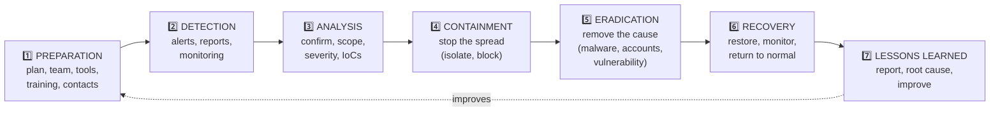

# Chapter 41 — Incident Response & Digital Forensics

**Level 4 · Advanced Knowledge** · *Exam objective 4.8*

---

## 🎯 Goal

By the end of this chapter you will know the incident response activities in Security+:
- **Process:** preparation, detection, analysis, containment, eradication, recovery, lessons learned
- **Training** and **testing** (tabletop exercise, simulation)
- **Root cause analysis** and **threat hunting**
- **Digital forensics:** legal hold, chain of custody, acquisition, reporting, preservation, e-discovery, plus the **order of volatility**

The exam loves **"what should you do FIRST / NEXT?"** questions here, so learn the **order**.

---

## 🏠 Real-Life Story: The Fire Brigade 🚒

A fire brigade doesn't invent its plan when the alarm rings:
1. **Preparation:** trucks maintained, crews trained, hydrants mapped.
2. **Detection:** a smoke alarm or a 999/911 call.
3. **Analysis:** "Kitchen fire or chemical plant? How big? Anyone inside?"
4. **Containment:** stop the fire **spreading** to neighboring buildings.
5. **Eradication:** put the fire **completely** out and remove hot spots.
6. **Recovery:** make the building safe and let people back in.
7. **Lessons learned:** "Why did it start? How do we prevent it next time?"

And if arson is suspected, **investigators** carefully collect evidence **without disturbing it**, so it can be used in court. That's **digital forensics**.

---

## 📖 Part 1 — The Incident Response Process ⭐⭐

## 🖼️ Figure 41.1 — The 7 Steps (CompTIA order)



| Step | Key activities | Example (ransomware on 3 PCs) |
|---|---|---|
| **1. Preparation** | IR **plan** and **policy**, IR team (**CSIRT**: Computer Security Incident Response Team) with roles, contact lists (legal, PR, law enforcement, insurers), tools (EDR, forensic kits), **training**, playbooks, clean backups | Ransomware playbook exists; offline backups tested; team knows roles |
| **2. Detection** | Recognize that something happened: SIEM/EDR alerts, user reports, IoCs, threat intel | EDR alerts on mass file encryption |
| **3. Analysis** | **Confirm** it's real (not a false positive), determine **scope** (which systems/data), **severity/priority**, attack vector, timeline | 3 PCs in Finance affected; started from a phishing email at 09:12 |
| **4. Containment** | **Stop it spreading** while preserving evidence: isolate hosts (EDR), disable accounts, block IPs/domains, segment networks | EDR isolates the 3 PCs; block the C2 domain; disable the phished user's account |
| **5. Eradication** | **Remove the root cause and all traces**: delete malware, remove attacker persistence/accounts, **patch the vulnerability**, reimage | Reimage the 3 PCs; remove malicious mailbox rules; patch |
| **6. Recovery** | **Restore** systems and data from clean backups, return to production carefully, **monitor closely** for reinfection | Restore files from offline backup; watch the hosts for 2 weeks |
| **7. Lessons learned** | **Post-incident review** (within days): what happened, what worked, what didn't, root cause, improvements; update the plan | Add attachment sandboxing; more phishing training; faster EDR isolation playbook |

> ⚠️ **Containment before eradication!** If you start deleting malware while the attacker still has access, they'll simply come back (and you may destroy evidence). First **stop the spread**, then **clean**.

> 💡 The classic NIST SP 800-61 (Revision 2) lifecycle groups these into four phases: (1) Preparation; (2) Detection & Analysis; (3) Containment, Eradication & Recovery; (4) Post-Incident Activity. Same ideas, fewer boxes. (NIST's newer Revision 3 maps incident response onto the NIST Cybersecurity Framework functions instead.) **On the exam, use CompTIA's seven steps above.**

### Containment Strategies
- **Isolation:** disconnect the host completely (EDR network isolation, pull the cable, quarantine VLAN).
- **Segmentation:** move affected systems into a restricted segment so they can still be observed.
- **Account actions:** disable or reset compromised credentials; revoke tokens/sessions.
- ⚠️ **Don't just power off** a compromised machine if you need evidence: **RAM** contents (running malware, encryption keys) are lost (see the order of volatility below).

---

## 📖 Part 2 — Training & Testing 🎓

| Activity | What it is |
|---|---|
| **Training** | Everyone knows their role: responders practise tools and procedures; all staff know **how to report** incidents |
| **Tabletop exercise** | Team talks through a scenario around a table ("It's 9 am, the CEO's email is compromised, what now?"). Low cost, no systems touched |
| **Simulation** | A realistic **practice run**: a simulated attack (e.g., red team, phishing simulation, mock ransomware outbreak in a test environment) that responders must actually handle |

(Same testing ladder as Chapter 32: tabletop → simulation → more realistic tests.)

---

## 📖 Part 3 — Root Cause Analysis & Threat Hunting 🔎

### Root Cause Analysis (RCA)
Finding the **underlying reason** an incident happened, not just the symptom, so it **doesn't happen again**. A simple method is the **"5 Whys"**:

```
   Problem: Ransomware encrypted the finance file server.
   Why? → Malware ran on a finance PC.
   Why? → A user opened a malicious attachment.
   Why? → The email gateway didn't block it.
   Why? → Attachment sandboxing was not enabled for .iso files.
   Why? → The email security baseline hadn't been reviewed in 2 years.
   ROOT CAUSE: no regular review of email security settings → fix the PROCESS, not just the PC.
```

### Threat Hunting 🏹
**Proactively searching** for attackers who are **already inside** but **haven't triggered any alert**. It's the opposite of waiting for alarms.
- Starts with a **hypothesis**, often from threat intelligence or MITRE ATT&CK: *"If an APT used stolen credentials, we'd see logins at odd hours from service accounts."*
- Hunters search logs, EDR data and NetFlow for evidence.
- Findings become **new detection rules**.

| | **Incident response** | **Threat hunting** |
|---|---|---|
| Trigger | An alert or report | A hypothesis, without waiting for alerts |
| Nature | Reactive | **Proactive** |

---

## 📖 Part 4 — Digital Forensics 🔬

**Digital forensics** = collecting, preserving and analyzing digital evidence in a way that is **legally defensible** (it can be trusted in court or in disciplinary proceedings).

### The Order of Volatility ⭐ (collect the most fragile evidence first)

## 🖼️ Figure 41.2 — Most Volatile → Least Volatile

```
   MOST VOLATILE (disappears fastest) — COLLECT FIRST
   ┌──────────────────────────────────────────────────────────────────┐
   │ 1. CPU registers, CPU cache                                      │  nanoseconds
   │ 2. Routing table, ARP cache, process table, kernel statistics,   │
   │    RAM (system memory)                                           │  lost at power-off
   │ 3. Temporary file systems / swap / page file                     │
   │ 4. Disk (HDD/SSD) data                                           │
   │ 5. Remote logging and monitoring data (SIEM, syslog servers)     │
   │ 6. Physical configuration, network topology                      │
   │ 7. Archival media (backups, tapes, optical discs)                │  years
   └──────────────────────────────────────────────────────────────────┘
   LEAST VOLATILE — COLLECT LAST            (based on RFC 3227)
```

> 🧠 In practice: **capture RAM first**, then the disk image, then logs and backups. **Pulling the plug destroys RAM evidence.**

### The Six Forensic Terms in SY0-701

| Term | Meaning |
|---|---|
| **Legal hold** | An instruction (usually from legal counsel) to **preserve all relevant data** and **suspend normal deletion/retention** because of actual or expected **litigation or investigation**. Overrides the normal retention policy |
| **Chain of custody** | A **documented record of everyone who handled the evidence**: who, what, when, where, why. Any gap can make evidence **inadmissible** |
| **Acquisition** | **Collecting** evidence correctly: making a **bit-for-bit forensic image** (exact copy, including deleted space) using a **write blocker** so the original isn't changed, and **hashing** the original and the copy to prove they match |
| **Preservation** | **Protecting evidence from change or damage**: store originals securely (evidence bags, locked storage, Faraday bags for phones), work only on **copies**, verify with hashes |
| **Reporting** | Writing up the investigation clearly and factually: method, tools, findings, timeline, conclusions, so others (managers, lawyers, courts) can understand and verify it |
| **E-discovery** (electronic discovery) | The **legal process** of **identifying, collecting and handing over electronically stored information** (emails, documents, chats) relevant to a lawsuit |

## 🖼️ Figure 41.3 — Forensic Acquisition Done Right

```
   ORIGINAL DISK ──► [ WRITE BLOCKER ] ──► forensic workstation ──► IMAGE FILE (bit-for-bit)
   (evidence)        (allows READ only,                               │
                      prevents ANY write)                             │
        │                                                             │
        ▼                                                             ▼
   hash: SHA-256 = 7c4e...a91    ═══ must MATCH ═══       hash: SHA-256 = 7c4e...a91

   ANALYZE ONLY THE COPY; store the original sealed
```

## 🖼️ Figure 41.4 — A Chain-of-Custody Form

```
   ┌──────────────────────────────────────────────────────────────────────────────┐
   │ CHAIN OF CUSTODY        Case #: IR-2026-0142    Item: Laptop LT-2026-00418   │
   │ Description: Dell Latitude, SN 9XK2L83, powered on when seized               │
   │ SHA-256 of disk image: 7c4e...a91                                            │
   ├────────────┬───────────┬─────────────────┬──────────────────┬────────────────┤
   │ Date/time  │ Released  │ Received by     │ Purpose          │ Location       │
   │            │ by        │                 │                  │                │
   ├────────────┼───────────┼─────────────────┼──────────────────┼────────────────┤
   │ 03-12 10:05│ J. Ortiz  │ R. Chen (IR)    │ Seizure          │ Evidence room  │
   │ 03-12 14:30│ R. Chen   │ M. Ade (forens.)│ Imaging          │ Forensics lab  │
   │ 03-13 09:00│ M. Ade    │ Evidence locker │ Storage (sealed) │ Locker #4      │
   └────────────┴───────────┴─────────────────┴──────────────────┴────────────────┘
```

### Other Forensic Practices
- **Timeline:** combine timestamps from many sources (adjusting for **time zones** and clock offsets) to rebuild what happened.
- **Take photos/video** of the scene and screens before touching anything.
- **Capture network traffic** and **memory** with proper tools.
- **Interview** witnesses and users.
- Use **forensic tools** such as FTK Imager, Autopsy, or `dd` (Linux imaging).

---

## 🧠 Memory Tricks

- **IR steps: "Please Do Analyze Carefully, Eradicate, Recover, Learn"**: Preparation, Detection, Analysis, Containment, Eradication, Recovery, Lessons learned.
- **Contain before you clean.**
- **Order of volatility: "Registers Rush, RAM Runs, Temp Tumbles, Disk Drags, Logs Linger, Archives Abide."**
- **Chain of custody = an unbroken signature trail.**
- **Write blocker + hash = proof the evidence didn't change.**
- **Legal hold = "Don't delete anything about this case!"**
- **Threat hunting = looking for the burglar before the alarm goes off.**

---

## ⚠️ Exam Tip

- *"An analyst confirms malware on a server. What should be done FIRST?"* → **Containment** (isolate), assuming detection and analysis are done.
- *"Which evidence should be collected FIRST from a running system?"* → **RAM / memory** (most volatile; CPU registers/cache are technically first).
- *"Which ensures evidence hasn't been altered since collection?"* → **Hashing** (with write blockers), documented in the **chain of custody**.
- *"Lawyers instruct the company to preserve all emails related to a dispute."* → **Legal hold.**
- *"The process of producing electronic records for a lawsuit."* → **E-discovery.**
- *"Which step involves a meeting to review what happened and improve?"* → **Lessons learned.**
- *"Security staff search for signs of compromise without any alert."* → **Threat hunting.**
- *"The team walks through a scenario in a conference room."* → **Tabletop exercise.**

---

## 🧪 Try It (30 minutes)

1. **Write a one-page IR plan** for your home: what counts as an incident (hacked email, stolen phone, ransomware), who you contact (bank, email provider, police), where your backups are, and how you'd recover.
2. **Practice acquisition in your lab:** in a Linux VM, attach a small extra virtual disk, check its device name with `lsblk` (below we assume `/dev/sdb`), then:
   ```bash
   sudo dd if=/dev/sdb of=evidence.img bs=4M status=progress
   sha256sum /dev/sdb evidence.img     # the two hashes must match
   ```
3. **Explore a free forensic tool:** install **Autopsy** (free) and open a sample disk image from the "Digital Corpora" project. Find a deleted file.
4. **Run a 5 Whys** on a recent problem in your life (e.g., "I missed my train") and find the root cause.

---

## ✅ Checkpoint Questions

1. List the seven incident response steps in order.
2. Why must containment happen before eradication?
3. Give two containment techniques.
4. What's the difference between a tabletop exercise and a simulation?
5. What is root cause analysis, and name one technique.
6. How does threat hunting differ from incident response?
7. Put these in order of volatility (most first): disk, RAM, backup tapes, CPU cache, remote logs.
8. What is chain of custody, and why does it matter?
9. Why use a write blocker and hashing during acquisition?
10. What's the difference between legal hold and e-discovery?

<details>
<summary><b>Show answers</b></summary>

1. **Preparation, detection, analysis, containment, eradication, recovery, lessons learned.**
2. Containment **stops the spread and the attacker's access** first. Cleaning while the attacker is still active lets them **re-infect**, and may destroy evidence.
3. E.g., **isolating hosts (EDR/network), segmentation, disabling compromised accounts/sessions, blocking malicious IPs/domains.**
4. A **tabletop** is a discussion-based walk-through. A **simulation** is a realistic practice exercise where responders act on a simulated attack.
5. Identifying the **underlying cause** of an incident to prevent recurrence, e.g., the **5 Whys** (or fishbone diagrams).
6. **Threat hunting is proactive**: searching for hidden threats from a hypothesis **without an alert**. **Incident response is reactive**, triggered by an alert or report.
7. **CPU cache → RAM → disk → remote logs → backup tapes.**
8. A **documented record of every person who handled evidence** (who, when, why, where). Gaps can make evidence **untrustworthy/inadmissible**.
9. The **write blocker** prevents changes to the original. **Matching hashes** prove the image is an exact, unaltered copy.
10. **Legal hold** = an order to **preserve** relevant data (stop deletion). **E-discovery** = the legal process of **identifying, collecting and producing** electronic information for litigation.

</details>

---

## 📌 Chapter Summary

| Topic | Key points |
|---|---|
| IR process | **Preparation → detection → analysis → containment → eradication → recovery → lessons learned** |
| Training & testing | Training, tabletop exercises, simulations |
| RCA & hunting | 5 Whys to fix the real cause; proactive, hypothesis-driven threat hunting |
| Forensics | **Order of volatility** (registers/cache → RAM → temp/swap → disk → remote logs → configuration → archives); **legal hold, chain of custody, acquisition (write blocker + hash), preservation, reporting, e-discovery** |

**Next chapter →** *Chapter 42: Investigations: Using Data Sources.* Time to put on the detective hat and read real logs.
