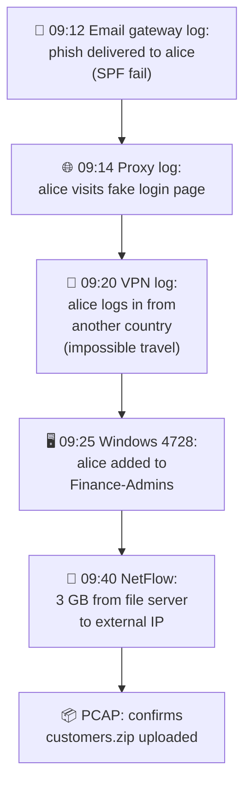

# Chapter 42 — Investigations: Using Data Sources

**Level 4 · Advanced Knowledge** · *Exam objective 4.9*

---

## 🎯 Goal

This objective says "Given a scenario, **use data sources** to support an investigation," so PBQs often show you logs. By the end of this chapter you will be able to read and use:
- **Log data:** firewall logs, application logs, endpoint logs, OS-specific security logs, IPS/IDS logs, network logs, metadata
- **Data sources:** vulnerability scans, automated reports, dashboards, packet captures

Every log in this chapter is **annotated**, so you learn to spot the clue.

---

## 🏠 Real-Life Story: The Detective's Evidence Board 🕵️

A detective solving a burglary collects **different kinds of evidence**:
- **CCTV from the street** (who arrived, when): **network/firewall logs**
- **The door's lock log** (which key opened it): **OS security logs**
- **Fingerprints inside** (what was touched): **endpoint logs**
- **The shop's till records** (what was taken): **application logs**
- **Phone records** (who called whom; not the conversation): **metadata / NetFlow**
- **An actual recording of a phone call** (every word): **packet capture**

No single source tells the whole story. Investigators **combine** them into a **timeline**.

---

## 📖 Part 1 — Log Data 📜

### 1. Firewall Logs 🧱
Show **allowed and blocked connections**: time, action, source/destination IP and port, protocol, rule.

## 🖼️ Figure 42.1 — A Port Scan in a Firewall Log

```
   2026-03-12 02:14:01 DENY TCP 198.51.100.77:41022 -> 203.0.113.10:21   rule=default-deny
   2026-03-12 02:14:01 DENY TCP 198.51.100.77:41023 -> 203.0.113.10:22   rule=default-deny
   2026-03-12 02:14:01 DENY TCP 198.51.100.77:41024 -> 203.0.113.10:23   rule=default-deny
   2026-03-12 02:14:02 DENY TCP 198.51.100.77:41025 -> 203.0.113.10:25   rule=default-deny
   2026-03-12 02:14:02 ALLOW TCP 198.51.100.77:41026 -> 203.0.113.10:443 rule=web-in
   2026-03-12 02:14:02 DENY TCP 198.51.100.77:41027 -> 203.0.113.10:3389 rule=default-deny
        ▲ ONE source IP           ▲ ONE target, MANY different ports in ~1 second
   🔍 Clue: sequential ports, same source, very fast → PORT SCAN (reconnaissance)
   ✅ Action: block 198.51.100.77, check what's exposed on 443, watch for follow-up attacks
```

Other firewall-log clues: lots of **outbound** connections to one strange IP (C2 beaconing), traffic on unusual ports, **allowed** traffic that should have been blocked (a rule mistake).

### 2. Application Logs 📱
Written by applications (web servers, databases, email servers, custom apps): requests, errors, user actions.

## 🖼️ Figure 42.2 — SQL Injection in a Web Server Access Log

```
   203.0.113.66 - - [12/Mar/2026:10:02:11] "GET /products?id=42 HTTP/1.1" 200 5120
   203.0.113.66 - - [12/Mar/2026:10:02:15] "GET /products?id=42' HTTP/1.1" 500 312
   203.0.113.66 - - [12/Mar/2026:10:02:19] "GET /products?id=42%20OR%201=1-- HTTP/1.1" 200 98211
   203.0.113.66 - - [12/Mar/2026:10:02:31] "GET /products?id=42%20UNION%20SELECT%20username,password%20FROM%20users-- HTTP/1.1" 200 15530
                                                          ▲ %20 = space (URL encoding)
   🔍 Clues: a single quote causing a 500 ERROR (testing), then OR 1=1, then UNION SELECT
            from the users table; response sizes jump (98 KB = lots of data returned)
   → SQL INJECTION with likely DATA EXFILTRATION
   ✅ Action: block IP / WAF rule, fix with parameterized queries, check what was taken,
             reset affected passwords
```

Other application-log clues: `../` (directory traversal), `<script>` (XSS), repeated HTTP **401/403** (password guessing or probing), lots of **404**s (scanning for hidden pages).

### 3. Endpoint Logs 💻
From devices and their security agents (**EDR**, antivirus, host firewall): processes started, files created, registry changes, USB insertions, malware detections.

## 🖼️ Figure 42.3 — An Endpoint (EDR) Process Tree

```
   WINWORD.EXE  (user opened Invoice_June.docm)
     └─ cmd.exe /c powershell -w hidden -enc SQBFAFgAIAAoAE4AZQB3AC0ATwBi...
          └─ powershell.exe  → connects to 198.51.100.9:443
               └─ rundll32.exe C:\Users\alice\AppData\Roaming\upd.dll
   🔍 Clues: Word should NEVER launch PowerShell; hidden window (-w hidden);
            Base64-encoded command (-enc); a DLL run from the user's AppData folder
   → malicious MACRO → fileless-style PowerShell download → malware loaded
   ✅ Action: isolate the host (EDR), block the IP, collect memory, check other hosts
```

### 4. OS-Specific Security Logs 🖥️

**Windows Security log** (Event Viewer). Event IDs worth knowing:

| Event ID | Meaning |
|---|---|
| **4624** | Successful logon |
| **4625** | **Failed** logon |
| **4634 / 4647** | Logoff |
| **4672** | Special (admin) privileges assigned at logon |
| **4720** | User account **created** |
| **4728 / 4732** | Member **added** to a security group (global / local) |
| **4740** | Account **locked out** |
| **1102** | **Audit log cleared** (suspicious!) |

## 🖼️ Figure 42.4 — Brute Force Then Success

```
   Time      Event  Account   Logon Type  Source IP        Result
   03:01:02  4625   admin     10 (RDP)    198.51.100.23    Failure (bad password)
   03:01:03  4625   admin     10          198.51.100.23    Failure
   ...       ...    (418 more failures in 6 minutes)  ...
   03:07:44  4624   admin     10          198.51.100.23    SUCCESS  ⚠️
   03:08:10  4720   newsvc$   -           -                account CREATED  ⚠️
   03:08:12  4732   newsvc$   -           -                added to Administrators  ⚠️
   03:15:40  1102   -         -           -                AUDIT LOG CLEARED  🚨
   → RDP brute force succeeded → attacker created a backdoor admin account → covered tracks
```

**Linux** logs: `/var/log/auth.log` (Debian/Ubuntu) or `/var/log/secure` (RHEL) for logins and `sudo`; `journalctl`; `/var/log/syslog`.

```
   Mar 12 03:01:02 web01 sshd[2211]: Failed password for root from 198.51.100.23 port 51122 ssh2
   Mar 12 03:01:04 web01 sshd[2213]: Failed password for invalid user oracle from 198.51.100.23 ...
   🔍 "invalid user" = guessing usernames that don't even exist → automated SSH brute force
```

### 5. IPS/IDS Logs 🚨
Alerts when traffic matches **signatures** or anomalies: signature name/ID, severity, source/destination, action (alerted/blocked).

```
   [**] [1:9000101:1] EXAMPLE-RULE Possible Log4j JNDI Injection Attempt ("${jndi:ldap://") [**]
   [Classification: Attempted Administrator Privilege Gain] [Priority: 1]
   03/12-11:20:41 198.51.100.40:53211 -> 203.0.113.10:443  Action: BLOCKED
   🔍 Known exploit signature, high priority, blocked by the IPS → check whether other
      servers (without IPS coverage) received the same request; verify patching
```

### 6. Network Logs 🌐
From routers, switches, wireless controllers, DNS and DHCP servers, proxies, VPN concentrators.
- **DNS logs:** lookups of malicious domains, DNS tunneling (long random subdomains).
- **DHCP logs:** which device (MAC) had which IP **at what time**. Essential for tying an IP in another log to an actual device!
- **Proxy logs:** which user visited which URL.
- **VPN logs:** who connected from where (impossible travel).

```
   DNS query log:
   10:14:02 client 10.0.5.23 query: a8f3k2lq9zx7.data.example-cdn-sync.net  TXT
   10:14:03 client 10.0.5.23 query: b2k9p0w8uv4m.data.example-cdn-sync.net  TXT
   10:14:03 client 10.0.5.23 query: c7z1n6r3ty8q.data.example-cdn-sync.net  TXT  (x 4,000/hour)
   🔍 Random subdomains + TXT queries + huge volume to one domain → DNS TUNNELING
```

### 7. Metadata 🏷️
**"Data about data."** It describes something without being its content:
- **Email headers:** real sender server, route, SPF/DKIM/DMARC results, timestamps.
- **File metadata:** author, creation/modification times, GPS coordinates in photos (EXIF).
- **Network metadata:** NetFlow (who talked to whom, how much).
- **Mobile metadata:** call logs, cell tower locations.

```
   Email header excerpt:
   From: "IT Support" <support@examp1e.com>
   Return-Path: <bounce@mailer-xyz.example>
   Received: from unknown (198.51.100.88) ...
   Authentication-Results: spf=fail; dkim=none; dmarc=fail (p=reject)
   🔍 Look-alike domain (examp1e), SPF FAIL, DMARC FAIL → SPOOFED PHISHING email
```

---

## 📖 Part 2 — Other Data Sources 📊

| Source | How it helps an investigation |
|---|---|
| **Vulnerability scans** | Show whether the attacked system **had the vulnerability** the attacker used, and which **other systems** are exposed to the same attack |
| **Automated reports** | Scheduled summaries (SIEM, EDR, scanners), e.g., "daily failed-login report," revealing patterns over time |
| **Dashboards** | Real-time visual overviews (alerts by severity, traffic spikes, top talkers) that help spot anomalies quickly and track an incident |
| **Packet captures (PCAP)** | The **full content** of network traffic (Wireshark/tcpdump). The ultimate evidence: see exactly what was sent (plaintext credentials, malware downloads, exfiltrated data). But PCAPs are **large**, and encrypted traffic shows only metadata unless decrypted |

## 🖼️ Figure 42.5 — Metadata vs Full Content

```
   NetFlow / metadata (the phone bill)          Packet capture (the recording)
   ─────────────────────────────────            ─────────────────────────────────────────────
   10.0.5.23 → 198.51.100.9:21  2 MB  TCP       USER alice
                                                PASS Summer2026!          ← plaintext creds!
                                                STOR customers.csv        ← file name & data
   ✔ small, keeps long history                   ✔ every detail
   ✘ no content                                  ✘ huge files, short retention, encrypted
                                                   traffic unreadable without keys
```

---

## 📖 Part 3 — Putting It Together: Building a Timeline ⏱️

## 🖼️ Figure 42.6 — Correlating Sources



**Tips for scenario questions:**
1. **Find the first malicious event** (initial access) and the **last** (impact).
2. Watch **timestamps and time zones**. Logs from different systems may use different zones (UTC vs local). **NTP** keeps clocks aligned.
3. **Map IPs to devices** using **DHCP logs**, and devices to people using **login/VPN logs**.
4. Pick the **data source that answers the question**: "what was sent?" → PCAP; "how much and to whom?" → NetFlow; "who logged in?" → OS security logs; "was it vulnerable?" → vulnerability scans.

---

## 🧠 Memory Tricks

- **Firewall log = the street CCTV. OS security log = the door lock record. Endpoint log = fingerprints inside. Application log = the till receipts.**
- **Metadata = the envelope. Packet capture = the letter inside.**
- **Windows IDs: 4624 = in, 4625 = failed, 4720 = new user, 4732 = added to group, 4740 = locked, 1102 = log wiped.**
- **DHCP logs turn IPs into machines.**

---

## ⚠️ Exam Tip

- *"Which data source shows the exact content transferred, including credentials?"* → **Packet capture.**
- *"Which data source shows how much data went from an internal host to an external IP, without content?"* → **NetFlow (network metadata).**
- *"Logs show hundreds of 4625 events followed by a 4624 from the same IP."* → **Brute-force** attack that **succeeded**.
- *"Which source identifies which device had a given IP address last Tuesday?"* → **DHCP logs.**
- *"Which data helps determine whether an exploited server was missing a patch?"* → **Vulnerability scan** results.
- *"An analyst sees `UNION SELECT` in web logs."* → **SQL injection** (application logs).
- *"An email header shows `spf=fail; dmarc=fail`."* → **Spoofed** email (metadata).

---

## 🧪 Try It (40 minutes)

1. **Read your own Windows Security log:** Event Viewer → Windows Logs → Security → **Filter Current Log** → `4624,4625`. Find your own logins and any failures.
2. **Linux lab:** on a lab VM, try `ssh wronguser@localhost` with wrong passwords 5 times, then run `sudo grep "Failed password" /var/log/auth.log`.
3. **Analyze a sample PCAP:** download a free practice capture from **malware-traffic-analysis.net** (training exercises; open them only inside your isolated lab VM). Open it in Wireshark and use **Statistics → Conversations** (like NetFlow), then follow a TCP stream (like a full packet capture).
4. **Build a timeline** from Figure 42.4: write each event, the time, and what it means in plain English.

---

## ✅ Checkpoint Questions

1. What clue in a firewall log suggests a port scan?
2. Which application-log patterns suggest SQL injection, directory traversal and XSS?
3. In an EDR process tree, why is "Word launching PowerShell" suspicious?
4. What do Windows Event IDs 4625, 4720 and 1102 mean?
5. Which Linux file records SSH login attempts on Ubuntu?
6. What does an IDS/IPS log entry usually contain?
7. Why are DHCP logs useful in investigations?
8. What is metadata? Give two examples.
9. When would you choose a packet capture over NetFlow, and vice versa?
10. Why do time zones matter when building a timeline?

<details>
<summary><b>Show answers</b></summary>

1. **One source IP hitting many different ports** (often sequentially) on a target in a **very short time**.
2. SQLi: **`'`, `OR 1=1`, `UNION SELECT`, `--`**. Directory traversal: **`../`** (or `%2e%2e%2f`). XSS: **`<script>`** (or encoded versions).
3. Office apps **shouldn't start command shells**. It indicates a **malicious macro** running code (often downloading malware).
4. **4625** = failed logon. **4720** = user account created. **1102** = audit log cleared.
5. **`/var/log/auth.log`** (on RHEL-family systems, `/var/log/secure`).
6. The **signature name/ID, classification, priority/severity, timestamp, source and destination IP/port, and action** (alert/block).
7. They map **IP addresses to specific devices (MAC addresses) at specific times**, linking network events to machines.
8. **Data about data.** E.g., **email headers**, **file metadata** (author, timestamps, EXIF GPS), **NetFlow**, call records.
9. **PCAP** when you need **exact content** (what was sent). **NetFlow** for **long-term, lightweight** visibility of who talked to whom and how much.
10. Different systems may log in **different time zones** or have **clock drift**. Without normalizing (and NTP), events appear in the **wrong order**.

</details>

---

## 📌 Chapter Summary

| Source | Best for |
|---|---|
| Firewall logs | Allowed/blocked connections, scans, C2 attempts |
| Application logs | Web attacks (SQLi, XSS, traversal), app misuse, errors |
| Endpoint logs (EDR) | Processes, file/registry changes, malware |
| OS security logs | Logons (4624/4625), account/group changes (4720/4732), lockouts (4740), log clearing (1102) |
| IPS/IDS logs | Signature matches, blocked exploits |
| Network logs | DNS, DHCP (IP→device), proxy, VPN |
| Metadata | Email headers, file properties, NetFlow |
| Vuln scans / reports / dashboards | Exposure, trends, real-time overview |
| Packet captures | Full content: the ultimate proof |

---

## 🎓 Domain 4 Complete!

You've now covered **all of Security Operations (28% of the exam)**. Next comes **Domain 5: Security Program Management & Oversight (20%)**.

**Next chapter →** *Chapter 43: Security Governance.* Who sets the rules, who owns the data, and how does a security program stay on track?
