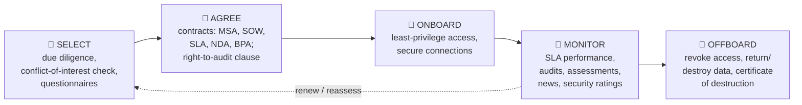

# Chapter 45 — Third-Party Risk Management

**Level 4 · Advanced Knowledge** · *Exam objective 5.3*

---

## 🎯 Goal

By the end of this chapter you will be able to explain the processes for assessing and managing **third-party (vendor) risk**:
- **Vendor assessment:** penetration testing, right-to-audit clause, evidence of internal audits, independent assessments, supply chain analysis
- **Vendor selection:** due diligence, conflict of interest
- **Agreement types:** **SLA, MOA, MOU, MSA, WO/SOW, NDA, BPA**
- **Vendor monitoring**, **questionnaires**, **rules of engagement**

---

## 🏠 Real-Life Story: Hiring a Babysitter 👶

Before leaving your child with a babysitter, you:
- **Check references and background** (due diligence).
- Make sure they're not your ex-partner's best friend with a grudge (**conflict of interest**).
- **Agree the rules in writing**: hours, pay, "no visitors" (agreements).
- Maybe **turn up early once** to see how things are going (right to audit, monitoring).
- Ask them to **keep family matters private** (NDA).

Organizations hand over something even more valuable to vendors: their **data and systems**. **Your vendor's weakness becomes your weakness** (SolarWinds, Kaseya, Target's HVAC contractor: Chapter 23).

---

## 🖼️ Figure 45.1 — The Vendor Lifecycle



---

## 📖 Part 1 — Vendor Assessment 🔍

How do you find out whether a vendor is secure?

| Method | What it is | Strength |
|---|---|---|
| **Questionnaires** | A standard list of security questions the vendor answers (e.g., "Do you encrypt data at rest? Do you require MFA?"). Common templates: **SIG**, **CAIQ** (for cloud) | Cheap, broad, but **self-reported** (the vendor could overstate) |
| **Evidence of internal audits** | The vendor shares results of its **own** internal audits and remediation status | Shows maturity; still internal |
| **Independent assessments** | Reports from **independent third parties**: **SOC 2 Type II** reports, **ISO/IEC 27001 certification**, PCI DSS attestation (AOC), FedRAMP | ⭐ More trustworthy: someone independent checked |
| **Penetration testing** | You (or a hired firm) **test the vendor's systems**, or review the vendor's own recent pentest results, with permission and rules of engagement | Shows real exploitability |
| **Right-to-audit clause** | A **contract clause** allowing **you** to **audit the vendor's** controls (on-site or remote) | Ensures access to verify claims later |
| **Supply chain analysis** | Examining the **vendor's own suppliers** (fourth parties): where components and services come from, single points of failure, foreign-ownership or geopolitical risks, SBOMs for software | Finds hidden dependencies |

> 💡 **SOC 2 Type I vs Type II:** a **Type I** report checks that controls are **designed** properly **at a point in time**. A **Type II** report checks that controls **operated effectively over a period** (usually 6–12 months). **Type II is stronger.**

## 🖼️ Figure 45.2 — The Trust Ladder

```
   MORE ASSURANCE ▲   Your own audit / pentest (right-to-audit)
                  │   Independent assessment (SOC 2 Type II, ISO 27001 certificate)
                  │   Evidence of the vendor's internal audits
                  │   Questionnaire answers (self-reported)
   LESS ASSURANCE ▼   Marketing claims ("bank-grade security!")
```

---

## 📖 Part 2 — Vendor Selection 🤝

### Due Diligence
**Investigating a vendor thoroughly before signing**: financial stability (will they go bankrupt?), security posture (assessments above), compliance (do they meet GDPR/HIPAA/PCI?), reputation and breach history, data location (sovereignty), business continuity plans, and references.

### Conflict of Interest
A situation where someone's **personal interests could improperly influence** the decision. Example: the IT manager choosing a vendor owned by their brother-in-law. Must be **disclosed** and managed (another person decides).

> Remember (Chapter 22): **due diligence** = research before acting; **due care** = acting responsibly afterwards.

---

## 📖 Part 3 — Agreement Types ⭐⭐ (very commonly tested)

## 🖼️ Figure 45.3 — The Agreement Cheat Table

| Agreement | Full name | What it is | Binding? | Example |
|---|---|---|---|---|
| **SLA** | Service-Level Agreement | Defines **measurable service levels** (uptime, response/repair times) and **penalties** if missed | ✅ (usually part of a contract) | "99.9% uptime; critical tickets answered in 1 hour; service credits if missed" |
| **MOU** | Memorandum of Understanding | A **statement of intent** / mutual goals between parties; **informal** | ❌ Usually **not** legally binding | Two universities agree to "cooperate on research" |
| **MOA** | Memorandum of Agreement | **More formal** than an MOU: defines **specific responsibilities and terms** for working together | ⚠️ More formal than an MOU; may be binding depending on its terms | Two agencies agree who does what in a joint project |
| **MSA** | Master Service Agreement | The **umbrella contract** setting general terms (payment, liability, confidentiality, IP) for **all future work** | ✅ | Signed once with an IT consultancy |
| **WO / SOW** | Work Order / Statement of Work | **Specific project details** under the MSA: tasks, **deliverables, timelines, costs** | ✅ | "Pentest of 3 web apps, report by 30 June, $25,000" |
| **NDA** | Non-Disclosure Agreement | Promise to **keep confidential information secret** | ✅ | Before sharing network diagrams with a vendor |
| **BPA** | Business Partners Agreement | Defines a **business partnership**: each partner's responsibilities, **profit/loss sharing**, decision-making, ownership | ✅ | Two companies jointly selling a product |

## 🖼️ Figure 45.4 — How the Documents Fit Together

```
                       ┌──────────────────────────────────┐
                       │  MSA (master terms, signed once) │
                       └──────────────┬───────────────────┘
               ┌──────────────────────┼───────────────────────┐
               ▼                      ▼                       ▼
        ┌─────────────┐        ┌─────────────┐         ┌─────────────┐
        │ SOW / WO #1 │        │ SOW / WO #2 │         │ SOW / WO #3 │   specific projects
        │ (pentest)   │        │ (SOC setup) │         │ (training)  │
        └─────────────┘        └─────────────┘         └─────────────┘
        + SLA (service levels for ongoing services)   + NDA (confidentiality)

   Informal → formal:  MOU (intent)  →  MOA (agreed responsibilities)  →  contracts (MSA/SOW/SLA)
```

> 🧠 **MOU vs MOA:** **U**nderstanding = "we **U**nderstand each other" (intent, informal). **A**greement = "we **A**gree on who does what" (more formal).

---

## 📖 Part 4 — Vendor Monitoring 📡

Assessment isn't one-and-done. Vendors change, get breached, or slip on quality.
- Track **SLA performance** (uptime, response times).
- **Periodic reassessments** (annual questionnaires, new SOC 2 reports).
- Monitor **news, breach notifications, security ratings** services, and financial health.
- Review the vendor's **access logs** to your systems; remove unused access.
- **Contract clauses:** breach notification within X hours, right to audit, data return/destruction at contract end.

---

## 📖 Part 5 — Rules of Engagement 📜

**Rules of engagement (RoE)** = the agreed **rules for a security test or engagement**, especially when testing a vendor or hiring a vendor to test you:
- **Scope:** which systems/IPs/apps are in and **out** of bounds
- **Timing:** dates and hours testing is allowed
- **Methods allowed/forbidden:** e.g., no denial-of-service, no social engineering of the CEO
- **Contacts and escalation:** who to call if something breaks or a real breach is found
- **Data handling:** how findings and any accessed data are protected
- **Authorization:** **written permission** from someone with authority (the "get out of jail free" letter)

(More on pen testing in Chapter 47.)

---

## 🧠 Memory Tricks

- **Assessment toolkit: "Q-E-I-P-R-S"**: Questionnaires, Evidence of internal audits, Independent assessments, Pentests, Right-to-audit, Supply chain analysis.
- **SLA = the Service Level (numbers + penalties).**
- **MOU = Understanding (intent, not binding). MOA = Agreement (more formal).**
- **MSA = the Master umbrella. SOW = the specific Slice of Work under it.**
- **NDA = No Disclosure Allowed. BPA = Business Partners share profit and responsibility.**
- **SOC 2 Type II = over Time (stronger) vs Type I = one point In time.**

---

## ⚠️ Exam Tip

- *"Which agreement defines 99.99% uptime and service credits for outages?"* → **SLA.**
- *"Two organizations document their intent to cooperate, without legally binding terms."* → **MOU.**
- *"An umbrella contract defining terms for all future projects with a consultant."* → **MSA.**
- *"A document listing deliverables and deadlines for one specific project."* → **SOW/WO.**
- *"A contract clause letting the company inspect the vendor's security controls."* → **Right-to-audit clause.**
- *"Which provides the MOST independent assurance of a cloud vendor's controls over time?"* → **SOC 2 Type II** (independent assessment).
- *"The IT manager's relative owns one of the bidding vendors."* → **Conflict of interest.**
- *"Reviewing where a vendor's hardware components are manufactured."* → **Supply chain analysis.**

---

## 🧪 Try It (20 minutes)

1. **Read a real trust page:** visit the "trust center" or security page of a big SaaS provider (Microsoft, Google Cloud, Salesforce, Atlassian). Which certifications/reports (SOC 2, ISO 27001) do they list?
2. **Write a mini questionnaire:** 10 questions you'd send a vendor that will store your customer data (encryption, MFA, backups, breach notification, data location, subcontractors…).
3. **Match the agreement:** for a company hiring a cloud backup service, list which agreements you'd sign (MSA, SLA, NDA, maybe SOW) and one key clause in each.

---

## ✅ Checkpoint Questions

1. Why is third-party risk part of your own risk?
2. Name six vendor assessment methods.
3. Why are questionnaires alone not enough?
4. What's the difference between SOC 2 Type I and Type II?
5. What is a right-to-audit clause?
6. What does due diligence in vendor selection include?
7. Give an example of a conflict of interest.
8. Explain SLA, MOU, MOA, MSA, SOW, NDA and BPA in a few words each.
9. Name three things to monitor after onboarding a vendor.
10. What are rules of engagement?

<details>
<summary><b>Show answers</b></summary>

1. Vendors often have **access to your systems or data**. A breach at the vendor can directly expose you (supply-chain attacks), and **you remain accountable**.
2. **Questionnaires, evidence of internal audits, independent assessments, penetration testing, right-to-audit clause, supply chain analysis.**
3. They're **self-reported**: answers may be inaccurate or optimistic and need **independent verification**.
4. **Type I** = controls are **designed** properly at a **point in time**. **Type II** = controls **operated effectively over a period**. Type II is stronger.
5. A **contract clause giving the customer the right to audit** the vendor's controls and compliance.
6. Investigating the vendor's **security posture, financial stability, compliance, reputation/breach history, data location, BC/DR plans and references** before signing.
7. E.g., an employee choosing a vendor owned by a **family member or friend**, or one that pays them personally.
8. **SLA:** measurable service levels + penalties. **MOU:** non-binding statement of intent. **MOA:** more formal agreement of responsibilities. **MSA:** umbrella terms for future work. **SOW/WO:** specific project tasks/deliverables. **NDA:** confidentiality. **BPA:** partnership responsibilities and profit sharing.
9. E.g., **SLA performance, periodic reassessments (new SOC 2 reports), breach news/security ratings, financial health, the vendor's access to your systems.**
10. The agreed **scope, timing, permitted methods, contacts and authorization** for a security test or engagement.

</details>

---

## 📌 Chapter Summary

| Area | Key points |
|---|---|
| Assessment | Questionnaires, internal audit evidence, **independent assessments (SOC 2 Type II, ISO 27001)**, pentests, **right-to-audit**, supply chain analysis |
| Selection | **Due diligence**, **conflict of interest** |
| Agreements | **SLA** (service levels), **MOU** (intent), **MOA** (formal responsibilities), **MSA** (umbrella), **SOW/WO** (project), **NDA** (confidentiality), **BPA** (partnership) |
| Ongoing | Vendor monitoring, reassessment, offboarding |
| Testing | Rules of engagement: scope, timing, methods, contacts, written authorization |

**Next chapter →** *Chapter 46: Compliance & Privacy.* What happens when the rules aren't followed, and what rights do people have over their personal data?
