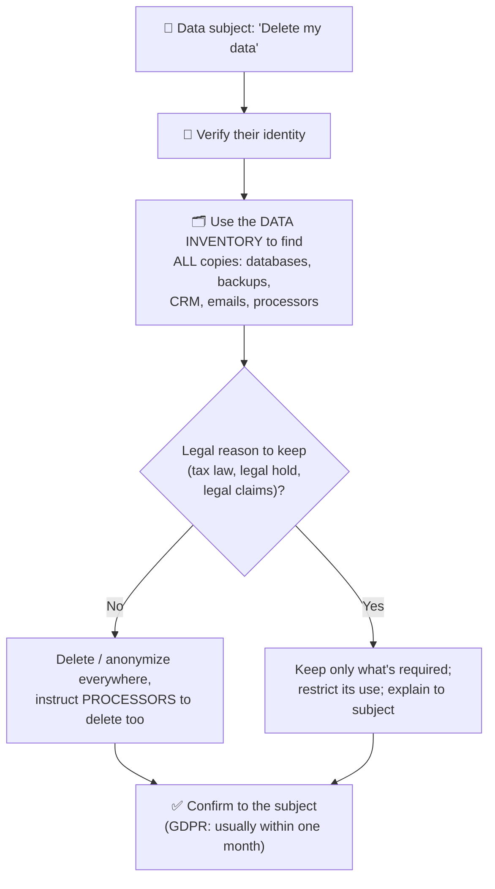

# Chapter 46 — Security Compliance & Privacy

**Level 4 · Advanced Knowledge** · *Exam objective 5.4*

---

## 🎯 Goal

By the end of this chapter you will be able to summarize the elements of effective security compliance:
- **Compliance reporting:** internal, external
- **Consequences of non-compliance:** fines, sanctions, reputational damage, loss of license, contractual impacts
- **Compliance monitoring:** due diligence/care, attestation and acknowledgement, internal and external, automation
- **Privacy:** legal implications (local/regional, national, global), **data subject**, **controller vs processor**, **ownership**, **data inventory and retention**, **right to be forgotten**

---

## 🏠 Real-Life Story: The Restaurant Health Inspection 🍽️

A restaurant must follow food-safety laws. It:
- keeps **temperature logs** every day (**internal reporting** and **monitoring**),
- gets **visited by inspectors** who publish a hygiene rating (**external reporting**),
- makes every new cook **sign** that they've read the hygiene rules (**acknowledgement**),
- and uses **smart fridges** that alert automatically if they get too warm (**automation**).

If it fails: **fines**, being **closed down** (loss of license), **bad reviews** (reputational damage), and suppliers or delivery apps **cancelling contracts**.

**Compliance** = meeting the requirements of laws, regulations, standards and contracts, **and being able to prove it**.

---

## 📖 Part 1 — Compliance Reporting 📋

| Type | To whom | Examples |
|---|---|---|
| **Internal** | **Inside** the organization: management, the board, the audit committee | Monthly compliance dashboards, internal audit results, policy-exception reports |
| **External** | **Outside**: regulators, customers, partners, card brands, the public | Breach notifications to regulators (e.g., GDPR: within **72 hours**), PCI DSS **Report on Compliance (ROC)** / **Attestation of Compliance (AOC)**, SOX financial control reports, SOC 2 reports to customers |

---

## 📖 Part 2 — Consequences of Non-Compliance ⚠️

## 🖼️ Figure 46.1 — What Can Happen

```
                         ┌──────────────────────────┐
                         │      NON-COMPLIANCE      │
                         └────────────┬─────────────┘
       ┌───────────────┬──────────────┼───────────────┬──────────────────┐
       ▼               ▼              ▼               ▼                  ▼
   FINES           SANCTIONS     REPUTATIONAL     LOSS OF LICENSE   CONTRACTUAL
   money penalties  legal/regulatory DAMAGE        no longer allowed  IMPACTS
   (e.g., GDPR up   actions: orders, customers     to operate or      partners end
   to €20M or 4% of restrictions,    lose trust,   process cards      contracts,
   global annual    criminal charges share price                      penalties,
   turnover)        for individuals  drops                            lost deals
```

| Consequence | Meaning | Example |
|---|---|---|
| **Fines** | Monetary penalties from regulators | Large GDPR fines for unlawful data processing |
| **Sanctions** | Formal penalties/restrictions: bans on processing, orders to change practices, even **criminal** penalties for individuals | A regulator orders a company to stop processing certain data |
| **Reputational damage** | Loss of **trust** from customers, partners and investors | Customers leave after a publicized breach |
| **Loss of license** | Losing the **right to operate** or to perform an activity | Losing the ability to process card payments (PCI) or a banking license |
| **Contractual impacts** | Breaching contract terms with customers/partners | Contract termination, penalties, failing a customer's security requirements |

---

## 📖 Part 3 — Compliance Monitoring 🔭

| Element | Meaning |
|---|---|
| **Due diligence** | **Investigating and understanding** compliance requirements and risks (doing your homework) |
| **Due care** | **Taking reasonable actions** to meet them (actually implementing and maintaining the controls) |
| **Attestation** | A **formal statement** (often signed) that something is true or compliant, e.g., management attesting that controls are effective (SOX), or an auditor's attestation report |
| **Acknowledgement** | Individuals **confirming** they have **received, read and understood** a policy (e.g., signing the AUP each year) |
| **Internal monitoring** | The organization **checks itself**: internal audits, self-assessments, compliance team reviews |
| **External monitoring** | **Outsiders** check: regulators, external auditors, customers' assessments |
| **Automation** | Tools continuously check compliance: configuration scanners (SCAP), cloud posture management, GRC platforms with dashboards, automated evidence collection |

> 🧠 **Diligence = Discover what's required. Care = Carry it out.**

---

## 📖 Part 4 — Privacy 🔐

**Privacy** = individuals' rights to control how their **personal data** is collected, used, shared and kept. Security protects data; **privacy** decides whether it **should be used at all**, and how.

### Legal Implications at Every Level

| Level | Examples |
|---|---|
| **Local / regional** | US state laws (California **CCPA/CPRA**, other state privacy laws), state breach-notification laws |
| **National** | HIPAA, GLBA (USA); India's **DPDP Act 2023**; Canada's **PIPEDA**; Brazil's **LGPD** |
| **Global** | **GDPR** (applies to organizations **anywhere** that process EU residents' data); cross-border transfer rules |

### Key Privacy Roles

## 🖼️ Figure 46.2 — Subject, Controller, Processor

```
        👤 DATA SUBJECT                    🏢 DATA CONTROLLER                ☁️ DATA PROCESSOR
   the person the data is about  ──►   decides WHY & HOW the data      ──►  processes it ON BEHALF
   (customer, patient, employee)       is processed (e.g., an online        of the controller
                                       shop)                                 (e.g., its cloud email
   HAS RIGHTS: access, correction,     ACCOUNTABLE: lawful basis,            or payment provider)
   deletion, portability, objection    security, honoring rights,           FOLLOWS the controller's
                                       breach notification                   instructions; must
                                                                             secure the data
```

| Term | Meaning |
|---|---|
| **Data subject** | The **identifiable person** the personal data is about |
| **Controller** | Determines the **purposes and means** of processing; carries primary legal responsibility |
| **Processor** | Processes data **for** the controller, under a contract (often a **Data Processing Agreement, DPA**) |
| **Ownership** | Which party **owns** the data and holds rights to it. In privacy terms, the data **subject** has rights over their personal data, while the organization's **data owner** is accountable for managing it (Chapter 43) |

### Data Inventory and Retention 🗂️
- **Data inventory (data map):** knowing **what personal data you hold, where it is, why you have it, who can access it and who you share it with**. You can't protect, delete or report on data you can't find.
- **Retention:** keep personal data **only as long as necessary** for its purpose or legal requirement, then **securely delete** it (GDPR's "storage limitation"). Balance against legal holds and legal minimum retention periods.

### The Right to Be Forgotten 🧽
Under **GDPR (Article 17, "right to erasure")**, a data subject can ask an organization to **delete their personal data** when, for example, it's no longer needed, consent is withdrawn, or it was processed unlawfully, **subject to exceptions** (legal obligations, public interest, legal claims, freedom of expression).

## 🖼️ Figure 46.3 — Handling an Erasure Request



### Other GDPR Points Worth Knowing
- **Lawful basis** is needed for processing (consent, contract, legal obligation, vital interests, public task, legitimate interests).
- Other rights: **access**, **rectification**, **portability**, **restriction**, **objection**.
- **Breach notification** to the supervisory authority within **72 hours** of becoming aware (where there's a risk to individuals).
- **Data Protection Officer (DPO)** required for some organizations.
- **Privacy by design and by default.**
- Fines up to **€20 million or 4% of worldwide annual turnover**, whichever is higher.

---

## 🧠 Memory Tricks

- **Consequences: "Five Scary Results Lose Contracts"**: Fines, Sanctions, Reputational damage, Loss of license, Contractual impacts.
- **Attestation = "I swear it's true" (formal statement). Acknowledgement = "I've read it."**
- **Subject = the person. Controller = decides. Processor = does it for them.**
- **Right to be forgotten = the right to erasure: "delete me," with exceptions.**
- **GDPR numbers: 72 hours (breach), 4% / €20M (fines), about one month (respond to requests).**

---

## ⚠️ Exam Tip

- *"Employees must sign that they've read the updated AUP."* → **Acknowledgement.**
- *"The CFO signs a statement that financial controls are effective."* → **Attestation** (SOX).
- *"A cloud provider stores customer data on behalf of a retailer."* → The provider is the **processor**; the retailer is the **controller**.
- *"A customer asks a company to delete all their personal data."* → **Right to be forgotten / right to erasure.**
- *"Which is needed FIRST to respond to deletion requests efficiently?"* → A **data inventory.**
- *"A company loses its ability to process card payments."* → **Loss of license** (consequence of PCI non-compliance).
- *"Compliance checks run continuously via a GRC platform."* → **Automation** (compliance monitoring).

---

## 🧪 Try It (20 minutes)

1. **Exercise a privacy right:** in your Google or Microsoft account, use "Download your data" (Google Takeout). That's the **right of access/portability** in action.
2. **Read a privacy policy:** open the privacy policy of an app you use. Find: what data it collects, its lawful basis, retention period, who it shares with (processors), and how to request deletion.
3. **Map your data:** make a mini data inventory for a pretend small business: list each type of personal data (customer emails, card payments, employee records), where it's stored, who processes it, and how long you'll keep it.

---

## ✅ Checkpoint Questions

1. What's the difference between internal and external compliance reporting?
2. Name the five consequences of non-compliance in SY0-701.
3. What's the difference between due diligence and due care?
4. What's the difference between attestation and acknowledgement?
5. Give one example of automation in compliance monitoring.
6. Who is the data subject, the controller and the processor in this example: "A gym uses a cloud booking app to store members' details"?
7. Why is a data inventory essential for privacy?
8. What is the right to be forgotten, and does it always apply?
9. Within how many hours must a GDPR breach be reported to the supervisory authority?
10. What's the maximum GDPR fine?

<details>
<summary><b>Show answers</b></summary>

1. **Internal** reporting goes to management/board/audit committee. **External** reporting goes to regulators, customers, partners or the public.
2. **Fines, sanctions, reputational damage, loss of license, contractual impacts.**
3. **Due diligence** = investigating and understanding requirements/risks. **Due care** = taking reasonable actions to meet them.
4. **Attestation** = a **formal statement/declaration** that something is true or compliant. **Acknowledgement** = an individual **confirming they've received and understood** a policy.
5. E.g., **automated configuration scanning (SCAP), cloud security posture management, GRC dashboards with automatic evidence collection.**
6. **Data subjects** = the members. **Controller** = the gym. **Processor** = the cloud booking app provider.
7. You must **know what personal data you have, where it is and who processes it** to protect it, apply retention, answer access/deletion requests and report breaches.
8. A data subject's **right to have their personal data erased** (GDPR Art. 17). **No:** exceptions apply (legal obligations, legal claims, public interest, etc.).
9. **72 hours** (from becoming aware, where there's risk to individuals).
10. **€20 million or 4% of worldwide annual turnover**, whichever is higher.

</details>

---

## 📌 Chapter Summary

| Area | Key points |
|---|---|
| Reporting | Internal (management, board) vs external (regulators, customers) |
| Consequences | Fines, sanctions, reputational damage, loss of license, contractual impacts |
| Monitoring | Due diligence/care, attestation & acknowledgement, internal & external, automation |
| Privacy law levels | Local/regional (CCPA), national (HIPAA, DPDP), global (GDPR) |
| Roles | Data subject, controller, processor; ownership |
| Data handling | Inventory + retention; right to be forgotten (with exceptions) |

**Next chapter →** *Chapter 47: Audits, Assessments & Penetration Testing.* How do organizations **prove** their security works? Audits, attestations and ethical hacking.
