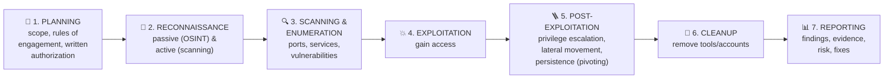

# Chapter 47 — Audits, Assessments & Penetration Testing

**Level 4 · Advanced Knowledge** · *Exam objective 5.5*

---

## 🎯 Goal

By the end of this chapter you will be able to explain the types and purposes of audits and assessments:
- **Attestation**
- **Internal:** compliance, audit committee, self-assessments
- **External:** regulatory, examinations, assessment, independent third-party audit
- **Penetration testing:** physical, offensive, defensive, integrated; **known**, **partially known** and **unknown** environments; **reconnaissance** (passive, active)

---

## 🏠 Real-Life Story: Checking a School's Safety 🏫

How do you know a school is safe?
- The **head teacher checks** the fire doors every month (**self-assessment**).
- The **school's governors' committee** reviews the safety reports (**audit committee**).
- **Government inspectors** visit and publish a report (**regulatory examination**).
- An **independent safety firm** certifies the building (**third-party audit**), and the head **signs a statement** that the school meets the rules (**attestation**).
- And to test whether strangers can get in, the school hires someone to **try to sneak in** with permission (a **physical penetration test**).

---

## 📖 Part 1 — Audits vs Assessments 📋

| | **Audit** | **Assessment** |
|---|---|---|
| Purpose | **Verify compliance** against a defined standard, law or policy | **Evaluate** security posture, find weaknesses, give recommendations |
| Style | Formal, evidence-based, pass/fail findings | Broader, advisory |
| Example | PCI DSS audit, SOX audit | Risk assessment, vulnerability assessment, gap analysis |

### Attestation ✍️
A **formal, written declaration** by a qualified party that something is true. For example:
- An **auditor's attestation report** (e.g., a **SOC 2** report states the auditor's opinion on the controls).
- **Management attestation** (e.g., executives attesting under **SOX** that financial controls are effective).
- PCI DSS **Attestation of Compliance (AOC)**.

---

## 📖 Part 2 — Internal Audits & Assessments 🏠

| Type | Meaning |
|---|---|
| **Compliance** (internal) | The organization's own team checks that it meets **laws, regulations and internal policies** before outsiders do |
| **Audit committee** | A **board-level committee** (usually independent directors) that **oversees** internal and external audits, financial reporting and controls. Internal audit reports to it, protecting auditors' **independence** from the managers they audit |
| **Self-assessments** | Teams **evaluate their own** controls (checklists, questionnaires, control self-assessments). Cheap and frequent, but **less independent** |

---

## 📖 Part 3 — External Audits & Assessments 🏛️

| Type | Meaning | Example |
|---|---|---|
| **Regulatory** | Audits **required or performed by regulators** | Health regulator auditing HIPAA compliance; financial regulator reviewing a bank |
| **Examinations** | Formal **reviews/inspections** by an external authority (common in banking and government) | Bank examiners reviewing IT controls |
| **Assessment** (external) | An outside firm **evaluates** security posture (often against a framework) and gives recommendations | NIST CSF maturity assessment by a consultancy |
| **Independent third-party audit** | An **independent, qualified auditor** (no conflict of interest) formally audits and certifies/attests | **SOC 2 Type II**, **ISO/IEC 27001 certification**, PCI DSS QSA audit |

## 🖼️ Figure 47.1 — Independence Ladder

```
   MOST INDEPENDENT ▲   Regulatory examination / independent third-party audit
                    │   External assessment by a consultancy
                    │   Internal audit (reports to the AUDIT COMMITTEE, not to IT)
                    │   Compliance team review
   LEAST INDEPENDENT▼   Self-assessment by the team that runs the controls
```

---

## 📖 Part 4 — Penetration Testing 🥷

A **penetration test (pentest)** = an **authorized, simulated attack** to find and **exploit** vulnerabilities, demonstrating **real impact**. Unlike a vulnerability scan (which lists *possible* holes), a pentest **proves** what an attacker could achieve.

### Pentest Phases

## 🖼️ Figure 47.2 — Phases of a Penetration Test



### Reconnaissance: Passive vs Active 🔭

| | **Passive reconnaissance** | **Active reconnaissance** |
|---|---|---|
| Meaning | Gathering info **without directly interacting** with the target's systems | **Directly interacting** with the target's systems |
| Detectable? | Very hard to detect | **Can be detected** (logs, IDS alerts) |
| Examples | **OSINT**: company website, LinkedIn staff lists, job ads (revealing technologies), DNS records via public tools, WHOIS, social media, Google searches, breach data, Shodan | **Port scans (Nmap)**, vulnerability scans, banner grabbing, ping sweeps, calling the help desk |

### Knowledge of the Environment (SY0-701 terms)

| SY0-701 term | Old name | Tester knows… | Simulates |
|---|---|---|---|
| **Known environment** | White box | **Everything**: network diagrams, source code, credentials | A thorough review / insider with full knowledge; most efficient coverage |
| **Partially known environment** | Gray box | **Some** information (e.g., a user account, some IP ranges) | An insider or an attacker who has done some research |
| **Unknown environment** | Black box | **Nothing** except the target name | A real external attacker; most realistic, but slower and may miss things |

## 🖼️ Figure 47.3 — How Much Does the Tester Know?

```
   UNKNOWN (black box)        PARTIALLY KNOWN (gray box)     KNOWN (white box)
   ┌──────────────────┐       ┌──────────────────┐           ┌──────────────────┐
   │ ████████████████ │       │ ████████░░░░░░░░ │           │ ░░░░░░░░░░░░░░░░ │
   │ ████████████████ │       │ ████████░░░░░░░░ │           │ ░░░░░░░░░░░░░░░░ │
   └──────────────────┘       └──────────────────┘           └──────────────────┘
   knows nothing:              some info: accounts,           full info: diagrams,
   most realistic outsider     IP ranges                      code, credentials
```

### Types of Penetration Testing (SY0-701)

| Type | Meaning |
|---|---|
| **Physical** | Testing **physical security**: tailgating, lock picking, badge cloning, getting into the server room, dropping USB sticks |
| **Offensive** | The **attacking** side: actively trying to break in (**red team**) |
| **Defensive** | Focus on the **defenders' detection and response** (**blue team**): do they notice and stop the test attack? |
| **Integrated** | **Offensive and defensive working together** (**purple team**), sharing findings in real time to improve detections quickly |

### Rules of Engagement (again!) 📜
Before any pentest: written **authorization**, **scope** (in/out), **timing**, allowed/forbidden **methods** (e.g., no DoS), **emergency contacts**, **data handling**, and **reporting** expectations (Chapter 45). Testing without permission is a crime.

### Related Exercises
- **Bug bounty** (Chapter 36): crowd-sourced, continuous testing by independent researchers.
- **Red team exercise:** a long, stealthy, goal-based attack simulation (e.g., "steal the CEO's email"), often testing people, processes and technology together.

---

## 🧠 Memory Tricks

- **Attestation = a signed "this is true."**
- **Audit committee = the board's watchdog over the auditors.**
- **Internal: Compliance, Committee, Self. External: Regulatory, Examinations, Assessment, Independent third party.**
- **Known = white (see everything). Unknown = black (see nothing). Partially known = gray.**
- **Passive recon = looking through the window from the street. Active recon = knocking on the doors.**
- **Offensive = red. Defensive = blue. Integrated = purple (red + blue).**

---

## ⚠️ Exam Tip

- *"A tester is given network diagrams and source code before testing."* → **Known environment.**
- *"A tester is given only the company name."* → **Unknown environment.**
- *"Searching LinkedIn and job postings to learn the target's technologies."* → **Passive reconnaissance** (OSINT).
- *"Running Nmap against the target's IP range."* → **Active reconnaissance.**
- *"Red and blue teams work together during the exercise, sharing results."* → **Integrated** (purple team).
- *"A tester tries to tailgate into the data center."* → **Physical** penetration test.
- *"Which group oversees the internal audit function independently of management?"* → **Audit committee.**
- *"An independent auditor issues a SOC 2 Type II report."* → **Independent third-party audit** (attestation).

---

## 🧪 Try It (25 minutes)

1. **Passive recon on yourself:** search your own name, email and username on Google and social media. What could an attacker learn? Tighten your privacy settings.
2. **OSINT on a company (legally):** pick a large company and, using only public sources, list: its email format (from public staff emails), technologies mentioned in job ads, and its DNS/mail providers (`nslookup -type=MX company.com`). That's passive recon. Don't touch their systems!
3. **Active recon in your lab only:** `nmap -sV` your lab VM and compare how much more you learn than from passive recon.
4. **Write rules of engagement** for testing your lab: scope (which VM IPs), time window, forbidden actions, and how you'll report findings.

---

## ✅ Checkpoint Questions

1. What's the difference between an audit and an assessment?
2. What is attestation? Give two examples.
3. What role does the audit committee play?
4. Name three types of external audits/assessments.
5. Why are independent third-party audits trusted more than self-assessments?
6. List the phases of a penetration test.
7. What's the difference between passive and active reconnaissance? Give an example of each.
8. Compare known, partially known and unknown environment tests.
9. What do offensive, defensive and integrated testing mean?
10. Why must a pentest have written authorization and rules of engagement?

<details>
<summary><b>Show answers</b></summary>

1. An **audit** formally **verifies compliance** against a defined standard (evidence-based findings). An **assessment** **evaluates** security posture more broadly and gives recommendations.
2. A **formal written declaration** that something is true/compliant. E.g., an auditor's **SOC 2 report**, **management attestation under SOX**, a PCI **Attestation of Compliance**.
3. A **board-level committee that oversees audits** (internal and external), financial reporting and controls, keeping auditors **independent** of management.
4. Any three of: **regulatory audits, examinations, external assessments, independent third-party audits.**
5. The auditor has **no stake in the outcome** (independence) and follows formal standards, so results are more objective.
6. **Planning (scope/RoE/authorization) → reconnaissance → scanning/enumeration → exploitation → post-exploitation (escalation, lateral movement, persistence) → cleanup → reporting.**
7. **Passive:** no direct interaction with target systems (OSINT, e.g., LinkedIn, WHOIS). **Active:** direct interaction (e.g., port scanning with Nmap).
8. **Known:** full information (white box). **Partially known:** some information (gray box). **Unknown:** no information (black box, most realistic outsider view).
9. **Offensive:** attacking (red team). **Defensive:** testing detection and response (blue team). **Integrated:** both working together (purple team).
10. Without permission, testing is **illegal unauthorized access**. RoE define **scope, timing, methods and contacts** to avoid damage, legal problems and misunderstandings.

</details>

---

## 📌 Chapter Summary

| Area | Key points |
|---|---|
| Attestation | Formal written declaration (SOC 2 report, SOX, PCI AOC) |
| Internal | Compliance reviews, audit committee oversight, self-assessments |
| External | Regulatory, examinations, assessments, independent third-party audits |
| Pentest types | Physical, offensive (red), defensive (blue), integrated (purple) |
| Environments | Known (white), partially known (gray), unknown (black) |
| Recon | Passive (OSINT, undetectable) vs active (scanning, detectable) |
| Must-haves | Written authorization + rules of engagement |

**Next chapter →** *Chapter 48: Security Awareness Programs.* The last Domain 5 objective: turning every employee into a sensor and a defender.
