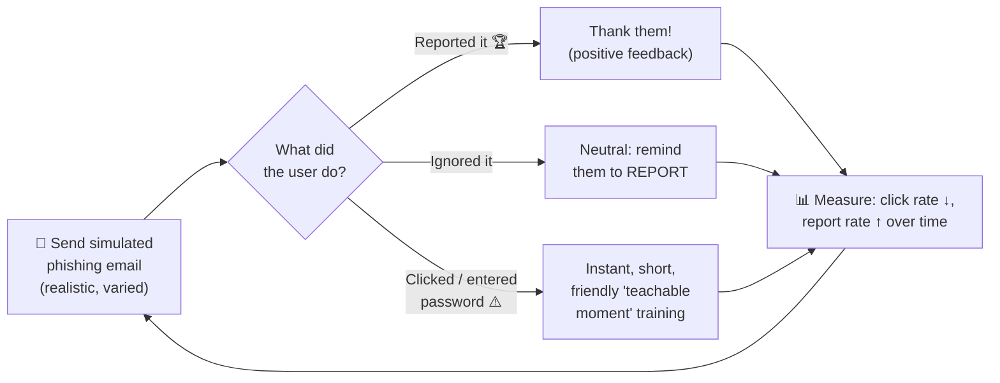

# Chapter 48 — Security Awareness Programs

**Level 4 · Advanced Knowledge** · *Exam objective 5.6*

---

## 🎯 Goal

This objective says "Given a scenario, **implement** security awareness practices." By the end of this chapter you will be able to design and run a security awareness program:
- **Phishing:** campaigns, recognizing a phishing attempt, responding to reported suspicious messages
- **Anomalous behavior recognition:** risky, unexpected, unintentional
- **User guidance and training:** policy/handbooks, situational awareness, insider threat, password management, removable media and cables, social engineering, operational security, hybrid/remote work environments
- **Reporting and monitoring:** initial, recurring
- **Development** and **execution**

---

## 🏠 Real-Life Story: Teaching Kids to Cross the Road 🚸

You don't teach road safety with one lecture on the first day of school. You:
- **explain the rules** ("stop, look, listen"),
- **practise** at real crossings,
- **remind** them often, especially when something changes (a new busy road),
- **praise** them when they get it right,
- and **check** how they're doing.

Security awareness is the same. A once-a-year slideshow doesn't work. **Frequent, practical, positive training** turns people from the **weakest link** into the **first line of defense** (and into human sensors who **report** problems early).

---

## 📖 Part 1 — Phishing Awareness 🎣

### Phishing Campaigns (Simulations)
The security team sends **realistic fake phishing emails** to employees to **measure** and **train**.

## 🖼️ Figure 48.1 — A Phishing Simulation Cycle



> 💡 **Measure the report rate, not just the click rate.** A rising report rate means people are actively defending the company. **Don't punish clickers**: shame makes people hide mistakes instead of reporting them.

### Recognizing a Phishing Attempt 🚩
Teach the red flags from Chapter 15:
- **Urgency, threats, rewards** ("Act within 1 hour!", "You've won!")
- **Look-alike sender domains** (`micros0ft-support.com`), mismatched reply-to
- **Links whose real address differs** from the displayed text (hover to check)
- **Unexpected attachments**, especially macros, `.zip`, `.iso`, `.html`
- Requests for **credentials, payments, gift cards, MFA codes**
- **Unusual requests** from executives (BEC), changes to bank details
- Generic greetings, odd tone, spelling mistakes (but AI-written phishing can be flawless!)

### Responding to Reported Suspicious Messages 📨
Make reporting **easy** (a **"Report Phish" button**) and handle reports **quickly**:
1. **Acknowledge** the reporter (thank them).
2. **Analyze** the message (headers, links, attachments in a sandbox).
3. If malicious: **remove it from all mailboxes**, **block** sender/URLs, check whether **anyone clicked**, reset credentials, and contain affected devices (often an automated playbook, Chapter 40).
4. **Feed back** to the reporter and use real examples in future training.

---

## 📖 Part 2 — Anomalous Behavior Recognition 👀

Employees (and managers) should recognize and report behavior that's out of the ordinary, whether by **colleagues**, **systems** or **themselves**.

| Type | Meaning | Examples |
|---|---|---|
| **Risky** | Behavior that **knowingly increases risk**, often to save time | Disabling antivirus, sharing passwords, using personal cloud storage for work files (shadow IT), plugging in unknown USB drives |
| **Unexpected** | Behavior that's **unusual** compared with normal patterns, which may indicate compromise or an insider | A colleague accessing files unrelated to their job, working odd hours suddenly, copying large amounts of data, a system behaving strangely (pop-ups, slowness) |
| **Unintentional** | **Honest mistakes** with security consequences | Emailing data to the wrong person, misconfiguring a share, losing a laptop, falling for a phish |

> 🔐 The response should fit the type: **unintentional** → support and training; **risky** → policy enforcement and coaching; **unexpected** → **report** to security for investigation (it may be an attacker using someone's account, or an insider threat).

---

## 📖 Part 3 — User Guidance & Training Topics 📚

## 🖼️ Figure 48.2 — The Training Curriculum (SY0-701 topics)

| Topic | What users should learn |
|---|---|
| **Policy / handbooks** | Where the policies are, what the **AUP** says, and the key rules in plain language; users **acknowledge** them |
| **Situational awareness** | Being alert to the **surroundings**: who's behind you at the door (tailgating), who can see your screen (shoulder surfing), what you discuss in public |
| **Insider threat** | Recognizing warning signs (unusual access, disgruntlement, policy violations) and **how to report concerns confidentially** |
| **Password management** | Long passphrases, **never reuse**, use the company **password manager**, **MFA** everywhere, never share passwords or MFA codes |
| **Removable media and cables** | Don't plug in **unknown USB drives or charging cables**; use only approved, encrypted drives; report found devices |
| **Social engineering** | Phishing, vishing, smishing, pretexting, impersonation, BEC: **verify through a second channel** |
| **Operational security (OPSEC)** | Protecting information that could help attackers: don't post badge photos, travel plans, internal project names or office layouts on social media; watch what you discuss in public |
| **Hybrid / remote work environments** | Secure home Wi-Fi (WPA3, changed router password), **VPN** use, screen locks, no family use of work devices, privacy in public places and video calls, physical security of devices at home and while travelling |

---

## 📖 Part 4 — Reporting & Monitoring 📊

| Type | Meaning | Example |
|---|---|---|
| **Initial** | A **baseline** measurement when the program starts (or for new hires) | First phishing simulation shows a 25% click rate; new-hire training completion |
| **Recurring** | **Regular, ongoing** measurement to track **trends** | Monthly simulations, quarterly reports to management: click rate down to 4%, report rate up to 60% |

Useful metrics: training **completion rates**, phishing **click** and **report rates**, **time-to-report**, number of real incidents reported by staff, policy acknowledgement rates, repeat clickers.

## 🖼️ Figure 48.3 — Progress Over a Year

```
   Phishing simulation results
   Month:        Jan    Mar    May    Jul    Sep    Nov
   Click rate:   25% ██████████████████████████
                        16% █████████████████
                               10% ███████████
                                      7% ████████
                                             5% ██████
                                                    4% █████
   Report rate:   8%    20%    35%    44%    52%    61%   ← the number that matters most
```

---

## 📖 Part 5 — Development & Execution 🛠️

### Development (building the program)
1. **Assess needs:** risks, past incidents, roles (finance staff need BEC training; developers need secure coding; executives need whaling awareness).
2. **Set goals and metrics** (e.g., "report rate above 50% by year end").
3. **Get management support** and budget.
4. **Create content:** short, engaging, **role-based**, in plain language, relevant to real threats (micro-learning, videos, games, posters).
5. **Plan the schedule:** onboarding, regular refreshers, simulations, special campaigns (e.g., Cybersecurity Awareness Month in October).

### Execution (running it)
- **Deliver** training regularly (not just once a year), **onboarding** for new staff, **just-in-time** lessons after a simulation click.
- Run **phishing campaigns** with increasing difficulty.
- **Communicate**: newsletters, intranet posts, stories of real (anonymized) incidents.
- **Measure** (initial + recurring), **report** to management, and **improve** the content.
- Build a **positive security culture**: reward reporting; "security champions" in each team.

## 🖼️ Figure 48.4 — The Awareness Program Lifecycle

```
        ┌──────────── DEVELOPMENT ─────────────┐     ┌──────────── EXECUTION ────────────┐
        │ assess needs → set goals → get       │ ──► │ deliver training → run phishing   │
        │ support → create role-based content  │     │ campaigns → communicate → measure │
        │ → plan schedule                      │     │ → report → improve                │
        └──────────────────────────────────────┘     └─────────────────┬─────────────────┘
                     ▲                                                 │
                     └──────────────── feedback & new threats ─────────┘
```

---

## 🧠 Memory Tricks

- **Phishing trio: Campaign (test), Recognize (spot), Respond (report & handle).**
- **Anomalous behavior: "Risky = knowingly, Unexpected = unusual, Unintentional = oops."**
- **Training topics: "Please Stay In Place, Remove Strange Objects, Home"**: Policy/handbooks, Situational awareness, Insider threat, Password management, Removable media & cables, Social engineering, OPSEC, Hybrid/remote work.
- **Reporting: Initial = baseline. Recurring = trend.**
- **Report rate up beats click rate down.**

---

## ⚠️ Exam Tip

- *"Which metric BEST shows that a phishing awareness program is building a security culture?"* → An increasing **report rate** (with a falling click rate).
- *"An employee keeps uploading work files to a personal cloud account to work from home."* → **Risky behavior** (shadow IT): coaching + policy enforcement.
- *"An employee accidentally emails a spreadsheet to the wrong customer."* → **Unintentional** behavior → report, contain, retrain.
- *"A colleague starts downloading large amounts of data unrelated to their role."* → **Unexpected** behavior → report (possible **insider threat**).
- *"Staff are advised not to post photos of their badges online."* → **Operational security (OPSEC).**
- *"The FIRST phishing simulation is run to measure current susceptibility."* → **Initial** reporting (baseline).
- *"Which training topic covers securing home routers and using the VPN?"* → **Hybrid/remote work environments.**

---

## 🧪 Try It (20 minutes)

1. **Design a 12-month awareness calendar** for a 100-person company: one topic per month from Figure 48.2, plus 4 phishing simulations of increasing difficulty.
2. **Write a 5-line "How to report phishing" guide** for employees: where to click, what happens next, and a thank-you message.
3. **OPSEC check on yourself:** look at your public social media. Is there anything (workplace badge, travel dates, home address clues, pet names used as passwords) an attacker could use?
4. **Free resources:** browse CISA's or your national cyber center's free awareness materials (posters, tip sheets) and pick one you'd use.

---

## ✅ Checkpoint Questions

1. What is a phishing campaign in an awareness program, and what should happen when someone clicks?
2. List five red flags of a phishing email.
3. What are the steps for responding to a reported suspicious message?
4. Define risky, unexpected and unintentional behavior, with an example of each.
5. Name the eight user guidance and training topics in SY0-701.
6. What is OPSEC? Give an example.
7. What should hybrid/remote work training cover?
8. What's the difference between initial and recurring reporting?
9. Which metrics show an awareness program is working?
10. What are the main steps in developing an awareness program?

<details>
<summary><b>Show answers</b></summary>

1. **Simulated phishing emails** sent to staff to measure and train. Clickers should get **immediate, short, friendly training** (a teachable moment), not punishment.
2. Any five of: **urgency/threats, look-alike domains, mismatched link addresses, unexpected attachments, requests for credentials/payments/MFA codes, unusual executive requests, generic greetings.**
3. **Acknowledge** the reporter → **analyze** the message → if malicious, **remove from all mailboxes, block** indicators, **check for clicks**, reset credentials/contain → **give feedback** and use it in training.
4. **Risky:** knowingly increasing risk (e.g., disabling antivirus). **Unexpected:** unusual behavior (e.g., accessing unrelated files at 3 am). **Unintentional:** honest mistakes (e.g., emailing data to the wrong person).
5. **Policy/handbooks, situational awareness, insider threat, password management, removable media and cables, social engineering, operational security, hybrid/remote work environments.**
6. **Operational security**: protecting information that could help attackers, e.g., **not posting badge photos, travel plans or internal project details** online.
7. **Secure home Wi-Fi/router, VPN use, screen locks, keeping work devices for work only, privacy in public spaces and on video calls, physical security of devices.**
8. **Initial** = a **baseline** measurement at the start. **Recurring** = **regular ongoing** measurement to track trends.
9. **Falling click rates, rising report rates, faster time-to-report, high training completion, more real incidents reported by staff.**
10. **Assess needs → set goals/metrics → get management support → create role-based content → plan the schedule** (then execute, measure and improve).

</details>

---

## 📌 Chapter Summary

| Area | Key points |
|---|---|
| Phishing | Campaigns (simulations), recognizing red flags, responding to reports quickly |
| Anomalous behavior | Risky, unexpected, unintentional |
| Training topics | Policy/handbooks, situational awareness, insider threat, passwords, removable media & cables, social engineering, OPSEC, hybrid/remote work |
| Reporting & monitoring | Initial (baseline) and recurring (trends); click rate ↓, report rate ↑ |
| Development & execution | Needs → goals → support → content → schedule → deliver → measure → improve |

---

## 🎓 Domain 5 Complete!

You've now covered **all five exam domains**. The remaining three chapters sharpen your skills for exam day: a **cryptography deep dive**, **PBQ mastery and memory drills**, and **full mock exams** with a final two-week plan.

**Next chapter →** *Chapter 49: Cryptography Deep Dive.*
