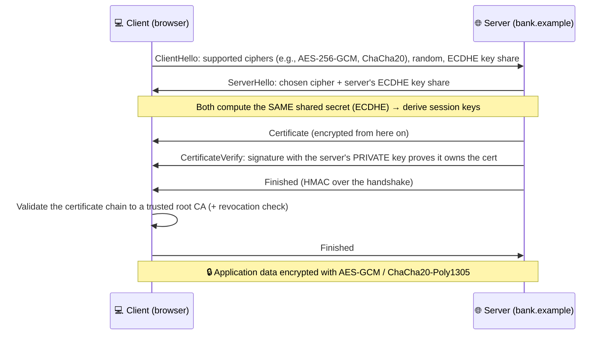

# Chapter 49 — Cryptography Deep Dive

**Level 4 · Advanced Knowledge** · *Deepens objectives 1.4, 2.3 and 2.4 (cryptographic)*

---

## 🎯 Goal

By the end of this chapter you will be able to pick the right algorithm for any scenario and explain how real systems use cryptography:
- **Algorithms:** AES, ChaCha20, 3DES/DES/RC4 (legacy), RSA, ECC, Diffie-Hellman/ECDHE, DSA/ECDSA/EdDSA
- **Hashing:** MD5, SHA-1, SHA-2, SHA-3; **HMAC**
- **Block vs stream ciphers**, **modes of operation** (ECB, CBC, CTR, GCM)
- **Key exchange**, **perfect forward secrecy**, the **TLS 1.3 handshake**
- **Key stretching**, **entropy**, **post-quantum cryptography**, and other modern ideas

---

## 🏠 Real-Life Story: Choosing the Right Lock 🔐

A locksmith doesn't put a bank-vault door on a garden shed, or a padlock on a bank vault. They choose the lock based on **what's being protected**, **how often it's opened**, and **who it must stop**. They also know which old lock designs are **easy to pick** and should never be sold again.

That's this chapter: knowing **which cryptographic "locks" are strong, which are broken, and which fits which job**.

---

## 📖 Part 1 — Symmetric Algorithms 🔑

### Block vs Stream Ciphers

## 🖼️ Figure 49.1 — Block vs Stream

```
   BLOCK CIPHER (e.g., AES)                       STREAM CIPHER (e.g., ChaCha20)
   encrypts FIXED-SIZE blocks (AES = 128 bits)    encrypts data BIT-BY-BIT / BYTE-BY-BYTE
                                                  by mixing it with a keystream
   [block 1][block 2][block 3][block 4]           data:      H  e  l  l  o
      │        │        │        │                keystream: 9f 2a 71 c4 0e   (from key+nonce)
      ▼        ▼        ▼        ▼                XOR ──────►  ciphertext bytes
   [ciph 1][ciph 2][ciph 3][ciph 4]
   ✔ very common, versatile                       ✔ fast, good for streaming & low-power devices
   (needs a MODE of operation)                    ✘ never reuse the same key + nonce!
```

### Symmetric Algorithm Table ⭐

| Algorithm | Type | Key size | Status | Notes |
|---|---|---|---|---|
| **AES** | Block (128-bit blocks) | **128 / 192 / 256** bits | ✅ **Standard** | The default choice for data at rest and in transit |
| **ChaCha20** (with Poly1305) | Stream | 256 bits | ✅ Strong | Fast on phones without AES hardware; used in TLS 1.3, WireGuard |
| **3DES** (Triple DES) | Block (64-bit) | 112/168 bits effective | ❌ **Deprecated** | Slow; NIST disallowed it for encryption after 2023 |
| **DES** | Block (64-bit) | **56** bits | ❌ **Broken** | Brute-forced in the 1990s |
| **RC4** | Stream | 40–2048 bits | ❌ **Broken** | Used by WEP and old TLS. Never use |
| **Blowfish / Twofish** | Block | Up to 448 / 256 bits | ⚠️ / ✅ | Blowfish is old (64-bit blocks); bcrypt is built from Blowfish |

### Modes of Operation (how block ciphers handle many blocks)

| Mode | How it works | Status |
|---|---|---|
| **ECB** (Electronic Codebook) | Each block encrypted **independently** with the same key → **identical plaintext blocks give identical ciphertext**, so **patterns leak** | ❌ **Insecure** |
| **CBC** (Cipher Block Chaining) | Each block is mixed (XOR) with the previous ciphertext block, starting with a random **IV** | ⚠️ OK if done right; no built-in integrity |
| **CTR** (Counter) | Turns a block cipher into a **stream** cipher using an incrementing counter | ✅ Fast, parallel |
| **GCM** (Galois/Counter Mode) | CTR **plus authentication**: **AEAD** (Authenticated Encryption with Associated Data) gives **confidentiality + integrity** in one step | ✅ **Preferred** (AES-GCM in TLS 1.2/1.3) |

## 🖼️ Figure 49.2 — Why ECB Is Bad (the famous "penguin")

```
   Original image          Encrypted with ECB            Encrypted with CBC/GCM
   ┌──────────────┐        ┌──────────────┐              ┌──────────────┐
   │    ▄███▄     │        │    ▒▓▓▓▒     │              │ ░▒▓█▒░▓▒█░▒▓ │
   │   █ ◉ ◉ █    │        │   ▓ ▒ ▒ ▓    │              │ ▓░█▒▓░▒█▓░▒░ │
   │   █  ▼  █    │  ──►   │   ▓  ▒  ▓    │              │ ▒█░▓▒█░▓▒▓█▒ │
   │    █████     │        │    ▓▓▓▓▓     │              │ █▒▓░▒▓█░▒░▓█ │
   └──────────────┘        └──────────────┘              └──────────────┘
                           the SHAPE is still visible!    random noise ✔
```

---

## 📖 Part 2 — Asymmetric Algorithms 🗝️

| Algorithm | Used for | Typical key size | Notes |
|---|---|---|---|
| **RSA** | Encryption, **digital signatures**, key transport | **2048** bits minimum (3072+ for long-term) | Based on factoring large numbers. Widely used in certificates |
| **ECC** (Elliptic Curve Cryptography) | Signatures (**ECDSA**, **EdDSA/Ed25519**), key exchange (**ECDH/ECDHE**) | **256** bits (≈ RSA 3072 strength) | **Small keys, fast, low power**: ideal for mobile and IoT |
| **Diffie-Hellman (DH)** | **Key exchange/agreement** only (not encryption or signatures) | 2048+ bits | Lets two parties agree on a shared secret over an open network |
| **DSA** | Digital signatures only | 2048+ bits | Older; being replaced by ECDSA/EdDSA |

### Diffie-Hellman: The Paint-Mixing Analogy 🎨

## 🖼️ Figure 49.3 — Agreeing on a Secret in Public

```
        ALICE                         PUBLIC (anyone can see)                     BOB
   secret colour: RED            common colour both agree on: YELLOW         secret colour: BLUE
   RED + YELLOW = ORANGE  ─────────────► sends ORANGE ─────────────►
                          ◄───────────── sends GREEN  ◄─────────────  BLUE + YELLOW = GREEN
   GREEN + RED                                                         ORANGE + BLUE
      = BROWN ✔                  eavesdropper sees YELLOW, ORANGE,        = BROWN ✔
                                 GREEN, but can't "un-mix" paint to
                                 get RED or BLUE → can't make BROWN

   Real math (tiny numbers): public p = 23, g = 5
     Alice secret a = 4 → sends A = 5^4 mod 23 = 4
     Bob   secret b = 3 → sends B = 5^3 mod 23 = 10
     Alice computes 10^4 mod 23 = 18    Bob computes 4^3 mod 23 = 18   → shared secret = 18
```

> ⚠️ Plain DH has **no authentication**, so an on-path attacker could do a separate exchange with each side. In TLS, the server's **certificate signature** authenticates the exchange.

### Perfect Forward Secrecy (PFS) 🔄
If each session uses **ephemeral (temporary) keys**, e.g., **DHE/ECDHE**, then **stealing the server's long-term private key later can't decrypt past recorded sessions**.

```
   WITHOUT PFS: attacker records traffic for years → steals the server's private key once
                → decrypts EVERYTHING recorded. 😱
   WITH PFS:    every session had its own throwaway key, now deleted
                → the stolen long-term key opens NOTHING from the past. ✔
```

TLS 1.3 **requires** PFS (only ephemeral DH/ECDHE key exchange is allowed).

---

## 📖 Part 3 — Hashing & HMAC #️⃣

| Hash | Output size | Status |
|---|---|---|
| **MD5** | 128 bits | ❌ **Broken** (collisions); OK only for non-security checksums |
| **SHA-1** | 160 bits | ❌ **Broken** (SHAttered collision, 2017) |
| **SHA-2 family** (SHA-224/**256**/384/512) | 224–512 bits | ✅ **Standard** |
| **SHA-3** | 224–512 bits | ✅ Different internal design (Keccak); a backup if SHA-2 is ever weakened |
| **RIPEMD-160** | 160 bits | ⚠️ Niche (used in Bitcoin addresses) |

### HMAC: Hash-based Message Authentication Code
**HMAC = hash + secret key.** It proves a message is **unchanged** *and* came from someone who **knows the shared key**.
- Plain hash: anyone can recompute it after changing the message, so it gives **no authentication**.
- HMAC: an attacker without the key **can't** produce a valid HMAC.
- Used in APIs (request signing), JWTs (HS256), TLS, IPsec, and HOTP/TOTP codes (Chapter 17).
- ⚠️ HMAC does **not** give non-repudiation (both sides share the key). For that you need a **digital signature**.

---

## 📖 Part 4 — The TLS 1.3 Handshake 🤝 (putting it all together)

## 🖼️ Figure 49.4 — TLS 1.3 (simplified, one round trip)



Every concept from this book appears in that one handshake:

| Step | Concept |
|---|---|
| ECDHE key shares | **Asymmetric key exchange** + **perfect forward secrecy** |
| Certificate + chain validation | **PKI**, CAs, root of trust, CRL/OCSP (Chapter 28) |
| CertificateVerify signature | **Digital signature** (server's private key) → authentication |
| Finished messages | **HMAC** → handshake integrity (detects tampering/downgrades) |
| AES-GCM / ChaCha20 | **Symmetric** bulk encryption with built-in integrity (AEAD) |

> TLS 1.3 also **removed** weak options entirely: no RSA key transport (no PFS), no CBC-mode ciphers, no RC4, no SHA-1, no compression. That makes **downgrade** attacks much harder.

---

## 📖 Part 5 — Keys, Randomness & Storage 🎲

| Concept | Meaning |
|---|---|
| **Key length** | Longer = stronger *within the same algorithm*. AES-128 ≈ RSA-3072 ≈ ECC-256 in strength |
| **Entropy** | **Unpredictability/randomness**. Keys must come from a **CSPRNG** (cryptographically secure random number generator); weak randomness = guessable keys |
| **Key stretching** | Slow down password-to-key derivation: **PBKDF2, bcrypt, scrypt, Argon2** (Chapter 28) |
| **Salt** | Random value per password hash: defeats rainbow tables |
| **Nonce / IV** | A "number used once" / initialization vector that makes each encryption unique. **Never reuse** with the same key |
| **Ephemeral key** | A temporary key for one session (enables PFS) |
| **Key rotation** | Replacing keys regularly or after suspected compromise |
| **Key storage** | **HSM, TPM, KMS, secure enclave**, never hard-coded in source code (Chapter 28) |

---

## 📖 Part 6 — Modern & Emerging Ideas 🚀

| Concept | Meaning |
|---|---|
| **Post-quantum cryptography (PQC)** | A large **quantum computer** running **Shor's algorithm** could break **RSA, ECC and DH**. NIST published the first **post-quantum standards in 2024**: **ML-KEM** (key exchange, FIPS 203), **ML-DSA** (FIPS 204) and **SLH-DSA** (FIPS 205) for signatures. Organizations are starting migrations now because of "**harvest now, decrypt later**" (attackers store encrypted data today to decrypt in the future) |
| **Quantum and symmetric crypto** | **Grover's algorithm** roughly **halves** symmetric key strength, so **AES-256** is recommended for long-term security |
| **Lightweight cryptography** | Algorithms for **tiny, low-power devices** (IoT, sensors). NIST selected the **Ascon** family in 2023 |
| **Homomorphic encryption** | Allows **calculations on encrypted data without decrypting it**, protecting data **in use** (still slow, but growing) |
| **Blockchain** | Hash-linked, distributed, tamper-evident ledger (Chapter 28) |

---

## 🖼️ Figure 49.5 — The Algorithm Picker ⭐

| Requirement | Choose |
|---|---|
| Encrypt a laptop disk / database | **AES-256** (XTS mode for disks; GCM for data) |
| Encrypt traffic on a phone without AES hardware | **ChaCha20-Poly1305** |
| Agree on a session key with forward secrecy | **ECDHE** (or DHE) |
| Digitally sign code or documents | **RSA-2048+**, **ECDSA**, or **EdDSA (Ed25519)** |
| Small keys for IoT/mobile | **ECC** |
| Verify file integrity | **SHA-256** (or SHA-3) |
| Verify integrity **and** shared-key authenticity of API messages | **HMAC-SHA256** |
| Store passwords | **Argon2 / bcrypt / PBKDF2** with salt |
| Future-proof against quantum computers | **AES-256** + **post-quantum** algorithms (ML-KEM, ML-DSA) |
| ❌ Never use | DES, 3DES, RC4, MD5, SHA-1, ECB mode, SSL, TLS 1.0/1.1 |

---

## 🧠 Memory Tricks

- **AES = "Always Encrypt Securely." DES/RC4/MD5/SHA-1 = "Dead, Retired, Mostly Shattered."**
- **Block cipher = chops into blocks. Stream cipher = flows like water (byte by byte).**
- **ECB = "Every Copy Betrays"**: identical blocks look identical.
- **GCM = "Gives Confidentiality + Message integrity."**
- **ECC = small keys, big strength. DH = paint mixing.**
- **PFS = ephemeral keys = yesterday's sessions stay safe tomorrow.**
- **HMAC = hash + key (integrity + authentication, but no non-repudiation).**
- **Quantum: Shor breaks RSA/ECC; Grover halves AES → use AES-256.**

---

## ⚠️ Exam Tip

- *"Which algorithm is BEST for encrypting large amounts of data quickly?"* → **AES** (symmetric).
- *"Which provides perfect forward secrecy?"* → **Ephemeral Diffie-Hellman (DHE/ECDHE).**
- *"Which mode should NOT be used because it reveals patterns?"* → **ECB.**
- *"Which mode provides both encryption and integrity?"* → **GCM** (AEAD).
- *"An API must verify that requests weren't modified and came from a holder of the shared secret."* → **HMAC.**
- *"Which asymmetric algorithm offers strong security with the smallest keys?"* → **ECC.**
- *"Which algorithms are vulnerable to future quantum computers?"* → **RSA, ECC, DH** (asymmetric).
- *"Which hash algorithms are considered broken?"* → **MD5 and SHA-1.**

---

## 🧪 Try It (30 minutes)

1. **See TLS details:** run `openssl s_client -connect example.com:443 -tls1_3 </dev/null 2>/dev/null | grep -E "Protocol|Cipher"`. Which TLS version and cipher suite did you get?
2. **HMAC vs hash:**
   ```bash
   echo -n "transfer 100" | openssl dgst -sha256                      # anyone can compute
   echo -n "transfer 100" | openssl dgst -sha256 -hmac "SharedSecret"  # needs the key
   ```
3. **Do Diffie-Hellman by hand** with p = 23, g = 5, Alice a = 6, Bob b = 15. Do you both get the same secret? (Answer: A = 8, B = 19, shared secret = **2**.)
4. **Check a site's TLS grade:** use the free **SSL Labs Server Test** (ssllabs.com) on a website you use. Does it support TLS 1.3? Any weak ciphers?

---

## ✅ Checkpoint Questions

1. What's the difference between a block cipher and a stream cipher? Give one example of each.
2. Why is ECB mode insecure?
3. What does GCM add compared with CTR?
4. Which symmetric algorithms are broken or deprecated?
5. Why is ECC popular for mobile and IoT devices?
6. What does Diffie-Hellman do, and what doesn't it do on its own?
7. Explain perfect forward secrecy.
8. What's the difference between a hash and an HMAC? Does HMAC give non-repudiation?
9. Which parts of the TLS 1.3 handshake provide authentication and integrity?
10. Why are organizations preparing for post-quantum cryptography now?

<details>
<summary><b>Show answers</b></summary>

1. **Block** ciphers encrypt fixed-size blocks (**AES**). **Stream** ciphers encrypt continuously byte by byte with a keystream (**ChaCha20**).
2. Identical plaintext blocks produce **identical ciphertext blocks**, so **patterns** in the data are visible.
3. **Authentication/integrity** (AEAD): it detects tampering as well as encrypting.
4. **DES, 3DES, RC4** (and older Blowfish for new designs).
5. It gives **strong security with small keys**, so it's **faster and uses less power/memory**.
6. It lets two parties **agree on a shared secret over an insecure channel**. On its own it **doesn't authenticate** the parties (vulnerable to on-path attacks) and doesn't encrypt data itself.
7. Using **ephemeral session keys**, so compromise of the long-term private key **can't decrypt previously recorded sessions**.
8. A **hash** has no key (anyone can recompute it). An **HMAC** combines a hash with a **shared secret key**, proving integrity **and** that the sender knows the key. **No non-repudiation**, because both parties share the key.
9. **Certificate + CertificateVerify signature** (authentication of the server) and **Finished messages with HMAC** (integrity of the handshake); then AEAD ciphers protect the data.
10. Future quantum computers could break **RSA/ECC/DH**, and attackers may **harvest encrypted data now to decrypt later**. Migration takes years, and NIST standards (ML-KEM, ML-DSA, SLH-DSA) were published in 2024.

</details>

---

## 📌 Chapter Summary

| Area | Key points |
|---|---|
| Symmetric | **AES** (standard), **ChaCha20** (stream); DES/3DES/RC4 broken/deprecated |
| Modes | ECB ❌ patterns; CBC ⚠️; CTR; **GCM ✅ AEAD** |
| Asymmetric | RSA (2048+), **ECC** (small keys), **DH/ECDHE** (key agreement), DSA/ECDSA/EdDSA (signatures) |
| Forward secrecy | Ephemeral keys protect past sessions; required in TLS 1.3 |
| Hashing | SHA-2/SHA-3 ✅; MD5/SHA-1 ❌; **HMAC** = hash + key |
| TLS 1.3 | ECDHE + certificate signature + HMAC-protected handshake + AEAD |
| Emerging | Post-quantum (ML-KEM, ML-DSA, SLH-DSA), lightweight crypto (Ascon), homomorphic encryption |

**Next chapter →** *Chapter 50: PBQ Mastery & Memory Drills.* Time to practise the hands-on questions and build your one-page brain dump.
